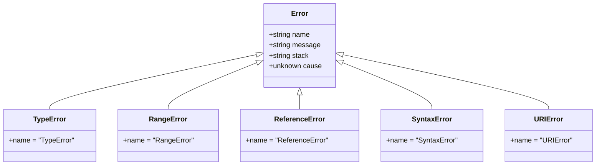
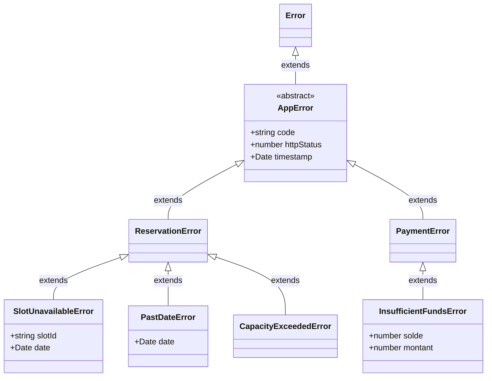

# Séance 10 — Gestion des Exceptions & Robustesse en POO

**Cours de programmation orientée objet — Bachelier en informatique (EAFC)**  
**Stack technique : TypeScript 5+, Angular 21/22 (approche signal-first)**

---

## Objectifs pédagogiques

À l'issue de cette séance, l'étudiant est en mesure de :

1. **Comprendre la rupture du flux nominal** : expliquer l'impasse des codes de retour sentinelles (`-1`, `null`, `false`), et maîtriser la mécanique du déroulement automatique de la pile d'appels (*stack unwinding*).
2. **Maîtriser la syntaxe et la sémantique de gestion** : orchestrer la surveillance avec `try`, l'interception ciblée avec `catch`, et s'appuyer sur la garantie absolue de libération des ressources fournie par le bloc `finally`.
3. **Appliquer le typage strict en TypeScript** : bannir définitivement `catch (error: any)`, contraindre le type de capture à `unknown`, et sécuriser l'accès aux propriétés de l'anomalie via le rétrécissement de type (*type narrowing*) et l'opérateur `instanceof`.
4. **Concevoir une hiérarchie d'exceptions métier en POO** : hériter de la classe standard `Error` (ou d'une classe abstraite socle `AppError`), attribuer des codes d'erreur constants, des horodatages et des métadonnées contextualisées pour enrichir le diagnostic sans altérer le contrat.
5. **Définir des stratégies de propagation architecturales** : appliquer méthodiquement la règle des trois étages (Domaine, Services, Présentation), pratiquer l'englobement d'erreurs techniques (*error wrapping*) grâce à l'option `cause` (ES2022+), et discerner les cas d'usage légitimes des exceptions par rapport aux valeurs de retour ordinaires.
6. **Bâtir une interface utilisateur Angular résiliente** : connecter des exceptions levées au sein d'un service métier à des signaux d'état réactifs (`signal`), garantissant l'intégrité des données affichées sans jamais bloquer ni faire planter l'application.

---

## Partie 00 — Le cheminement : d'où venons-nous ?

Cette séance marque une étape d'aboutissement dans notre cursus de Programmation Orientée Objet. Depuis le début du semestre, chaque séance a introduit un concept fondamental pour résoudre les défaillances architecturales de la précédente :

- **Séance 5 — Encapsulation & Invariants** : nous avons appris à masquer l'état interne (`private`), à exposer des accesseurs contrôlés, et à définir des invariants stricts (par exemple : un solde de compte ne peut être arbitrairement négatif, un âge ne peut pas valoir $-15$).
- **Séances 6 & 7 — Héritage & Polymorphisme** : nous avons factorisé nos structures communes (`extends`, `super()`), éliminé les aiguillages conditionnels massifs (`switch` et cascades de `if`), et laissé la liaison dynamique exécuter le comportement propre à chaque classe fille.
- **Séance 8 — Classes Abstraites & Interfaces** : nous avons verrouillé les contrats purs, banni les « objets fantômes » non instanciables et découplé nos briques logicielles grâce au typage structurel.
- **Séance 9 — Composition vs Héritage** : nous avons compris qu'un objet est plus flexible lorsqu'il *assemble* des composants spécialisés (« relation a-un ») et délègue ses opérations, plutôt que lorsqu'il subit une filiation rigide (« relation est-un »).

Jusqu'ici, tous nos diagrammes et nos algorithmes ont été pensés pour le **scénario nominal** (le fameux *happy path*), c'est-à-dire l'hypothèse idyllique où les données transmises sont valides, où le réseau ne tombe jamais en panne et où les utilisateurs respectent scrupuleusement les consignes de l'application.

Or, le monde réel est hostile :
- Un utilisateur saisit un montant de retrait supérieur à ses avoirs.
- Le serveur d'authentification répond par une erreur `503 Service Unavailable`.
- Un fichier de configuration indispensable au démarrage est corrompu ou inaccessible.
- Un constructeur reçoit un paramètre incohérent.

La question fondamentale de cette séance 10 est donc :

> **« Que doit faire un objet lorsque ses invariants sont violés ou qu'une opération ne peut physiquement pas aboutir ? »**

Pour mesurer la puissance des exceptions orientées objet, examinons les deux approches historiques qui les ont précédées, et pourquoi l'ingénierie logicielle les a rejetées.

---

### Problème 1 : Les « codes de retour magiques » (valeurs sentinelles)

L'approche procédurale historique, omniprésente dans les années 1970 en langage C, consistait à renvoyer une valeur numérique spéciale (dite « sentinelle ») pour signaler un incident : `-1`, `null`, `false` ou un code d'erreur numérique.

Considérons une classe bancaire modélisée selon cet anti-pattern :

```typescript
// ❌ ANTI-PATTERN ARCHITECTURAL : Le code d'erreur magique
class CompteBancaire {
  private solde: number = 100;

  // Retourne le nouveau solde en cas de succès, ou -1 en cas d'erreur
  retirer(montant: number): number {
    if (montant > this.solde) {
      return -1; // 🛑 Valeur sentinelle arbitraire
    }
    this.solde -= montant;
    return this.solde;
  }
}

// Appelant distrait ou pressé dans l'interface graphique :
const compte = new CompteBancaire();
const nouveauSolde = compte.retirer(500);

// Le développeur oublie de tester la condition 'if (nouveauSolde === -1)' :
console.log(`Retrait validé ! Votre solde est de : ${nouveauSolde} €`);
// Sortie console : "Retrait validé ! Votre solde est de : -1 €"
```

Cette technique conduit à trois défaillances majeures :

1. **Mélange confus des données métier et des statuts d'erreur** : La valeur de retour cumule deux responsabilités incompatibles. Comment distinguer un solde légitime de $-1\text{ €}$ (autorisé par un découvert bancaire contractuel) d'un code d'erreur technique $-1$ ? L'ambiguïté est totale.
2. **Absence de contrainte mécanique du compilateur** : Rien n'oblige le développeur appelant à vérifier la valeur sentinelle. Si le test est omis, la valeur corrompue contamine le reste du système en silence.
3. **Perte absolue du contexte de l'anomalie** : Le nombre `-1` est muet. Pourquoi l'opération a-t-elle échoué ? Le solde était-il insuffisant ? Le plafond hebdomadaire de la carte était-il dépassé ? Le compte était-il bloqué par la banque ? L'information a été détruite au moment du retour.

---

### Problème 2 : La corvée de propagation manuelle

Même lorsque les développeurs s'astreignent rigoureusement à inspecter chaque code de retour, surgit un second fléau : la **pollution des couches intermédiaires**.

Dans une architecture modulaire en couches, l'anomalie se produit généralement au plus profond du système (au niveau de la base de données ou de l'entité métier), tandis que la décision de gestion se situe au plus haut (dans le composant d'interface utilisateur ou le contrôleur HTTP).

Sans mécanisme d'exception, chaque fonction intermédiaire est condamnée à relayer manuellement le code d'erreur :

```typescript
// ❌ Labyrinthe de propagation manuelle
function coucheBase(): number {
  if (disquePlein()) {
    return -5; // Erreur d'écriture disque
  }
  return 42;
}

function coucheService(): number {
  const resultat = coucheBase();
  if (resultat < 0) {
    return resultat; // 🛑 Relais manuel parasite
  }
  return resultat * 2;
}

function coucheControleur(): number {
  const resultat = coucheService();
  if (resultat < 0) {
    return resultat; // 🛑 Relais manuel parasite
  }
  return resultat + 1;
}
```

Ce mode de fonctionnement présente deux tares critiques :
- **80% de code parasite (*boilerplate*)** : La logique métier réelle est ensevelie sous un dédale de vérifications défensives répétitives.
- **Une chaîne de responsabilité d'une extrême fragilité** : Il suffit qu'un seul développeur sur la chaîne d'appel oublie d'écrire `if (resultat < 0)` pour que l'erreur s'évanouisse dans la nature.

**Le besoin réel de la POO :**  
Un mécanisme automatique qui traverse instantanément les couches intermédiaires sans les contraindre à relayer quoi que ce soit, et transfère le contrôle directement au premier composant habilité à traiter l'anomalie. C'est précisément la définition du mécanisme des exceptions.

---

## Partie 01 — Le mécanisme des exceptions en POO

### 1.1 L'instruction `throw` : signaler la rupture d'un contrat

En programmation orientée objet, lorsqu'une précondition n'est pas honorée ou qu'un invariant d'objet risque d'être enfreint, la méthode **refuse catégoriquement de continuer son travail**. Elle signale cette impossibilité au moyen du mot-clé `throw` :

```typescript
export class CompteBancaire {
  constructor(
    public readonly numero: string,
    private solde: number
  ) {
    // Invariant d'intégrité : interdiction d'instancier un compte invalide
    if (solde < 0) {
      throw new Error(`Solde initial invalide : ${solde} €. Impossible de créer le compte.`);
    }
  }

  retirer(montant: number): void {
    if (montant <= 0) {
      throw new Error(`Montant de retrait invalide : ${montant} € (doit être > 0).`);
    }

    if (montant > this.solde) {
      throw new Error(`Solde insuffisant (${this.solde} €) pour un retrait de ${montant} €.`);
    }

    this.solde -= montant; // Atteint uniquement si toutes les préconditions sont valides
  }
}
```

L'instruction `throw` procure trois avantages majeurs :

1. **Arrêt immédiat de l'exécution** : Dès que l'instruction `throw` est rencontrée, le flux d'exécution nominal s'interrompt instantanément. Les lignes situées en dessous (ici le débit du solde `this.solde -= montant`) ne sont **jamais exécutées**. L'intégrité de l'objet est préservée.
2. **Protection inviolable des constructeurs** : Un constructeur ne possède pas d'instruction `return` (il retourne implicitement la nouvelle instance). L'instruction `throw` constitue **le seul et unique moyen légitime** d'empêcher l'instanciation d'un objet corrompu en mémoire vive.
3. **Pureté absolue des signatures** : La méthode `retirer()` déclare renvoyer `void`. Elle n'a plus besoin de polluer son type de retour avec des unions de sentinelles comme `number | null | -1`.

---

### 1.2 Le déroulement de la pile (*Stack Unwinding*)

Que se passe-t-il concrètement sous le capot d'un moteur d'exécution (Node.js ou le moteur JavaScript du navigateur) lorsqu'un `throw` est déclenché ?

Le runtime bascule immédiatement du mode nominal au **mode exceptionnel** et opère ce que l'on appelle le **déroulement de pile** (*stack unwinding*) :

```
┌────────────────────────────────────────────────────────┐
│               PILE D'APPELS (CALL STACK)               │
├────────────────────────────────────────────────────────┤
│ 1. Étage UI (Bouton Clic)       ➔ onValider()          │
│ 2. Étage Contrôleur             ➔ traiterCommande()     │
│ 3. Étage Service Métier         ➔ debiterCompte()       │
│ 4. Étage Entité (CompteBancaire)➔ retirer() 💥 THROW   │
└────────────────────────────────────────────────────────┘
```

1. Le runtime met en pause la méthode courante (`retirer()`).
2. Il examine si un gestionnaire `try / catch` est actif dans cette fonction. Comme il n'y en a pas, la méthode est immédiatement retirée de la pile d'exécution (*dépilée*), et ses variables locales sont détruites.
3. Le runtime remonte à la fonction appelante (`debiterCompte()`). Elle ne possède pas de `catch` ? Elle est dépilée à son tour.
4. Le moteur poursuit son ascension étage par étage, sans qu'aucun code intermédiaire n'ait eu besoin de relayer l'erreur à la main.
5. Dès qu'un bloc `catch` correspondant est rencontré, le déroulement s'arrête : le runtime y injecte l'objet d'erreur et reprend l'exécution normale à cet endroit précis.

> [!WARNING]
> **Le crash par exception non interceptée (*Unhandled Exception*)**  
> Si la pile est entièrement déroulée jusqu'à la racine de l'application sans qu'aucun bloc `catch` n'ait intercepté l'anomalie, l'exception est déclarée *Unhandled*. En environnement serveur (Node.js), le processus s'arrête brutalement (*crash*). Dans un navigateur web, le script s'arrête net et affiche une erreur bloquante en rouge dans la console d'outils de développement.

---

### 1.3 Syntaxe fondamentale : `try` / `catch` / `finally`

La structure syntaxique universelle s'articule autour de trois blocs complémentaires :

```typescript
function executerOperation(): void {
  // 1. Périmètre surveillé (chemin nominal)
  try {
    console.log("A. Début de l'opération");
    compte.retirer(9999); // 💥 Lève une exception
    console.log("B. Cette ligne ne sera JAMAIS exécutée");
  } 
  // 2. Filet de capture et réaction
  catch (error: unknown) {
    console.warn("C. Exception interceptée : traitement de l'anomalie !");
  } 
  // 3. Garantie absolue d'exécution et de nettoyage
  finally {
    console.log("D. Bloc finally : toujours exécuté dans 100% des cas !");
  }

  console.log("E. Reprise normale du flux de l'application");
}
```

Analysons la trace d'exécution observée dans la console :
```
A. Début de l'opération
C. Exception interceptée : traitement de l'anomalie !
D. Bloc finally : toujours exécuté dans 100% des cas !
E. Reprise normale du flux de l'application
```

Remarquez que :
- La ligne **B** a été court-circuitée.
- La ligne **C** a pris le relais immédiatement.
- La ligne **D** s'est exécutée après le bloc de capture.
- L'application n'a pas planté : la ligne **E** s'exécute sereinement.

---

### 1.4 La garantie indestructible du bloc `finally`

Le bloc `finally` possède une propriété capitale souvent méconnue : **il s'exécute dans 100 % des cas**, que le bloc `try` réussisse, qu'il échoue, et même si le `try` ou le `catch` contient une instruction `return` prématurée !

```typescript
function traiterTransactionFichier(): string {
  const fichier = ouvrirFichier('transactions.csv');

  try {
    if (!fichier.estValide()) {
      throw new Error('Format de fichier corrompu');
    }
    fichier.ecrireDonnees();
    return 'Succès nominal'; // ⚠️ Retour anticipé dans le try !
  } catch (error: unknown) {
    console.error('Échec opération :', error);
    return 'Échec traité';   // ⚠️ Retour anticipé dans le catch !
  } finally {
    // 🛡️ Ce bloc est IMPÉRATIVEMENT exécuté avant que la fonction ne rende la main !
    fichier.fermer();
    console.log('[Système] Descripteur de fichier fermé avec succès.');
  }
}
```

À quoi sert concrètement le bloc `finally` ?  
À la **libération des ressources critiques** et au rétablissement de la cohérence du système :
- Fermer une connexion à une base de données ou un socket réseau.
- Fermer un flux de lecture/écriture de fichier (*file handle*).
- Rétablir l'état d'un indicateur visuel de chargement dans l'interface (ex. : `this.isLoading.set(false)`).
- Relâcher un verrou mémoire synchrone (mutex / lock).

> [!CAUTION]
> **Anti-pattern assassin : placer un `return` ou un `throw` dans le `finally`**  
> Ne placez **jamais** d'instruction `return` ou `throw` dans un bloc `finally`. Cela aurait pour effet pernicieux d'annihiler et d'écraser silencieusement tout `return` ou toute exception légitime levée dans le `try` ou le `catch`, rendant les bogues totalement invisibles.

---

## Partie 02 — La hiérarchie native & le typage strict

### 2.1 L'objet standard `Error` : anatomie d'une anomalie

En TypeScript et JavaScript, une exception n'est pas une simple chaîne de caractères : c'est une **instance de classe** richement dotée, fournissant toutes les informations nécessaires à l'analyse :

```typescript
const anomalie = new Error("Connexion au serveur refusée.");

console.log(anomalie.name);    // "Error" (nom de la classe d'erreur)
console.log(anomalie.message); // "Connexion au serveur refusée."
console.log(anomalie.stack);   // Tracé complet de la pile d'exécution
```

L'inspection de la propriété `stack` révèle :
```
Error: Connexion au serveur refusée.
    at AuthService.connect (auth.service.ts:42:15)
    at LoginComponent.onSubmit (login.component.ts:18:22)
    at HTMLButtonElement.dispatch (zone.js:561:1)
```

Un objet `Error` se compose de quatre propriétés clés :

| Propriété | Type | Rôle technique |
|---|---|---|
| `name` | `string` | Identifiant du type d'anomalie (par défaut `"Error"`, ou `"TypeError"`, etc.). |
| `message` | `string` | Description humaine du dysfonctionnement, passée en argument au constructeur. |
| `stack` | `string \| undefined` | Tracé photographique de la pile au moment précis de l'instanciation de `new Error()`. |
| `cause` | `unknown` *(ES2022+)* | Encapsule l'erreur d'origine sous-jacente pour préserver la traçabilité complète. |

---

### 2.2 Les spécialisations natives de JavaScript

Le moteur JavaScript applique lui-même la programmation orientée objet et l'héritage de classes pour structurer ses propres erreurs internes. Toutes les anomalies techniques héritent de la classe de base `Error` :



| Classe standard | Déclencheur typique | Exemple de code provocateur |
|---|---|---|
| **`TypeError`** | Type incompatible ou tentative d'accès à une propriété de `null` ou `undefined`. | `const x: any = null; x.afficher();` |
| **`RangeError`** | Valeur numérique ou taille de structure en dehors des bornes permises. | `new Array(-5);` ou boucle infinie d'appels récursifs (*stack overflow*). |
| **`ReferenceError`** | Tentative d'accès à un identifiant ou une variable inexistante dans la portée. | `console.log(variableNonDeclaree);` |
| **`SyntaxError`** | Échec de lecture grammaticale lors de l'analyse d'un texte ou d'un flux. | `JSON.parse("{ bad: json }");` |
| **`URIError`** | Encodage ou décodage d'URL invalide. | `decodeURIComponent("%");` |

**Leçon de POO fondamentale :**  
Toutes ces classes vérifient la relation `anomalie instanceof Error === true`. Le moteur du langage s'appuie sur le polymorphisme d'héritage pour classifier ses pannes.

---

### 2.3 Le chaînage d'erreurs moderne : `Error Cause`

Introduite dans le standard ECMAScript 2022 et gérée nativement par TypeScript depuis la version 4.6, la propriété `cause` résout un dilemme historique : comment lever une erreur métier compréhensible pour l'utilisateur sans effacer l'erreur technique originelle indispensable aux équipes DevOps ?

```typescript
async function chargerProfil(utilisateurId: string): Promise<Utilisateur> {
  try {
    return await apiHttp.get(`/users/${utilisateurId}`);
  } catch (errOriginal: unknown) {
    // 🛡️ On lève une erreur de haut niveau en préservant l'erreur technique initiale
    throw new Error(`Impossible de récupérer le profil de l'utilisateur ${utilisateurId}`, {
      cause: errOriginal
    });
  }
}
```

Cette technique offre un **double niveau de diagnostic** :
1. **Lisibilité pour la couche de présentation** : L'interface utilisateur lit `error.message` et affiche un message clair à l'utilisateur : *« Impossible de récupérer le profil... »*.
2. **Investigation irréprochable pour la maintenance** : Dans les outils de monitoring de production (Sentry, Datadog), l'ingénieur inspecte `error.cause` et découvre instantanément l'incident réseau sous-jacent : `NetworkError: Failed to fetch (DNS lookup timeout)`. La preuve technique n'a pas été écrasée.

---

### 2.4 Le typage strict : pourquoi `catch (error: unknown)` ?

En JavaScript, le mot-clé `throw` est permissif au point d'en devenir dangereux : le langage autorise à jeter absolument n'importe quel type de donnée :

```typescript
// En JavaScript / TypeScript, toutes ces instructions sont valides :
throw new Error("Erreur standard");
throw "Oups, une simple chaîne !";
throw 404;
throw { details: "Objet anonyme sans stack" };
throw null;
throw undefined;
```

Supposons qu'un développeur écrive :

```typescript
// ❌ DANGER MORTEL : Le typage 'any'
try {
  executerOperationRisquee();
} catch (error: any) {
  // Si 'error' s'avère être une chaîne, un nombre ou null :
  console.log(error.message.toUpperCase()); 
  // 💥 BOOM ! TypeError: Cannot read properties of undefined (reading 'toUpperCase')
}
```

En utilisant `any`, le développeur désactive le compilateur. Tenter d'accéder à `error.message` alors qu'une chaîne primitive ou `null` a été jetée déclenche un **second crash au cœur même du gestionnaire d'erreurs**, provoquant l'effondrement immédiat de l'application !

Pour éradiquer ce fléau, TypeScript intègre l'option de configuration stricte `useUnknownInCatchVariables` (activée par défaut dans le mode `strict`). Avec cette règle, la variable d'un bloc `catch` est typée `unknown` :

```typescript
// ✅ CONTRAINTE TYPESCRIPT STRICTE
try {
  // ...
} catch (error: unknown) {
  // error.message est INTERDIT ici par le compilateur !
  // TypeScript exige une preuve préalable de type.
}
```

---

### 2.5 Pratique du rétrécissement de type (*narrowing*) dans le bloc `catch`

Pour manipuler sereinement une erreur typée `unknown`, le développeur applique un garde de type (*type guard*) avec `instanceof` (notion vue en séance 7) :

```typescript
try {
  executerTraitement();
} catch (error: unknown) {
  // 1. Est-ce une véritable instance de la classe standard Error ?
  if (error instanceof Error) {
    // ✅ TypeScript affine le type : 'error' est de type Error
    console.error(`[${error.name}] ${error.message}`);
    if (error.stack) {
      console.debug(error.stack);
    }
  } 
  // 2. Est-ce une chaîne primitive non conforme ?
  else if (typeof error === 'string') {
    console.error('Anomalie textuelle brute :', error);
  } 
  // 3. Cas imprévu résiduel (nombre, booléen, objet littéral exotique)
  else {
    console.error('Anomalie de nature non standard :', String(error));
  }
}
```

Dès lors que la condition `if (error instanceof Error)` est validée, l'environnement de développement réactive automatiquement l'autocomplétion sur `name`, `message` et `stack`. Le code est mathématiquement invulnérable au runtime.

> [!IMPORTANT]
> **Règle absolue de l'ingénierie TypeScript :**  
> Bannissez définitivement `catch (error: any)` de votre code. Utilisez systématiquement `catch (error: unknown)` et sécurisez vos accès avec `instanceof Error`.

---

## Partie 03 — Concevoir des exceptions métier typées en POO

### 3.1 Pourquoi `throw new Error("texte")` ne suffit pas ?

L'utilisation exclusive de la classe de base `Error` avec un message sous forme de texte brut conduit à une régression architecturale désastreuse : l'inspection de chaînes de caractères par le composant appelant.

```typescript
// ❌ HORREUR ARCHITECTURALE : Le filtrage par texte
try {
  serviceReservation.reserverCreneau('slot-104');
} catch (error: unknown) {
  if (error instanceof Error) {
    // Tenter de deviner la nature de la panne en analysant des sous-chaînes ???
    if (error.message.includes('déjà réservé')) {
      afficherModalCreneauOccupe();
    } else if (error.message.includes('paiement refusé')) {
      redirigerVersModulePaiement();
    }
  }
}
```

Ce code est un piège pour deux raisons évidentes :
1. **Fragilité extrême au moindre remaniement (*fragile code*)** : Si un collègue modifie le message d'erreur pour corriger une coquille d'orthographe (par exemple : changer *« déjà réservé »* en *« créneau indisponible »*), toute la logique conditionnelle de l'application s'effondre silencieusement en production.
2. **Incompatibilité totale avec l'internationalisation (i18n)** : Dès que l'application est traduite en anglais ou en néerlandais, la recherche de `'déjà réservé'` renvoie systématiquement `false`.

**La solution orientée objet :**  
Remplacer le texte arbitraire par des **types distincts**. En créant des classes d'exception héritant de notre domaine, le compilateur et la machine virtuelle vérifient la nature de l'anomalie grâce à l'identité de sa classe, et non grâce à des morceaux de phrases.

---

### 3.2 Créer sa première exception métier (`extends Error`)

Pour structurer proprement les erreurs de notre système, la bonne pratique industrielle consiste à définir une classe de base abstraite (concept de la séance 8) qui étend la classe native `Error` :

```typescript
// src/app/errors/app-error.base.ts

export abstract class AppError extends Error {
  public readonly timestamp: Date;

  constructor(
    message: string,
    public readonly code: string,
    public readonly httpStatus: number = 400
  ) {
    // 1. Initialise la classe parente Error avec le message
    super(message);

    // 2. Rétablit le nom exact de la classe concrète instanciée
    this.name = this.constructor.name;

    // 3. Capture l'horodatage précis de la survenue de l'incident
    this.timestamp = new Date();

    // 4. Restauration de la chaîne de prototypes (indispensable pour la transpilation ES5/TS)
    Object.setPrototypeOf(this, new.target.prototype);
  }
}
```

Quatre détails techniques cruciaux méritent votre attention :

- **`super(message)`** : Obligatoire en POO (séance 6). Transmet le message à la classe parente `Error`, ce qui garantit la capture correcte de la pile d'exécution `stack`.
- **`this.name = this.constructor.name`** : Sans cette réaffectation, toute classe dérivée afficherait `this.name === "Error"`. En lui assignant dynamiquement le constructeur concret, le terminal ou la console affichera clairement `[ReservationError]` ou `[SoldeInsuffisantError]`.
- **`public readonly code: string`** : Fournit une constante symbolique immuable (ex. : `"ERR_SLOT_UNAVAILABLE"`). C'est ce code constant que le frontend ou les tests automatisés vérifieront, à l'abri de toute modification de texte ou de traduction linguistique.
- **`Object.setPrototypeOf(this, new.target.prototype)`** : En TypeScript, lorsqu'on étend des classes natives du moteur d'exécution (comme `Error`, `Array` ou `Map`), la chaîne de prototypes peut être compromise lors de la compilation vers des cibles JavaScript anciennes. Cette ligne garantit que l'opérateur `instanceof` fonctionnera à 100 % de fiabilité sur tous les environnements.

---

### 3.3 L'arbre des exceptions du domaine (taxonomie POO)

À partir de notre socle `AppError`, nous concevons une arborescence de spécialisation reflétant notre modèle d'affaires :



L'implémentation TypeScript est concise et élégante :

```typescript
// src/app/errors/reservation.errors.ts
import { AppError } from './app-error.base';

// Classe générique pour tous les incidents liés aux réservations
export class ReservationError extends AppError {}

// Sous-classe spécialisée avec données contextuelles précises
export class SlotUnavailableError extends ReservationError {
  constructor(
    public readonly slotId: string, 
    public readonly date: Date
  ) {
    super(
      `Le créneau ${slotId} du ${date.toLocaleDateString()} est déjà réservé.`,
      'ERR_SLOT_UNAVAILABLE',
      409 // Code HTTP Conflit
    );
  }
}

export class PastDateError extends ReservationError {
  constructor(public readonly date: Date) {
    super(
      `Impossible de réserver une date échue : ${date.toLocaleDateString()}.`,
      'ERR_PAST_DATE',
      422 // Code HTTP Entité non traitable
    );
  }
}
```

Grâce à l'héritage, `SlotUnavailableError` **est une** `ReservationError`, qui **est une** `AppError`, qui **est une** `Error`.

---

### 3.4 Le filtrage chirurgical avec `instanceof`

Cette modélisation en arborescence confère au bloc `catch` une flexibilité exceptionnelle grâce au polymorphisme d'interception :

```typescript
try {
  reservationService.reserver(creneauId, dateSelectionnee);
} catch (error: unknown) {
  // 1. Gestion chirurgicale d'un cas spécifique
  if (error instanceof SlotUnavailableError) {
    notification.warning(`Le créneau ${error.slotId} vient d'être pris. Souhaitez-vous une alerte ?`);
  } 
  // 2. Polymorphisme : capture toute autre erreur de réservation (ex: PastDateError)
  else if (error instanceof ReservationError) {
    notification.error(`Erreur de réservation [${error.code}] : ${error.message}`);
  } 
  // 3. Capture toute autre erreur métier applicative connue
  else if (error instanceof AppError) {
    notification.error(`Erreur applicative système : ${error.message}`);
  } 
  // 4. Exception inconnue ou bogue technique imprévu (ex: TypeError)
  else {
    notification.fatal("Un incident imprévu est survenu. Notre support a été notifié.");
    throw error; // ⚠️ OBLIGATION : On relance l'inconnu pour ne pas le dissimuler !
  }
}
```

Deux règles d'or régissent cette structure :

1. **L'ordre des clauses : du plus spécifique au plus général**  
   Placer toujours la sous-classe spécialisée (`SlotUnavailableError`) avant sa classe mère (`ReservationError`). Si la classe mère figurait en premier, elle intercepterait tous les enfants et masquerait le traitement spécialisé !
2. **La relance impérative de l'inconnu (`throw error`)**  
   Si l'anomalie interceptée ne correspond à aucune classe métier attendue, il s'agit vraisemblablement d'un bogue de programmation (ex. : `TypeError: Cannot read properties of undefined`). Il ne faut **jamais** l'avaler : le relancer permet aux outils de diagnostic et aux tests unitaires de détecter immédiatement l'anomalie.

---

## Partie 04 — Stratégies architecturales : lever, capturer ou propager ?

Une fois la syntaxe maîtrisée, la question centrale qui distingue le développeur junior de l'architecte logiciel est la suivante : *À quel endroit précis de l'architecture doit-on poser un bloc `try / catch` ?*

---

### 4.1 La Règle des Trois Étages

Dans une application professionnelle moderne, les responsabilités se répartissent rigoureusement selon trois paliers :

```
┌────────────────────────────────────────────────────────┐
│ ÉTAGE 3 : PRÉSENTATION (Composants UI Angular)         │
│ • try / catch pour capter les erreurs métier           │
│ • Alimentation des signaux réactifs d'affichage        │
│ • Règle : Ne laisse jamais fuiter d'erreur vers l'UI   │
└───────────────────────────▲────────────────────────────┘
                            │ (Exceptions métier typées)
┌───────────────────────────┴────────────────────────────┐
│ ÉTAGE 2 : SERVICES APPLICATIFS (Services Angular)      │
│ • Orchestration des règles et des flux externes        │
│ • Traduction (wrapping) des erreurs HTTP/DB en erreurs │
│ • Règle : Logue et propage (rethrow)                   │
└───────────────────────────▲────────────────────────────┘
                            │ (Invariants purs violés)
┌───────────────────────────┴────────────────────────────┐
│ ÉTAGE 1 : DOMAINE MÉTIER (Entités & Modèles POO)       │
│ • Vérification des invariants dans les constructeurs   │
│ • throw new ... immédiat si une règle est violée       │
│ • Règle : Ne contient JAMAIS de try / catch !          │
└────────────────────────────────────────────────────────┘
```

#### Étage 1 : Le Domaine Métier (Entités & Modèles)
- **Son rôle** : Garantir la conformité absolue des données et des règles de gestion de l'entreprise.
- **Son action** : Lève immédiatement une exception (`throw new ...`) dès qu'un invariant est violé ou qu'un paramètre est invalide.
- **Sa discipline** : Le modèle métier ne contient **jamais de bloc `try / catch`**. Il n'a pas à masquer une faute ; il est payé pour la dénoncer immédiatement.

#### Étage 2 : Les Services Applicatifs
- **Son rôle** : Orchestrer les cas d'usage, contacter les APIs distantes, persister les données.
- **Son action** : Intercepte les pannes techniques brutes (ex. : un code réseau HTTP 409 ou une coupure de base de données) et les **traduit** en exceptions métier explicites (*error wrapping*).
- **Sa discipline** : Il ne prend pas de décision d'affichage. Il journalise l'incident technique et propage l'erreur métier à l'étage supérieur.

#### Étage 3 : La Présentation (Composants UI Angular)
- **Son rôle** : Interagir avec l'être humain assis devant son écran.
- **Son action** : Pose le bloc `try / catch / finally` terminal. Intercepte les exceptions métier pour alimenter des signaux réactifs d'affichage (bandeau rouge, texte explicatif).
- **Sa discipline** : Il garantit qu'aucun crash n'apparaît à l'écran et réactive les formulaires ou boutons de chargement dans le bloc `finally`.

> [!TIP]
> **La Maxime de l'interception :**  
> *« On lève l'exception là où on constate l'anomalie. On ne la capture que là où on possède le pouvoir de faire quelque chose d'utile pour la réparer ou pour en informer l'utilisateur. »*

---

### 4.2 L'Englobement d'Erreur (*Error Wrapping*)

L'englobement consiste à encapsuler une panne de bas niveau au sein d'une exception de domaine afin d'isoler le reste de l'application de la technologie d'infrastructure sous-jacente :

```typescript
// src/app/services/reservation.service.ts
import { Injectable } from '@angular/core';
import { HttpClient, HttpErrorResponse } from '@angular/common/http';
import { firstValueFrom } from 'rxjs';
import { SlotUnavailableError, ReservationError } from '../errors/reservation.errors';

export interface ReservationConfirmation {
  id: string;
  slotId: string;
  confirmedAt: Date;
}

@Injectable({ providedIn: 'root' })
export class ReservationService {
  constructor(private http: HttpClient) {}

  async reserver(slotId: string): Promise<ReservationConfirmation> {
    try {
      return await firstValueFrom(
        this.http.post<ReservationConfirmation>(`/api/creneaux/${slotId}/reserver`, {})
      );
    } catch (rawError: unknown) {
      // 1. Analyse de l'erreur réseau bas niveau : est-ce un conflit HTTP 409 ?
      if (rawError instanceof HttpErrorResponse && rawError.status === 409) {
        throw new SlotUnavailableError(slotId, new Date());
      }

      // 2. Est-ce une ressource introuvable HTTP 404 ?
      if (rawError instanceof HttpErrorResponse && rawError.status === 404) {
        throw new ReservationError(`Le créneau ${slotId} n'existe plus.`, 'ERR_NOT_FOUND', 404);
      }

      // 3. Panne inconnue : on encapsule en conservant la cause technique
      throw new ReservationError(
        'Impossible de contacter le serveur de réservation.',
        'ERR_SERVICE_UNAVAILABLE',
        503
      );
    }
  }
}
```

Les bénéfices architecturaux de cette pratique sont immenses :
1. **Découplage technologique total** : Le composant graphique Angular ne sait même pas si les réservations proviennent d'une requête REST `HttpClient`, d'un canal WebSocket ou d'un appel GraphQL. Il manipule exclusivement `SlotUnavailableError`.
2. **Langage ubiquitaire (*Ubiquitous Language*)** : Le code de l'interface dialogue avec des termes métier bancaires ou de réservation, et non avec des codes de statut HTTP génériques.
3. **Testabilité unitaire facilitée** : Pour tester le composant d'interface, il suffit de simuler la levée d'un `SlotUnavailableError`, sans avoir à instancier un objet complexe `HttpErrorResponse` doté d'en-têtes et de flux réseau.

---

### 4.3 Quand utiliser une Exception vs une Valeur de retour ?

Une dérive fréquente chez les développeurs consiste à abuser des exceptions pour piloter la logique ordinaire de leurs boucles ou formulaires. Le tableau ci-dessous fixe la frontière méthodique :

| Situation rencontrée | Choix recommandé | Justification architecturale |
|---|---|---|
| **Violation d'un invariant d'objet** (ex. : tenter d'attribuer un rayon négatif à un cercle). | 💥 **Exception (`throw`)** | L'objet refuse formellement d'exister dans un état mathématiquement faux. |
| **Saisie utilisateur incomplète dans un formulaire** (ex. : champ email sans `@`). | 📝 **Valeur de retour / Signal d'état** | Saisir une valeur incomplète est un comportement humain normal et prévisible, pas un événement exceptionnel ! |
| **Recherche dans un tableau qui ne renvoie aucun résultat**. | 🔍 **Retourner `null`, `undefined` ou `[]`** | Ne rien trouver est une issue légitime d'une recherche, pas une anomalie système. |
| **Fichier de configuration vital introuvable au boot**. | 💥 **Exception (`throw`)** | L'application ne peut physiquement pas démarrer sans ce fichier : arrêt impératif du flux. |
| **Panne réseau ou déconnexion de la base de données**. | 💥 **Exception (`throw`)** | Incident externe imprévu qui rend l'accomplissement du contrat impossible. |

> [!IMPORTANT]
> **Règle d'or de performance et de conception :**  
> *« Les exceptions sont strictement réservées aux situations **exceptionnelles**. Ne les utilisez jamais pour contrôler le flux normal d'un algorithme (comme boucler jusqu'à lever une exception de dépassement d'indice). »*  
> Lever une exception a un coût mémoire (construction de la chaîne de prototypes et de la trace `stack`) et rend le flux d'exécution impossible à anticiper si elle remplace un simple `if`.

---

## Partie 05 — Pièges fréquents & bonnes pratiques

### 5.1 Piège 1 : Le `catch` vide (Avaler l'erreur en silence)

C'est sans doute le péché le plus grave commis dans le développement d'applications :

```typescript
// ❌ CRIME MAJEUR : Le swallow catch
try {
  compte.retirer(montant);
  baseDeDonnees.sauvegarder(compte);
} catch (error: unknown) {
  // Silence radio absolu... rien n'est affiché ni logué !
}
```

Conséquence vécue en entreprise :  
L'opération échoue en silence, mais l'application continue d'exécuter la suite comme si de rien n'était. Deux jours plus tard, le service comptabilité constate un écart financier inexpliqué. L'ingénieur ouvre les journaux de serveurs : **zéro ligne d'erreur**. Deux semaines entières sont perdues à traquer un « bogue fantôme ».

**Le quadruple devoir face à un `catch` :**  
Si vous attrapez une exception dans un `catch`, vous avez l'obligation d'appliquer au moins l'une de ces quatre actions :
1. **La réparer** (activer un mode dégradé ou une ressource miroir de repli).
2. **La journaliser** (`console.error` ou envoi vers un service de télémétrie type Sentry).
3. **Informer l'utilisateur** (mettre à jour un signal réactif avec un message clair).
4. **La relancer** (`throw error`) si vous ne savez pas comment la traiter à ce niveau.

---

### 5.2 Pièges 2, 3 & 4 : Les erreurs courantes des juniors

```typescript
// ❌ PIÈGE 2 : Lancer une primitive au lieu d'un objet Error
throw "Erreur de connexion"; 
// Conséquence : Zéro stack trace, zéro numéro de ligne, 'instanceof Error' renvoie false !

// ❌ PIÈGE 3 : Oublier de réassigner 'this.name' dans une classe fille
class MaCustomError extends Error {
  constructor(message: string) {
    super(message);
    // Oubli : this.name = this.constructor.name;
  }
}
console.log(new MaCustomError('panne').name); // Affiche "Error", perdant l'identité de classe !

// ❌ PIÈGE 4 : L'interception partielle sans relance
try {
  executer();
} catch (err: unknown) {
  if (err instanceof SoldeInsuffisantError) {
    afficherAlerte();
  }
  // Oubli de la clause 'else' : toute erreur inconnue (ex: TypeError) est étouffée !
}
```

**Correctif immédiat du Piège 4 :**
```typescript
try {
  executer();
} catch (err: unknown) {
  if (err instanceof SoldeInsuffisantError) {
    afficherAlerte();
  } else {
    // ✅ Toujours relancer ce que l'on ne maîtrise pas
    throw err;
  }
}
```

---

### 5.3 Les 5 Commandements de la Robustesse en POO

1. **Jamais d'invariants brisés en mémoire vive** : Si les paramètres d'un constructeur violent vos règles métier, levez immédiatement une exception plutôt que de concevoir un objet invalide.
2. **Zéro `catch (error: any)`** : Le paramètre d'un bloc `catch` doit toujours être typé `unknown`. Vérifiez systématiquement `instanceof Error` avant d'accéder à ses membres.
3. **Créer des classes d'exceptions typées** : Proscrivez `throw new Error("texte")` pour vos règles de domaine. Créez des classes concrètes dotées d'un code constant et héritez de `Error`.
4. **Garantir le nettoyage dans le bloc `finally`** : Tout désengagement de ressource ou réinitialisation d'état d'attente UI doit impérativement résider dans un bloc `finally`.
5. **Dissocier la levée de la présentation** : Le domaine et les services lèvent l'erreur sans se préoccuper de l'interface graphique. C'est le composant d'interface utilisateur qui intercepte l'exception pour alimenter l'affichage.

---

## Partie 06 — Démonstration Angular : Le Distributeur Bancaire (ATM)

Pour ancrer ces concepts dans une réalisation concrète, nous étudions l'implémentation complète d'un **Distributeur Automatique de Billets (Automated Teller Machine - ATM)** développé avec Angular 21/22 et les signaux réactifs.

### 6.1 Architecture du mini-projet

Le projet respecte scrupuleusement la séparation en trois étages :

```
src/app/
├── errors/
│   └── banque.errors.ts             (Hiérarchie des exceptions bancaires métier)
├── services/
│   └── banque.service.ts            (Règles métier pures, vérification d'invariants)
├── components/
│   └── atm/
│       ├── atm.component.ts         (Composant standalone, gestion try/catch/finally)
│       └── atm.component.html       (Template réactif, affichage des alertes et du solde)
└── app.component.ts                 (Composant racine hébergeant l'ATM)
```

Ce que cette démonstration met en lumière :
- **Intégrité absolue du solde** : En cas de tentative de retrait illégale, le débit n'a jamais lieu.
- **Réactivité instantanée via Signals** : Les messages d'erreur et de succès mettent à jour l'écran sans le moindre rechargement de page.
- **Résilience absolue de l'interface** : Aucune exception ne fuit dans la console du navigateur ; tout incident se traduit par un état contrôlé.

---

### 6.2 Les exceptions métier bancaires

```typescript
// src/app/errors/banque.errors.ts

// 1. Classe socle pour l'ensemble des erreurs bancaires
export abstract class BanqueError extends Error {
  constructor(message: string, public readonly code: string) {
    super(message);
    this.name = this.constructor.name;
    Object.setPrototypeOf(this, new.target.prototype);
  }
}

// 2. Exception spécialisée : Solde insuffisant pour honorer le débit
export class SoldeInsuffisantError extends BanqueError {
  constructor(
    public readonly soldeActuel: number, 
    public readonly montantDemande: number
  ) {
    const manque = montantDemande - soldeActuel;
    super(
      `Solde insuffisant (${soldeActuel} €) pour retirer ${montantDemande} € ! Montant manquant : ${manque} €.`,
      'SOLDE_INSUFFISANT'
    );
  }
}

// 3. Exception spécialisée : Montant négatif ou nul
export class MontantInvalideError extends BanqueError {
  constructor(public readonly montant: number) {
    super(
      `Le montant demandé (${montant} €) doit être strictement supérieur à zéro !`,
      'MONTANT_INVALIDE'
    );
  }
}
```

Points remarquables :
- `BanqueError` est déclarée `abstract` : impossible de créer une erreur bancaire sans préciser sa nature exacte.
- `SoldeInsuffisantError` calcule elle-même le montant manquant (`manque`) et conserve `soldeActuel` et `montantDemande` en propriétés `readonly` pour consultation ultérieure par l'interface.

---

### 6.3 Le service métier : `BanqueService`

Le service applique les règles bancaires sans aucune dépendance envers le DOM ou Angular UI :

```typescript
// src/app/services/banque.service.ts
import { Injectable } from '@angular/core';
import { SoldeInsuffisantError, MontantInvalideError } from '../errors/banque.errors';

@Injectable({ providedIn: 'root' })
export class BanqueService {
  /**
   * Tente de débiter un montant d'un solde donné.
   * Renvoie le nouveau solde en cas de succès nominal.
   * Lève une exception BanqueError si une règle métier est violée.
   */
  retirer(soldeActuel: number, montant: number): number {
    // Invariant 1 : Le montant doit être strictement positif
    if (montant <= 0) {
      throw new MontantInvalideError(montant);
    }

    // Invariant 2 : Interdiction de dépasser les avoirs disponibles
    if (montant > soldeActuel) {
      throw new SoldeInsuffisantError(soldeActuel, montant);
    }

    // Scénario nominal : opération approuvée
    return soldeActuel - montant;
  }
}
```

Observez la pureté du service :
- Il ne contient aucun `console.log`, aucun `alert()`, aucun signal.
- Si tout est conforme, il retourne le résultat mathématique.
- Si une règle est enfreinte, il lève l'exception typée correspondante.

---

### 6.4 Le composant Angular Standalone : `AtmComponent`

Le composant orchestre l'interface en traduisant les exceptions du service en signaux réactifs :

```typescript
// src/app/components/atm/atm.component.ts
import { Component, signal } from '@angular/core';
import { BanqueService } from '../../services/banque.service';
import { BanqueError } from '../../errors/banque.errors';

@Component({
  selector: 'app-atm',
  standalone: true,
  templateUrl: './atm.component.html'
})
export class AtmComponent {
  // Signaux d'état réactifs du guichet
  solde = signal<number>(100);                    // Solde initial : 100 €
  erreur = signal<BanqueError | null>(null);      // Dernière exception capturée
  succes = signal<string | null>(null);           // Dernier message de succès
  enCours = signal<boolean>(false);               // Verrouillage pendant transaction

  constructor(private banque: BanqueService) {}

  onRetirer(montant: number): void {
    // Réinitialisation des signaux d'état avant l'opération
    this.enCours.set(true);
    this.erreur.set(null);
    this.succes.set(null);

    try {
      // Appel du service métier à risque
      const nouveauSolde = this.banque.retirer(this.solde(), montant);
      
      // ✅ La mise à jour du signal de solde n'a lieu QU'EN CAS DE SUCCÈS !
      this.solde.set(nouveauSolde);
      this.succes.set(`💵 Retrait de ${montant} € effectué avec succès.`);
    } catch (e: unknown) {
      // 🛡️ Typage strict : on capture l'exception métier sans jamais planter l'UI
      if (e instanceof BanqueError) {
        this.erreur.set(e);
      } else {
        // En cas d'erreur inconnue, on relance pour ne pas masquer de bogue
        throw e;
      }
    } finally {
      // 🔒 Toujours exécuté : réactivation garantie des commandes de l'automate
      this.enCours.set(false);
    }
  }
}
```

La logique est d'une rigueur absolue :
1. **Intégrité des données** : Si `this.banque.retirer()` lève une exception, le flux saute immédiatement au bloc `catch`. La ligne `this.solde.set(nouveauSolde)` est purement court-circuitée. Le solde du client ne perd pas un seul centime !
2. **Typage strict** : `e` est de type `unknown`. Le garde `e instanceof BanqueError` certifie que l'erreur possède le code et le message typés, et alimente le signal `erreur`.
3. **Nettoyage inconditionnel** : Que le retrait réussisse ou qu'il échoue, `this.enCours.set(false)` est garanti par le bloc `finally`, déverrouillant les boutons de l'écran.

---

### 6.5 Le template Angular du guichet (`atm.component.html`)

Le template s'appuie sur la nouvelle syntaxe de contrôle de flux native (`@if`) :

```html
<!-- src/app/components/atm/atm.component.html -->
<main class="p-6 max-w-sm mx-auto bg-slate-900 text-slate-100 rounded-3xl border-2 border-slate-700 shadow-2xl">
  
  <!-- En-tête de l'automate -->
  <header class="flex items-center justify-between border-b border-slate-800 pb-3 mb-4">
    <div class="font-extrabold text-sm flex items-center gap-2 text-blue-400">
      🏧 EAFC Bank ATM
    </div>
    <span class="text-[10px] px-2.5 py-0.5 rounded-full bg-emerald-500/20 text-emerald-400 font-mono font-bold">
      En Ligne
    </span>
  </header>

  <!-- Afficheur dynamique du solde réactif -->
  <section class="p-4 rounded-2xl bg-slate-800/90 border border-slate-700/60 text-center mb-4">
    <span class="text-[10px] uppercase tracking-wider text-slate-400 font-bold">Solde Disponible</span>
    <div class="text-3xl font-black text-emerald-400 tracking-tight my-1">
      {{ solde() }} €
    </div>
    <div class="text-[10px] text-slate-500 font-mono">Compte Courant · BE76 **** 4210</div>
  </section>

  <!-- Boutons de commande avec retrait rapide -->
  <div class="text-xs font-bold text-slate-400 mb-2">Sélectionnez un montant :</div>
  <div class="grid grid-cols-3 gap-2.5 mb-4">
    <button (click)="onRetirer(40)" [disabled]="enCours()"
      class="p-2.5 rounded-xl bg-slate-800 hover:bg-slate-700 active:scale-95 border border-slate-700 text-center font-bold text-white transition disabled:opacity-50">
      40 €
    </button>
    <button (click)="onRetirer(150)" [disabled]="enCours()"
      class="p-2.5 rounded-xl bg-slate-800 hover:bg-slate-700 active:scale-95 border border-slate-700 text-center font-bold text-white transition disabled:opacity-50">
      150 €
    </button>
    <button (click)="onRetirer(-20)" [disabled]="enCours()"
      class="p-2.5 rounded-xl bg-slate-800 hover:bg-slate-700 active:scale-95 border border-slate-700 text-center font-bold text-slate-400 transition disabled:opacity-50">
      -20 €
    </button>
  </div>

  <!-- Zone de notification de succès -->
  @if (succes()) {
    <div class="p-3 mb-3 text-xs bg-emerald-500/20 border border-emerald-500/40 text-emerald-300 rounded-xl flex items-center gap-2">
      <span>✅</span>
      <span>{{ succes() }}</span>
    </div>
  }

  <!-- Zone d'alerte d'erreur métier typée -->
  @if (erreur(); as err) {
    <div class="p-3 rounded-xl bg-rose-950/80 border-2 border-rose-500 text-rose-200 text-xs">
      <div class="flex items-center justify-between mb-1">
        <span class="font-bold flex items-center gap-1 text-rose-300">
          ⚠️ Retrait Refusé
        </span>
        <span class="font-mono text-[9px] px-1.5 py-0.5 rounded bg-rose-900 text-rose-100 font-bold">
          {{ err.code }}
        </span>
      </div>
      <p class="leading-relaxed opacity-90 m-0">
        {{ err.message }}
      </p>
    </div>
  }

</main>
```

---

### 6.6 Scénarios d'exécution et analyse du comportement

Testons le comportement de l'automate à travers trois scénarios successifs en direct :

```
┌────────────────────────────────────────────────────────────────────────┐
│                        SCÉNARIOS UTILISATEUR                           │
├────────────────────────────────────────────────────────────────────────┤
│ 1. Clic sur [40 €] (Solde initial : 100 €)                             │
│    ➔ Succès nominal : Nouveau solde calculé = 60 €                     │
│    ➔ Bandeau vert : « 💵 Retrait de 40 € effectué avec succès. »       │
├────────────────────────────────────────────────────────────────────────┤
│ 2. Clic sur [150 €] (Solde courant : 60 €)                             │
│    ➔ Invariant violé : 150 > 60                                        │
│    ➔ SoldeInsuffisantError levée par le service                        │
│    ➔ Solde inchangé : toujours 60 € !                                  │
│    ➔ Bandeau rouge actif :                                             │
│       [SOLDE_INSUFFISANT] Solde insuffisant (60 €) pour retirer 150 € !│
│       Montant manquant : 90 €.                                         │
├────────────────────────────────────────────────────────────────────────┤
│ 3. Clic sur [-20 €]                                                    │
│    ➔ Invariant violé : -20 <= 0                                        │
│    ➔ MontantInvalideError levée par le service                         │
│    ➔ Solde inchangé : toujours 60 € !                                  │
│    ➔ Bandeau rouge actif :                                             │
│       [MONTANT_INVALIDE] Le montant demandé (-20 €) doit être > 0 !    │
└────────────────────────────────────────────────────────────────────────┘
```

#### Rendu visuel direct de l'écran de l'ATM (Scénario 2) :

```
┌──────────────────────────────────────────────┐
│  🏧 EAFC Bank ATM               [ En Ligne ] │
├──────────────────────────────────────────────┤
│               SOLDE DISPONIBLE               │
│                   60,00 €                    │
│      Compte Courant · BE76 **** 4210         │
├──────────────────────────────────────────────┤
│ Sélectionnez un montant :                    │
│  [  40 €  ]     [ 150 € ]*    [ -20 € ]      │
├──────────────────────────────────────────────┤
│ ⚠️ Retrait Refusé       [SOLDE_INSUFFISANT]  │
│ Solde insuffisant (60 €) pour retirer 150 € !│
│ Montant manquant : 90 €.                     │
└──────────────────────────────────────────────┘
```

**Victoire de l'architecture :**  
L'application ne s'est pas arrêtée. Aucun bogue ne s'est produit. Le solde bancaire en mémoire n'a subi aucune altération corruptrice. L'anomalie métier a été levée, propagée, interceptée, et présentée à l'utilisateur de manière limpide.

---

## Synthèse : ce qu'il faut retenir absolument

### Tableau récapitulatif des mécanismes

| Mécanisme / Concept | Rôle et syntaxe | Règle de bonne pratique |
|---|---|---|
| **`throw`** | Interrompt immédiatement le flux d'exécution normal et lève une exception. | Instancier toujours une classe fille de `Error` (`throw new MonErreur()`). Ne jamais jeter de chaînes ou de nombres bruts. |
| **`try`** | Délimite la zone de code sous surveillance où une opération peut faillir. | N'y placer que le code strictement lié à l'opération à risque (garder le bloc concis). |
| **`catch (e: unknown)`** | Filet d'interception de l'anomalie. Typé obligatoirement `unknown` en mode strict. | Proscrire `any`. Appliquer un garde de type (`if (e instanceof MonErreur)`) et toujours relancer l'inconnu (`else throw e;`). |
| **`finally`** | Bloc exécuté inconditionnellement dans 100 % des cas (même après un `return`). | Y placer le nettoyage des ressources critiques et la désactivation des loaders UI. Ne jamais y mettre de `return`. |
| **`cause` *(ES2022+)*** | Propriété d'encapsulation de l'erreur d'origine (`{ cause: errOriginal }`). | Permet le chaînage d'erreurs : offrir un message clair à l'UI tout en préservant le diagnostic DevOps dans les logs. |
| **Exceptions Métier** | Classes concrètes qui héritent de `Error` ou `AppError` avec code d'erreur constant. | Remplace le parsing fragile de messages texte (`includes`) par un typage fort et pérenne face à l'internationalisation. |
| **Règle des Trois Étages** | 1. Domaine (`throw`), 2. Services (`wrapping`), 3. Présentation (`try/catch` + signaux UI). | On lève là où l'anomalie est constatée ; on ne capture que là où on sait réparer ou afficher. |

---

### La Règle d'Or de la Séance 10

> **« Ne laissez jamais votre logiciel fonctionner dans un état corrompu : levez immédiatement une exception typée dès qu'un invariant d'objet est violé.**  
> **Ne capturez l'anomalie que là où vous pouvez la réparer ou en informer l'utilisateur, et garantissez la libération des ressources dans un bloc `finally`. »**

---

## Aperçu de la séance suivante

La **séance 11** abordera la clé de voûte de la conception logicielle orientée objet : **Les Principes SOLID**.  
Nous y étudierons les trois premiers piliers qui transforment un code fonctionnel en une architecture d'entreprise durable sur le long terme :

1. **Le principe de responsabilité unique (SRP - *Single Responsibility Principle*)** : Une classe ne doit posséder qu'une seule et unique raison de changer (séparation du calcul métier, du stockage et de la présentation).
2. **Le principe Ouvert / Fermé (OCP - *Open/Closed Principle*)** : Une classe doit être ouverte à l'extension mais fermée à la modification, permettant d'ajouter de nouvelles fonctionnalités sans retoucher au code source déjà testé et validé.
3. **Le principe d'inversion des dépendances (DIP - *Dependency Inversion Principle*)** : Les modules de haut niveau ne doivent pas dépendre des modules de bas niveau, mais d'abstractions (interfaces), incarnant ainsi le cœur même du moteur d'injection de dépendances d'Angular.
