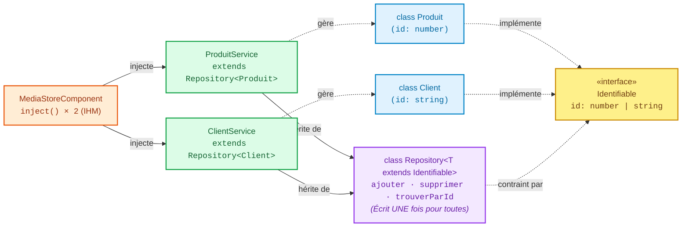

<style>
.slidev-code, .slidev-code pre { font-size: 0.72rem !important; line-height: 1.3 !important; }
.slidev-code pre { padding: 0.45rem 0.65rem !important; }
.slidev-code-wrapper, .slidev-code { width: 100% !important; max-width: 100% !important; }
</style>

<div class="h-full flex flex-col justify-center items-center">
  <div class="inline-flex items-center gap-2 px-3.5 py-1 mb-4 text-xs font-bold rounded-full bg-blue-100 dark:bg-blue-900/40 text-blue-700 dark:text-blue-300 border-2 border-blue-300 dark:border-blue-700">
    <span class="w-2.5 h-2.5 rounded-full bg-blue-600 animate-pulse"></span>
    Programmation Orientée Objet · EAFC
  </div>

  <h1 class="text-4xl font-extrabold tracking-tight mb-3 bg-gradient-to-r from-blue-700 via-indigo-600 to-purple-700 bg-clip-text text-transparent">
    Séance 14 — Services & Généricité TypeScript
  </h1>

  <p class="text-base text-slate-800 dark:text-slate-100 max-w-2xl mx-auto mb-5 font-semibold">
    Rappel compact : Injection <code>inject()</code> · Cœur de séance : Généricité <code>&lt;T&gt;</code> · Un <code>Repository&lt;T&gt;</code> pour toute l'application
  </p>

  <div class="flex items-center justify-center gap-2 text-xs font-mono font-bold">
    <span class="px-2.5 py-1 rounded bg-slate-200 dark:bg-slate-800 text-slate-800 dark:text-slate-200 border border-slate-300 dark:border-slate-600">TypeScript 5+</span>
    <span class="px-2.5 py-1 rounded bg-slate-200 dark:bg-slate-800 text-slate-800 dark:text-slate-200 border border-slate-300 dark:border-slate-600">Angular 22</span>
    <span class="px-2.5 py-1 rounded bg-slate-200 dark:bg-slate-800 text-slate-800 dark:text-slate-200 border border-slate-300 dark:border-slate-600">Signal-First</span>
    <span class="px-2.5 py-1 rounded bg-indigo-100 dark:bg-indigo-900/40 text-indigo-700 dark:text-indigo-300 border border-indigo-300 dark:border-indigo-700">Cœur Bloc C</span>
  </div>
</div>

<!--
Bienvenue en séance 14.
Annoncez le contrat dès le départ : les services et l'injection, vous les avez déjà rencontrés en S13.
Ici, on les reprend en 15 minutes de rappel compact, puis on passe le reste de la séance
sur LE vrai sujet du jour : la généricité TypeScript.
-->

---
layout: default
---

# 🎯 Objectifs de la séance

<div class="grid grid-cols-2 gap-3.5 mt-4 text-xs">
  <div class="p-2.5 rounded-xl bg-slate-500/5 border border-slate-500/15 flex items-start gap-3">
    <span class="w-7 h-7 rounded-lg bg-blue-500/10 text-blue-500 flex items-center justify-center font-bold text-xs flex-shrink-0">01</span>
    <div>
      <h4 class="font-bold text-sm mb-0.5">Rappeler l'essentiel des services &amp; de l'injection</h4>
      <p class="opacity-75"><code>inject()</code>, <code>providedIn: 'root'</code>, état partagé en signaux — en version compacte.</p>
    </div>
  </div>

  <div class="p-2.5 rounded-xl bg-slate-500/5 border border-slate-500/15 flex items-start gap-3">
    <span class="w-7 h-7 rounded-lg bg-indigo-500/10 text-indigo-500 flex items-center justify-center font-bold text-xs flex-shrink-0">02</span>
    <div>
      <h4 class="font-bold text-sm mb-0.5">Comprendre le problème que résout la généricité</h4>
      <p class="opacity-75">Dupliquer son code ou tout accepter avec <code>any</code> : un faux choix. Il existe une troisième voie.</p>
    </div>
  </div>

  <div class="p-2.5 rounded-xl bg-slate-500/5 border border-slate-500/15 flex items-start gap-3">
    <span class="w-7 h-7 rounded-lg bg-purple-500/10 text-purple-500 flex items-center justify-center font-bold text-xs flex-shrink-0">03</span>
    <div>
      <h4 class="font-bold text-sm mb-0.5">Écrire une classe générique</h4>
      <p class="opacity-75">Du moule <code>Boite&lt;T&gt;</code> au vrai cas d'usage : <code>Repository&lt;T extends Identifiable&gt;</code>, avec une contrainte claire.</p>
    </div>
  </div>

  <div class="p-2.5 rounded-xl bg-slate-500/5 border border-slate-500/15 flex items-start gap-3">
    <span class="w-7 h-7 rounded-lg bg-teal-500/10 text-teal-500 flex items-center justify-center font-bold text-xs flex-shrink-0">04</span>
    <div>
      <h4 class="font-bold text-sm mb-0.5">Réutiliser un seul algorithme pour plusieurs entités</h4>
      <p class="opacity-75">Un <code>Repository&lt;T&gt;</code> pour <code>Produit</code> et <code>Client</code>, sans dupliquer une seule ligne d'algorithme.</p>
    </div>
  </div>
</div>

<div class="mt-4 p-2.5 rounded-xl bg-amber-500/10 border border-amber-500/20 text-xs text-center font-semibold text-amber-700 dark:text-amber-300">
  ⚠️ Précision : la généricité, on n'en écrit pas tous les jours — mais on en <em>lit</em> partout (Angular, les types natifs…). Aujourd'hui : apprendre à la lire, et à l'écrire <strong>en version essentielle</strong>.
</div>

<!--
Présentez les 4 objectifs.
La précision en bas détend l'atmosphère : on ne prétend pas former des architectes seniors,
on donne les clés pour lire et écrire le minimum utile.
-->

---
layout: center
class: text-center
---

<div class="inline-flex items-center gap-2 px-3 py-1 mb-3 text-xs font-mono font-semibold rounded-full bg-blue-500/10 text-blue-500 border border-blue-500/20">
  PARTIE 01
</div>

# Rappel compact — Services & Injection
## Vous l'avez déjà vu : seulement ce qu'il faut pour la suite

<!--
Annoncez clairement : cette partie est une révision express.
Si des étudiants ont raté la S13, c'est le moment de rattraper — mais sans s'y éterniser.
-->

---
layout: default
---

# Un composant affiche, un service réfléchit

<div class="grid grid-cols-2 gap-4 mt-4 text-xs">
  <div class="p-3.5 rounded-xl bg-blue-500/10 border border-blue-500/20 min-h-[11rem]">
    <div class="font-bold text-sm text-blue-600 dark:text-blue-400 mb-2">🖥️ Le COMPOSANT</div>
    <ul class="space-y-1.5 opacity-85 leading-relaxed">
      <li>Le template HTML, les styles, l'affichage.</li>
      <li>Capture les clics et les frappes clavier.</li>
      <li>Ne détient que de l'état purement visuel (onglet ouvert, menu déplié…).</li>
    </ul>
  </div>

  <div class="p-3.5 rounded-xl bg-emerald-500/10 border border-emerald-500/20 min-h-[11rem]">
    <div class="font-bold text-sm text-emerald-600 dark:text-emerald-400 mb-2">🧠 Le SERVICE (aujourd'hui)</div>
    <ul class="space-y-1.5 opacity-85 leading-relaxed">
      <li>Détient les <strong>données</strong> et les règles métier.</li>
      <li>Calcule, valide, protégera la persistance (Bloc D).</li>
      <li>Une classe TypeScript ordinaire + <code>@Injectable()</code>.</li>
    </ul>
  </div>
</div>

<div class="mt-4 p-3 rounded-xl bg-blue-500/10 border border-blue-500/20 text-xs text-center font-semibold text-blue-700 dark:text-blue-300">
  💡 Le composant est les mains et les yeux de l'utilisateur ; le service est le cerveau de l'application.<br>
  Pourquoi sortir l'état du composant ? <strong>Partage entre composants</strong>, <strong>survie à la navigation</strong> et <strong>testabilité</strong>.
</div>

<!--
La formule mnémotechnique en bas suffit : mains/yeux vs cerveau.
La justification du partage sera démontrée visuellement dans la démo.
-->

---
layout: default
---

# Le piège classique : `new` vs `inject()`

<div class="grid grid-cols-3 gap-4 mt-3 items-start">
  <div class="col-span-2 min-h-[19rem]">

```ts
// ❌ LE PIÈGE : chaque composant fabrique son service
export class CatalogueComponent {
  panier = new PanierService();  // Objet #0x1A4F dans le Tas
}
export class NavbarComponent {
  panier = new PanierService();  // Objet #0x8B9C : un AUTRE objet !
  // → le compteur de la navbar reste à 0, même après un ajout 😱
}

// ✅ LA SOLUTION : laisser Angular fournir l'instance unique
export class CatalogueComponent {
  panier = inject(PanierService);  // la MÊME instance pour tous
}
```

  </div>

  <div class="text-xs space-y-2.5 min-h-[19rem]">
    <div class="p-2.5 rounded-lg bg-rose-500/10 border border-rose-500/20">
      <strong class="text-rose-600 dark:text-rose-400">Pourquoi ça coince ?</strong><br>
      Rappel S12 : deux adresses dans le tas = deux boîtes étanches. Chaque <code>new</code> fabrique un panier isolé.
    </div>
    <div class="p-2.5 rounded-lg bg-emerald-500/10 border border-emerald-500/20">
      <strong class="text-emerald-600 dark:text-emerald-400">Ce que fait <code>inject()</code></strong><br>
      Angular crée <strong>une seule instance</strong> et la distribue à tous les composants qui la demandent.
    </div>
    <div class="p-2.5 rounded-lg bg-slate-500/10 border border-slate-500/15">
      Une ligne par service, dans la déclaration des champs. Plus besoin d'écrire de constructeur.
    </div>
  </div>
</div>

<!--
Faites-leur deviner le bug avant de montrer la solution :
"D'après la S12, pourquoi la navbar ne voit rien ?"
Réponse attendue : deux instances distinctes dans le Tas.
-->

---
layout: default
---

# Le squelette d'un service Angular 22

<div class="grid grid-cols-3 gap-4 mt-3 items-start">
  <div class="col-span-2 min-h-[21rem]">

```ts
import { Injectable, signal, computed } from '@angular/core';

@Injectable({ providedIn: 'root' })  // 1 instance unique (singleton)
export class PanierService {
  // 1. L'état : privé et réactif
  readonly #articles = signal<Produit[]>([]);

  // 2. La vue publique : lecture seule
  readonly articles = this.#articles.asReadonly();
  readonly total = computed(() =>
    this.#articles().reduce((t, p) => t + p.prix, 0)
  );

  // 3. Les seules portes d'entrée pour modifier
  ajouter(p: Produit): void {
    this.#articles.update(liste => [...liste, p]); // immutable
  }
}
```

  </div>

  <div class="text-xs space-y-2.5 min-h-[21rem]">
    <div class="p-2.5 rounded-lg bg-emerald-500/10 border border-emerald-500/20">
      <strong class="text-emerald-600 dark:text-emerald-400"><code>providedIn: 'root'</code></strong><br>
      Enregistre le service à la racine : <strong>singleton</strong> partagé par toute l'application.
    </div>
    <div class="p-2.5 rounded-lg bg-blue-500/10 border border-blue-500/20">
      <strong class="text-blue-600 dark:text-blue-400"><code>#articles</code> privé</strong><br>
      Personne ne peut vider le panier de l'extérieur (encapsulation).
    </div>
    <div class="p-2.5 rounded-lg bg-indigo-500/10 border border-indigo-500/20">
      <strong class="text-indigo-600 dark:text-indigo-400"><code>asReadonly()</code></strong><br>
      Les composants lisent <code>articles()</code> et <code>total()</code>, mais ne modifient jamais.
    </div>
    <div class="p-2.5 rounded-lg bg-purple-500/10 border border-purple-500/20">
      <strong class="text-purple-600 dark:text-purple-400"><code>update(...)</code></strong><br>
      Toujours une nouvelle référence de tableau — jamais <code>.push()</code> (rappel S12).
    </div>
  </div>
</div>

<div class="mt-3 p-2.5 rounded-xl bg-rose-500/10 border border-rose-500/20 text-xs text-center font-semibold text-rose-700 dark:text-rose-300">
  🚫 Deux interdits : appeler <code>inject()</code> dans un <code>(click)</code> (erreur NG0203) · faire <code>.push()</code> sur le tableau d'un signal (l'écran ne bouge plus)
</div>

<style>
  pre code {
    font-size: 12px !important;
  }
</style>

<!--
Ce slide est LE modèle à copier pour tous les TP de l'année.
Les 4 annotations de droite correspondent aux 4 blocs du code.
Lisez le bandeau du bas à voix haute : ce sont les deux bugs les plus fréquents en machine.
-->

---
layout: default
---

# Fiche de dépannage : les pièges déjà connus

<div class="mt-3 text-xs">

| Le piège | Ce qui se passe | Le réflexe |
|---|---|---|
| `new MonService()` dans un composant | 2 instances, données désynchronisées | `inject(MonService)` |
| `providers: [MonService]` dans `@Component` | Chaque composant a sa copie privée | `providedIn: 'root'` (sauf isolement volontaire) |
| `.push()` sur le tableau d'un signal | La donnée change, l'écran non | `update(liste => [...liste, x])` (S12) |
| Signal mutable public dans un service | N'importe qui peut `.set()` sans règle | privé `#` + `asReadonly()` |
| `inject()` appelé dans un `(click)` | Erreur `NG0203` | `inject()` au niveau des champs |

</div>

<div class="mt-4 p-3 rounded-xl bg-emerald-500/10 border border-emerald-500/20 text-center text-xs font-semibold text-emerald-700 dark:text-emerald-300">
  Rappel terminé — passons au vrai sujet du jour : <strong>la généricité</strong> !
</div>

<!--
Ce tableau sert de fiche réflexe pendant les TP.
Un rapide tour de table : "qui se reconnaît dans un de ces pièges ?"
-->

---
layout: center
class: text-center
---

<div class="inline-flex items-center gap-2 px-3 py-1 mb-3 text-xs font-mono font-semibold rounded-full bg-purple-500/10 text-purple-500 border border-purple-500/20">
  PARTIE 02
</div>

# La Généricité : écrire une fois, typer partout
## Décoder la lettre `<T>` — en version essentielle

<p class="opacity-70 text-sm max-w-lg mx-auto">
  Comment gérer des Produits, des Clients… sans copier-coller les méthodes ni sacrifier le typage.
</p>

<!--
Transition : on quitte Angular quelques minutes pour parler TypeScript pur.
Rassurez-les : pas de magie, juste un paramètre… de type.
-->

---
layout: default
---

# Le problème : deux listes, deux fois le même code ?

Votre application gère des **Produits** et des **Clients**. Il faut ajouter, supprimer, rechercher dans les deux listes. Trois stratégies s'offrent à vous :

<div class="grid grid-cols-3 gap-3.5 mt-4 text-xs">
  <div class="p-3 rounded-xl bg-rose-500/10 border border-rose-500/20 min-h-[12rem]">
    <div class="font-bold text-rose-600 dark:text-rose-400 mb-1.5">❌ 1. Copier-coller</div>
    <p class="opacity-85 leading-relaxed mb-2"><code>ProduitRepository</code>, <code>ClientRepository</code>, <code>CommandeRepository</code>… même code, types différents.</p>
    <p class="opacity-85">Un bug corrigé dans l'un ? À corriger <strong>dans tous les autres</strong>.</p>
  </div>

  <div class="p-3 rounded-xl bg-rose-500/10 border border-rose-500/20 min-h-[12rem]">
    <div class="font-bold text-rose-600 dark:text-rose-400 mb-1.5">❌ 2. Tout accepter avec <code>any</code></div>
    <p class="opacity-85 leading-relaxed mb-2">Une seule classe avec <code>items: any[]</code>. Plus de duplication…</p>
    <p class="opacity-85">… mais plus de <strong>typage du tout</strong> : l'autocomplétion est aveugle, les fautes passent à la compilation.</p>
  </div>

  <div class="p-3 rounded-xl bg-emerald-500/10 border-2 border-emerald-500/30 min-h-[12rem]">
    <div class="font-bold text-emerald-600 dark:text-emerald-400 mb-1.5">✅ 3. La généricité</div>
    <p class="opacity-85 leading-relaxed mb-2">Une seule classe <code>Repository&lt;T&gt;</code> : le code est écrit <strong>une fois</strong>.</p>
    <p class="opacity-85">Et à l'usage, TypeScript <strong>vérifie tout</strong> : <code>Repository&lt;Produit&gt;</code> refuse un <code>Client</code>.</p>
  </div>
</div>

<div class="mt-4 p-2.5 rounded-xl bg-slate-500/10 text-center text-xs font-mono">
  Duplication (DRY) et typage (sécurité) : la généricité garde les deux. C'est pour ça qu'elle existe.
</div>

<!--
Question au tableau : "Que feriez-vous, aujourd'hui, avec vos acquis ?"
La plupart répondent copier-coller. Montrez le coût réel sur 10 entités.
-->

---
layout: default
---

# Le moule : une classe avec un paramètre de type

<div class="grid grid-cols-3 gap-4 mt-3 items-start">
  <div class="col-span-2 min-h-[19rem]">

```ts
// Le moule : T est un "paramètre de type"
export class Boite<T> {
  #contenu: T;

  constructor(valeur: T) { this.#contenu = valeur; }
  obtenir(): T { return this.#contenu; }
  remplacer(nouvelle: T): void { this.#contenu = nouvelle; }
}

// On "verse" du number dedans →
const boiteNombre = new Boite<number>(42);
boiteNombre.obtenir();      // type : number 
boiteNombre.remplacer('x'); // ❌ TS2345 : string ≠ number

// On "verse" du string →
const boiteTexte = new Boite<string>('Bonjour');
boiteTexte.obtenir();       // type : string 
```

  </div>

  <div class="text-xs space-y-2.5 min-h-[19rem]">
    <div class="p-2.5 rounded-lg bg-purple-500/10 border border-purple-500/20">
      <strong class="text-purple-600 dark:text-purple-400">🍰 L'analogie du moule à gâteau</strong><br>
      Le moule (<code>Boite&lt;T&gt;</code>) ne change jamais. Versez du chocolat (<code>number</code>) : gâteau au chocolat. Versez de la vanille (<code>string</code>) : gâteau à la vanille.
    </div>
    <div class="p-2.5 rounded-lg bg-blue-500/10 border border-blue-500/20">
      <strong class="text-blue-600 dark:text-blue-400"><code>&lt;T&gt;</code> = un paramètre</strong><br>
      Comme un paramètre de méthode, mais pour des <strong>types</strong>. Le compilateur « remplace » T partout dans la classe.
    </div>
    <div class="p-2.5 rounded-lg bg-emerald-500/10 border border-emerald-500/20">
      Le refus de <code>remplacer('x')</code> n'est pas une règle maison : c'est le compilateur qui parle.
    </div>
  </div>
</div>

<!--
Insistez : T se déclare entre chevrons, comme un paramètre.
L'erreur TS2345 est leur première victoire contre les bugs : elle arrive AVANT d'exécuter le programme.
-->

---
layout: default
---

# Le vrai cas d'usage : `Repository<T>`… qui ne compile pas !

On veut écrire UNE fois la suppression par identifiant. Premier essai :

<div class="grid grid-cols-3 gap-4 mt-3 items-start">
  <div class="col-span-2 min-h-[13rem]">

```ts
// ❌ ÉCHEC DE COMPILATION
export class Repository<T> {          // T = n'importe quel type
  private items: T[] = [];

  supprimer(id: number): void {
    // 💥 Erreur TS2339 :
    // Property 'id' does not exist on type 'T'.
    this.items = this.items.filter(item => item.id !== id);
  }
}
```

  </div>

  <div class="text-xs space-y-2.5 min-h-[13rem]">
    <div class="p-2.5 rounded-lg bg-rose-500/10 border border-rose-500/20">
      <strong class="text-rose-600 dark:text-rose-400">Pourquoi TypeScript refuse ?</strong><br>
      Pour lui, <code>T</code> peut être <em>n'importe quoi</em> : un <code>number</code>, un <code>boolean</code>… Or un <code>boolean</code> n'a pas de propriété <code>.id</code>.
    </div>
    <div class="p-2.5 rounded-lg bg-amber-500/10 border border-amber-500/20">
      TypeScript ne compile pas « à l'aveugle » : c'est exactement ce qu'on veut d'un allié.
    </div>
  </div>
</div>

<div class="mt-3 p-2.5 rounded-xl bg-blue-500/10 border border-blue-500/20 text-xs text-center font-semibold text-blue-700 dark:text-blue-300">
  👉 Il faut lui dire : « T peut être n'importe quoi, <strong>POURVU qu'il possède un <code>id</code></strong> ». C'est une contrainte.
</div>

<!--
Ce slide est le moment pédagogique clé : TypeScript n'est pas capricieux, il est rigoureux.
La contrainte arrive comme la solution logique du problème, pas comme une syntaxe tombée du ciel.
-->

---
layout: default
---

# La contrainte générique : `<T extends Identifiable>`

<div class="grid grid-cols-3 gap-4 mt-3 items-start">
  <div class="col-span-2 min-h-[17rem]">

```ts
// 1. Le contrat : « je possède un identifiant »
export interface Identifiable {
  readonly id: number | string;
}

// 2. La contrainte : T doit honorer le contrat
export class Repository<T extends Identifiable> {
  private items: T[] = [];

  supprimer(id: T['id']): void {
    // ✅ Le compilateur SAIT que chaque item a un .id
    this.items = this.items.filter(item => item.id !== id);
  }
}
```

  </div>

  <div class="text-xs space-y-2.5 min-h-[17rem]">
    <div class="p-2.5 rounded-lg bg-emerald-500/10 border border-emerald-500/20">
      <strong class="text-emerald-600 dark:text-emerald-400">⚠️ <code>extends</code> ≠ héritage (S06)</strong><br>
      Ici, ce n'est pas « hériter d'une classe mère » : c'est « <strong>respecter un contrat</strong> » posé par une interface (S08).
    </div>
    <div class="p-2.5 rounded-lg bg-blue-500/10 border border-blue-500/20">
      <strong class="text-blue-600 dark:text-blue-400">Qui peut entrer ?</strong><br>
      ✅ <code>Produit</code> (id: number), ✅ <code>Client</code> (id: string)<br>
      ❌ <code>PointGeo</code> (lat/lng, pas d'id) — refusé à la compilation.
    </div>
    <div class="p-2.5 rounded-lg bg-slate-500/10 border border-slate-500/15">
      <strong>Bonus express :</strong> <code>T['id']</code> = « le type exact du <code>id</code> de T » (number pour Produit, string pour Client).
    </div>
  </div>
</div>

<!--
Le point le plus déroutant pour eux : extends utilisé sur un générique.
Répétez la phrase : "contrat à respecter", pas "classe mère".
-->

---
layout: default
---

# Deux entités, un seul algorithme, zéro duplication

<div class="grid grid-cols-3 gap-4 mt-3 items-start">
  <div class="col-span-2 min-h-[17rem]">

```ts
const produits = new Repository<Produit>();
const clients  = new Repository<Client>();

// ✅ Chaque repository connaît SON type :
produits.ajouter(new Produit(1, 'Clavier', 49.99, 10));
clients.ajouter(new Client('CLI-01', 'Alice'));

// ❌ Et le compilateur attrape les mélanges :
produits.ajouter(new Client('CLI-02', 'Bob'));
// TS2345: Argument of type 'Client' is not
// assignable to parameter of type 'Produit'.
```

  </div>

  <div class="text-xs space-y-2.5 min-h-[17rem]">
    <div class="p-2.5 rounded-lg bg-emerald-500/10 border border-emerald-500/20">
      <strong class="text-emerald-600 dark:text-emerald-400">Ce qu'on vient de gagner</strong><br>
      <code>ajouter</code>, <code>supprimer</code>, <code>trouverParId</code>… écrits <strong>une seule fois</strong>, mais typés séparément pour chaque entité.
    </div>
    <div class="p-2.5 rounded-lg bg-blue-500/10 border border-blue-500/20">
      Autocomplétion correcte sur <code>produits</code> ET sur <code>clients</code> — comme si vous aviez écrit deux classes.
    </div>
    <div class="p-2.5 rounded-lg bg-purple-500/10 border border-purple-500/20">
      Une nouvelle entité demain (Film, Commande) ? <strong>Zéro ligne</strong> à modifier dans <code>Repository</code>.
    </div>
  </div>
</div>

<!--
C'est le "aha !" de la séance : une classe écrite, deux usages typés.
Faites-leur remarquer que l'erreur TS2345 aurait été un bug silencieux avec any.
-->

---
layout: center
class: text-center
---

<div class="inline-flex items-center gap-2 px-3 py-1 mb-3 text-xs font-mono font-semibold rounded-full bg-teal-500/10 text-teal-500 border border-teal-500/20">
  PARTIE 03
</div>

# Démo : MediaStore
## Un `Repository<T>` pour toute l'application

<p class="opacity-70 text-sm max-w-lg mx-auto">
  Deux entités, deux services, un seul algorithme.
</p>

<!--
La démo est volontairement courte : 4 étapes, un scénario d'atelier.
L'objectif : qu'ils voient le concept en action, pas une usine à gaz.
-->

---
layout: default
---

# L'architecture de MediaStore en un coup d'œil




<div class="mt-3 p-2.5 rounded-xl bg-slate-500/10 text-center text-xs font-mono">
  Deux services, deux types d'id différents… et pas une ligne de persistance dupliquée.
</div>

<!--
Présentez la pyramide de bas en haut : le Repository fait le travail,
les services ne font qu'ajouter leurs règles propres, le composant affiche.
-->

---
layout: default
---

# Étape 1 — Le contrat et les deux entités

<div class="grid grid-cols-3 gap-4 mt-3 items-start">
  <div class="col-span-2 min-h-[20rem]">

```ts {maxHeight:'375px'}
// src/app/models/entites.model.ts

// 1. Le contrat d'entrée du Repository
export interface Identifiable {
  readonly id: number | string;
}

// 2. Entité Produit (id numérique)
export class Produit implements Identifiable {
  constructor(
    public readonly id: number,
    public readonly nom: string,
    public readonly prix: number,
    public stock: number
  ) {
    if (prix < 0) throw new Error('Prix négatif interdit !');
  }
}

// 3. Entité Client (id texte — volontairement différent !)
export class Client implements Identifiable {
  constructor(
    public readonly id: string,
    public readonly nom: string
  ) {}
}
```

  </div>

  <div class="text-xs space-y-2.5 min-h-[20rem]">
    <div class="p-2.5 rounded-lg bg-blue-500/10 border border-blue-500/20">
      <strong class="text-blue-600 dark:text-blue-400">Le contrat d'abord</strong><br>
      Une interface (S08) : <strong>zéro octet</strong> de JavaScript généré, juste un contrat pour le compilateur.
    </div>
    <div class="p-2.5 rounded-lg bg-emerald-500/10 border border-emerald-500/20">
      <strong class="text-emerald-600 dark:text-emerald-400">Deux id différents</strong><br>
      <code>number</code> pour Produit, <code>string</code> pour Client : le Repository gèrera les deux sans broncher, grâce à <code>T['id']</code>.
    </div>
    <div class="p-2.5 rounded-lg bg-slate-500/10 border border-slate-500/15">
      Les invariants (prix négatif) restent dans le constructeur.
    </div>
  </div>
</div>

<!--
Soulignez le choix pédagogique : id number vs id string.
C'est ce qui rendra la démo convaincante : deux types réellement différents.
-->

<style>
  pre code {
    font-size: 12px !important;
  }
</style>

---
layout: default
---

# Étape 2 — Le Repository générique

<div class="grid grid-cols-3 gap-4 mt-3 items-start">
  <div class="col-span-2 min-h-[22rem]">

```ts {maxHeight:'400px'}
// src/app/services/repository.ts
import { signal } from '@angular/core';
import { Identifiable } from '../models/entites.model';

export class Repository<T extends Identifiable> {
  // État réactif privé, le pattern du jour appliqué à T
  readonly #items = signal<T[]>([]);
  readonly items = this.#items.asReadonly();

  ajouter(element: T): void {
    if (this.trouverParId(element.id)) {
      throw new Error(`L'id ${element.id} existe déjà.`);
    }
    this.#items.update(liste => [...liste, element]); // immutable (S12)
  }

  supprimer(id: T['id']): void {
    this.#items.update(liste => liste.filter(i => i.id !== id));
  }

  trouverParId(id: T['id']): T | undefined {
    return this.#items().find(i => i.id === id);
  }
}
```

  </div>

  <div class="text-xs space-y-2.5 min-h-[22rem]">
    <div class="p-2.5 rounded-lg bg-blue-500/10 border border-blue-500/20">
      <strong class="text-blue-600 dark:text-blue-400">Tout le cours réuni</strong><br>
      Signal privé + <code>asReadonly()</code> (rappel), immutabilité (S12), contrainte <code>extends Identifiable</code> (aujourd'hui).
    </div>
    <div class="p-2.5 rounded-lg bg-emerald-500/10 border border-emerald-500/20">
      <strong class="text-emerald-600 dark:text-emerald-400">Écrit une fois, pour toujours</strong><br>
      Produit, Client, Film demain : ce fichier ne changera <strong>jamais</strong>.
    </div>
    <div class="p-2.5 rounded-lg bg-slate-500/10 border border-slate-500/15">
      <code>T['id']</code> dans les signatures : number pour Produit, string pour Client.
    </div>
  </div>
</div>

<!--
Prenez le temps : c'est le slide central de la démo.
Chaque ligne doit pouvoir être expliquée par un étudiant à la fin de la séance.
-->

<style>
  pre code {
    font-size: 12px !important;
  }
</style>

---
layout: default
---

# Étape 3 — Deux services métier… en quelques lignes

<div class="grid grid-cols-3 gap-4 mt-3 items-start">
  <div class="col-span-2 min-h-[15rem]">

```ts
// src/app/services/produit.service.ts
@Injectable({ providedIn: 'root' })
export class ProduitService extends Repository<Produit> {
  // Règle métier propre aux produits uniquement :
  readonly valeurStock = computed(() =>
    this.items().reduce((total, p) => total + p.prix * p.stock, 0)
  );
}

// src/app/services/client.service.ts
@Injectable({ providedIn: 'root' })
export class ClientService extends Repository<Client> {
  // Rien à écrire : ajouter, supprimer, trouverParId
  // sont hérités du Repository<T> !
}
```

  </div>

  <div class="text-xs space-y-2.5 min-h-[15rem]">
    <div class="p-2.5 rounded-lg bg-emerald-500/10 border border-emerald-500/20">
      <strong class="text-emerald-600 dark:text-emerald-400">Le gain en clair</strong><br>
      <code>ClientService</code> est <strong>vide</strong> — et pourtant il fait tout : ajouter, supprimer, chercher, notifier le DOM.
    </div>
    <div class="p-2.5 rounded-lg bg-blue-500/10 border border-blue-500/20">
      <strong class="text-blue-600 dark:text-blue-400">Chaque service ajoute sa spécialité</strong><br>
      <code>valeurStock</code> n'existe que pour les produits : les règles métier restent au bon endroit.
    </div>
  </div>
</div>

<!--
Faites contraster : le fichier le plus court de l'application est celui qui fait le plus de choses.
C'est la preuve visuelle que la duplication a disparu.
-->

---
layout: default
---

# Étape 4 — Le composant qui consomme tout ça

<div class="grid grid-cols-3 gap-4 mt-3 items-start">
  <div class="col-span-2 min-h-[22rem]">

```ts {maxHeight:'400px'}
@Component({
  selector: 'app-media-store',
  template: `
    <h3>Produits ({{ produitService.items().length }})</h3>
    <p>Valeur du stock : {{ produitService.valeurStock() }} €</p>
    <ul>
      @for (p of produitService.items(); track p.id) {
        <li>
          {{ p.nom }} — {{ p.prix }} € (stock : {{ p.stock }})
          <button (click)="produitService.supprimer(p.id)">Supprimer</button>
        </li>
      } @empty {
        <li>Aucun produit.</li>
      }
    </ul>
    <button (click)="ajouterClavier()">+ Ajouter un clavier</button>
  `
})
export class MediaStoreComponent {
  protected readonly produitService = inject(ProduitService);
  protected readonly clientService = inject(ClientService);

  ajouterClavier(): void {
    this.produitService.ajouter(
      new Produit(101, 'Clavier sans fil', 129.99, 14)
    );
  }
}
```

  </div>

  <div class="text-xs space-y-2.5 min-h-[22rem]">
    <div class="p-2.5 rounded-lg bg-blue-500/10 border border-blue-500/20">
      <strong class="text-blue-600 dark:text-blue-400">Deux injections, zéro <code>new</code></strong><br>
      Le composant ne fabrique rien : il demande et affiche (rappel partie 01).
    </div>
    <div class="p-2.5 rounded-lg bg-emerald-500/10 border border-emerald-500/20">
      <strong class="text-emerald-600 dark:text-emerald-400">Le test qui fait mouche</strong><br>
      Cliquez sur « Ajouter » : la liste <em>et</em> la valeur du stock bougent instantanément — les <code>computed</code> réagissent tout seuls.
    </div>
    <div class="p-2.5 rounded-lg bg-slate-500/10 border border-slate-500/15">
      <code>clientService</code> est déjà branché : même mécanique pour une liste de clients, sans une ligne d'algorithme en plus.
    </div>
  </div>
</div>

<!--
Déroulez le test en direct : ajout → liste + stock mis à jour, suppression → liste mise à jour.
Puis une question : "Combien de lignes pour ajouter les Films ?" Réponse : voir atelier.
-->

<style>

  pre code {
    font-size: 12px !important;
  }

</style>

---
layout: default
---

# 🛠️ Atelier : votre tour — l'entité `Film`

<div class="grid grid-cols-3 gap-4 mt-3 items-start">
  <div class="col-span-2 min-h-[15rem]">

```ts
// 1. Votre entité (le contrat Identifiable existe déjà) :
export class Film implements Identifiable {
  constructor(
    public readonly id: number,
    public readonly titre: string,
    public readonly dureeMinutes: number
  ) {}
}

// 2. Votre service :
@Injectable({ providedIn: 'root' })
export class FilmService extends Repository<Film> {}

// 3. Dans le composant :
protected readonly filmService = inject(FilmService);

// Question finale : combien de lignes avez-vous
// dû modifier dans Repository<T> pour Film ?
```

  </div>

  <div class="text-xs space-y-2.5 min-h-[15rem]">
    <div class="p-2.5 rounded-lg bg-blue-500/10 border border-blue-500/20">
      <strong class="text-blue-600 dark:text-blue-400">Consigne</strong><br>
      Ajoutez l'entité <code>Film</code> et affichez la liste des films dans MediaStore — en autonomie.
    </div>
    <div class="p-2.5 rounded-lg bg-emerald-500/10 border border-emerald-500/20">
      <strong class="text-emerald-600 dark:text-emerald-400">La réponse attendue</strong><br>
      <strong>Zéro ligne</strong> modifiée dans le Repository : c'est toute la promesse de la généricité.
    </div>
    <div class="p-2.5 rounded-lg bg-slate-500/10 border border-slate-500/15">
      ⏱️ 15 minutes · Bonus : refusez un film de plus de 4h via le constructeur.
    </div>
  </div>
</div>

<!--
Atelier volontairement court : il conclut la démonstration par une victoire rapide.
Chaque étudiant doit repartir avec le réflexe : entité → service vide → inject.
-->

---
layout: default
---

# Synthèse — ce qu'il faut retenir

<div class="mt-3 text-xs">

| Mécanisme | À quoi ça sert | En une phrase |
|---|---|---|
| `@Injectable({ providedIn: 'root' })` | Déclarer un service singleton | Une instance partagée par toute l'application. |
| `inject(MonService)` | Recevoir le service | Jamais de `new` : Angular fournit et partage. |
| `signal` privé + `asReadonly()` | Encapsuler l'état du service | Les composants lisent, le service décide. |
| `class X<T>` | Paramétrer une classe par un type | Un moule : le code une fois, le type au choix. |
| `<T extends Identifiable>` | Contraindre le paramètre | « Tout type, pourvu qu'il ait un `id`. » |
| `Repository<T>` | Réutiliser les algorithmes CRUD | Produit, Client, Film : zéro duplication. |

</div>

<div class="mt-4 p-2.5 rounded-xl bg-gradient-to-r from-blue-500/10 to-purple-500/10 border border-indigo-500/20 text-center text-xs font-semibold text-indigo-700 dark:text-indigo-300">
  Le composant affiche et écoute ; le service détient et calcule ; le Repository&lt;T&gt; fait le reste pour toutes les entités.
</div>

<!--
Parcourez le tableau ligne par ligne : chaque ligne correspond à une partie de la séance.
La phrase du bas est celle qu'ils doivent pouvoir réciter en sortant.
-->

---
layout: default
---

# 🚀 Clôture & pont vers la Séance 15

- ✅ Rappels : service singleton, `inject()`, état en signaux encapsulé.
- ✅ Lecture et écriture d'une classe générique avec contrainte : `Repository<T extends Identifiable>`.
- ✅ Un seul algorithme peut servir plusieurs entités, sans duplication.

<div class="mt-4 p-4 rounded-xl bg-purple-500/10 border border-purple-500/20 text-xs">
  <div class="font-bold text-sm text-purple-600 dark:text-purple-400 mb-1 flex items-center gap-1.5">
    <span>🔮</span> Séance 15 : Formulaires & Navigation
  </div>
  <p class="opacity-85 leading-relaxed">
    Prochaine étape, pour clôturer le Bloc C :
  </p>
  <ul class="list-disc list-inside mt-2 space-y-1 opacity-80">
    <li><strong>Les formulaires</strong> : récupérer la saisie d'un humain faillible… sans corrompre nos objets métier (avec <code>ngModel</code> et les Signal Forms).</li>
    <li><strong>La navigation SPA</strong> : changer d'écran sans recharger la page — donc <strong>sans détruire nos singletons</strong> ni nos données.</li>
  </ul>
</div>

<div class="mt-5 text-center text-xs font-mono opacity-60">
  Séance 14 terminée · 💻
</div>

<!--
Teaser de la S15 : reliez-la immédiatement à la démo du jour.
"Nos données sont en mémoire... et si l'utilisateur changeait de page ?" → rendez-vous en S15.
-->