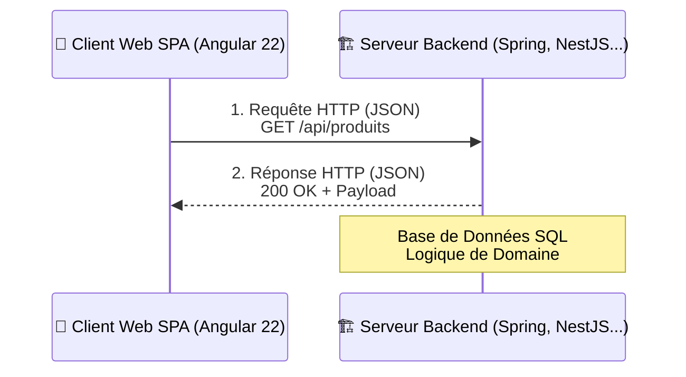
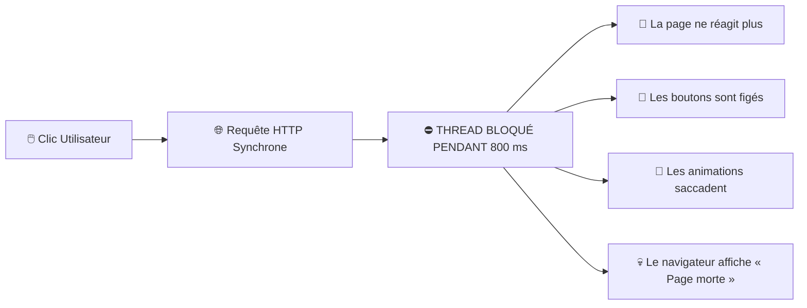
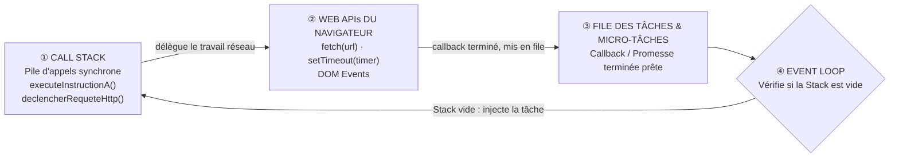
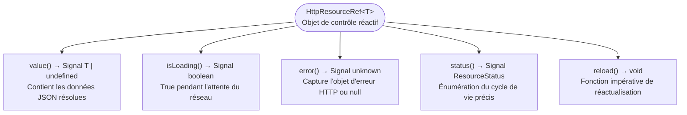
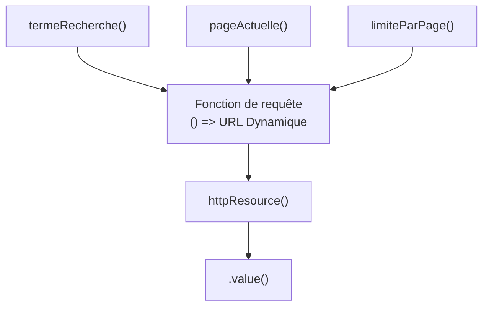
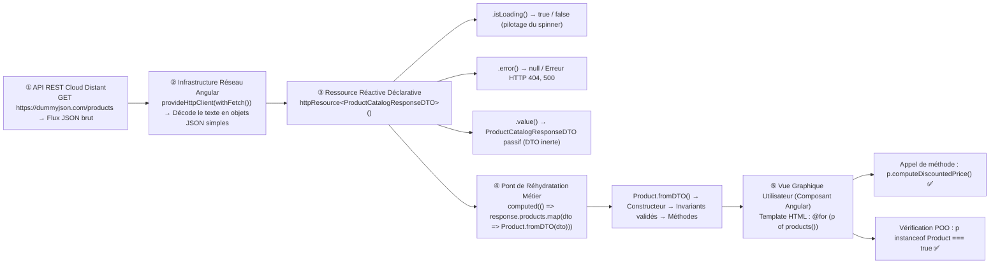

<style>
.slidev-code, .slidev-code pre { font-size: 0.72rem !important; line-height: 1.3 !important; }
.slidev-code pre { padding: 0.45rem 0.65rem !important; }
</style>

<div class="h-full flex flex-col justify-center items-center">
  <div class="inline-flex items-center gap-2 px-3.5 py-1 mb-4 text-xs font-bold rounded-full bg-blue-100 dark:bg-blue-900/40 text-blue-700 dark:text-blue-300 border-2 border-blue-300 dark:border-blue-700">
    <span class="w-2.5 h-2.5 rounded-full bg-blue-600 animate-pulse"></span>
    Programmation Orientée Objet · EAFC
  </div>

  <h1 class="text-4xl font-extrabold tracking-tight mb-3 bg-gradient-to-r from-blue-700 via-indigo-600 to-purple-700 bg-clip-text text-transparent">
    Séance 17 — Consommer une API REST
  </h1>

  <p class="text-base text-slate-800 dark:text-slate-100 max-w-2xl mx-auto mb-5 font-semibold">
    <code>httpResource()</code> · Asynchronisme & Event Loop · Protocoles REST · Le Pont DTO vers Entité Métier
  </p>

  <div class="flex items-center justify-center gap-2 text-xs font-mono font-bold">
    <span class="px-2.5 py-1 rounded bg-slate-200 dark:bg-slate-800 text-slate-800 dark:text-slate-200 border border-slate-300 dark:border-slate-600">TypeScript 5+</span>
    <span class="px-2.5 py-1 rounded bg-slate-200 dark:bg-slate-800 text-slate-800 dark:text-slate-200 border border-slate-300 dark:border-slate-600">Angular 22</span>
    <span class="px-2.5 py-1 rounded bg-slate-200 dark:bg-slate-800 text-slate-800 dark:text-slate-200 border border-slate-300 dark:border-slate-600">Signal-First</span>
    <span class="px-2.5 py-1 rounded bg-purple-100 dark:bg-purple-900/40 text-purple-700 dark:text-purple-300 border border-purple-300 dark:border-purple-700">Bloc D · Persistance</span>
  </div>
</div>

<!--
Bienvenue à la séance 17 du cours de Programmation Orientée Objet !
Aujourd'hui, nous poursuivons notre exploration du Bloc D (Persistance des données).
Lors de la séance 16, nous avons compris le mécanisme de la sérialisation locale et le drame du prototype perdu.
Aujourd'hui, nous faisons franchir à nos objets la frontière physique de notre propre machine :
nous allons chercher des données sur le réseau Internet mondial, à travers des APIs REST,
et apprendre comment marier l'asynchronisme du Web moderne avec nos classes d'objets protectrices !
-->

---
layout: default
---

# 🎯 Objectifs pédagogiques de la séance

<div class="grid grid-cols-2 gap-3.5 mt-4 text-xs">
  <div class="p-2.5 rounded-xl bg-slate-500/5 border border-slate-500/15 flex items-start gap-3">
    <span class="w-7 h-7 rounded-lg bg-blue-500/10 text-blue-500 flex items-center justify-center font-bold text-xs flex-shrink-0">01</span>
    <div>
      <h4 class="font-bold text-sm mb-0.5">Maîtriser REST & HTTP</h4>
      <p class="opacity-75">Comprendre le modèle de ressource/URI, les verbes HTTP (<code>GET</code>, <code>POST</code>, <code>PUT</code>, <code>DELETE</code>), la notion d'idempotence et les grandes familles de codes de statut (2xx, 3xx, 4xx, 5xx).</p>
    </div>
  </div>

  <div class="p-2.5 rounded-xl bg-slate-500/5 border border-slate-500/15 flex items-start gap-3">
    <span class="w-7 h-7 rounded-lg bg-indigo-500/10 text-indigo-500 flex items-center justify-center font-bold text-xs flex-shrink-0">02</span>
    <div>
      <h4 class="font-bold text-sm mb-0.5">Démystifier l'Asynchronisme</h4>
      <p class="opacity-75">Comprendre pourquoi le thread principal du navigateur ne doit <strong>jamais</strong> être bloqué et visualiser la mécanique de l'<strong>Event Loop</strong> (Call Stack, Web APIs, Microtasks).</p>
    </div>
  </div>

  <div class="p-2.5 rounded-xl bg-slate-500/5 border border-slate-500/15 flex items-start gap-3">
    <span class="w-7 h-7 rounded-lg bg-purple-500/10 text-purple-500 flex items-center justify-center font-bold text-xs flex-shrink-0">03</span>
    <div>
      <h4 class="font-bold text-sm mb-0.5">Découvrir la Révolution <code>httpResource()</code></h4>
      <p class="opacity-75">Approche déclarative <strong>Signal-First</strong> d'Angular 22.</p>
    </div>
  </div>

  <div class="p-2.5 rounded-xl bg-slate-500/5 border border-slate-500/15 flex items-start gap-3">
    <span class="w-7 h-7 rounded-lg bg-rose-500/10 text-rose-500 flex items-center justify-center font-bold text-xs flex-shrink-0">04</span>
    <div>
      <h4 class="font-bold text-sm mb-0.5">Configurer l'App avec <code>provideHttpClient()</code></h4>
      <p class="opacity-75">Activer l'infrastructure réseau moderne dans <code>app.config.ts</code> avec l'option <code>withFetch()</code> pour des performances et une résilience optimales.</p>
    </div>
  </div>

</div>

<!--
Présentez ces 6 objectifs pédagogiques clés aux étudiants.
Rassurez-les : même si le terme "API REST" ou "Asynchrone" peut sembler intimidant,
nous allons tout construire pas à pas avec des analogies simples et des schémas clairs.
La grande force de cette séance est de relier la théorie réseau avec nos objets métier concrets.
-->

---
layout: default
---

# 🎯 Objectifs pédagogiques de la séance

<div class="grid grid-cols-2 gap-3.5 mt-4 text-xs">
  <div class="p-2.5 rounded-xl bg-slate-500/5 border border-slate-500/15 flex items-start gap-3">
    <span class="w-7 h-7 rounded-lg bg-amber-500/10 text-amber-500 flex items-center justify-center font-bold text-xs flex-shrink-0">05</span>
    <div>
      <h4 class="font-bold text-sm mb-0.5">Piloter le Cycle de Vie Réactif</h4>
      <p class="opacity-75">Exploiter les signaux <code>value()</code>, <code>isLoading()</code>, <code>error()</code>, décoder <code>ResourceStatus</code> et déclencher des réactualisations avec <code>.reload()</code>.</p>
    </div>
  </div>

  <div class="p-2.5 rounded-xl bg-slate-500/5 border border-slate-500/15 flex items-start gap-3">
    <span class="w-7 h-7 rounded-lg bg-emerald-500/10 text-emerald-500 flex items-center justify-center font-bold text-xs flex-shrink-0">06</span>
    <div>
      <h4 class="font-bold text-sm mb-0.5">Pérenniser le Pont POO : DTO ➔ Entité</h4>
      <p class="opacity-75">Bannir le typage naïf sur les réponses HTTP et associer <code>httpResource()</code> à <code>computed()</code> et à la fabrique <code>fromDTO()</code> pour réhydrater des entités vivantes.</p>
    </div>
  </div>
</div>

---
layout: center
class: text-center
---

<div class="inline-flex items-center gap-2 px-3 py-1 mb-3 text-xs font-mono font-semibold rounded-full bg-blue-500/10 text-blue-500 border border-blue-500/20">
  PARTIE 00
</div>

# Le Cheminement : D'où venons-nous ?
## L'Évolution du Bloc D

<!--
Prenez 3 minutes pour replacer cette séance dans la progression d'ensemble.
Les étudiants découvrent la POO pour la 1ère fois : ils ont besoin de comprendre le fil conducteur.
Pourquoi avons-nous fait du JSON en S16 ? Pour être capables aujourd'hui de dialoguer avec des serveurs distants !
-->


---
layout: default
---

# La progression pédagogique du cursus POO

<div class="grid grid-cols-12 gap-2 mt-2 text-xs">
  <div class="col-span-3 p-2.5 rounded-xl bg-slate-500/5 border border-slate-500/15">
    <div class="font-mono font-bold text-blue-500 mb-1">BLOC A (S5 à S9)</div>
    <h3 class="font-bold mb-1">Fondamentaux POO</h3>
    <ul class="opacity-80 space-y-0.5 text-[10px]">
      <li>Encapsulation & invariants (S5)</li>
      <li>Héritage & spécialisation (S6)</li>
      <li>Polymorphisme dynamique (S7)</li>
      <li>Abstraction & contrats purs (S8)</li>
      <li>Composition vs héritage (S9)</li>
    </ul>
    <div class="mt-2 px-1.5 py-0.5 rounded bg-blue-500/10 text-blue-600 dark:text-blue-400 font-semibold text-center text-[10px]">
      Architecture & Relations
    </div>
  </div>

  <div class="col-span-3 p-2.5 rounded-xl bg-slate-500/5 border border-slate-500/15">
    <div class="font-mono font-bold text-indigo-500 mb-1">BLOC B & C (S10 à S15)</div>
    <h3 class="font-bold mb-1">Qualité & Angular</h3>
    <ul class="opacity-80 space-y-0.5 text-[10px]">
      <li>Exceptions & SOLID (S10-S11)</li>
      <li>Identité & Immutabilité (S12)</li>
      <li>Signaux Réactifs (S13)</li>
      <li>Services Métier & DI (S14)</li>
      <li>Signal Forms & Routing (S15)</li>
    </ul>
    <div class="mt-2 px-1.5 py-0.5 rounded bg-indigo-500/10 text-indigo-700 dark:text-indigo-300 font-semibold text-center text-[10px]">
      Robustesse & Réactivité
    </div>
  </div>

  <div class="col-span-3 p-2.5 rounded-xl bg-purple-500/10 border-2 border-purple-500/40">
    <div class="font-mono font-bold text-purple-500 mb-1">BLOC D (S16 à S19)</div>
    <h3 class="font-bold mb-1">Persistance</h3>
    <ul class="opacity-80 space-y-0.5 text-[10px]">
      <li>Formats & Sérialisation (S16)</li>
      <li><strong>Aujourd'hui : APIs REST & httpResource (S17)</strong></li>
      <li>Stockage Local (S18)</li>
      <li>Dexie.js CRUD (S19)</li>
    </ul>
    <div class="mt-2 px-1.5 py-0.5 rounded bg-purple-500/20 text-purple-700 dark:text-purple-300 font-bold text-center text-[10px]">
      Survie Hors Mémoire
    </div>
  </div>

  <div class="col-span-3 p-2.5 rounded-xl bg-slate-500/5 border border-slate-500/15">
    <div class="font-mono font-bold text-slate-500 mb-1">BLOCS E à G</div>
    <h3 class="font-bold mb-1">Mobile & Synthèse</h3>
    <ul class="opacity-80 space-y-0.5 text-[10px]">
      <li>Capacitor Mobile (S20)</li>
      <li>Tests Unitaires Isolés (S21)</li>
      <li>Projet Intégrateur Final (S22)</li>
    </ul>
    <div class="mt-2 px-1.5 py-0.5 rounded bg-slate-500/10 text-slate-700 dark:text-slate-300 font-semibold text-center text-[10px]">
      Déploiement & Maîtrise
    </div>
  </div>
</div>

<div class="mt-4 p-3 rounded-xl bg-purple-500/10 border border-purple-500/20 text-xs">
  <div class="font-bold text-purple-700 dark:text-purple-300 mb-1 flex items-center gap-1.5">
    <span>💡</span> Le bilan de la Séance 16 : Une persistance encore prisonnière de la machine locale
  </div>
  <p class="opacity-85">
    En séance 16, nous avons appris à sérialiser nos objets en chaînes JSON et à les réhydrater via <code>fromDTO()</code>. Mais nos données provenaient uniquement de notre propre code ou de fichiers locaux. Or, dans le monde réel, les données résident sur des serveurs distants, hébergés dans le cloud et partagés entre des millions d'utilisateurs !
  </p>
</div>

<!--
Rappelez aux étudiants que jusqu'ici, tout se passait sur une seule machine isolée.
Mais aucune application d'entreprise moderne (banque, e-commerce, réseau social) ne garde ses données sur le PC du client.
Il faut interroger des serveurs distants. C'est le rôle fondamental des APIs REST !
-->

---
layout: default
---

# La Grande Question de la Séance 17

<div class="h-full flex flex-col justify-center items-center px-8 text-center">
  <div class="p-6 rounded-2xl bg-gradient-to-br from-blue-500/10 via-purple-500/10 to-indigo-500/10 border-2 border-purple-500/30 shadow-xl max-w-3xl">
    <div class="text-3xl mb-3">🌍</div>
    <blockquote class="text-lg font-bold leading-relaxed text-slate-800 dark:text-slate-100">
      « Comment interroger de façon asynchrone et non-bloquante un service distant sur le Web,<br>
      tout en intégrant de façon transparente et réactive les flux JSON reçus<br>
      dans notre architecture Orientée Objet sous Angular 22 ? »
    </blockquote>
    <div class="mt-4 text-xs font-mono font-semibold text-purple-600 dark:text-purple-400">
      — Le Pont Réseau entre le Cloud et nos Entités Métier Vivantes
    </div>
  </div>
</div>

<!--
Lisez cette question avec solennité.
Demandez aux étudiants : "Si le serveur met 1 seconde à répondre, que doit faire notre navigateur pendant cette seconde ? S'arrêter complètement ? Continuer à vivre ?"
Laissez-les réagir. C'est le point d'entrée idéal vers la notion d'asynchronisme.
-->

---
layout: center
class: text-center
---

<div class="inline-flex items-center gap-2 px-3 py-1 mb-3 text-xs font-mono font-semibold rounded-full bg-blue-500/10 text-blue-500 border border-blue-500/20">
  PARTIE 01
</div>

# Le Web Distant : REST, HTTP & Défi Asynchrone
## Architecture Réseau, Verbes Sémantiques & L'Horlogerie de l'Event Loop

<p class="opacity-70 text-sm max-w-xl mx-auto">
  Comprendre comment le Web structure ses requêtes et pourquoi un navigateur interdit catégoriquement les opérations bloquantes.
</p>

<!--
Partie 1 : Posons les bases. Beaucoup d'étudiants ont déjà entendu parler d'"API" ou de "GET/POST",
mais très peu comprennent la mécanique sous-jacente du protocole HTTP et le fonctionnement de l'Event Loop.
-->

---
layout: default
---

# Qu'est-ce qu'une API REST ?

Le style architectural **REST** (*Representational State Transfer*) régit les communications du Web moderne :

<div class="grid grid-cols-12 gap-4 mt-2 text-xs items-start">

<div class="col-span-6">
  <h3 class="font-bold text-sm mb-2">🏛️ Les Piliers Fondamentaux de REST</h3>
  <div class="p-3 rounded-xl bg-blue-500/10 border border-blue-500/20 space-y-2">
    <div>
      <strong>1. Notion de Ressource :</strong> Chaque donnée métier est une ressource exposée par une <strong>URI</strong> unique.
    </div>
    <div>
      <strong>2. Sans État (Stateless) :</strong> Chaque requête contient toutes les informations requises pour être comprise par le serveur.
    </div>
    <div>
      <strong>3. Format d'Échange Standard :</strong> Les données circulent sous forme de représentations légères, principalement en <strong>JSON</strong>.
    </div>
    <div>
      <strong>4. Découplage Client / Serveur :</strong> L'interface Angular ignore totalement si le serveur est codé en Java, Node.js ou Python.
    </div>
  </div>
</div>

<div class="col-span-6">
  <h3 class="font-bold text-sm mb-2">🔄 Le Dialogue Client-Serveur</h3>
  <div class="p-3 rounded-xl bg-slate-500/5 border border-slate-500/15">



  </div>
</div>

</div>

<!--
Expliquez bien la notion de ressource :
Dans une API REST, on ne demande pas "exécute la fonction getArticles()".
On désigne une ressource : "/api/articles".
Le client et le serveur sont strictement découplés : le serveur fournit de la donnée brute en JSON, notre client Angular en fait une belle interface riche.
-->

---
layout: default
---

## Les Verbes HTTP : La Sémantique de l'Action

Dans une architecture REST conforme, l'action à réaliser est déterminée par le **verbe HTTP** :

<div class="mt-3 text-xs">

| Verbe HTTP | Rôle sémantique | Idempotent ? | Sûr (Safe) ? | Présence d'un Body |
| :--- | :--- | :---: | :---: | :---: |
| **`GET`** | Récupère la représentation d'une ressource ou liste | **Oui** | **Oui** (Lecture seule) | Non recommandé |
| **`POST`** | Crée une nouvelle ressource subordonnée | **Non** | **Non** (Crée un état) | **Oui** (Données à créer) |
| **`PUT`** | Remplace intégralement une ressource existante | **Oui** | **Non** (Écrase l'état) | **Oui** (Données complètes) |
| **`PATCH`** | Modifie partiellement certains champs d'une ressource | **Non** | **Non** (Altère l'état) | **Oui** (Diff des champs) |
| **`DELETE`** | Supprime définitivement la ressource ciblée | **Oui** | **Non** (Supprime l'état) | Rare / Déconseillé |

</div>

<div class="mt-4 p-3 rounded-xl bg-amber-500/10 border border-amber-500/20 text-xs">
  <div class="font-bold text-amber-700 dark:text-amber-300 mb-1 flex items-center gap-1.5">
    <span>💡</span> Zoom Pédagogique : Qu'est-ce que l'Idempotence ?
  </div>
  <p class="opacity-85">
    Une opération est <strong>idempotente</strong> si l'exécuter 1 fois ou 10 fois consécutives produit exactement le même état final sur le serveur.
    Exemple : <code>DELETE /api/articles/42</code> supprime l'article. Le rappeler 5 fois de suite ne supprimera rien de plus. En revanche, répéter 10 fois un <code>POST</code> va créer 10 nouveaux articles en base de données !
  </p>
</div>

<!--
Prenez le temps d'expliquer ce tableau.
Beaucoup de juniors confondent PUT et PATCH :
- PUT remplace tout le meuble par un nouveau meuble.
- PATCH remplace juste la poignée du meuble.
Insistez sur l'importance du verbe GET qui doit être STRICTEMENT sans effet secondaire (Safe).
-->

---
layout: default
---

## Les Codes de Statut HTTP : La Grammaire du Diagnostic

Le serveur accompagne systématiquement chaque réponse d'un code numérique normalisé sur 3 chiffres :

<div class="grid grid-cols-2 gap-3 mt-3 text-xs">
  <div class="p-3 rounded-xl bg-emerald-500/10 border border-emerald-500/20">
    <div class="font-bold text-emerald-700 dark:text-emerald-300 flex items-center gap-2 mb-1.5">
      <span class="w-5 h-5 rounded-full bg-emerald-500/20 flex items-center justify-center font-mono">2xx</span>
      <span>Succès (Success)</span>
    </div>
    <ul class="space-y-1 opacity-80 text-[11px]">
      <li><strong>200 OK :</strong> Requête traitée avec succès, contenu renvoyé.</li>
      <li><strong>201 Created :</strong> Ressource créée avec succès (après POST).</li>
      <li><strong>204 No Content :</strong> Succès avéré mais aucun corps à renvoyer (ex: DELETE).</li>
    </ul>
  </div>

  <div class="p-3 rounded-xl bg-blue-500/10 border border-blue-500/20">
    <div class="font-bold text-blue-700 dark:text-blue-300 flex items-center gap-2 mb-1.5">
      <span class="w-5 h-5 rounded-full bg-blue-500/20 flex items-center justify-center font-mono">3xx</span>
      <span>Redirection</span>
    </div>
    <ul class="space-y-1 opacity-80 text-[11px]">
      <li><strong>301 Moved Permanently :</strong> L'URI a changé de façon définitive.</li>
      <li><strong>304 Not Modified :</strong> La ressource en cache est encore fraîche, aucun transfert nécessaire.</li>
    </ul>
  </div>

  <div class="p-3 rounded-xl bg-amber-500/10 border border-amber-500/20">
    <div class="font-bold text-amber-700 dark:text-amber-300 flex items-center gap-2 mb-1.5">
      <span class="w-5 h-5 rounded-full bg-amber-500/20 flex items-center justify-center font-mono">4xx</span>
      <span>Erreur du Client (Notre faute !)</span>
    </div>
    <ul class="space-y-1 opacity-80 text-[11px]">
      <li><strong>400 Bad Request :</strong> Données envoyées invalides ou syntaxe corrompue.</li>
      <li><strong>401 Unauthorized :</strong> Authentification requise (token absent/expiré).</li>
      <li><strong>403 Forbidden :</strong> Identifié mais droits insuffisants.</li>
      <li><strong>404 Not Found :</strong> L'URI demandée n'existe pas sur le serveur.</li>
      <li><strong>422 Unprocessable :</strong> Données bien formées mais rejetées par les règles métier.</li>
    </ul>
  </div>

  <div class="p-3 rounded-xl bg-rose-500/10 border border-rose-500/20">
    <div class="font-bold text-rose-700 dark:text-rose-300 flex items-center gap-2 mb-1.5">
      <span class="w-5 h-5 rounded-full bg-rose-500/20 flex items-center justify-center font-mono">5xx</span>
      <span>Erreur du Serveur (Leur faute !)</span>
    </div>
    <ul class="space-y-1 opacity-80 text-[11px]">
      <li><strong>500 Internal Error :</strong> Le code backend a levé une exception non gérée (crash).</li>
      <li><strong>502 Bad Gateway :</strong> Le serveur mandataire / passerelle a reçu une réponse invalide.</li>
      <li><strong>503 Service Unavailable :</strong> Serveur surchargé ou temporairement en maintenance.</li>
    </ul>
  </div>
</div>

<!--
Moyen mnémotechnique classique à partager avec les étudiants :
- 2xx : Tout va bien, bravo !
- 3xx : Va voir là-bas.
- 4xx : C'est TOI (le client) qui as fait une bêtise (mauvaise URL, mauvais mot de passe).
- 5xx : C'est le SERVEUR qui a planté, ce n'est pas ta faute !
-->

---
layout: default
---

# Le Défi : Synchrone vs Asynchrone

Pour comprendre l'asynchronisme, imaginons deux serveurs dans un restaurant bondé :

<div class="grid grid-cols-12 gap-4 mt-3 text-xs items-start">

<div class="col-span-6">
  <h4 class="font-bold text-sm mb-2">Le Serveur Synchrone (Bloquant)</h4>
  <div class="p-3 rounded-xl bg-rose-500/10 border border-rose-500/20 space-y-2">
    <div class="flex items-start gap-2">
      <span class="text-rose-500 font-bold">1.</span>
      <div>Il prend la commande d'une table.</div>
    </div>
    <div class="flex items-start gap-2">
      <span class="text-rose-500 font-bold">2.</span>
      <div>Il dépose le bon en cuisine.</div>
    </div>
    <div class="flex items-start gap-2">
      <span class="text-rose-500 font-bold">3.</span>
      <div><strong>Il reste planté immobile devant les fourneaux pendant 25 minutes</strong> sans rien faire, attendant la cuisson !</div>
    </div>
    <div class="flex items-start gap-2">
      <span class="text-rose-500 font-bold">💥</span>
      <div><strong>Résultat :</strong> Les autres tables meurent de soif, personne ne peut entrer, tout le restaurant est paralysé !</div>
    </div>
  </div>
</div>

<div class="col-span-6">
  <h4 class="font-bold text-sm mb-2">Le Serveur Asynchrone (Non-Bloquant)</h4>
  <div class="p-3 rounded-xl bg-emerald-500/10 border border-emerald-500/20 space-y-2">
    <div class="flex items-start gap-2">
      <span class="text-emerald-500 font-bold">1.</span>
      <div>Il prend la commande d'une table.</div>
    </div>
    <div class="flex items-start gap-2">
      <span class="text-emerald-500 font-bold">2.</span>
      <div>Il donne le bon et confie un <strong>bip électronique</strong> (buzzer) aux clients.</div>
    </div>
    <div class="flex items-start gap-2">
      <span class="text-emerald-500 font-bold">3.</span>
      <div><strong>Il retourne immédiatement en salle :</strong> il accueille de nouveaux clients, sert les boissons, encaisse les additions.</div>
    </div>
    <div class="flex items-start gap-2">
      <span class="text-emerald-500 font-bold">🔔</span>
      <div><strong>Quand le bip sonne</strong> (l'événement se produit), il va chercher le plat et le pose sur la table. Fluidité totale !</div>
    </div>
  </div>
</div>

</div>

<!--
Cette analogie du bip de restaurant (buzzer) parle immédiatement aux étudiants.
Expliquez-leur : le serveur du restaurant, c'est le thread JavaScript unique de notre navigateur !
S'il reste planté à attendre le réseau, tout le navigateur freeze.
-->

---
layout: default
---

## La Réalité Physique du Navigateur : Un Seul Thread !

Dans un navigateur Web, JavaScript s'exécute sur **un seul thread d'exécution principal** (*Single-Threaded*) :

<div class="grid grid-cols-4 gap-2.5 my-3 text-xs">
  <div class="p-2.5 rounded-xl bg-slate-500/5 border border-slate-500/15 text-center">
    <div class="text-xl mb-1">💻</div>
    <div class="font-bold">Calcul TypeScript</div>
    <div class="opacity-70 text-[10px]">Exécution du code de vos fonctions et classes</div>
  </div>
  <div class="p-2.5 rounded-xl bg-slate-500/5 border border-slate-500/15 text-center">
    <div class="text-xl mb-1">🎨</div>
    <div class="font-bold">Rendu Graphique</div>
    <div class="opacity-70 text-[10px]">Calcul CSS, disposition (Layout) et rendu 60 FPS</div>
  </div>
  <div class="p-2.5 rounded-xl bg-slate-500/5 border border-slate-500/15 text-center">
    <div class="text-xl mb-1">🖱️</div>
    <div class="font-bold">Événements Utilisateur</div>
    <div class="opacity-70 text-[10px]">Gestion des clics, frappes au clavier, défilements</div>
  </div>
  <div class="p-2.5 rounded-xl bg-slate-500/5 border border-slate-500/15 text-center">
    <div class="text-xl mb-1">⚡</div>
    <div class="font-bold">Signaux Réactifs</div>
    <div class="opacity-70 text-[10px]">Propagation dans le graphe de dépendance Angular</div>
  </div>
</div>

<div class="mt-3 p-2 rounded-xl bg-rose-500/10 border border-rose-500/20 text-xs font-semibold text-rose-700 dark:text-rose-300 text-center">
  ⚠️ LE DANGER D'UN APPEL RÉSEAU SYNCHRONE : si une requête HTTP vers un serveur distant prenait 800 ms de latence et était SYNCHRONE (bloquante)…
</div>



<!--
Faites bien comprendre le lien entre le processeur et l'expérience utilisateur.
Un appel réseau prend entre 50 millisecondes et plusieurs secondes selon la qualité de la connexion 4G/WiFi.
Si le thread était bloqué, l'utilisateur penserait que son ordinateur a planté.
-->

---
layout: default
---

# L'Event Loop JavaScript : Sous le Capot

Pour gérer l'attente du réseau sans figer l'écran, JavaScript orchestre **l'Event Loop** :



<div class="grid grid-cols-3 gap-2 mt-2 text-xs">
  <div class="p-2 rounded-lg bg-blue-500/10 border border-blue-500/20">
    <strong>1. Call Stack :</strong> Exécute le code immédiatement. Tant qu'une fonction est sur la pile, rien d'autre ne tourne.
  </div>
  <div class="p-2 rounded-lg bg-indigo-500/10 border border-indigo-500/20">
    <strong>2. Web APIs :</strong> Le navigateur gère le réseau en arrière-plan sur d'autres threads système. La Call Stack est libérée !
  </div>
  <div class="p-2 rounded-lg bg-purple-500/10 border border-purple-500/20">
    <strong>3. Event Loop :</strong> Dès que la Call Stack est vide, elle prélève les résultats réseau arrivés et les transmet à Angular.
  </div>
</div>

<!--
Cette diapositive est l'une des plus fondamentales du cours de programmation moderne.
Expliquez la chronologie :
1. J'appelle httpResource(). La fonction se termine en 1 milliseconde.
2. Le réseau prend 300 ms en tâche de fond dans le navigateur.
3. Quand la réponse arrive, l'Event Loop injecte la mise à jour dans nos signaux Angular !
-->

---
layout: default
---

# Grille d'Arbitrage : Quand employer le Synchrone vs l'Asynchrone ?

Comment décider si votre code doit être synchrone ou asynchrone ? Voici la règle d'or d'ingénierie :

<div class="grid grid-cols-2 gap-4 my-3 text-xs">
  <div class="p-3.5 rounded-xl bg-blue-500/10 border border-blue-500/20">
    <div class="font-bold text-blue-700 dark:text-blue-300 flex items-center gap-1.5 mb-2 text-sm">
      <span>⚡</span> UTILISER LE SYNCHRONE POUR :
    </div>
    <ul class="space-y-1.5 opacity-85">
      <li>Les calculs mathématiques et algorithmiques en mémoire vive.</li>
      <li>L'instanciation de classes d'objets (<code>new Article(...)</code>).</li>
      <li>La validation stricte des invariants métier (constructeurs).</li>
      <li>Les accesseurs encapsulés (<code>getters</code> et <code>setters</code>).</li>
      <li>Les signaux dérivés purs (<code>computed(...)</code>).</li>
      <li>Toute opération dont le temps d'exécution est prévisible et quasi-instantané (&lt; 1 ms).</li>
    </ul>
  </div>

  <div class="p-3.5 rounded-xl bg-purple-500/10 border border-purple-500/20">
    <div class="font-bold text-purple-700 dark:text-purple-300 flex items-center gap-1.5 mb-2 text-sm">
      <span>🌐</span> UTILISER L'ASYNCHRONE POUR :
    </div>
    <ul class="space-y-1.5 opacity-85">
      <li>Toutes les requêtes réseau (HTTP REST, WebSockets).</li>
      <li>Les accès aux stockages physiques ou bases de données (IndexedDB).</li>
      <li>Les délais, temporisations et intervalles (<code>setTimeout</code>).</li>
      <li>L'accès aux capteurs matériels (GPS, caméra, fichiers disque).</li>
      <li><strong>Règle générale :</strong> Tout franchissement de frontière physique hors de la RAM de votre processus !</li>
    </ul>
  </div>
</div>

<div class="p-2.5 rounded-xl bg-emerald-500/10 border border-emerald-500/20 text-xs text-center font-semibold text-emerald-800 dark:text-emerald-200">
  💡 Retenez bien : En mémoire vive locale ➔ Synchrone. Franchissement de frontière physique ➔ Asynchrone !
</div>

<!--
Posez des questions rapides aux étudiants pour vérifier la compréhension :
- "Calculer le prix TTC d'un panier ?" ➔ Synchrone !
- "Vérifier si un email existe déjà sur la base de données de l'entreprise ?" ➔ Asynchrone !
- "Valider qu'un âge est supérieur à 18 ans ?" ➔ Synchrone !
-->

---
layout: center
class: text-center
---

<div class="inline-flex items-center gap-2 px-3 py-1 mb-3 text-xs font-mono font-semibold rounded-full bg-blue-500/10 text-blue-500 border border-blue-500/20">
  PARTIE 02
</div>

# L'Accès Réseau sous Angular 22
## Approche Déclarative Signal-First


<!--
Partie 2 : Transition vers Angular 22.
Expliquez le contexte historique sans accabler RxJS, mais en soulignant à quel point
l'arrivée de httpResource() simplifie la vie d'un développeur moderne.
-->

---
layout: default
---

## La Révolution Déclarative : `httpResource()`

Angular 22 unifie enfin la gestion des requêtes réseau au sein de son graphe réactif natif :

<div class="mt-3 text-xs">

| Critère d'Ingénierie | Ancien Monde (RxJS Impératif) | Monde Moderne (Angular 22 Signals) |
| :--- | :--- | :--- |
| **Paradigme de programmation** | Flux d'événements continus (*Streams*) | **Primitives d'état pures (*Signals*)** |
| **Souscriptions** | Manuelles (<code>subscribe()</code>) | **Déclaratives et automatiques** |
| **Gestion de la mémoire** | Risques élevés de fuites de mémoire | **Zéro fuite : cycle de vie géré par Angular** |
| **Gestion des états** | Variables manuelles <code>isLoading</code>, <code>error</code> | **Signaux natifs <code>.isLoading()</code>, <code>.error()</code>** |
| **Annulation de requête** | Opérateurs complexes (<code>switchMap</code>) | **Automatique dès qu'un signal change** |
| **Lisibilité du code** | 20 à 30 lignes verbeuses de plomberie | **1 seule déclaration limpide** |

</div>

<div class="mt-4 p-3 rounded-xl bg-purple-500/10 border border-purple-500/20 text-xs">
  <code class="text-purple-800 dark:text-purple-200 font-bold">
    readonly articlesResource = httpResource&lt;ArticleDTO[]&gt;('https://api.monsite.com/articles');
  </code>
  <p class="opacity-85 mt-0">
    Angular se charge d'émettre la requête, de surveiller le chargement, d'intercepter les erreurs et de mettre à disposition les signaux réactifs dans votre template.
  </p>
</div>

<!--
Faites savourer cette simplification aux étudiants.
Le contraste entre les 20 lignes précédentes et cette ligne unique est spectaculaire.
-->

---
layout: default
---

# Configuration Préalable : `provideHttpClient()`

Pour que les requêtes réseau fonctionnent dans une application Angular moderne (sans `AppModule`), nous devons enregistrer le fournisseur HTTP dans `app.config.ts` :

<div class="grid grid-cols-12 gap-4 mt-2 items-start">

<div class="col-span-8">

```typescript
// src/app/app.config.ts
import { ApplicationConfig, provideZoneChangeDetection } from '@angular/core';
import { provideRouter } from '@angular/router';
import { provideHttpClient, withFetch } from '@angular/common/http';
import { routes } from './app.routes';

export const appConfig: ApplicationConfig = {
  providers: [
    provideZoneChangeDetection({ eventCoalescing: true }),
    provideRouter(routes),

    // 🌐 Active l'infrastructure réseau d'Angular
    // withFetch() active l'API fetch native du navigateur à la place 
    // de XMLHttpRequest
    provideHttpClient(withFetch())
  ]
};
```

</div>

<div class="col-span-4">
  <div class="p-3 rounded-xl bg-blue-500/10 border border-blue-500/20 text-xs">
    <div class="font-bold text-blue-700 dark:text-blue-300 mb-1 flex items-center gap-1.5">
      <span>💡</span> Pourquoi inclure impérativement <code>withFetch()</code> ?
    </div>
    <p class="opacity-85">
      Par défaut historique, Angular utilisait le très vieux protocole <code>XMLHttpRequest</code>. En passant <code>withFetch()</code>, Angular s'appuie sur la fonction native <code>fetch()</code> du navigateur. Cela offre de meilleures performances, une consommation mémoire réduite et une compatibilité native avec les annulations de requêtes via <code>AbortSignal</code>.
    </p>
  </div>
</div>

</div>

<!--
Attention piège classique pour les débutants :
S'ils oublient d'ajouter provideHttpClient() dans app.config.ts, l'application va crasher au premier appel avec l'erreur :
"NullInjectorError: No provider for HttpClient!"
Insistez bien sur cette étape obligatoire de configuration.
-->

<style>
  pre code {
    font-size: 12px !important;
  }
</style>

---
layout: center
class: text-center
---

<div class="inline-flex items-center gap-2 px-3 py-1 mb-3 text-xs font-mono font-semibold rounded-full bg-blue-500/10 text-blue-500 border border-blue-500/20">
  PARTIE 03
</div>

# Maîtriser `httpResource()`
## Signaux d'État, Machine à États & Requêtes Réactives Paramétrées

<p class="opacity-70 text-sm max-w-xl mx-auto">
  Explorer les capacités réactives de HttpResourceRef et synchroniser vos appels réseau avec les interactions utilisateur.
</p>

<!--
Partie 3 : Entrons dans le moteur technique de httpResource().
Nous allons examiner son interface complète et apprendre à réagir aux changements de filtres ou de recherche.
-->

---
layout: default
---

# Anatomie d'un `HttpResourceRef<T>`

L'appel à `httpResource<T>()` ne renvoie pas une simple promesse, mais un objet de contrôle réactif :



<div class="mt-3 p-2.5 rounded-xl bg-slate-500/5 border border-slate-500/15 text-xs">
  Chaque membre est un <strong>Signal Angular</strong> ! Cela signifie que vous pouvez les lire directement dans vos templates HTML sans aucune souscription manuelle, et la vue se rafraîchira instantanément dès l'arrivée des paquets réseau.
</div>

<!--
Expliquez aux étudiants :
Ce sont des signaux ! On peut écrire {{ ressource.value() }} ou @if (ressource.isLoading()) directement dans le template.
Et pour forcer une réactualisation (ex: bouton "Actualiser"), on appelle simplement ressource.reload().
-->

---
layout: default
---

# Le Cycle de Vie Réseau : L'Énumération `ResourceStatus`

Pour piloter avec finesse vos écrans, Angular expose la machine à états `ResourceStatus` :

```typescript
export enum ResourceStatus {
  Idle = 0,        // En attente : aucune requête émise (ex: URL undefined)
  Error = 1,       // Échec : erreur de connexion, statut 404, 500, etc.
  Loading = 2,     // Chargement initial en cours (première requête)
  Reloading = 3,   // Réactualisation en cours (anciennes données encore visibles)
  Resolved = 4,    // Succès : les données sont disponibles dans .value()
  Local = 5        // Mutation locale effectuée sur la ressource
}
```

<div class="grid grid-cols-3 gap-2.5 mt-3 text-xs">
  <div class="p-2.5 rounded-xl bg-slate-500/5 border border-slate-500/15 text-center">
    <div class="font-mono font-bold text-slate-500 mb-1">Idle (0)</div>
    <div class="opacity-75 text-[11px]">En sommeil. Idéal quand l'utilisateur n'a pas encore tapé de recherche.</div>
  </div>

  <div class="p-2.5 rounded-xl bg-blue-500/10 border border-blue-500/20 text-center">
    <div class="font-mono font-bold text-blue-500 mb-1">Loading (2)</div>
    <div class="opacity-75 text-[11px]">Premier affichage. L'écran est vide, on affiche un spinner géant.</div>
  </div>

  <div class="p-2.5 rounded-xl bg-emerald-500/10 border border-emerald-500/20 text-center">
    <div class="font-mono font-bold text-emerald-500 mb-1">Resolved (4)</div>
    <div class="opacity-75 text-[11px]">Succès confirmé ! Les données sont prêtes à être transformées en objets.</div>
  </div>
</div>

<!--
Montrez comment cette énumération permet de savoir exactement ce qui se passe à tout instant.
En POO, utiliser un enum TypeScript est la manière la plus propre et sûre de gérer une machine à états.
-->

<style>
  pre code {
    font-size: 11px !important;
  }
</style>

---
layout: default
---

# Ergonomie UI : `Loading` vs `Reloading`

Comprendre la nuance entre premier chargement et rafraîchissement d'arrière-plan :

<div class="grid grid-cols-12 gap-4 mt-2 text-xs items-start">

<div class="col-span-6">
  <h4 class="font-bold text-sm mb-2">⏳ Cas 1 : Premier Chargement (<code>Loading</code>)</h4>
  <div class="p-3 rounded-xl bg-blue-500/10 border border-blue-500/20 space-y-2">
    <div>• L'utilisateur arrive sur la page pour la première fois.</div>
    <div>• Aucune donnée n'existe encore en mémoire vive (<code>.value() === undefined</code>).</div>
    <div>• <strong>Comportement UI recommandé :</strong> Afficher un spinner central ou un squelette de chargement (*Skeleton UI*).</div>
  </div>

```html
@if (ressource.status() === ResourceStatus.Loading) {
  <div class="spinner-border text-primary" />
  <p>Chargement initial de vos articles...</p>
}
```

</div>

<div class="col-span-6">
  <h4 class="font-bold text-sm mb-2">🔄 Cas 2 : Réactualisation (<code>Reloading</code>)</h4>
  <div class="p-3 rounded-xl bg-purple-500/10 border border-purple-500/20 space-y-2">
    <div>• L'utilisateur clique sur « Actualiser » ou modifie un filtre.</div>
    <div>• <code>.value()</code> <strong>conserve les données précédentes affichées</strong> !</div>
    <div>• <strong>Comportement UI recommandé :</strong> Laisser la liste affichée et afficher un petit voyant discret en haut à droite. Pas d'effet de clignotement désagréable !</div>
  </div>

```html
@if (ressource.status() === ResourceStatus.Reloading) {
  <span class="badge bg-warning">Actualisation en cours...</span>
}
```

</div>

</div>

<!--
Faites remarquer la qualité d'expérience utilisateur :
Rien n'est plus désagréable pour un internaute que de voir toute la page disparaître au profit d'un spinner dès qu'il clique sur un filtre !
Grâce à Reloading, les données restent visibles pendant que la mise à jour s'exécute en coulisse.
-->

<style>
  pre code {
    font-size: 11px !important;
  }
</style>

---
layout: default
---

## Requêtes Dynamiques : Le Graphe Réactif en Cascade

`httpResource()` peut recevoir **une fonction de requête** qui lit d'autres signaux :

<div class="grid grid-cols-5">

<div class="col-span-3">

```typescript
@Component({ ... })
export class RechercheArticlesComponent {
  // 1. Signaux réactifs pilotés par les interactions de l'utilisateur
  readonly termeRecherche = signal<string>('ordinateur');
  readonly pageActuelle = signal<number>(1);
  readonly limiteParPage = signal<number>(12);

  // 2. Ressource HTTP connectée au graphe réactif
  readonly articlesResource = httpResource<CatalogueResponseDTO>(() => {
    const terme = this.termeRecherche().trim();
    const page = this.pageActuelle();
    const limite = this.limiteParPage();

    // Dès qu'un de ces 3 signaux change, l'URL est recalculée
    // et Angular relance AUTOMATIQUEMENT la requête réseau !
    return `https://api.monsite.com/v1/articles?q=${encodeURIComponent(terme)}
    &page=${page}&limit=${limite}`;
  });
}
```

</div>

<div class="col-span-2">



</div>
</div>

<!--
Expliquez aux étudiants :
Vous vous souvenez des signaux computed() vus en séance 13 ?
httpResource fonctionne exactement de la même manière !
Si termeRecherche() change, Angular détecte la dépendance et déclenche immédiatement la nouvelle requête réseau sans qu'on ait besoin d'écrire un seul écouteur manuel d'événement !
-->

<style>
  pre code {
    font-size: 10px !important;
  }
</style>

---
layout: default
---

## Annulation Automatique & Suspension Conditionnelle

Deux fonctionnalités avancées indispensables dans les applications professionnelles :

<div class="grid grid-cols-12 gap-4 mt-2 text-xs items-start">

<div class="col-span-5">
  <h3 class="font-bold text-sm mb-2">🚫 Annulation Automatique</h3>
  <div class="p-3 rounded-xl bg-blue-500/10 border border-blue-500/20 space-y-2">
    <p>
      Que se passe-t-il si l'utilisateur tape rapidement <code>c</code>, puis <code>ca</code>, puis <code>caf</code> ?
    </p>
    <p>
      Trois requêtes sont émises. Si la première met plus de temps que la troisième, l'ancienne réponse risquerait d'écraser la nouvelle (problème classique de <em>Race Condition</em>).
    </p>
    <p>
      <strong>Solution native Angular 22 :</strong> Dès que le signal change, Angular envoie un signal d'interruption (<code>AbortSignal</code>) qui <strong>annule immédiatement la requête obsolète</strong> !
    </p>
  </div>
</div>

<div class="col-span-7">
  <h3 class="font-bold text-sm mb-2">⏸️ Suspendre avec <code>undefined</code></h3>
  <div class="p-3 rounded-xl bg-purple-500/10 border border-purple-500/20 space-y-2">
    <p>
      Si le champ de recherche est vide ou trop court, nous ne voulons pas saturer le serveur de requêtes inutiles.
    </p>
    <p>
      Il suffit de retourner <code>undefined</code> dans la fonction de calcul d'URL !
    </p>
  </div>

```typescript
readonly searchResource = httpResource<CatalogueDTO>(() => {
  const terme = this.termeRecherche().trim();
  
  // Moins de 3 caractères ? On ne fait rien !
  if (terme.length < 3) {
    return undefined; // Reste à l'état Idle !
  }

  return `https://api.monsite.com/search?q=${encodeURIComponent(terme)}`;
});
```

</div>

</div>

<!--
Insistez sur la beauté du retour undefined :
Pas besoin de if/else compliqué dans les templates ou d'annuler manuellement la requête.
Si la fonction renvoie undefined, la ressource passe sagement en Idle et n'émet aucun paquet réseau !
-->

<style>
  pre code {
    font-size: 10px !important;
  }
</style>

---
layout: default
---

## Comparaison : `httpResource()` vs `resource()` Générique

<div class="mt-0 text-xs">

| Caractéristique Technique | `httpResource()` | `resource()` |
| :--- | :--- | :--- |
| **Package d'importation** | `@angular/common/http` | `@angular/core` |
| **Moteur sous-jacent** | `HttpClient` d'Angular | Fonction `loader` asynchrone libre |
| **Intercepteurs HTTP (Auth, Logs)** | **Oui** (automatiquement pris en compte) | Non (sauf si branché à la main) |
| **Rendu SSR & Hydratation** | **Oui** (support natif intégré) | Nécessite configuration manuelle |
| **Capacité hors-HTTP** | Restreint au protocole HTTP REST | **Universel (IndexedDB, Dexie, Firebase...)** |
| **Cas d'usage type** | **Toutes les APIs REST standard d'entreprise** | **Bases de données locales, SDKs cloud** |

</div>

```typescript
// Exemple de resource() avec loader asynchrone arbitraire (hors HTTP)
import { resource } from '@angular/core';

readonly dbResource = resource({
  request: () => ({ id: this.selectedId() }),
  loader: async ({ request, abortSignal }) => {
    return await maBaseIndexedDB.articles.get(request.id);
  }
});
```

<!--
Cette comparaison est essentielle pour faire le pont avec la séance 18 et 19 :
Aujourd'hui en S17, nous utilisons httpResource() car nous dialoguons avec des APIs REST sur le Web.
En S18-S19, avec Dexie.js et IndexedDB, nous pourrons employer resource() pour charger nos données locales !
-->

<style>
  pre code {
    font-size: 10px !important;
  }
</style>

---
layout: center
class: text-center
---

<div class="inline-flex items-center gap-2 px-3 py-1 mb-3 text-xs font-mono font-semibold rounded-full bg-blue-500/10 text-blue-500 border border-blue-500/20">
  PARTIE 04
</div>

# L'Intégration POO : Du DTO Inerte à l'Entité Métier Vivante

<p class="opacity-70 text-sm max-w-xl mx-auto">
  Pourquoi une API REST détruit vos classes et comment ressusciter vos objets avec les méthodes de fabrique.
</p>

<!--
Partie 4 : Le cœur battant du cours de POO !
C'est ici que nos étudiants doivent réaliser que sans la POO et sans fabrique statique,
le typage TypeScript n'est qu'une illusion au moment de l'exécution.
-->

---
layout: default
---

# Le Piège : `httpResource<Produit[]>()`


```typescript
// ❌ ATTENTION : Typage naïf et trompeur !
readonly produitsResource = httpResource<Produit[]>('https://dummyjson.com/products');
```

<div class="grid grid-cols-2 gap-3 mt-3 text-xs">
  <div class="p-3 rounded-xl bg-blue-500/10 border border-blue-500/20">
    <div class="font-bold text-blue-700 dark:text-blue-300 mb-1">
      Ce que s'imagine le développeur :
    </div>
    <p class="opacity-80">
      « TypeScript ne signale aucune erreur de compilation ! Donc mes objets sont de vraies instances de ma classe <code>Produit</code>. Je vais pouvoir appeler <code>produit.calculerPrixNet()</code> ! »
    </p>
  </div>

  <div class="p-3 rounded-xl bg-rose-500/10 border border-rose-500/20">
    <div class="font-bold text-rose-700 dark:text-rose-300 mb-1">
      La réalité brutale au Runtime (dans le navigateur) :
    </div>
    <p class="opacity-80">
      <code>JSON.parse()</code> a simplement reconstruit des dictionnaires d'attributs anonymes.
      <strong>Aucun prototype n'a été rattaché !</strong>
    </p>
  </div>
</div>

```typescript
const premier = this.produitsResource.value()?.[0];

console.log(premier instanceof Produit); 
// ➔ false ! Ce n'est absolument PAS un Produit !

premier.calculerPrixNet(); 
// ➔ CRASH AU RUNTIME : TypeError: premier.calculerPrixNet is not a function !
```

<!--
Faites répéter ce piège aux étudiants !
TypeScript vérifie les types à la compilation. Mais le navigateur n'exécute pas TypeScript, il exécute JavaScript !
Au runtime, le réseau n'a renvoyé qu'un bloc de texte JSON.
Aucun constructeur n'a été exécuté, aucune méthode n'existe sur ces objets.
-->

<style>
  pre code {
    font-size: 12px !important;
  }
</style>

---
layout: default
---

# Le Découplage : Contrat DTO Passif vs Entité Métier

Rappelons les deux rôles distincts formalisés lors de la séance 16 :

<div class="grid grid-cols-12 gap-4 mt-2 text-xs items-start">

<div class="col-span-6">
  <h3 class="font-bold text-sm mb-2">📄 Le DTO (Data Transfer Object)</h3>
  <div class="p-3 rounded-xl bg-slate-500/5 border border-slate-500/15 space-y-2">
    <div>• Déclaré sous forme d'une <strong><code>interface</code> TypeScript</strong>.</div>
    <div>• Modélise fidèlement la forme brute des données transmises par le serveur distant (noms de champs anglophones, types basiques).</div>
    <div>• <strong>Donnée inerte :</strong> aucune méthode, aucun constructeur, aucune protection d'invariants.</div>
    <div>• Ne fait aucune supposition sur la logique interne de notre application.</div>
  </div>
</div>

<div class="col-span-6">
  <h3 class="font-bold text-sm mb-2">🏰 L'Entité Métier (Domaine POO)</h3>
  <div class="p-3 rounded-xl bg-purple-500/10 border border-purple-500/20 space-y-2">
    <div>• Déclarée sous forme d'une <strong><code>class</code> TypeScript</strong>.</div>
    <div>• Encapsule ses attributs avec des champs privés (<code>#</code>) et expose des accesseurs contrôlés.</div>
    <div>• <strong>Valide ses invariants</strong> dans son constructeur (lève une exception si le prix est négatif ou le titre vide).</div>
    <div>• Porte des calculs et règles métier (<code>calculerPrixNet()</code>, <code>isLowStock()</code>).</div>
  </div>
</div>

</div>

<!--
Soulignez le principe SOLID de Responsabilité Unique (SRP vu en séance 11) :
Le DTO a une seule raison de changer : si l'API externe modifie son schéma JSON.
L'Entité métier a une seule raison de changer : si la règle de gestion de notre entreprise évolue.
Découpler les deux rend l'application incroyablement résiliente aux changements externes !
-->

---
layout: default
---

# Schéma Architectural Global du Cycle Réseau-POO

Visualisons l'ensemble de la chaîne de bout en bout :



<!--
Faites une pause sur cette diapositive de synthèse.
C'est le plan directeur de toute application Web professionnelle moderne.
Chaque boîte a une responsabilité unique et limpide.
-->

---
layout: center
class: text-center
---

<div class="inline-flex items-center gap-2 px-3 py-1 mb-3 text-xs font-mono font-semibold rounded-full bg-blue-500/10 text-blue-500 border border-blue-500/20">
  PARTIE 05
</div>

# Pièges Fréquents & Anti-Patterns

<p class="opacity-70 text-sm max-w-xl mx-auto">
  Identifier les pièges récurrents quand on découvre les APIs REST et la programmation réactive.
</p>

<!--
Partie 5 : Revue des pièges.
Cette partie est très appréciée des étudiants car elle leur évite de passer 2 heures à déboguer une erreur bête chez eux.
-->

---
layout: default
---

<div class="mt-0 text-xs">

| Anti-Pattern Fréquent | Pourquoi c'est une défaillance grave | Solution d'ingénierie conforme |
| :--- | :--- | :--- |
| **Le Cast naïf du type de la ressource** : `httpResource<Produit[]>()` | TypeScript compile sans erreur, mais au runtime les objets reçus sont de simples JSON bruts. `p.calculerPrixNet()` plante instantanément. | Typer avec le DTO (`httpResource<ProduitDTO[]>()`), puis réhydrater via `computed(() => val.map(Produit.fromDTO))`. |
| **L'oubli de `provideHttpClient()`** | Tenter d'utiliser `httpResource` sans avoir enregistré le fournisseur réseau dans `app.config.ts`. L'application crash au démarrage avec `NullInjectorError`. | Ajouter systématiquement `provideHttpClient(withFetch())` dans les `providers` du fichier `app.config.ts`. |
| **L'illusion synchrone** : `const data = res.value();` juste après | Au moment où la ligne s'exécute, la requête réseau vient à peine de partir. `.value()` vaut obligatoirement `undefined`. Crash garanti sur `data[0]`. | Traiter la valeur de manière réactive dans un `computed()`, ou dans le template avec `@if (!res.isLoading())`. |
| **La boucle infinie dans un `effect()`** | Mettre à jour un signal dans un `effect()` qui écoute la même ressource HTTP. La ressource se recharge, l'effet se redéclenche : le navigateur freeze ! | Ne jamais muter les signaux déclencheurs de requêtes à l'intérieur d'un effet observant la ressource. |
| **L'omission de `encodeURIComponent()`** | Écrire `search?q=${terme()}`. Si l'utilisateur saisit un espace, un accent ou `&`, la requête HTTP est syntaxiquement corrompue (erreur 400). | Toujours protéger les paramètres d'URL avec `encodeURIComponent(terme())`. |


</div>

<!--
Passez rapidement sur chaque ligne en donnant un exemple concret.
L'illusion synchrone est le piège n°1 des débutants : ils oublient que le réseau prend du temps et essaient de lire .value() à la ligne suivante !
-->

---
layout: center
class: text-center
---

<div class="inline-flex items-center gap-2 px-3 py-1 mb-3 text-xs font-mono font-semibold rounded-full bg-blue-500/10 text-blue-500 border border-blue-500/20">
  PARTIE 06
</div>

# Démonstration : RecipeLab
## L'Atelier Cuisine Signal-First & Composition POO

<p class="opacity-70 text-sm max-w-xl mx-auto">
  Un mini-projet compact branché sur l'API publique <code>dummyjson.com/recipes</code> : chaque concept de la séance prend vie... en cuisine !
</p>

<!--
Partie 6 : La démo concrète — volontairement courte et parlante.
RecipeLab reprend TOUT ce que nous venons de voir, sur un domaine que tout le monde comprend : la cuisine.
Chaque geste de l'utilisateur illustre un concept précis vu aujourd'hui.
L'accent POO est mis sur la composition : une Recipe EST FAITE d'Ingredients, elle n'EST PAS un Ingredient (rappel de la séance 09 !).
-->

---
layout: default
---

# RecipeLab : Chaque Interaction = Un Concept du Cours

<div class="mt-3 text-xs">

| Sur votre écran, en direct | Le concept du cours en action |
| :--- | :--- |
| Le badge passe de <code>Loading</code> → <code>Resolved</code> → <code>Reloading</code> | La machine à états <code>ResourceStatus</code> (Partie 03) |
| Tapez seulement 2 lettres : <strong>aucune requête ne part</strong> | Retour <code>undefined</code> → état <code>Idle</code>, zéro gaspillage réseau |
| Tapez vite <code>p</code>, <code>pi</code>, <code>piz</code> : la réponse de <code>pi</code> est <strong>jetée</strong> | Annulation automatique via <code>AbortSignal</code> |
| <code>premier instanceof Recipe</code> affiche <strong><code>true ✅</code></strong> | La réhydratation <code>fromDTO()</code> bat le cast naïf (Partie 04) |
| Le badge <code>⚡ Express</code> apparaît sur les recettes ≤ 30 min | Méthodes métier <strong>calculées par nos objets</strong>, pas par le serveur |
| Chaque carte liste des <code>Ingredient</code> vivants | <strong>La composition</strong> : une <code>Recipe</code> EST FAITE d'ingrédients (S9) |

</div>

<div class="mt-3 p-2.5 rounded-xl bg-blue-500/10 border border-blue-500/20 text-xs">
  💡 <strong>Zéro configuration nouvelle :</strong> <code>provideHttpClient(withFetch())</code> est déjà en place dans <code>app.config.ts</code> depuis la Partie 02 — la démo démarre immédiatement !
</div>

<!--
Déroulé conseillé en direct (5 minutes maximum) :
1. Tapez "pizza" : le badge Loading s'affiche, puis les recettes arrivent (Resolved).
2. Cliquez sur Actualiser : Reloading — les cartes restent visibles, pas de clignotement !
3. Tapez seulement "pi" : le badge passe en Idle, aucun paquet dans l'onglet Réseau !
4. Tapez vite "piz" : montrez que la réponse obsolète de "pi" n'écrase jamais la nouvelle.
5. Terminez par l'audit POO : instanceof affiche true — la théorie de la Partie 04 est validée sous leurs yeux.
-->

---
layout: default
---

## Étape 1 : Le Contrat DTO & la Composition Ressuscitée

<div class="grid grid-cols-12 gap-3 mt-1 text-xs items-start">

<div class="col-span-5">

```typescript
// models/recipe.dto.ts
export interface RecipeDTO {
  readonly id: number;
  readonly name: string;
  readonly ingredients: readonly string[]; // ⚠️ de simples chaînes !
  readonly prepTimeMinutes: number;
  readonly cookTimeMinutes: number;
  readonly caloriesPerServing: number;
  readonly image: string;
}

export interface RecipeResponseDTO {
  readonly recipes: readonly RecipeDTO[];
}
```

</div>

<div class="col-span-7">

```typescript {maxHeight:'400px'}
// models/ingredient.ts — Objet-Valeur (rappel S9)
export class Ingredient {
  readonly #nom: string;
  readonly #detail: string | null;

  constructor(libelle: string) {
    if (!libelle?.trim()) throw new Error('Ingrédient vide interdit.');
    const [nom, ...reste] = libelle.split(','); // "Tofu, cubed"
    this.#nom = nom.trim();
    this.#detail = reste.join(',').trim() || null;
  }

  get nom(): string { return this.#nom; }
  get estPrepare(): boolean { return this.#detail !== null; }
}

// models/recipe.entity.ts
export class Recipe {
  readonly #id: number;
  readonly #nom: string;
  readonly #ingredients: readonly Ingredient[]; // 🎯 COMPOSITION !
  readonly #prep: number;
  readonly #cuisson: number;
  readonly #calories: number;

  constructor(id: number, nom: string, ingredients: readonly Ingredient[],
              prep: number, cuisson: number, calories: number) {
    if (id <= 0) throw new Error('Id invalide.');
    if (!nom?.trim()) throw new Error('Le nom est requis.');
    this.#id = id; this.#nom = nom.trim();
    this.#ingredients = ingredients;
    this.#prep = prep; this.#cuisson = cuisson;
    this.#calories = calories;
  }

  get id(): number { return this.#id; }
  get nom(): string { return this.#nom; }
  get ingredients(): readonly Ingredient[] { return this.#ingredients; }
  get tempsTotalMinutes(): number { return this.#prep + this.#cuisson; }
  isExpress(): boolean { return this.tempsTotalMinutes <= 30; }
  isGourmande(): boolean { return this.#calories >= 500; }

  static fromDTO(dto: RecipeDTO): Recipe {
    return new Recipe(dto.id, dto.name,
      dto.ingredients.map(libelle => new Ingredient(libelle)), // réhydratation récursive !
      dto.prepTimeMinutes, dto.cookTimeMinutes, dto.caloriesPerServing);
  }
}
```

</div>

</div>

<div class="mt-2 p-2.5 rounded-xl bg-purple-500/10 border border-purple-500/20 text-xs">
  🧩 Une <code>Recipe</code> n'<strong>hérite pas</strong> d'<code>Ingredient</code> : elle en est <strong>composée</strong>. <code>fromDTO()</code> doit donc réhydrater <strong>toute la hiérarchie</strong> : l'entité ET chacun de ses composants. C'est le drame du prototype perdu (S16)... version poupées russes !
</div>

<!--
Insistez sur la ligne dto.ingredients.map(libelle => new Ingredient(libelle)) :
Le serveur ne renvoie que des chaînes de caractères inertes.
C'est NOTRE fabrique qui ressuscite chaque Ingredient, puis la Recipe entière.
Sortie de fromDTO() : des objets avec méthodes, invariants et encapsulation — de vrais objets métier !
-->

<style>
  pre code { font-size: 10px !important; }
</style>

---
layout: default
---

## Étape 2 : Le Service Réactif (`recipe.service.ts`)

<div class="grid grid-cols-12 gap-3 mt-1 items-start">

<div class="col-span-8">

```typescript {maxHeight:'400px'}
import { Injectable, signal, computed } from '@angular/core';
import { httpResource } from '@angular/common/http';

@Injectable({ providedIn: 'root' })
export class RecipeService {
  readonly termeRecherche = signal('');
  readonly typeRepas = signal('all');

  // ① Requête dynamique : l'URL est recalculée dès qu'un signal change
  readonly recettesResource = httpResource<RecipeResponseDTO>(() => {
    const terme = this.termeRecherche().trim();
    const type = this.typeRepas();

    if (terme.length > 0 && terme.length < 3) return undefined; // → Idle !
    if (terme) return `https://dummyjson.com/recipes/search?q=${encodeURIComponent(terme)}`;
    if (type !== 'all') return `https://dummyjson.com/recipes/meal-type/${type}?limit=9`;
    return `https://dummyjson.com/recipes?limit=9`;
  });

  // ② Réhydratation continue : DTO inertes → entités composées vivantes
  readonly recettes = computed<readonly Recipe[]>(() =>
    (this.recettesResource.value()?.recipes ?? []).map(Recipe.fromDTO));

  // ③ Indicateurs dérivés, calculés par NOS objets
  readonly nbExpress = computed(() => this.recettes().filter(r => r.isExpress()).length);
  readonly auditPOO = computed(() => {
    const premiere = this.recettes()[0];
    return premiere instanceof Recipe ? 'true ✅' : 'false ❌';
  });

  setRecherche(v: string): void { this.termeRecherche.set(v); }
  setTypeRepas(v: string): void { this.typeRepas.set(v); }
  rafraichir(): void { this.recettesResource.reload(); }
}
```

</div>

<div class="col-span-4">

<div class="space-y-2 text-xs">
  <div class="p-2.5 rounded-xl bg-blue-500/10 border border-blue-500/20">
    <strong>① Graphe en cascade :</strong> comme <code>computed()</code> en S13 — la frappe modifie le signal, Angular relance la requête tout seul.
  </div>
  <div class="p-2.5 rounded-xl bg-indigo-500/10 border border-indigo-500/20">
    <strong>② Zéro souscription :</strong> pas de <code>subscribe()</code>, aucune fuite mémoire possible. Le <code>computed()</code> est le pont DTO ➔ Entité de la Partie 04.
  </div>
  <div class="p-2.5 rounded-xl bg-purple-500/10 border border-purple-500/20">
    <strong>③ POO locale :</strong> le serveur ne connaît pas <code>isExpress()</code>. Cette règle métier vit dans NOS objets, dans le navigateur !
  </div>
</div>

</div>

</div>

<!--
Faites le lien avec chaque slide de la Partie 03 :
- la fonction de requête lit 2 signaux → même mécanique que la slide "Requêtes Dynamiques"
- le retour undefined → même mécanique que la slide "Suspension Conditionnelle"
- .reload() → même bouton que la slide "Anatomie d'un HttpResourceRef"
Une seule classe, toute la séance !
-->

<style>
  pre code { font-size: 10px !important; }
</style>

---
layout: default
---

## Étape 3 : Le Template — Trois États, Trois Écrans

<div class="grid grid-cols-12 gap-3 mt-1 items-start">

<div class="col-span-8">

```html {maxHeight:'400px'}
<!-- ① Badge d'état : ResourceStatus visible en permanence -->
<span class="badge">{{ statusLabel() }}</span>
<button (click)="svc.rafraichir()"
        [disabled]="svc.recettesResource.isLoading()">🔄 Actualiser</button>

<!-- ② Filtres qui pilotent les signaux du service -->
<input [ngModel]="svc.termeRecherche()"
       (ngModelChange)="svc.setRecherche($event)"
       placeholder="Une envie de pizza ?" />

<!-- ③ Trois états réseau, trois écrans distincts -->
@if (svc.recettesResource.error()) {
  <p>🍽️ Serveur injoignable...
     <button (click)="svc.rafraichir()">Réessayer</button></p>
} @else if (svc.recettesResource.isLoading() && svc.recettes().length === 0) {
  <p>⏳ Préchauffage des recettes...</p>
} @else {
  <!-- Reloading ? Les cartes précédentes restent affichées ! -->
  @for (recette of svc.recettes(); track recette.id) {
    
    <h5>{{ recette.nom }}</h5>
    <span>{{ recette.tempsTotalMinutes }} min</span>
    @if (recette.isExpress()) { <span>⚡ Express</span> }
    @for (ingredient of recette.ingredients; track $index) {
      <li>{{ ingredient.nom }}</li>
    }
  }
  <footer>Audit POO : premier instanceof Recipe → {{ svc.auditPOO() }}</footer>
}
```

</div>

<div class="col-span-4">

<div class="space-y-2 text-xs">
  <div class="p-2.5 rounded-xl bg-blue-500/10 border border-blue-500/20">
    <strong>Le composant TS :</strong> un <code>inject(RecipeService)</code> et un <code>computed()</code> <code>statusLabel()</code> qui traduit l'enum <code>ResourceStatus</code> en français.
  </div>
  <div class="p-2.5 rounded-xl bg-emerald-500/10 border border-emerald-500/20">
    <strong>Loading ≠ Reloading :</strong> premier affichage → spinner plein écran ; actualisation → les cartes restent, seul un badge vibre. La qualité d'UX de la slide dédiée !
  </div>
  <div class="p-2.5 rounded-xl bg-purple-500/10 border border-purple-500/20">
    <strong>Le bouquet final :</strong> chaque carte exécute <code>tempsTotalMinutes</code>, <code>isExpress()</code> et parcourt les <code>Ingredient</code> réhydratés — <strong>la POO voyage à travers le réseau</strong> !
  </div>
</div>

</div>

</div>

<!--
Conclusion de la démo en une phrase :
"Ce matin, vous ne saviez pas encore interroger un serveur distant. À présent, vous faites traverser le Web à des objets composés, encapsulés et vivants !"
Laissez ensuite les étudiants refaire la démo sur leur poste : l'onglet Réseau des DevTools est très parlant (les requêtes annulées y sont visibles).
-->

<style>
  pre code { font-size: 10px !important; }
</style>

---
layout: center
class: text-center
---

<div class="inline-flex items-center gap-2 px-3 py-1 mb-3 text-xs font-mono font-semibold rounded-full bg-blue-500/10 text-blue-500 border border-blue-500/20">
  PARTIE 08
</div>

# Synthèse & Clôture de la Séance

<p class="opacity-70 text-sm max-w-lg mx-auto">
  Consolidation des acquis fondamentaux de la consommation réseau et transition vers la persistance locale sur disque.
</p>

<!--
Dernière étape : synthèse générale et félicitations pour avoir franchi cette étape clé du Bloc D !
-->

---
layout: default
---

<div class="mt-2 text-xs">

| Mécanisme / Syntaxe | Rôle technique et conceptuel | Avantage architectural clé en POO |
| :--- | :--- | :--- |
| **`provideHttpClient(withFetch())`** | Active l'infrastructure réseau moderne dans `app.config.ts`. | Utilise l'API native `fetch` du navigateur, annulation et SSR optimisés. |
| **`httpResourceT()`** | Déclare une ressource réseau réactive sans RxJS. | Expose des signaux réactifs clairs (`.value()`, `.isLoading()`, `.error()`). |
| **Machine à états `ResourceStatus`** | Énumération décrivant le cycle de vie précis de la requête. | Permet de distinguer un premier chargement (`Loading`) d'un refresh (`Reloading`). |
| **Fonction de requête réactive** | Permet à l'URL de recalculer son adresse dès qu'un signal change. | Annulation automatique des requêtes obsolètes lors de la frappe. |
| **Retour `undefined` dans l'URL** | Maintient la ressource à l'état `Idle` sans émettre d'appel réseau. | Évite de requêter le serveur si la recherche fait moins de 3 caractères. |
| **Contrat DTO (`interface`)** | Modélise la structure brute du JSON reçu du Web. | Découple l'architecture externe du modèle objet interne. |
| **Fabrique `Entite.fromDTO()`** | Méthode statique reconstruisant l'objet métier depuis le DTO. | Revalide les invariants, restaure le prototype et attache les méthodes. |
| **Signal `computed()`** | Connecte la ressource HTTP à la liste d'entités réhydratées. | Réactivité automatique de la vue dès réception du flux JSON. |

</div>

<!--
Prenez 2 minutes pour parcourir chaque ligne.
Les étudiants ont sous les yeux leur fiche de révision complète pour cette séance.
-->

---
layout: default
---

# 🚀 Clôture de la Séance & Pont vers la Séance 18

Félicitations ! Vous venez de franchir avec succès la deuxième étape majeure du **Bloc D (Persistance des Données)** :

<div class="grid grid-cols-2 gap-3 mt-3 text-xs">
  <div class="p-3 rounded-xl bg-slate-500/5 border border-slate-500/15">
    <strong class="text-blue-600 dark:text-blue-400 font-bold">Acquis du jour (Séance 17) :</strong>
    <ul class="list-disc list-inside mt-1.5 space-y-1 opacity-80">
      <li>Architecture REST, verbes HTTP, codes de statut et idempotence.</li>
      <li>Mécanique de l'Event Loop (Call Stack, Web APIs, Microtasks).</li>
      <li>Fin du labyrinthe RxJS au profit de <code>httpResource()</code> natif.</li>
      <li>Machine à états <code>ResourceStatus</code> et requêtes dynamiques réactives.</li>
      <li>Le pont POO : Réhydratation continue via <code>computed()</code> et <code>fromDTO()</code>.</li>
    </ul>
  </div>

  <div class="p-3 rounded-xl bg-purple-500/10 border border-purple-500/20">
    <strong class="text-purple-600 dark:text-purple-400 font-bold">À venir en Séance 18 : Stockage Local & Dexie.js</strong>
    <ul class="list-disc list-inside mt-1.5 space-y-1 opacity-80">
      <li><strong>Les limites du Réseau :</strong> Que faire si l'utilisateur perd sa connexion Internet ?</li>
      <li><strong>Stockages Web :</strong> Duel <code>LocalStorage</code> vs <code>SessionStorage</code> vs <code>Cookies</code>.</li>
    </ul>
  </div>
</div>

<div class="mt-5 text-center text-xs font-mono opacity-60">
  Séance 17 terminée · Bloc D en cours
</div>

<!--
Félicitez chaleureusement les étudiants pour leur concentration et leurs progrès.
Ouvrez la session de questions / réponses et lancez les ateliers pratiques sur leurs postes de travail !
-->
