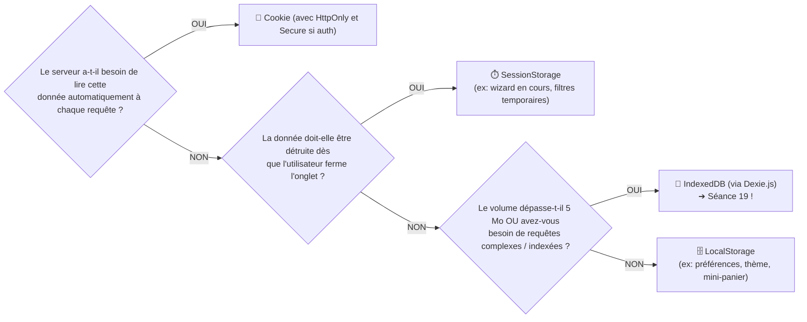
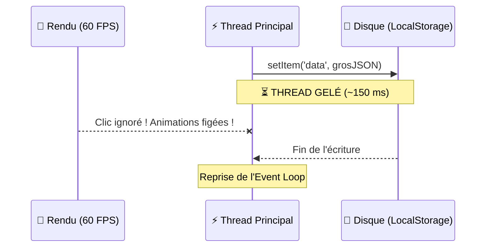
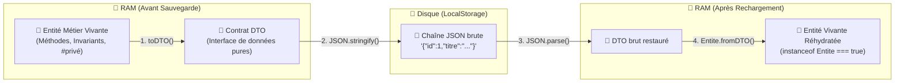

<style>
.slidev-code, .slidev-code pre { font-size: 0.72rem !important; line-height: 1.3 !important; }
.slidev-code pre { padding: 0.45rem 0.65rem !important; }
</style>

<div class="h-full flex flex-col justify-center items-center">
  <div class="inline-flex items-center gap-2 px-3.5 py-1 mb-4 text-xs font-bold rounded-full bg-blue-100 dark:bg-blue-900/40 text-blue-700 dark:text-blue-300 border-2 border-blue-300 dark:border-blue-700">
    <span class="w-2.5 h-2.5 rounded-full bg-blue-600 animate-pulse"></span>
    Programmation Orientée Objet · EAFC
  </div>

  <h1 class="text-4xl font-extrabold tracking-tight mb-3 bg-gradient-to-r from-blue-700 via-indigo-600 to-purple-700 bg-clip-text text-transparent">
    Séance 18 — Stockage Local
  </h1>

  <p class="text-base text-slate-800 dark:text-slate-100 max-w-2xl mx-auto mb-5 font-semibold">
    <code>LocalStorage</code> · <code>SessionStorage</code> · <code>Cookies</code> · Le Défi POO du Stockage Clé-Valeur
  </p>

  <div class="flex items-center justify-center gap-2 text-xs font-mono font-bold">
    <span class="px-2.5 py-1 rounded bg-slate-200 dark:bg-slate-800 text-slate-800 dark:text-slate-200 border border-slate-300 dark:border-slate-600">TypeScript 5+</span>
    <span class="px-2.5 py-1 rounded bg-slate-200 dark:bg-slate-800 text-slate-800 dark:text-slate-200 border border-slate-300 dark:border-slate-600">Angular 22</span>
    <span class="px-2.5 py-1 rounded bg-slate-200 dark:bg-slate-800 text-slate-800 dark:text-slate-200 border border-slate-300 dark:border-slate-600">Signal-First</span>
    <span class="px-2.5 py-1 rounded bg-purple-100 dark:bg-purple-900/40 text-purple-700 dark:text-purple-300 border border-purple-300 dark:border-purple-700">Bloc D · Persistance</span>
  </div>
</div>

<!--
Bienvenue à la séance 18 du cours de Programmation Orientée Objet !
Nous poursuivons le Bloc D (Persistance des données).
En S16, nous avons compris la sérialisation JSON et le drame du prototype perdu.
En S17, nous avons fait traverser le Web à nos données avec httpResource().
Aujourd'hui, nous apprenons à sauvegarder des données directement sur la machine du client,
sans dépendre du réseau : LocalStorage, SessionStorage et Cookies.
Et nous allons découvrir que ce stockage "simple" cache de vrais défis POO !
-->

---
layout: default
---

# 🎯 Objectifs pédagogiques de la séance (1/2)

<div class="grid grid-cols-2 gap-3.5 mt-4 text-xs">
  <div class="p-2.5 rounded-xl bg-slate-500/5 border border-slate-500/15 flex items-start gap-3">
    <span class="w-7 h-7 rounded-lg bg-blue-500/10 text-blue-500 flex items-center justify-center font-bold text-xs flex-shrink-0">01</span>
    <div>
      <h4 class="font-bold text-sm mb-0.5">Cartographier la Trilogie Web</h4>
      <p class="opacity-75">Distinguer <code>LocalStorage</code>, <code>SessionStorage</code> et <code>Cookies</code> : cycle de vie, portée, taille et transit réseau. Savoir choisir le bon outil selon le besoin.</p>
    </div>
  </div>

  <div class="p-2.5 rounded-xl bg-slate-500/5 border border-slate-500/15 flex items-start gap-3">
    <span class="w-7 h-7 rounded-lg bg-indigo-500/10 text-indigo-500 flex items-center justify-center font-bold text-xs flex-shrink-0">02</span>
    <div>
      <h4 class="font-bold text-sm mb-0.5">Dompter l'API <code>LocalStorage</code></h4>
      <p class="opacity-75">Manipuler <code>setItem</code>, <code>getItem</code>, <code>removeItem</code> et <code>clear</code>. Comprendre la contrainte stricte des chaînes de caractères et le coût synchrone.</p>
    </div>
  </div>

  <div class="p-2.5 rounded-xl bg-slate-500/5 border border-slate-500/15 flex items-start gap-3">
    <span class="w-7 h-7 rounded-lg bg-purple-500/10 text-purple-500 flex items-center justify-center font-bold text-xs flex-shrink-0">03</span>
    <div>
      <h4 class="font-bold text-sm mb-0.5">Résoudre le Choc POO & Sérialisation</h4>
      <p class="opacity-75">Éviter le piège fatal du <code>[object Object]</code>. Réappliquer le patron DTO et la fabrique <code>fromDTO()</code> (S16) pour ressusciter de vraies entités dotées de méthodes.</p>
    </div>
  </div>

  <div class="p-2.5 rounded-xl bg-slate-500/5 border border-slate-500/15 flex items-start gap-3">
    <span class="w-7 h-7 rounded-lg bg-rose-500/10 text-rose-500 flex items-center justify-center font-bold text-xs flex-shrink-0">04</span>
    <div>
      <h4 class="font-bold text-sm mb-0.5">Encapsuler dans un Service Angular</h4>
      <p class="opacity-75">Bannir l'accès direct au stockage dans les composants. Concevoir un service réactif <strong>Signal-First</strong> avec synchronisation inter-onglets via l'événement <code>storage</code>.</p>
    </div>
  </div>
</div>

<!--
Présentez les 4 premiers objectifs.
Rappelez aux étudiants que bien que LocalStorage paraisse simple ("clé / valeur"),
il soulève d'immenses défis de conception POO :
le typage disparaît, les prototypes s'évaporent et les invariants risquent d'être bafoués.
-->

---
layout: default
---

# 🎯 Objectifs pédagogiques de la séance (2/2)

<div class="grid grid-cols-2 gap-3.5 mt-4 text-xs">
  <div class="p-2.5 rounded-xl bg-slate-500/5 border border-slate-500/15 flex items-start gap-3">
    <span class="w-7 h-7 rounded-lg bg-amber-500/10 text-amber-500 flex items-center justify-center font-bold text-xs flex-shrink-0">05</span>
    <div>
      <h4 class="font-bold text-sm mb-0.5">Gérer les Erreurs & Synchroniser les Onglets</h4>
      <p class="opacity-75">Intercepter <code>QuotaExceededError</code> avec <code>try / catch</code> (rappel S10) et exploiter l'événement <code>storage</code> pour des onglets qui dialoguent sans serveur !</p>
    </div>
  </div>

  <div class="p-2.5 rounded-xl bg-slate-500/5 border border-slate-500/15 flex items-start gap-3">
    <span class="w-7 h-7 rounded-lg bg-emerald-500/10 text-emerald-500 flex items-center justify-center font-bold text-xs flex-shrink-0">06</span>
    <div>
      <h4 class="font-bold text-sm mb-0.5">Identifier les Limites</h4>
      <p class="opacity-75">Comprendre pourquoi LocalStorage échoue pour les applications complexes (5 Mo, blocage du thread, zéro requête). C'est le pont direct vers la Séance 19 !</p>
    </div>
  </div>
</div>

<div class="mt-4 p-3 rounded-xl bg-blue-500/10 border border-blue-500/20 text-xs">
  <div class="font-bold text-blue-700 dark:text-blue-300 mb-1 flex items-center gap-1.5">
    <span>💡</span> Le Fil Conducteur Pédagogique
  </div>
  <p class="opacity-85">
    La séance 18 est le pont entre la persistance naïve en texte brut et la vraie base de données du navigateur.
    Chaque limite de LocalStorage que nous éprouverons aujourd'hui justifiera les outils de la Séance 19 !
  </p>
</div>

<!--
Présentez ces deux derniers objectifs.
La séance ne se contente pas de montrer comment stocker une chaîne :
elle forge l'esprit critique de l'ingénieur — savoir quand LocalStorage suffit, et quand il devient dangereux.
-->

---
layout: center
class: text-center
---

<div class="inline-flex items-center gap-2 px-3 py-1 mb-3 text-xs font-mono font-semibold rounded-full bg-blue-500/10 text-blue-500 border border-blue-500/20">
  PARTIE 00
</div>

# Le Cheminement : D'où venons-nous ?
## L'Évolution du Bloc D (Persistance des Données)

<!--
Prenez 3 minutes pour replacer cette séance dans la progression d'ensemble du cursus.
Les étudiants abordent la POO pour la première fois : ils ont besoin de repères constants.
-->

---
layout: default
---

# La progression pédagogique du cursus POO

<div class="grid grid-cols-12 gap-2 mt-2 text-xs">
  <div class="col-span-3 p-2.5 rounded-xl bg-slate-500/5 border border-slate-500/15">
    <div class="font-mono font-bold text-blue-500 mb-1">BLOC A (S5 à S9)</div>
    <h3 class="font-bold mb-1">Fondamentaux POO</h3>
    <ul class="opacity-80 space-y-0.5 text-[10px]">
      <li>Encapsulation & invariants (S5)</li>
      <li>Héritage & spécialisation (S6)</li>
      <li>Polymorphisme dynamique (S7)</li>
      <li>Abstraction & contrats purs (S8)</li>
      <li>Composition vs héritage (S9)</li>
    </ul>
    <div class="mt-2 px-1.5 py-0.5 rounded bg-blue-500/10 text-blue-600 dark:text-blue-400 font-semibold text-center text-[10px]">
      Architecture & Objets
    </div>
  </div>

  <div class="col-span-3 p-2.5 rounded-xl bg-slate-500/5 border border-slate-500/15">
    <div class="font-mono font-bold text-indigo-500 mb-1">BLOC B (S10 à S12)</div>
    <h3 class="font-bold mb-1">Conception & Qualité</h3>
    <ul class="opacity-80 space-y-0.5 text-[10px]">
      <li>Exceptions & robustesse (S10)</li>
      <li>Principes SOLID (S, O, D) (S11)</li>
      <li>Identité, égalité & clonage (S12)</li>
    </ul>
    <div class="mt-2 px-1.5 py-0.5 rounded bg-indigo-500/10 text-indigo-600 dark:text-indigo-400 font-semibold text-center text-[10px]">
      Règles & Fiabilité
    </div>
  </div>

  <div class="col-span-3 p-2.5 rounded-xl bg-slate-500/5 border border-slate-500/15">
    <div class="font-mono font-bold text-purple-500 mb-1">BLOC C (S13 à S15)</div>
    <h3 class="font-bold mb-1">Angular Signal-First</h3>
    <ul class="opacity-80 space-y-0.5 text-[10px]">
      <li>Composants & Signals réactifs (S13)</li>
      <li>Services & Injection (DI) (S14)</li>
      <li>Signal Forms & Routing SPA (S15)</li>
    </ul>
    <div class="mt-2 px-1.5 py-0.5 rounded bg-purple-500/10 text-purple-600 dark:text-purple-400 font-semibold text-center text-[10px]">
      Réactivité & UI
    </div>
  </div>

  <div class="col-span-3 p-2.5 rounded-xl bg-amber-500/10 border-2 border-amber-500/40">
    <div class="font-mono font-bold text-amber-500 mb-1">BLOC D (S16 à S19)</div>
    <h3 class="font-bold mb-1">Persistance Données</h3>
    <ul class="opacity-80 space-y-0.5 text-[10px]">
      <li>Sérialisation & DTO (S16)</li>
      <li>Consommer une API REST (S17)</li>
      <li class="font-bold text-amber-600 dark:text-amber-300">👉 Stockage Local (S18)</li>
      <li>IndexedDB & Dexie.js (S19)</li>
    </ul>
    <div class="mt-2 px-1.5 py-0.5 rounded bg-amber-500/20 text-amber-700 dark:text-amber-300 font-bold text-center text-[10px]">
      Nous sommes ici !
    </div>
  </div>
</div>

<div class="mt-4 p-3 rounded-xl bg-amber-500/10 border border-amber-500/20 text-xs">
  <div class="font-bold text-amber-700 dark:text-amber-300 mb-1 flex items-center gap-1.5">
    <span>💡</span> La continuité logique du Bloc D
  </div>
  <p class="opacity-85">
    En S16, nous avons découvert le format JSON et le patron DTO. En S17, nous avons dialogué avec un serveur distant via <code>httpResource()</code>.
    Aujourd'hui en S18, nous ancrons nos objets sur le disque du navigateur lui-même — sans serveur, sans réseau, même hors ligne !
  </p>
</div>

<!--
Rappelez la cohérence pédagogique :
S16 : sérialisation JSON locale et pattern DTO / fromDTO.
S17 : JSON à travers le Web avec httpResource().
S18 : aujourd'hui, nous stockons ces objets sur le disque du navigateur lui-même.
-->

---
layout: default
---

# La Grande Question de la Séance 18

<div class="grid grid-cols-12 gap-4 mt-3 text-xs items-start">
  <div class="col-span-6 p-3 rounded-xl bg-rose-500/10 border border-rose-500/20 space-y-2">
  <div class="font-bold text-rose-600 dark:text-rose-400 text-sm flex items-center gap-1.5">
  <span>🛑</span> Le Double Problème
  </div>
  <p>
  <strong>1. La Mémoire Vive (RAM) s'évapore :</strong><br/>
      Dès que l'utilisateur appuie sur <kbd>F5</kbd> ou ferme son onglet, toutes les instances de classes créées en mémoire vive sont <strong>définitivement détruites</strong>.
  </p>
  <p>
  <strong>2. Le Réseau distant est trop lourd :</strong><br/>
      Faire un appel HTTP vers un serveur pour mémoriser le choix du thème sombre ou la langue préférée est lent, coûteux, et <strong>ne fonctionne pas hors ligne</strong> !
  </p>
  </div>

  <div class="col-span-6 p-3 rounded-xl bg-emerald-500/10 border border-emerald-500/20 space-y-2">
  <div class="font-bold text-emerald-600 dark:text-emerald-400 text-sm flex items-center gap-1.5">
  <span>✨</span> La Solution Locale
  </div>
  <p>
      Les navigateurs modernes intègrent des espaces de stockage persistants directement sur le disque dur du client :
      <strong>Cookies</strong>, <strong>SessionStorage</strong> et <strong>LocalStorage</strong>.
  </p>
  <p>
  <strong>Mais attention :</strong> aucun de ces stockages ne sait manipuler d'objets TypeScript vivants !
      Ils ne stockent que des <strong>chaînes de caractères brutes</strong>.
  </p>
  </div>
</div>

<div class="mt-4 p-3 rounded-xl bg-purple-500/10 border border-purple-500/20 text-center text-xs font-semibold">
  🎯 Le Défi du Jour : Comment faire cohabiter nos objets vivants (méthodes, invariants, encapsulation) avec des stockages qui ne connaissent que du texte brut ?
</div>

<!--
Posez la question à la classe :
"Quand vous fermez votre navigateur et que vous revenez le lendemain sur un site, comment se souvient-il que vous aviez activé le mode sombre ou un article dans votre panier ?"
Laissez-les proposer : cookies ? base de données ? localStorage ?
C'est exactement l'objet de notre première partie !
-->

---
layout: center
class: text-center
---

<div class="inline-flex items-center gap-2 px-3 py-1 mb-3 text-xs font-mono font-semibold rounded-full bg-blue-500/10 text-blue-500 border border-blue-500/20">
  PARTIE 01
</div>

# La Trilogie du Stockage Web
## LocalStorage, SessionStorage & Cookies

<p class="opacity-70 text-sm max-w-xl mx-auto">
  Distinguer les trois espaces de stockage du navigateur, comprendre leur cycle de vie et choisir le bon outil selon le besoin métier.
</p>

<!--
Partie 1 : Posons les bases conceptuelles.
Beaucoup de développeurs juniors confondent cookie et localStorage,
ou ne savent pas quand utiliser sessionStorage.
Nous allons leur donner une grille de lecture limpide et mémorable.
-->

---
layout: default
---

# L'Analogie Pédagogique : Les 3 Tiroirs du Navigateur

Pour ne plus jamais les confondre, visualisez ces trois espaces comme trois rangements du quotidien :

<div class="grid grid-cols-3 gap-3 mt-4 text-xs">
  <div class="p-3 rounded-xl bg-amber-500/10 border border-amber-500/20 flex flex-col justify-between">
  <div>
  <div class="text-2xl mb-2 text-center">🍪</div>
  <h4 class="font-bold text-amber-700 dark:text-amber-300 text-sm mb-1 text-center">Le Cookie</h4>
  <div class="font-mono text-center text-[10px] opacity-75 mb-2">Le Badge Visiteur</div>
  <p class="opacity-85 text-[11px] leading-relaxed">
        Minuscule étiquette accrochée à votre col. À chaque porte franchie (chaque requête HTTP), le gardien du serveur regarde votre badge.
  </p>
  </div>
  <div class="mt-2 pt-2 border-t border-amber-500/20 text-[10px] font-semibold text-amber-800 dark:text-amber-200">
      ~4 Ko · Voyage sur le réseau à chaque requête
  </div>
  </div>

  <div class="p-3 rounded-xl bg-indigo-500/10 border border-indigo-500/20 flex flex-col justify-between">
  <div>
  <div class="text-2xl mb-2 text-center">⏱️</div>
  <h4 class="font-bold text-indigo-700 dark:text-indigo-300 text-sm mb-1 text-center">SessionStorage</h4>
  <div class="font-mono text-center text-[10px] opacity-75 mb-2">Le Casier de la Piscine</div>
  <p class="opacity-85 text-[11px] leading-relaxed">
        Vous y déposez vos affaires pendant votre séance. Vous pouvez plonger et ressortir (<kbd>F5</kbd>), vos affaires sont là. Mais dès que vous quittez la piscine (fermeture de l'onglet), le casier est vidé !
  </p>
  </div>
  <div class="mt-2 pt-2 border-t border-indigo-500/20 text-[10px] font-semibold text-indigo-800 dark:text-indigo-200">
      ~5 Mo · Isolé par onglet · Meurt à la fermeture
  </div>
  </div>

  <div class="p-3 rounded-xl bg-emerald-500/10 border border-emerald-500/20 flex flex-col justify-between">
  <div>
  <div class="text-2xl mb-2 text-center">🗄️</div>
  <h4 class="font-bold text-emerald-700 dark:text-emerald-300 text-sm mb-1 text-center">LocalStorage</h4>
  <div class="font-mono text-center text-[10px] opacity-75 mb-2">Le Coffre à la Maison</div>
  <p class="opacity-85 text-[11px] leading-relaxed">
        Installé dans votre salon. Même si vous partez en vacances 6 mois ou redémarrez votre PC, vos objets restent sagement dans le coffre jusqu'à ce que vous décidiez de faire le ménage.
  </p>
  </div>
  <div class="mt-2 pt-2 border-t border-emerald-500/20 text-[10px] font-semibold text-emerald-800 dark:text-emerald-200">
      ~5-10 Mo · Partagé par tout le domaine · Éternel
  </div>
  </div>
</div>

<!--
Cette analogie est extrêmement efficace auprès des étudiants :
- Le cookie = le badge qu'on montre au serveur à chaque voyage.
- Le casier = lié à la présence physique dans l'onglet.
- Le coffre = persistance longue durée sur le disque local.
-->

---
layout: default
---

# Les Cookies : L'Ancêtre du Web & Sa Véritable Mission

Inventés en 1994 par Netscape pour donner de la mémoire au protocole HTTP (qui est *stateless*) :

<div class="grid grid-cols-12 gap-3 mt-2 text-xs items-start">
  <div class="col-span-6 p-3 rounded-xl bg-slate-500/5 border border-slate-500/15 space-y-2">
  <h4 class="font-bold text-sm text-blue-600 dark:text-blue-400">🔍 Fonctionnement Technique</h4>
  <ul class="list-disc list-inside space-y-1.5 opacity-85">
  <li>Le serveur envoie un en-tête HTTP : <code>Set-Cookie: session_id=xyz789; HttpOnly; Secure</code>.</li>
  <li>À <strong>chaque future requête HTTP</strong> vers ce domaine, le navigateur renvoie automatiquement : <code>Cookie: session_id=xyz789</code>.</li>
  <li>Taille maximale dérisoire : <strong>4 Ko par cookie</strong>.</li>
  </ul>
  </div>

  <div class="col-span-6 p-3 rounded-xl bg-rose-500/10 border border-rose-500/20 space-y-2">
  <h4 class="font-bold text-sm text-rose-600 dark:text-rose-400">🛡️ Attributs de Sécurité Essentiels</h4>
  <div>
  <strong>• <code>HttpOnly</code> :</strong> Interdit à JavaScript d'accéder au cookie. Protection contre le vol de session par faille <strong>XSS</strong>.
  </div>
  <div>
  <strong>• <code>Secure</code> :</strong> Le cookie n'est envoyé qu'en <strong>HTTPS</strong>.
  </div>
  <div>
  <strong>• <code>SameSite=Strict|Lax</code> :</strong> Empêche l'envoi du cookie depuis un site tiers (protection <strong>CSRF</strong>).
  </div>
  </div>
</div>

<div class="mt-3 p-2.5 rounded-xl bg-amber-500/10 border border-amber-500/20 text-xs">
  ⚠️ <strong>Règle d'or :</strong> Ne stockez <strong>JAMAIS</strong> de données applicatives (panier, objets métier) dans des cookies ! Renvoyés à chaque requête, ils ralentissent chaque aller-retour HTTP. Les cookies sont réservés aux jetons d'authentification et identifiants de session serveur.
</div>

<!--
Insistez lourdement : les étudiants appellent "cookie" tout ce qui est sauvegardé dans le navigateur.
Faites-leur comprendre le coût réseau : 4 Ko dans les cookies = 4 Ko ajoutés à CHAQUE requête (images, CSS, appels API) !
-->

---
layout: default
---

# SessionStorage vs LocalStorage : Deux Sœurs, Deux Caractères

Introduits avec HTML5, ils partagent la **même API** (`setItem`, `getItem`...), mais pas le même cycle de vie :

<div class="grid grid-cols-12 gap-3 mt-2 text-xs items-start">
  <div class="col-span-6">
  <div class="p-3 rounded-xl bg-indigo-500/10 border border-indigo-500/20 space-y-2">
  <h4 class="font-bold text-sm text-indigo-600 dark:text-indigo-400">⏱️ SessionStorage : éphémère et isolé</h4>
  <ul class="list-disc list-inside space-y-1.5 opacity-85">
  <li><strong>Vit et meurt avec l'onglet :</strong> survit à <kbd>F5</kbd>, détruit à la fermeture de l'onglet.</li>
  <li><strong>Isolation totale :</strong> deux onglets sur le même site ont chacun leur casier hermétique.</li>
  <li><strong>Cas d'usage :</strong> wizard multi-étapes, filtres de recherche temporaires, état de navigation.</li>
  </ul>
  </div>
  </div>

  <div class="col-span-6">
  <div class="p-3 rounded-xl bg-emerald-500/10 border border-emerald-500/20 space-y-2">
  <h4 class="font-bold text-sm text-emerald-600 dark:text-emerald-400">🗄️ LocalStorage : durable et partagé</h4>
  <ul class="list-disc list-inside space-y-1.5 opacity-85">
  <li><strong>Persistance illimitée :</strong> survit à la fermeture du navigateur et au redémarrage du PC !</li>
  <li><strong>Partagé par tout le domaine :</strong> tous les onglets de la même origine voient les mêmes données en temps réel.</li>
  <li><strong>Cas d'usage :</strong> thème sombre, langue, panier léger, brouillons.</li>
  </ul>
  </div>
  </div>
</div>

<div class="mt-3 p-2.5 rounded-xl bg-amber-500/10 border border-amber-500/20 text-xs">
  ⚠️ <strong>Le piège du dev local :</strong> le stockage est cloisonné par origine stricte (<strong>Protocole + Domaine + Port</strong>). <code>http://localhost:4200</code> et <code>http://localhost:3000</code> ont deux LocalStorage <strong>distincts</strong> !
</div>

<!--
Expliquez l'isolation de sessionStorage :
"Sur un site de billetterie, si vous ouvrez 2 onglets pour réserver deux places différentes : avec sessionStorage, les deux onglets ne se marchent pas sur les pieds !"
Et montrez le piège du port 4200 vs 4201 en dev local.
-->

---
layout: default
---

# Tableau Comparatif Exhaustif : Cookies vs Session vs LocalStorage

<div class="mt-2 text-xs">

| Caractéristique clé | 🍪 Cookies | ⏱️ SessionStorage | 🗄️ LocalStorage |
| :--- | :--- | :--- | :--- |
| **Capacité maximale** | ~**4 Ko** par cookie | ~**5 Mo** par origine | ~**5 à 10 Mo** par origine |
| **Durée de vie** | Définie par `Expires` / `Max-Age` | Fermeture de l'onglet | **Permanente** (jusqu'à suppression) |
| **Portée (Scope)** | Tout le domaine configuré | **L'onglet unique** en cours | **Tous les onglets** de la même origine |
| **Transit réseau HTTP** | **Automatique** à chaque requête | **Jamais** (100% client) | **Jamais** (100% client) |
| **Accès JavaScript** | Oui (sauf `HttpOnly`) | Oui (`window.sessionStorage`) | Oui (`window.localStorage`) |
| **Performances** | Ralentit le réseau si surchargé | Lecture synchrone en mémoire | Lecture synchrone depuis le disque |
| **Cas d'usage type** | Jetons de session, auth sécurisée | Wizards, filtres éphémères | Thème UI, préférences, mini-panier |

</div>

<div class="mt-3 p-2.5 rounded-xl bg-blue-500/10 border border-blue-500/20 text-xs text-center font-semibold text-blue-800 dark:text-blue-200">
  💡 Retenez la règle simple : Authentification avec le serveur ➔ Cookies `HttpOnly`. Stockage client durable ➔ LocalStorage. Tâche isolée à un seul onglet ➔ SessionStorage.
</div>

<!--
Prenez 2 minutes pour commenter ce tableau ligne par ligne.
C'est une question classique d'entretien d'embauche web et une synthèse indispensable pour leur examen.
-->

---
layout: default
---

# Grille d'Arbitrage : Quel Stockage Choisir ?

Face à un besoin de stockage dans votre application Angular, suivez cet arbre de décision :



<!--
Faites cheminer les étudiants sur des exemples concrets :
- "Où stocke-t-on le jeton d'authentification ?" -> Cookie HttpOnly (recommandé contre le XSS).
- "Où stocke-t-on le choix de la langue 'Français' ?" -> LocalStorage !
- "Où stocke-t-on 10 000 pièces automobiles avec recherche par référence ?" -> IndexedDB / Dexie.js (séance 19 !)
-->

---
layout: center
class: text-center
---

<div class="inline-flex items-center gap-2 px-3 py-1 mb-3 text-xs font-mono font-semibold rounded-full bg-blue-500/10 text-blue-500 border border-blue-500/20">
  PARTIE 02
</div>

# Plongée Technique dans `LocalStorage`
## L'API Web Storage, les Pièges & l'Event Loop

<p class="opacity-70 text-sm max-w-xl mx-auto">
  Manipuler l'API native en TypeScript, comprendre ses pièges de typage et maîtriser les erreurs et les événements.
</p>

<!--
Partie 2 : Place au code.
Nous détaillons l'API native de LocalStorage, mettons en garde contre les pièges de typage,
et étudions comment intercepter les erreurs de quota.
-->

---
layout: default
---

# L'Interface `Storage` : Les 6 Méthodes Natives

En TypeScript, l'objet global `window.localStorage` implémente l'interface standard `Storage` :

<div class="grid grid-cols-12 gap-3 mt-2 text-xs items-start">
  <div class="col-span-7">

```typescript
// 1. Écrire une valeur associée à une clé
localStorage.setItem('theme', 'sombre');

// 2. Lire une valeur (renvoie string | null)
const theme: string | null = localStorage.getItem('theme'); // 'sombre'
const inconnu: string | null = localStorage.getItem('inexistant'); // null !

// 3. Supprimer une clé précise
localStorage.removeItem('theme');

// 4. Vider intégralement tout le stockage du domaine !
localStorage.clear();

// 5. Connaître le nombre d'éléments enregistrés
const total: number = localStorage.length;

// 6. Inspecter la clé située à l'index n
const nomCle: string | null = localStorage.key(0);
```

  </div>

  <div class="col-span-5 space-y-2">
  <div class="p-3 rounded-xl bg-blue-500/10 border border-blue-500/20">
  <strong class="text-blue-600 dark:text-blue-400">💡 Les Subtilités à Connaître :</strong>
  <ul class="list-disc list-inside mt-1.5 space-y-1 opacity-85 text-[11px]">
  <li>Si une clé existe déjà, <code>setItem()</code> <strong>écrase silencieusement</strong> l'ancienne valeur.</li>
  <li>Si une clé n'existe pas, <code>getItem()</code> renvoie <code>null</code> (et <strong>jamais</strong> <code>undefined</code>).</li>
  <li><code>clear()</code> vide <strong>TOUT</strong> le domaine, y compris les clés d'autres services ! À manipuler avec prudence.</li>
  </ul>
  </div>
  </div>
</div>


<!--
Soulignez bien le retour `null` :
En TypeScript strict, le type de retour est `string | null`.
Il faudra donc toujours vérifier la présence de la valeur avant de l'exploiter.
-->

<style>
  pre code {
    font-size: 12px !important;
  }
</style>

---
layout: default
---

# Attention : Tout est Chaîne de Caractères !

<div class="grid grid-cols-12 gap-3 mt-2 text-xs items-start">
  <div class="col-span-6  space-y-2">
  <div class="font-bold text-rose-600 dark:text-rose-400 text-sm">❌ Le Code Naïf & Le Bug Invisible</div>

```typescript
localStorage.setItem('estConnecte', false as any);
localStorage.setItem('tentatives', 0 as any);

// À la lecture :
const estCo = localStorage.getItem('estConnecte');
// estCo vaut la CHAÎNE "false" !

if (estCo) {
  // 💣 CATASTROPHE ! En JS, toute
  // chaîne non vide est TRUTHY !
  console.log('Connecté !'); // S'exécute TOUJOURS !
}

const nb = localStorage.getItem('tentatives'); // "0"
const total = nb + 1; // "01" (concaténation !)
```

  </div>

  <div class="col-span-6 space-y-2">
  <div class="font-bold text-emerald-600 dark:text-emerald-400 text-sm">✅ La Conversion Explicite Obligatoire</div>

```typescript
// Sérialiser puis convertir rigoureusement :
const estConnecte = false;
localStorage.setItem('estConnecte', JSON.stringify(estConnecte));

// Lecture avec conversion booléenne réelle :
const brut = localStorage.getItem('estConnecte');
const estCoReel: boolean = brut !== null ? JSON.parse(brut) : false;

if (estCoReel) {
  console.log('Ne sera PAS affiché ✅');
}

// Pour un nombre :
const score = Number(localStorage.getItem('tentatives') ?? 0);
const scoreExact = score + 1; // 1 ✅
```

  </div>
</div>

<!--
Faites rire les étudiants avec le test `if ("false")` :
En JavaScript, Boolean("false") === true !
Parce qu'une chaîne de 5 caractères n'est pas une chaîne vide.
Le typage fort de TypeScript et la rigueur sont indispensables ici.
-->

<style>
  pre code {
    font-size: 10px !important;
  }
</style>

---
layout: default
---

# La Réalité Physique : Un Stockage Synchrone et Bloquant

Rappelez-vous la Séance 17 : le navigateur exécute notre code sur un **thread unique** (l'Event Loop) :

<div class="grid grid-cols-12 gap-4 mt-2 text-xs items-start">
  <div class="col-span-6 space-y-2">
  <div class="p-3 rounded-xl bg-amber-500/10 border border-amber-500/20 space-y-2">
  <h4 class="font-bold text-amber-700 dark:text-amber-300 text-sm">🐌 LocalStorage est 100% Synchrone</h4>
  <p class="opacity-85">
        Contrairement à <code>fetch()</code> qui est asynchrone, chaque appel à <code>setItem()</code> ou <code>getItem()</code> <strong>bloque immédiatement le thread principal</strong> pendant la lecture ou l'écriture disque !
  </p>
  <ul class="list-disc list-inside space-y-1 text-rose-600 dark:text-rose-400 font-semibold">
  <li>L'écran freeze et ne répond plus aux clics.</li>
  <li>Les animations CSS chutent à 0 image par seconde.</li>
  <li>L'utilisateur ressent un violent ralentissement.</li>
  </ul>
  </div>
  </div>

  <div class="col-span-6">
  <div class="p-3 rounded-xl bg-slate-500/5 border border-slate-500/15">


</div>
</div>
</div>

<!--
Expliquez cette différence cruciale avec le réseau :
Le réseau est lent mais asynchrone (l'Event Loop continue de tourner).
LocalStorage est local mais SYNCHRONE (l'Event Loop attend le disque).
C'est pourquoi on n'y stocke que de petites quantités de données.
-->

---
layout: default
---

# Gestion du Quota : `QuotaExceededError`

Que se passe-t-il si votre application tente d'écrire alors que les 5 Mo sont pleins ?

<div class="grid grid-cols-12 gap-3 mt-2 text-xs items-start">
  <div class="col-span-4 p-3 rounded-xl bg-rose-500/10 border border-rose-500/20 space-y-2">
  <div class="font-bold text-rose-600 dark:text-rose-400 text-sm">🛑 Le Crash Non Géré</div>
  <p class="opacity-85">
      Le navigateur lève une exception native <code>DOMException</code> nommée <code>QuotaExceededError</code>.
      Si vous ne l'interceptez pas, l'application Angular plante brutalement !
  </p>
  <div class="font-mono text-[10px] p-2 bg-slate-900 text-rose-400 rounded">
      Uncaught DOMException: Failed to execute 'setItem' on 'Storage': ... exceeded the quota.
  </div>
  </div>

  <div class="col-span-8 p-3 rounded-xl bg-emerald-500/10 border border-emerald-500/20 space-y-2">
  <div class="font-bold text-emerald-600 dark:text-emerald-400 text-sm">🛡️ La Protection POO : `try / catch` (Rappel S10)</div>

```typescript
export function sauvegarderSecurise(cle: string, valeur: string): boolean {
  try {
    localStorage.setItem(cle, valeur);
    return true;
  } catch (erreur) {
    if (erreur instanceof DOMException &&
       (erreur.name === 'QuotaExceededError' || erreur.code === 22)) {
      console.error(`[Storage] Quota dépassé pour ${cle} !`);
      // Stratégie de repli : purger, notifier...
    } else {
      console.error('[Storage] Stockage indisponible (navigation privée ?)');
    }
    return false;
  }
}
```

  </div>
</div>

<!--
Rappel de la Séance 10 (Exceptions en POO) :
on vérifie le type de l'exception avec `instanceof DOMException`
et on implémente une stratégie de repli gracieuse.
La théorie de S10 prend tout son sens ici !
-->

<style>
  pre code {
    font-size: 10px !important;
  }
</style>

---
layout: default
---

# L'Événement `storage` : Synchronisation Magique Inter-Onglets

Saviez-vous que deux onglets ouverts sur votre application peuvent dialoguer grâce à `localStorage` ?

<div class="grid grid-cols-12 gap-3 mt-2 text-xs items-start">
  <div class="col-span-7">

```typescript
// Écoute des mutations effectuées par les AUTRES onglets :
window.addEventListener('storage', (event: StorageEvent) => {
  console.log(`Clé modifiée : ${event.key}`);
  console.log(`Nouvelle valeur : ${event.newValue}`);

  if (event.key === 'panier_nb_articles') {
    // Mettre à jour immédiatement le badge du panier ici !
  }
});
```

  </div>

  <div class="col-span-5 space-y-2">
  <div class="p-3 rounded-xl bg-indigo-500/10 border border-indigo-500/20">
  <h4 class="font-bold text-indigo-700 dark:text-indigo-300 text-sm mb-1">⚡ Règle Cruciale à Retenir :</h4>
  <p class="opacity-85 text-[11px] leading-relaxed">
        L'événement <code>storage</code> ne se déclenche <strong>QUE dans les autres onglets</strong> ouverts sur la même origine, et <strong>JAMAIS</strong> dans l'onglet qui a exécuté le <code>setItem()</code> !
  </p>
  <div class="mt-2 p-1.5 rounded bg-white dark:bg-slate-800 border border-indigo-300 dark:border-indigo-700 text-[10px] font-semibold text-indigo-800 dark:text-indigo-200">
        ✨ Le moyen le plus simple du Web pour créer une application multi-écrans réactive, sans WebSocket ni serveur !
  </div>
  </div>
  </div>
</div>

<!--
Faites une démonstration mentale :
"Vous avez ouvert un site de e-commerce dans l'onglet A et dans l'onglet B.
Dans l'onglet A, vous ajoutez un livre au panier.
Magie : dans l'onglet B, le badge du panier passe instantanément à 1 sans recharger la page !"
Nous implémenterons ce mécanisme dans la démo de la séance.
-->

<style>
  pre code {
    font-size: 11px !important;
  }
</style>

---
layout: center
class: text-center
---

<div class="inline-flex items-center gap-2 px-3 py-1 mb-3 text-xs font-mono font-semibold rounded-full bg-blue-500/10 text-blue-500 border border-blue-500/20">
  PARTIE 03
</div>

# Le Choc POO & LocalStorage
## Du Texte Brut Inerte aux Entités Métier Vivantes

<p class="opacity-70 text-sm max-w-xl mx-auto">
  Comprendre pourquoi LocalStorage détruit vos objets, comment ressusciter leurs méthodes et invariants, et concevoir un Service Angular réactif.
</p>

<!--
Partie 3 : Le cœur de notre sujet POO !
Ici, nous connectons les fondamentaux de la POO (encapsulation, invariants, méthodes, prototypes)
avec les contraintes de LocalStorage.
-->

---
layout: default
---

# Le Piège : `[object Object]` !

Voyons ce qui se passe lorsqu'un développeur tente de sauvegarder une instance de classe :

<div class="grid grid-cols-12 gap-3 mt-2 text-xs items-start">
  <div class="col-span-6 p-3 rounded-xl bg-rose-500/10 border border-rose-500/20 space-y-2">
  <div class="font-bold text-rose-600 dark:text-rose-400 text-sm">💻 Le Code Naïf</div>

```typescript
class ArticlePanier {
  constructor(
    public readonly nom: string,
    public readonly prix: number
  ) {}
}

const article = new ArticlePanier('Clavier mécanique', 89);

// L'erreur : passer l'objet directement
localStorage.setItem('mon_article', article as any);
```

  </div>

  <div class="col-span-6 p-3 rounded-xl bg-slate-500/5 border border-slate-500/15 space-y-2">
  <div class="font-bold text-slate-700 dark:text-slate-300 text-sm">👀 Ce qui est réellement enregistré sur disque</div>

```text
Clé : "mon_article"
Valeur : "[object Object]"
```

  <div class="p-2.5 rounded bg-rose-500/10 border border-rose-500/20 text-rose-700 dark:text-rose-300 text-[11px] leading-relaxed">
  <strong>💥 Pourquoi cette catastrophe ?</strong><br/>
      <code>localStorage</code> n'accepte QUE des chaînes : JavaScript appelle automatiquement <code>article.toString()</code>.
      Toutes vos données (nom, prix) sont irrémédiablement perdues, remplacées par la chaîne inutile <code>"[object Object]"</code> !
  </div>
  </div>
</div>

<!--
Demandez aux étudiants :
"Combien d'entre vous ont déjà vu [object Object] s'afficher sur une page web ?"
Tout le monde lèvera la main !
Expliquez la cause mécanique : la conversion implicite en string via Object.prototype.toString().
-->

<style>
  pre code {
    font-size: 10px !important;
  }
</style>

---
layout: default
---

# `JSON.parse` : Le Drame du Prototype Perdu


<div class="grid grid-cols-12 gap-3 mt-0 text-xs items-start">
  <div class="col-span-7 space-y-2">
  <div class="font-bold text-amber-700 dark:text-amber-300 text-sm">Le Code avec Cast TypeScript Naïf</div>

```typescript
class CompteBancaire {
  #solde: number; // Propriété privée encapsulée

  constructor(soldeInitial: number) {
    if (soldeInitial < 0) throw new Error('Solde négatif interdit');
    this.#solde = soldeInitial;
  }

  get solde(): number { return this.#solde; }
  retirer(montant: number): void { this.#solde -= montant; }
}

// 1. Sauvegarde en JSON
const compte = new CompteBancaire(100);
localStorage.setItem('compte', JSON.stringify(compte));

// 2. Rechargement avec cast mensonger
const recup = JSON.parse(localStorage.getItem('compte')!) as CompteBancaire;
```

  </div>

  <div class="col-span-5 space-y-2">
  <div class="font-bold text-rose-600 dark:text-rose-400 text-sm">Le Réveil Brutal au Premier Appel !</div>

```typescript
console.log(recup instanceof CompteBancaire);
// 👉 false ❌ ! Ce n'est PAS un CompteBancaire !

recup.retirer(50);
// 💥 TypeError: recup.retirer is not a function !
```

  <div class="p-2 rounded bg-slate-900 text-slate-100 text-[10px] font-mono">
      JSON.parse produit un objet littéral générique (Object.prototype).
      Toutes vos méthodes métier, vos champs privés (#) et vos getters ont disparu !
  </div>
  </div>
</div>

<!--
Rappelez avec force le "Drame du prototype perdu" de la Séance 16 :
Le cast `as CompteBancaire` n'est qu'une illusion d'optique pour rassurer le compilateur TypeScript.
Au runtime, JavaScript ne connaît aucun type et constate que l'objet n'a aucune méthode `retirer` !
-->

<style>
  pre code {
    font-size: 10px !important;
  }
</style>

---
layout: default
---

# La Triade Architecturale : DTO, Entité Métier & Fabrique

Nous déployons la même rigueur qu'en Séance 16 et 17 :

<div class="mt-2">



</div>

<div class="grid grid-cols-3 gap-2 mt-2 text-xs">
  <div class="p-2 rounded-xl bg-blue-500/10 border border-blue-500/20 text-center">
    <strong>1. Le Contrat DTO :</strong> Décrit exactement la structure sérialisée stockée en chaîne JSON.
  </div>
  <div class="p-2 rounded-xl bg-purple-500/10 border border-purple-500/20 text-center">
    <strong>2. La Méthode `toDTO()` :</strong> L'entité extrait ses données publiques propres à être stockées.
  </div>
  <div class="p-2 rounded-xl bg-emerald-500/10 border border-emerald-500/20 text-center">
    <strong>3. La Fabrique `fromDTO()` :</strong> Réinstancie la classe avec <code>new</code> et revalide tous les invariants !
  </div>
</div>

<!--
Cette slide ancre l'apprentissage :
Le pattern toDTO / fromDTO est universel :
qu'on échange des données avec un serveur distant (S17) ou avec le disque dur local (S18),
l'architecture POO reste strictement identique et protectrice !
-->

---
layout: default
---

## Code Modèle : Le Contrat DTO et la Classe Métier Robuste

<div class="grid grid-cols-12 gap-3 mt-1 text-xs items-start">
  <div class="col-span-5">

```typescript
// models/tache.dto.ts
export interface TacheDTO {
  readonly id: string;
  readonly titre: string;
  readonly dateCreationISO: string;
  readonly priorite: 'basse' | 'moyenne' | 'haute';
  readonly terminee: boolean;
}
```

  </div>

  <div class="col-span-7">

```typescript {maxHeight:'380px'}
// models/tache.entity.ts
export class Tache {
  readonly #id: string;
  readonly #titre: string;
  readonly #dateCreation: Date;
  #priorite: 'basse' | 'moyenne' | 'haute';
  #terminee: boolean;

  constructor(id: string, titre: string, date: Date,
              priorite: 'basse'|'moyenne'|'haute', terminee = false) {
    if (!id?.trim()) throw new Error('ID obligatoire');
    if (!titre || titre.trim().length < 3) throw new Error('Titre trop court');
    this.#id = id;
    this.#titre = titre.trim();
    this.#dateCreation = date;
    this.#priorite = priorite;
    this.#terminee = terminee;
  }

  get id(): string { return this.#id; }
  get titre(): string { return this.#titre; }
  get dateCreation(): Date { return this.#dateCreation; }
  get isTerminee(): boolean { return this.#terminee; }

  // Méthode métier
  isUrgente(): boolean {
    return this.#priorite === 'haute' && !this.#terminee;
  }

  // Export vers DTO inerte
  toDTO(): TacheDTO {
    return {
      id: this.#id,
      titre: this.#titre,
      dateCreationISO: this.#dateCreation.toISOString(),
      priorite: this.#priorite,
      terminee: this.#terminee
    };
  }

  // Fabrique de réhydratation
  static fromDTO(dto: TacheDTO): Tache {
    return new Tache(dto.id, dto.titre,
      new Date(dto.dateCreationISO), dto.priorite, dto.terminee);
  }
}
```

  </div>
</div>

<!--
Observez la ligne de `fromDTO()` : `new Date(dto.dateCreationISO)`.
En JSON, une Date devient une string ISO.
C'est NOTRE fabrique qui reconstruit un vrai objet Date avec toutes ses méthodes !
Le constructeur est rappelé à la lecture : les invariants sont donc TOUJOURS revalidés !
-->

<style>
  pre code {
    font-size: 10px !important;
  }
</style>


---
layout: default
---

# L'Encapsulation dans un Service Angular : Le Pattern Repository

Ne laissez **jamais** un composant Angular appeler directement `localStorage` !

<div class="grid grid-cols-12 gap-3 mt-2 text-xs items-start">
  <div class="col-span-6 space-y-2">
  <div class="p-3 rounded-xl bg-rose-500/10 border border-rose-500/20">
  <h4 class="font-bold text-rose-600 dark:text-rose-400 mb-1">❌ Pourquoi l'accès direct en composant est une faute :</h4>
  <ul class="list-disc list-inside space-y-1 opacity-85 text-[11px]">
  <li><strong>Violation du SRP (S11) :</strong> le composant gère la vue, pas les spécificités du disque dur.</li>
  <li><strong>Testabilité impossible (S21) :</strong> on ne peut pas tester le composant sans mocker le navigateur entier.</li>
  <li><strong>Crash SSR immédiat :</strong> en Server-Side Rendering, <code>window.localStorage</code> n'existe pas sur le serveur Node.js !</li>
  </ul>
  </div>
  </div>

  <div class="col-span-6 space-y-2">
  <div class="p-3 rounded-xl bg-emerald-500/10 border border-emerald-500/20">
  <h4 class="font-bold text-emerald-600 dark:text-emerald-400 mb-1">✅ La Solution : Un Service Dédié</h4>
  <ul class="list-disc list-inside space-y-1 opacity-85 text-[11px]">
  <li>Centralise la clé de stockage (évite les fautes de frappe de chaînes).</li>
  <li>Encapsule les blocs <code>try { ... } catch</code> de gestion du quota.</li>
  <li>Vérifie la plateforme d'exécution (SSR) avant de toucher au disque.</li>
  <li>Expose un <strong>Signal Angular réactif</strong> en lecture seule pour la vue.</li>
  </ul>
  </div>
  </div>
</div>

<!--
Faites le lien avec les principes SOLID de la séance 11 :
Un service = une responsabilité unique (la persistance locale).
Le composant consomme le service par injection de dépendance (DIP).
-->

---
layout: default
---

# Signal-First : Synchroniser un `signal()` avec `localStorage`

Comment rendre notre persistance locale réactive avec les Signals d'Angular 22 ?

```typescript {maxHeight: '450px'}
import { Injectable, signal, computed } from '@angular/core';
import { Tache, TacheDTO } from './tache.entity';

@Injectable({ providedIn: 'root' })
export class LocalTacheService {
  readonly #CLE_STORAGE = 'eafc_taches_v1';
  readonly #tachesSignal = signal<readonly Tache[]>(this.#chargerInitiales());

  // Signal public en lecture seule pour les composants
  readonly taches = this.#tachesSignal.asReadonly();
  readonly nbUrgentes = computed(() => this.taches().filter(t => t.isUrgente()).length);

  ajouter(titre: string, priorite: 'basse' | 'moyenne' | 'haute'): void {
    const nouvelle = new Tache(crypto.randomUUID(), titre, new Date(), priorite);
    const nouvelleListe = [...this.#tachesSignal(), nouvelle];
    this.#sauvegarder(nouvelleListe);
    this.#tachesSignal.set(nouvelleListe); // Déclenche le rafraîchissement réactif !
  }

  #sauvegarder(liste: readonly Tache[]): void {
    if (typeof localStorage === 'undefined') return; // Sécurité SSR
    const dtos: TacheDTO[] = liste.map(t => t.toDTO());
    localStorage.setItem(this.#CLE_STORAGE, JSON.stringify(dtos));
  }

  #chargerInitiales(): readonly Tache[] {
    if (typeof localStorage === 'undefined') return [];
    const brut = localStorage.getItem(this.#CLE_STORAGE);
    if (!brut) return [];
    try {
      const dtos: TacheDTO[] = JSON.parse(brut);
      return dtos.map(Tache.fromDTO); // Réhydratation POO continue !
    } catch {
      return []; // Données corrompues : repli gracieux
    }
  }
}
```

<!--
Expliquez la beauté de ce pattern Signal-First :
1. Au démarrage, on charge les données du LocalStorage et on réhydrate les vraies entités Tache.
2. À chaque modification, on met à jour le LocalStorage ET le signal.
3. Les composants n'ont qu'à lire `svc.taches()` : zéro RxJS, zéro souscription, zéro fuite mémoire !
-->

<style>
  pre code {
    font-size: 10px !important;
  }
</style>


---
layout: center
class: text-center
---

<div class="inline-flex items-center gap-2 px-3 py-1 mb-3 text-xs font-mono font-semibold rounded-full bg-blue-500/10 text-blue-500 border border-blue-500/20">
  PARTIE 04
</div>

# Pièges Fréquents & Anti-Patterns
## Les 5 Erreurs

<p class="opacity-70 text-sm max-w-xl mx-auto">
  Identifier les pièges récurrents du stockage local et adopter les réflexes indispensables.
</p>

<!--
Partie 4 : Revue critique des erreurs.
Cette section est conçue pour éviter aux étudiants de perdre des heures lors des futurs TP et de l'examen.
-->

---
layout: default
---

# Tableau des 5 Anti-Patterns Majeurs

<div class="mt-2 text-xs">

| Anti-Pattern fréquent | Pourquoi c'est une défaillance grave | Solution d'ingénierie conforme |
| :--- | :--- | :--- |
| **Stocker l'objet directement** : `setItem('x', article)` | JavaScript convertit en chaîne : la valeur lue sera `"​[object Object]"`. Toutes les données sont perdues. | Toujours passer par `toDTO()` puis `JSON.stringify()`. |
| **Le booléen stringifié** : `if (localStorage.getItem('connecte'))` | La chaîne `"false"` est **truthy** ! Le test s'exécute toujours. | Convertir explicitement : `JSON.parse(brut)` ou comparaison `=== 'true'`. |
| **L'accès direct dans le composant** | Violation du SRP (S11), composant intestable, crash en SSR. | Encapsuler dans un service injecté, exposant un signal en lecture seule. |
| **L'écriture sans `try / catch`** | `QuotaExceededError` (5 Mo pleins, navigation privée) crashe l'application. | Intercepter `DOMException` (S10) et implémenter un repli gracieux. |
| **Le `JSON.parse` sans filet** | Si la chaîne est corrompue (écriture interrompue, édition manuelle), `SyntaxError` fatal. | Encapsuler dans `try / catch` et retourner une liste vide en secours. |

</div>

<!--
Lisez chaque ligne avec les étudiants.
Illustration parlante pour la ligne 5 : si l'utilisateur édite la valeur à la main dans les DevTools
et casse le JSON, l'application doit survivre et repartir sur des données saines !
-->

---
layout: center
class: text-center
---

<div class="inline-flex items-center gap-2 px-3 py-1 mb-3 text-xs font-mono font-semibold rounded-full bg-blue-500/10 text-blue-500 border border-blue-500/20">
  PARTIE 05
</div>

# Démonstration : PocketNotes
## L'Atelier de Persistance Locale Signal-First & Audit POO

<p class="opacity-70 text-sm max-w-xl mx-auto">
  Un mini-projet compact : des notes qui survivent à <kbd>F5</kbd>, qui se synchronisent entre onglets, et qui restent de vrais objets vivants.
</p>

<!--
Partie 5 : La démo concrète — volontairement courte et parlante.
PocketNotes reprend TOUT ce que nous venons de voir sur un domaine que tout le monde comprend : des notes.
Chaque geste de l'utilisateur illustre un concept précis vu aujourd'hui.
-->

---
layout: default
---

# PocketNotes : Chaque Interaction = Un Concept du Cours

<div class="mt-3 text-xs">

| Sur votre écran, en direct | Le concept du cours en action |
| :--- | :--- |
| **Appuyez sur <kbd>F5</kbd> :** les notes restent affichées intactes | La persistance sur disque a survécu à la mort de la RAM (Partie 01) |
| **Ouvrez un 2ᵉ onglet :** ajoutez une note dans l'onglet A | L'onglet B s'actualise **instantanément sans recharger** via l'événement `storage` ! |
| **Audit POO en direct :** <code>premier instanceof Note</code> affiche **`true ✅`** | La fabrique <code>fromDTO()</code> a réhydraté l'objet avec ses méthodes ! (Partie 03) |
| **Badge "⚡ Urgente"** calculé par la méthode métier <code>isUrgente()</code> | La règle métier s'exécute dans l'objet, pas dans une simple chaîne inerte |
| **Inspecteur DevTools (F12) :** onglet Application ➔ Local Storage | Découverte visuelle du tiroir : la clé JSON brute est lisible ! |

</div>

<div class="mt-3 p-2.5 rounded-xl bg-blue-500/10 border border-blue-500/20 text-xs">
  💡 <strong>Architecture en 3 fichiers propres :</strong> Modèle & DTO (<code>note.entity.ts</code>), Service LocalStorage (<code>local-notes.service.ts</code>), et Composant UI (<code>notes.component.ts</code>).
</div>

<!--
Déroulé conseillé en direct (5 minutes maximum) :
1. Créez 2 notes dans l'application.
2. Appuyez sur F5 : elles sont toujours là !
3. Ouvrez un 2e onglet : montrez la synchronisation immédiate.
4. Ouvrez les DevTools (F12 -> Application -> Local Storage) : montrez la clé JSON brute.
5. Terminez par l'audit POO : instanceof affiche true — la théorie de la Partie 03 est validée sous leurs yeux.
-->

---
layout: default
---

## Étape 1 : Le Modèle Métier & le Contrat DTO (`note.entity.ts`)

<div class="grid grid-cols-12 gap-3 mt-1 text-xs items-start">
  <div class="col-span-5">

```typescript
// models/note.dto.ts
export interface NoteDTO {
  readonly id: string;
  readonly titre: string;
  readonly priorite: 'normale' | 'urgente';
  readonly dateISO: string;
}
```

  </div>

  <div class="col-span-7">

```typescript {maxHeight:'400px'}
// models/note.entity.ts
export class Note {
  readonly #id: string;
  readonly #titre: string;
  readonly #priorite: 'normale' | 'urgente';
  readonly #date: Date;

  constructor(id: string, titre: string,
              priorite: 'normale' | 'urgente', date = new Date()) {
    if (!id?.trim()) throw new Error('ID obligatoire');
    if (!titre || titre.trim().length < 3) {
      throw new Error('Le titre doit comporter au moins 3 caractères.');
    }
    this.#id = id.trim();
    this.#titre = titre.trim();
    this.#priorite = priorite;
    this.#date = date;
  }

  get id(): string { return this.#id; }
  get titre(): string { return this.#titre; }
  get date(): Date { return this.#date; }

  // Règle métier vivant dans l'objet
  isUrgente(): boolean { return this.#priorite === 'urgente'; }

  toDTO(): NoteDTO {
    return {
      id: this.#id,
      titre: this.#titre,
      priorite: this.#priorite,
      dateISO: this.#date.toISOString()
    };
  }

  static fromDTO(dto: NoteDTO): Note {
    return new Note(dto.id, dto.titre,
      dto.priorite, new Date(dto.dateISO));
  }
}
```

  </div>
</div>

<!--
Soulignez l'inviolabilité de l'invariant :
Si quelqu'un essaie d'instancier une Note avec un titre de 2 caractères, le constructeur jette une exception.
Grâce à `fromDTO()`, même si quelqu'un altère manuellement le LocalStorage dans la console,
l'application refusera de créer une entité invalide !
-->

<style>
  pre code { font-size: 10px !important; }
</style>

---
layout: default
---

## Étape 2 : Le Service LocalStorage Signal-First (`local-notes.service.ts`)

<div class="grid grid-cols-12 gap-3 mt-1 items-start text-xs">
  <div class="col-span-8">

```typescript {maxHeight:'410px'}
import { Injectable, signal, computed, inject, PLATFORM_ID } from '@angular/core';
import { isPlatformBrowser } from '@angular/common';
import { Note, NoteDTO } from '../models/note.entity';

@Injectable({ providedIn: 'root' })
export class LocalNotesService {
  readonly #platformId = inject(PLATFORM_ID);
  readonly #CLE = 'pocket_notes_v1';
  readonly #notesSignal = signal<readonly Note[]>(this.#lireStockage());

  readonly notes = this.#notesSignal.asReadonly();
  readonly nbUrgentes = computed(() =>
    this.notes().filter(n => n.isUrgente()).length);

  constructor() {
    // Synchronisation inter-onglets : l'événement `storage` !
    if (isPlatformBrowser(this.#platformId)) {
      window.addEventListener('storage', (event: StorageEvent) => {
        if (event.key === this.#CLE || event.key === null) {
          this.#notesSignal.set(this.#lireStockage());
        }
      });
    }
  }

  ajouter(titre: string, priorite: 'normale' | 'urgente'): void {
    const nouvelle = new Note(crypto.randomUUID(), titre, priorite);
    const maj = [nouvelle, ...this.#notesSignal()];
    this.#ecrireStockage(maj);
    this.#notesSignal.set(maj);
  }

  #lireStockage(): readonly Note[] {
    if (!isPlatformBrowser(this.#platformId)) return [];
    const brut = localStorage.getItem(this.#CLE);
    if (!brut) return [];
    try {
      const dtos: NoteDTO[] = JSON.parse(brut);
      return dtos.map(Note.fromDTO); // Réhydratation POO !
    } catch { return []; }
  }

  #ecrireStockage(notes: readonly Note[]): void {
    if (!isPlatformBrowser(this.#platformId)) return;
    try {
      localStorage.setItem(this.#CLE,
        JSON.stringify(notes.map(n => n.toDTO())));
    } catch (e) {
      console.error('Erreur quota LocalStorage', e);
    }
  }
}
```

  </div>

  <div class="col-span-4 space-y-2">
  <div class="p-2.5 rounded-xl bg-blue-500/10 border border-blue-500/20">
  <strong>1. Résilience SSR :</strong> <code>isPlatformBrowser()</code> garantit que le code ne plantera jamais côté serveur.
  </div>
  <div class="p-2.5 rounded-xl bg-indigo-500/10 border border-indigo-500/20">
  <strong>2. Écoute Inter-Onglets :</strong> le listener <code>storage</code> recharge le signal dès qu'un autre onglet modifie la clé !
  </div>
  <div class="p-2.5 rounded-xl bg-emerald-500/10 border border-emerald-500/20">
  <strong>3. Signal Réactif :</strong> dès que <code>set(maj)</code> est appelé, Angular met à jour l'écran instantanément.
  </div>
  </div>
</div>

<!--
Expliquez la structure :
Le service prend en charge TOUS les détails techniques :
la sérialisation, la sécurité SSR, la réactivité inter-onglets, la gestion du quota.
Pour le composant qui l'utilise, c'est de l'or en barre : il n'a qu'à appeler `ajouter()` !
-->

<style>
  pre code { font-size: 10px !important; }
</style>

---
layout: default
---

## Étape 3 : Le Composant & le Template (`notes.component.ts`)

<div class="grid grid-cols-12 gap-3 mt-1 items-start text-xs">
  <div class="col-span-12">

```typescript {maxHeight: '500px'}
import { Component, inject, computed } from '@angular/core';
import { LocalNotesService } from '../services/local-notes.service';
import { Note } from '../models/note.entity';

@Component({
  selector: 'app-notes',
  standalone: true,
  templateUrl: './notes.component.html'
})
export class NotesComponent {
  readonly svc = inject(LocalNotesService);

  // Audit POO : le prototype a-t-il survécu au disque ?
  readonly auditPOO = computed(() => {
    const premier = this.svc.notes()[0];
    if (!premier) return 'Aucune note';
    return premier instanceof Note
      ? 'true ✅ (Objet vivant !)'
      : 'false ❌ (Prototype perdu !)';
  });

  creer(titre: string, priorite: 'normale' | 'urgente'): void {
    if (titre.trim().length >= 3) {
      this.svc.ajouter(titre.trim(), priorite);
    }
  }
}
```

  </div>

</div>

<!--
Admirez le template HTML :
- note.isUrgente() : c'est une méthode de l'objet métier !
- note.date.toLocaleTimeString() : c'est un vrai objet Date !
- Et le badge d'audit affiche `true ✅` fièrement sous les yeux des étudiants.
Laissez ensuite les étudiants refaire la démo sur leur poste.
-->

<style>
  pre code { font-size: 10px !important; }
</style>

---
layout: default
---

```html {maxHeight: '500px'}
<h3>📝 PocketNotes · Persistance Locale POO</h3>
<p class="small">Audit POO : premier instanceof Note ➔
  <strong>{{ auditPOO() }}</strong></p>

<input #titreInput placeholder="Nouvelle note (min. 3 car.)..." />
<select #prioSelect>
  <option value="normale">Normale</option>
  <option value="urgente">⚡ Urgente</option>
</select>
<button (click)="creer(titreInput.value, prioSelect.value as any);
        titreInput.value = ''">
  Ajouter
</button>

<ul>
  @for (note of svc.notes(); track note.id) {
    <li>
      <strong>{{ note.titre }}</strong>
      <span class="text-muted">({{ note.date.toLocaleTimeString() }})</span>
      @if (note.isUrgente()) {
        <span class="badge">⚡ Urgente</span>
      }
    </li>
  } @empty {
    <li>Aucune note sauvegardée sur votre disque.</li>
  }
</ul>
```

<style>
  pre code { font-size: 10px !important; }
</style>

---
layout: default
---

# Où regarder dans les DevTools du Navigateur ?

Ouvrez l'inspecteur avec <kbd>F12</kbd> pour observer votre stockage en direct :

<div class="grid grid-cols-2 gap-3 mt-2 text-xs">
  <div class="p-3 rounded-xl bg-slate-500/5 border border-slate-500/15 space-y-2">
  <h4 class="font-bold text-sm text-blue-600 dark:text-blue-400">1. Onglet Application ➔ Local Storage</h4>
  <ul class="list-disc list-inside space-y-1 opacity-75">
  <li>Sélectionnez <code>http://localhost:4200</code> dans l'arborescence.</li>
  <li>Observez la clé <code>pocket_notes_v1</code> : le JSON textuel brut est lisible !</li>
  <li>Vous pouvez double-cliquer pour modifier une valeur à la main — testez le repli gracieux du <code>try / catch</code> !</li>
  </ul>
  </div>

  <div class="p-3 rounded-xl bg-slate-500/5 border border-slate-500/15 space-y-2">
  <h4 class="font-bold text-sm text-purple-600 dark:text-purple-400">2. Le test de la corruption volontaire</h4>
  <ul class="list-disc list-inside space-y-1 opacity-75">
  <li>Cassez le JSON à la main (supprimez une accolade) puis rechargez la page.</li>
  <li>Sans le <code>try / catch</code> du service : crash <code>SyntaxError</code> garanti !</li>
  <li>Avec notre service : l'application survit et repart avec une liste vide. ✅</li>
  </ul>
  </div>
</div>

<div class="mt-3 p-2.5 rounded-xl bg-emerald-500/10 border border-emerald-500/20 text-center text-xs font-semibold">
  👀 Voir physiquement le tiroir Local Storage dans les DevTools lève définitivement le mystère de la persistance côté client !
</div>

<!--
Prenez 3 minutes pour projeter les DevTools en grand écran.
Le test de corruption volontaire est très parlant :
montrez le crash SANS try/catch, puis la résilience AVEC le service de la démo.
-->

---
layout: center
class: text-center
---

<div class="inline-flex items-center gap-2 px-3 py-1 mb-3 text-xs font-mono font-semibold rounded-full bg-blue-500/10 text-blue-500 border border-blue-500/20">
  PARTIE 06
</div>

# Les Limites de `LocalStorage`
## Pourquoi il faut une vraie base de données


<!--
Partie 6 : Le constat des limites.
C'est le pivot pédagogique qui rend IndexedDB et Dexie.js (Séance 19) indispensables et désirables !
-->

---
layout: default
---

# Les 3 Murs de LocalStorage

<div class="grid grid-cols-3 gap-3 mt-3 text-xs">
  <div class="p-3 rounded-xl bg-rose-500/10 border border-rose-500/20 space-y-2">
  <div class="text-xl">🧱</div>
  <h4 class="font-bold text-sm text-rose-600 dark:text-rose-400">Mur 1 : Le Plafond des 5 Mo</h4>
  <p class="opacity-80">
      Une seule photo haute résolution pèse déjà 3 à 4 Mo ! Un catalogue de produits ou un historique dépasse vite le seuil : <code>QuotaExceededError</code> garanti.
  </p>
  </div>

  <div class="p-3 rounded-xl bg-amber-500/10 border border-amber-500/20 space-y-2">
  <div class="text-xl">🧊</div>
  <h4 class="font-bold text-sm text-amber-600 dark:text-amber-400">Mur 2 : Le Gel Synchrone</h4>
  <p class="opacity-80">
      Sérialiser 10 000 objets avec <code>JSON.stringify</code> monopolise le thread pendant 50 à 200 ms : clics ignorés, animations figées, application "lente".
  </p>
  </div>

  <div class="p-3 rounded-xl bg-purple-500/10 border border-purple-500/20 space-y-2">
  <div class="text-xl">🔍</div>
  <h4 class="font-bold text-sm text-purple-600 dark:text-purple-400">Mur 3 : Zéro Requête, Zéro Index</h4>
  <p class="opacity-80">
      Le stockage est <strong>aveugle</strong> : pour trouver 1 article parmi 5 000, il faut TOUT lire, TOUT parser, filtrer en RAM... puis TOUT réécrire pour modifier un seul champ !
  </p>
  </div>
</div>

<div class="mt-4 p-3 rounded-xl bg-emerald-500/10 border border-emerald-500/20 text-center text-xs font-semibold">
  🚀 La Réponse existe déjà dans votre navigateur : <strong>IndexedDB</strong>, une vraie base de données asynchrone, indexée et transactionnelle — que nous dompterons avec <strong>Dexie.js</strong> à la Séance 19 !
</div>

<!--
Donnez l'ordre de grandeur : 5 Mo = une chanson MP3 ou 2 photos de smartphone.
Analogie marquante pour le Mur 3 :
"Imaginez une bibliothèque de 50 000 livres. LocalStorage, c'est devoir sortir TOUS les livres sur la table pour en chercher un seul,
puis tout re-ranger pour modifier une seule page !"
Annoncez la Séance 19 : la réponse professionnelle à ces trois murs.
-->

---
layout: center
class: text-center
---

<div class="inline-flex items-center gap-2 px-3 py-1 mb-3 text-xs font-mono font-semibold rounded-full bg-blue-500/10 text-blue-500 border border-blue-500/20">
  PARTIE 08
</div>

# Synthèse & Clôture de la Séance

<p class="opacity-70 text-sm max-w-lg mx-auto">
  Consolidation des acquis et transition vers la vraie base de données du navigateur.
</p>

<!--
Dernière étape : synthèse finale et félicitations pour avoir maîtrisé cette étape clé de la persistance locale !
-->

---
layout: default
---

##### Tableau Récapitulatif des Mécanismes et Syntaxes Clés

<div class="mt-0 text-xs">

| Mécanisme / Syntaxe | Rôle technique et conceptuel | Avantage architectural clé en POO |
| :--- | :--- | :--- |
| **`localStorage.setItem(k, v)`** | Écrit une chaîne de manière synchrone et persistante. | Conserve l'état utilisateur (thème, panier) sans serveur — mais ne stocke QUE du texte ! |
| **`sessionStorage`** | Stockage temporaire borné à la vie d'un onglet unique. | Isolation totale entre onglets pour les wizards et états temporaires. |
| **`Cookies (HttpOnly)`** | Minuscule en-tête (4 Ko) transmis à chaque requête HTTP. | Dédié à l'authentification serveur (protection XSS). Jamais de données applicatives ! |
| **`QuotaExceededError`** | Exception native levée en cas de dépassement des 5 Mo. | À intercepter avec `try / catch` (S10) pour un repli gracieux. |
| **Événement `storage`** | Déclenché dans les AUTRES onglets après un `setItem()`. | Synchronisation temps réel entre fenêtres, sans WebSocket ni serveur. |
| **Patron DTO & `toDTO()`** | Projette l'entité vivante vers une structure sérialisable. | L'objet décide lui-même de ce qu'il accepte de divulguer (encapsulation S05). |
| **Fabrique `Entite.fromDTO()`** | Reconstruit une vraie instance depuis le JSON brut. | Restaure le prototype, rattache les méthodes et revalide les invariants ! |
| **Service Signal-First** | Encapsule le stockage derrière un `signal()` en lecture seule. | SRP (S11), testabilité, résilience SSR et réactivité automatique de la vue. |

</div>

<!--
Prenez 2 minutes pour parcourir chaque ligne.
Les étudiants ont sous les yeux leur fiche de révision complète pour cette séance.
-->

---
layout: default
---

# 🚀 Clôture de la Séance & Pont vers la Séance 19

Félicitations ! Vous venez de franchir avec brio la troisième étape du **Bloc D (Persistance des Données)** :

<div class="grid grid-cols-2 gap-3 mt-3 text-xs">
  <div class="p-3 rounded-xl bg-slate-500/5 border border-slate-500/15">
  <strong class="text-blue-600 dark:text-blue-400 font-bold">Acquis du jour (Séance 18) :</strong>
  <ul class="list-disc list-inside mt-1.5 space-y-1 opacity-80">
  <li>Maîtrise de la trilogie <code>LocalStorage</code> vs <code>SessionStorage</code> vs <code>Cookies</code>.</li>
  <li>Conscience physique de l'Event Loop : le coût du stockage synchrone.</li>
  <li>Évitement du piège <code>[object Object]</code> et du prototype perdu.</li>
  <li>Architecture de service réactif Angular 22 <strong>Signal-First</strong> avec sync inter-onglets.</li>
  <li>Connaissance des 3 murs : quota, gel du thread, absence de requêtes.</li>
  </ul>
  </div>

  <div class="p-3 rounded-xl bg-purple-500/10 border border-purple-500/20">
  <strong class="text-purple-600 dark:text-purple-400 font-bold">À venir en Séance 19 : IndexedDB & Dexie.js</strong>
  <ul class="list-disc list-inside mt-1.5 space-y-1 opacity-80">
  <li><strong>La vraie base de données du navigateur :</strong> des gigaoctets, 100% asynchrone, indexée.</li>
  <li><strong>Dexie.js :</strong> dompter IndexedDB avec des classes TypeScript et des requêtes fluides.</li>
  <li><strong>Transactions ACID :</strong> sécuriser des opérations multi-tables avec rollback automatique.</li>
  <li><strong>Migrations :</strong> faire évoluer la base sans perdre les données des utilisateurs !</li>
  </ul>
  </div>
</div>

<div class="mt-5 text-center text-xs font-mono opacity-60">
  Séance 18 terminée · Bloc D en cours · Rendez-vous à la Séance 19 !
</div>

<!--
Félicitez chaleureusement les étudiants pour leur concentration et leurs progrès.
Ouvrez la session de questions / réponses et laissez-les refaire la démo PocketNotes sur leur poste !
-->
