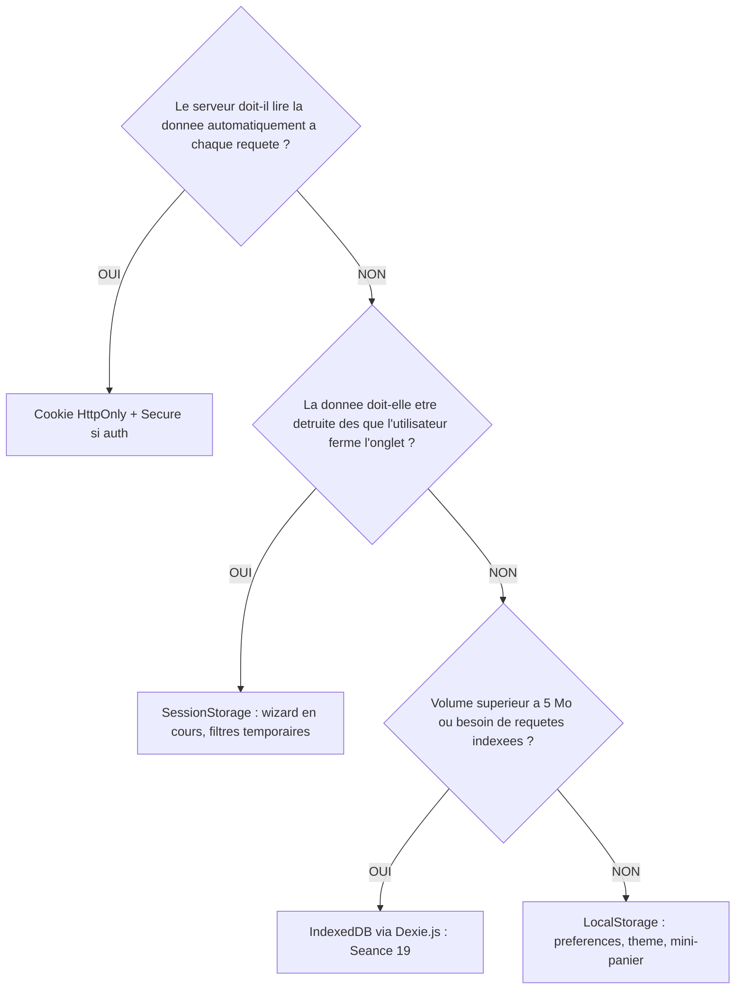
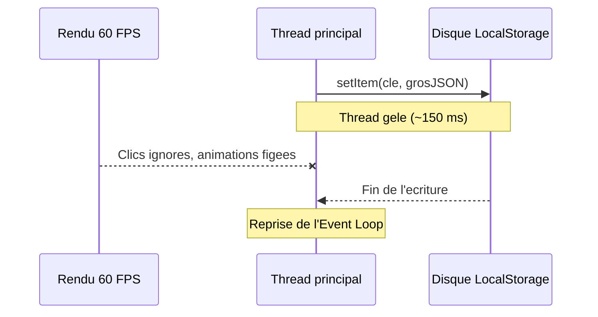
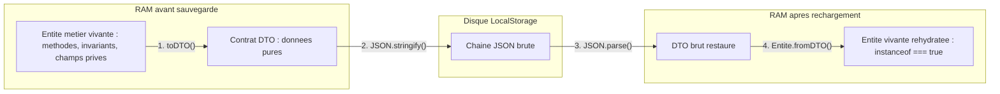

# Séance 18 — Stockage Local : LocalStorage, SessionStorage & Cookies

**Cours de programmation orientée objet — Bachelier en informatique (EAFC)**  
**Stack technique : TypeScript 5+, Angular 22 (approche signal-first)**

---

## Objectifs pédagogiques

À l'issue de cette séance, l'étudiant est en mesure de :

1. **Cartographier la trilogie Web** : distinguer `LocalStorage`, `SessionStorage` et `Cookies` selon leur cycle de vie, leur portée, leur capacité et leur transit réseau, et savoir choisir le bon outil selon le besoin métier.
2. **Dompter l'API `LocalStorage`** : manipuler `setItem`, `getItem`, `removeItem` et `clear`, comprendre la contrainte stricte des chaînes de caractères et le coût d'un accès synchrone au disque.
3. **Résoudre le choc POO & sérialisation** : éviter le piège fatal du `[object Object]`, et réappliquer le patron DTO et la fabrique `fromDTO()` (Séance 16) pour ressusciter de vraies entités dotées de méthodes et d'invariants.
4. **Encapsuler dans un service Angular** : bannir l'accès direct au stockage dans les composants, et concevoir un service réactif **Signal-First** avec synchronisation inter-onglets via l'événement `storage`.
5. **Gérer les erreurs & synchroniser les onglets** : intercepter `QuotaExceededError` avec `try / catch` (rappel de la Séance 10) et exploiter l'événement `storage` pour faire dialoguer des onglets sans serveur.
6. **Identifier les limites** : comprendre pourquoi `LocalStorage` échoue pour les applications complexes (5 Mo, blocage du thread, zéro requête) — le pont direct vers la Séance 19 (IndexedDB & Dexie.js).

---

## Partie 00 — Le cheminement : d'où venons-nous ?

Cette séance poursuit le **Bloc D (Persistance des données)**, l'ultime bloc du cursus. Rappelons la logique d'ensemble :

- **Bloc A (S5 à S9) — Fondamentaux POO** : encapsulation et invariants (S5), héritage (S6), polymorphisme dynamique (S7), abstraction et contrats purs (S8), composition vs héritage (S9).
- **Bloc B (S10 à S12) — Conception & Qualité** : exceptions et robustesse (S10), principes SOLID (S11), identité, égalité et clonage (S12).
- **Bloc C (S13 à S15) — Angular Signal-First** : composants et Signals réactifs (S13), services et injection de dépendances (S14), Signal Forms et routage SPA (S15).
- **Bloc D (S16 à S19) — Persistance des données** : sérialisation JSON et patron DTO (S16), consommation d'une API REST avec `httpResource()` (S17), **stockage local (S18 — aujourd'hui)**, IndexedDB et Dexie.js (S19).

La continuité logique du Bloc D est limpide :

- En **S16**, nous avons découvert le format JSON et le patron DTO / `fromDTO()` en mémoire.
- En **S17**, nous avons fait voyager ce même JSON à travers le Web grâce à `httpResource()`.
- En **S18**, nous ancrons nos objets sur le disque du navigateur lui-même — sans serveur, sans réseau, même hors ligne !

### Le double problème de la séance

Deux constats rendent la persistance locale indispensable :

1. **La mémoire vive (RAM) s'évapore.** Dès que l'utilisateur appuie sur `F5` ou ferme son onglet, toutes les instances de classes créées en mémoire vive sont **définitivement détruites**. Un panier, un thème, un brouillon : tout disparaît.
2. **Le réseau distant est trop lourd.** Faire un appel HTTP vers un serveur pour mémoriser le choix du thème sombre ou de la langue préférée est lent, coûteux, et **ne fonctionne pas hors ligne**.

La solution : les navigateurs modernes intègrent des espaces de stockage persistants directement sur le disque du client — **Cookies**, **SessionStorage** et **LocalStorage**.

> [!WARNING]
> **Aucun de ces stockages ne sait manipuler d'objets TypeScript vivants !**  
> Ils ne stockent que des **chaînes de caractères brutes**. Le typage disparaît, les prototypes s'évaporent et les invariants risquent d'être bafoués.

> [!IMPORTANT]
> **La question fondamentale de la séance 18 :**  
> *« Comment faire cohabiter nos objets vivants (méthodes, invariants, encapsulation) avec des stockages qui ne connaissent que du texte brut ? »*

---

## Partie 01 — La trilogie du stockage Web

### 1.1 L'analogie des trois tiroirs

Pour ne plus jamais confondre les trois espaces, visualisez-les comme trois rangements du quotidien :

| Espace | Analogie | Caractéristique mémorable |
|---|---|---|
| 🍪 **Cookie** | **Le badge visiteur** : une minuscule étiquette accrochée à votre col. À chaque porte franchie (chaque requête HTTP), le gardien du serveur regarde votre badge. | ~4 Ko · Voyage sur le réseau à chaque requête |
| ⏱️ **SessionStorage** | **Le casier de la piscine** : vous y déposez vos affaires pendant la séance. Vous pouvez plonger et ressortir (`F5`), vos affaires sont là. Mais dès que vous quittez la piscine (fermeture de l'onglet), le casier est vidé ! | ~5 Mo · Isolé par onglet · Meurt à la fermeture |
| 🗄️ **LocalStorage** | **Le coffre à la maison** : installé dans votre salon. Même si vous partez en vacances six mois ou redémarrez votre PC, vos objets restent dans le coffre jusqu'à ce que vous décidiez de faire le ménage. | ~5-10 Mo · Partagé par tout le domaine · Éternel |

### 1.2 Les cookies : l'ancêtre du Web et sa véritable mission

Inventés en 1994 par Netscape pour donner de la mémoire au protocole HTTP (qui est *stateless*), les cookies fonctionnent ainsi :

1. Le serveur envoie un en-tête HTTP : `Set-Cookie: session_id=xyz789; HttpOnly; Secure`.
2. À **chaque future requête HTTP** vers ce domaine, le navigateur renvoie automatiquement : `Cookie: session_id=xyz789`.
3. Taille maximale dérisoire : **4 Ko par cookie**.

**Les attributs de sécurité essentiels :**

| Attribut | Effet | Protection apportée |
|---|---|---|
| `HttpOnly` | Interdit à JavaScript d'accéder au cookie. | Vol de session par faille **XSS**. |
| `Secure` | Le cookie n'est envoyé qu'en **HTTPS**. | Interception en clair sur le réseau. |
| `SameSite=Strict\|Lax` | Empêche l'envoi du cookie depuis un site tiers. | Attaques **CSRF**. |

> [!CAUTION]
> **Règle d'or :** ne stockez **jamais** de données applicatives (panier, objets métier) dans des cookies ! Renvoyés à chaque requête, ils ralentissent chaque aller-retour HTTP (4 Ko dans les cookies = 4 Ko ajoutés à **chaque** requête : images, CSS, appels API). Les cookies sont réservés aux **jetons d'authentification** et **identifiants de session serveur**.

### 1.3 SessionStorage vs LocalStorage : deux sœurs, deux caractères

Introduits avec HTML5, ils partagent la **même API** (`setItem`, `getItem`...), mais pas le même cycle de vie :

**⏱️ SessionStorage : éphémère et isolé**
- **Vit et meurt avec l'onglet** : survit à `F5`, détruit à la fermeture de l'onglet.
- **Isolation totale** : deux onglets sur le même site ont chacun leur casier hermétique. Sur un site de billetterie, si vous ouvrez deux onglets pour réserver deux places différentes, les deux onglets ne se marchent pas sur les pieds !
- **Cas d'usage** : wizard multi-étapes, filtres de recherche temporaires, état de navigation.

**🗄️ LocalStorage : durable et partagé**
- **Persistance illimitée** : survit à la fermeture du navigateur et au redémarrage du PC !
- **Partagé par tout le domaine** : tous les onglets de la même origine voient les mêmes données en temps réel.
- **Cas d'usage** : thème sombre, langue, panier léger, brouillons.

> [!WARNING]
> **Le piège du dev local :** le stockage est cloisonné par origine stricte — **Protocole + Domaine + Port**. `http://localhost:4200` et `http://localhost:3000` ont donc deux LocalStorage **distincts** ! Un bug de persistance « mystérieux » vient souvent de là.

### 1.4 Tableau comparatif exhaustif

| Caractéristique clé | 🍪 Cookies | ⏱️ SessionStorage | 🗄️ LocalStorage |
| :--- | :--- | :--- | :--- |
| **Capacité maximale** | ~**4 Ko** par cookie | ~**5 Mo** par origine | ~**5 à 10 Mo** par origine |
| **Durée de vie** | Définie par `Expires` / `Max-Age` | Fermeture de l'onglet | **Permanente** (jusqu'à suppression) |
| **Portée (scope)** | Tout le domaine configuré | **L'onglet unique** en cours | **Tous les onglets** de la même origine |
| **Transit réseau HTTP** | **Automatique** à chaque requête | **Jamais** (100 % client) | **Jamais** (100 % client) |
| **Accès JavaScript** | Oui (sauf `HttpOnly`) | Oui (`window.sessionStorage`) | Oui (`window.localStorage`) |
| **Performances** | Ralentit le réseau si surchargé | Lecture synchrone en mémoire | Lecture synchrone depuis le disque |
| **Cas d'usage type** | Jetons de session, auth sécurisée | Wizards, filtres éphémères | Thème UI, préférences, mini-panier |

> [!TIP]
> **La règle simple à retenir :** authentification avec le serveur ➔ cookies `HttpOnly`. Stockage client durable ➔ LocalStorage. Tâche isolée à un seul onglet ➔ SessionStorage.

### 1.5 Grille d'arbitrage : quel stockage choisir ?

Face à un besoin de stockage dans votre application Angular, suivez cet arbre de décision :



Trois exemples pour s'entraîner :
- *« Où stocke-t-on le jeton d'authentification ? »* ➔ Cookie `HttpOnly` (recommandé contre le XSS).
- *« Où stocke-t-on le choix de la langue 'Français' ? »* ➔ LocalStorage !
- *« Où stocke-t-on 10 000 pièces automobiles avec recherche par référence ? »* ➔ IndexedDB / Dexie.js (Séance 19 !)

---

## Partie 02 — Plongée technique dans `LocalStorage`

### 2.1 L'interface `Storage` : les 6 méthodes natives

En TypeScript, l'objet global `window.localStorage` implémente l'interface standard `Storage` :

```typescript
// 1. Écrire une valeur associée à une clé
localStorage.setItem('theme', 'sombre');

// 2. Lire une valeur (renvoie string | null)
const theme: string | null = localStorage.getItem('theme');   // 'sombre'
const inconnu: string | null = localStorage.getItem('inexistant'); // null !

// 3. Supprimer une clé précise
localStorage.removeItem('theme');

// 4. Vider intégralement tout le stockage du domaine !
localStorage.clear();

// 5. Connaître le nombre d'éléments enregistrés
const total: number = localStorage.length;

// 6. Inspecter la clé située à l'index n
const nomCle: string | null = localStorage.key(0);
```

Trois subtilités à connaître :

1. Si une clé existe déjà, `setItem()` **écrase silencieusement** l'ancienne valeur.
2. Si une clé n'existe pas, `getItem()` renvoie `null` (et **jamais** `undefined`). En TypeScript strict, le type de retour est `string | null` : il faut donc toujours vérifier la présence de la valeur avant de l'exploiter.
3. `clear()` vide **TOUT** le domaine, y compris les clés d'autres services ! À manipuler avec une extrême prudence.

### 2.2 Attention : tout est chaîne de caractères !

Le stockage ne connaît que du texte. Passer un booléen ou un nombre « en direct » produit des bugs invisibles :

```typescript
// ❌ Le code naïf et le bug invisible
localStorage.setItem('estConnecte', false as any);
localStorage.setItem('tentatives', 0 as any);

// À la lecture :
const estCo = localStorage.getItem('estConnecte');
// estCo vaut la CHAÎNE "false" !

if (estCo) {
  // 💣 CATASTROPHE ! En JS, toute chaîne non vide est TRUTHY !
  console.log('Connecté !'); // S'exécute TOUJOURS !
}

const nb = localStorage.getItem('tentatives'); // "0"
const total = nb + 1; // "01" (concaténation !)
```

```typescript
// ✅ La conversion explicite obligatoire
const estConnecte = false;
localStorage.setItem('estConnecte', JSON.stringify(estConnecte));

// Lecture avec conversion booléenne réelle :
const brut = localStorage.getItem('estConnecte');
const estCoReel: boolean = brut !== null ? JSON.parse(brut) : false;

if (estCoReel) {
  console.log('Ne sera PAS affiché ✅');
}

// Pour un nombre :
const score = Number(localStorage.getItem('tentatives') ?? 0);
const scoreExact = score + 1; // 1 ✅
```

> [!IMPORTANT]
> **Le piège du truthy :** en JavaScript, `Boolean("false") === true` ! Une chaîne de cinq caractères n'est pas une chaîne vide. Sérialisez avec `JSON.stringify()`, désérialisez avec `JSON.parse()`, et convertissez explicitement (`Number(...)`) — jamais de lecture « brute » exploitée telle quelle.

### 2.3 La réalité physique : un stockage synchrone et bloquant

Rappel de la Séance 17 : le navigateur exécute notre code sur un **thread unique** (l'Event Loop). Contrairement à `fetch()` qui est asynchrone, chaque appel à `setItem()` ou `getItem()` **bloque immédiatement le thread principal** pendant la lecture ou l'écriture disque :



Conséquences concrètes d'une écriture volumineuse :
- L'écran *freeze* et ne répond plus aux clics.
- Les animations CSS chutent à 0 image par seconde.
- L'utilisateur ressent un violent ralentissement.

> [!TIP]
> **La différence cruciale avec le réseau :** le réseau est lent mais **asynchrone** (l'Event Loop continue de tourner). LocalStorage est local mais **synchrone** (l'Event Loop attend le disque). C'est pourquoi on n'y stocke que de petites quantités de données.

### 2.4 Gestion du quota : `QuotaExceededError`

Que se passe-t-il si l'application tente d'écrire alors que les 5 Mo sont pleins ? Le navigateur lève une exception native `DOMException` nommée `QuotaExceededError`. Sans interception, l'application Angular plante brutalement :

```text
Uncaught DOMException: Failed to execute 'setItem' on 'Storage':
... exceeded the quota.
```

La protection POO s'appuie directement sur la Séance 10 (`try / catch`, typage `unknown`, `instanceof`) :

```typescript
export function sauvegarderSecurise(cle: string, valeur: string): boolean {
  try {
    localStorage.setItem(cle, valeur);
    return true;
  } catch (erreur) {
    if (erreur instanceof DOMException &&
       (erreur.name === 'QuotaExceededError' || erreur.code === 22)) {
      console.error(`[Storage] Quota dépassé pour ${cle} !`);
      // Stratégie de repli : purger, notifier...
    } else {
      console.error('[Storage] Stockage indisponible (navigation privée ?)');
    }
    return false;
  }
}
```

> [!NOTE]
> **Rappel S10 :** on vérifie le type de l'exception avec `instanceof DOMException` et on implémente une stratégie de repli gracieuse. La théorie de la Séance 10 prend ici tout son sens : quota dépassé, mais aussi **navigation privée** ou stockage désactivé.

### 2.5 L'événement `storage` : synchronisation magique inter-onglets

Deux onglets ouverts sur la même application peuvent dialoguer grâce à `localStorage` :

```typescript
// Écoute des mutations effectuées par les AUTRES onglets :
window.addEventListener('storage', (event: StorageEvent) => {
  console.log(`Clé modifiée : ${event.key}`);
  console.log(`Nouvelle valeur : ${event.newValue}`);

  if (event.key === 'panier_nb_articles') {
    // Mettre à jour immédiatement le badge du panier ici !
  }
});
```

> [!WARNING]
> **La règle cruciale :** l'événement `storage` ne se déclenche **QUE dans les autres onglets** ouverts sur la même origine, et **JAMAIS** dans l'onglet qui a exécuté le `setItem()` !

Scénario de démonstration : un site e-commerce est ouvert dans les onglets A et B. Dans l'onglet A, vous ajoutez un livre au panier. Magie : dans l'onglet B, le badge du panier passe instantanément à 1 sans recharger la page ! C'est le moyen le plus simple du Web de créer une application multi-écrans réactive, sans WebSocket ni serveur.

---

## Partie 03 — Le choc POO & LocalStorage

### 3.1 Le piège : `[object Object]` !

Que se passe-t-il lorsqu'un développeur tente de sauvegarder une instance de classe ?

```typescript
// ❌ Le code naïf
class ArticlePanier {
  constructor(
    public readonly nom: string,
    public readonly prix: number
  ) {}
}

const article = new ArticlePanier('Clavier mécanique', 89);

// L'erreur : passer l'objet directement
localStorage.setItem('mon_article', article as any);
```

Ce qui est réellement enregistré sur disque :

```text
Clé : "mon_article"
Valeur : "[object Object]"
```

**La cause mécanique :** `localStorage` n'accepte QUE des chaînes. JavaScript appelle donc automatiquement `article.toString()`, c'est-à-dire la conversion implicite via `Object.prototype.toString()`. Toutes les données (`nom`, `prix`) sont irrémédiablement perdues, remplacées par la chaîne inutile `"[object Object]"`.

### 3.2 `JSON.parse` : le drame du prototype perdu

Même en sérialisant correctement, un cast TypeScript naïf crée une illusion dangereuse :

```typescript
class CompteBancaire {
  #solde: number; // Propriété privée encapsulée

  constructor(soldeInitial: number) {
    if (soldeInitial < 0) throw new Error('Solde négatif interdit');
    this.#solde = soldeInitial;
  }

  get solde(): number { return this.#solde; }
  retirer(montant: number): void { this.#solde -= montant; }
}

// 1. Sauvegarde en JSON
const compte = new CompteBancaire(100);
localStorage.setItem('compte', JSON.stringify(compte));

// 2. Rechargement avec cast mensonger
const recup = JSON.parse(localStorage.getItem('compte')!) as CompteBancaire;
```

Le réveil est brutal au premier appel :

```typescript
console.log(recup instanceof CompteBancaire);
// 👉 false ❌ ! Ce n'est PAS un CompteBancaire !

recup.retirer(50);
// 💥 TypeError: recup.retirer is not a function !
```

> [!IMPORTANT]
> **Le « drame du prototype perdu » (rappel S16) :** le cast `as CompteBancaire` n'est qu'une illusion d'optique pour rassurer le compilateur TypeScript. Au runtime, `JSON.parse` produit un objet littéral générique (`Object.prototype`) : toutes vos méthodes métier, vos champs privés (`#`) et vos getters ont disparu !

### 3.3 La triade architecturale : DTO, entité métier & fabrique

Nous déployons la même rigueur qu'aux Séances 16 et 17. Le pattern `toDTO()` / `fromDTO()` est universel : qu'on échange des données avec un serveur distant (S17) ou avec le disque dur local (S18), l'architecture POO reste strictement identique et protectrice.



Les trois piliers :

1. **Le contrat DTO** : décrit exactement la structure sérialisée stockée en chaîne JSON.
2. **La méthode `toDTO()`** : l'entité extrait ses données publiques propres à être stockées. L'objet décide lui-même de ce qu'il accepte de divulguer (encapsulation, S5).
3. **La fabrique `fromDTO()`** : réinstancie la classe avec `new` et **revalide tous les invariants** !

### 3.4 Code modèle : le contrat DTO et la classe métier robuste

```typescript
// models/tache.dto.ts
export interface TacheDTO {
  readonly id: string;
  readonly titre: string;
  readonly dateCreationISO: string;
  readonly priorite: 'basse' | 'moyenne' | 'haute';
  readonly terminee: boolean;
}
```

```typescript
// models/tache.entity.ts
export class Tache {
  readonly #id: string;
  readonly #titre: string;
  readonly #dateCreation: Date;
  #priorite: 'basse' | 'moyenne' | 'haute';
  #terminee: boolean;

  constructor(id: string, titre: string, date: Date,
              priorite: 'basse'|'moyenne'|'haute', terminee = false) {
    if (!id?.trim()) throw new Error('ID obligatoire');
    if (!titre || titre.trim().length < 3) throw new Error('Titre trop court');
    this.#id = id;
    this.#titre = titre.trim();
    this.#dateCreation = date;
    this.#priorite = priorite;
    this.#terminee = terminee;
  }

  get id(): string { return this.#id; }
  get titre(): string { return this.#titre; }
  get dateCreation(): Date { return this.#dateCreation; }
  get isTerminee(): boolean { return this.#terminee; }

  // Méthode métier
  isUrgente(): boolean {
    return this.#priorite === 'haute' && !this.#terminee;
  }

  // Export vers DTO inerte
  toDTO(): TacheDTO {
    return {
      id: this.#id,
      titre: this.#titre,
      dateCreationISO: this.#dateCreation.toISOString(),
      priorite: this.#priorite,
      terminee: this.#terminee
    };
  }

  // Fabrique de réhydratation
  static fromDTO(dto: TacheDTO): Tache {
    return new Tache(dto.id, dto.titre,
      new Date(dto.dateCreationISO), dto.priorite, dto.terminee);
  }
}
```

Observez la ligne clé de `fromDTO()` : `new Date(dto.dateCreationISO)`. En JSON, une `Date` devient une simple chaîne ISO. C'est **notre** fabrique qui reconstruit un vrai objet `Date` avec toutes ses méthodes. Et puisque le constructeur est rappelé à la lecture, **les invariants sont toujours revalidés** : même si quelqu'un altère manuellement le LocalStorage dans la console, l'application refusera de créer une entité invalide !

### 3.5 L'encapsulation dans un service Angular : le pattern Repository

Ne laissez **jamais** un composant Angular appeler directement `localStorage` !

**❌ Pourquoi l'accès direct en composant est une faute :**
- **Violation du SRP (S11)** : le composant gère la vue, pas les spécificités du disque dur.
- **Testabilité impossible** : on ne peut pas tester le composant sans mocker le navigateur entier.
- **Crash SSR immédiat** : en Server-Side Rendering, `window.localStorage` n'existe pas sur le serveur Node.js !

**✅ La solution : un service dédié qui :**
- Centralise la clé de stockage (évite les fautes de frappe de chaînes).
- Encapsule les blocs `try { ... } catch` de gestion du quota.
- Vérifie la plateforme d'exécution (SSR) avant de toucher au disque.
- Expose un **Signal Angular réactif** en lecture seule pour la vue.

> [!TIP]
> **Lien avec les principes SOLID (S11) :** un service = une responsabilité unique (la persistance locale). Le composant consomme le service par injection de dépendances (DIP).

### 3.6 Signal-First : synchroniser un `signal()` avec `localStorage`

```typescript
import { Injectable, signal, computed } from '@angular/core';
import { Tache, TacheDTO } from './tache.entity';

@Injectable({ providedIn: 'root' })
export class LocalTacheService {
  readonly #CLE_STORAGE = 'eafc_taches_v1';
  readonly #tachesSignal = signal<readonly Tache[]>(this.#chargerInitiales());

  // Signal public en lecture seule pour les composants
  readonly taches = this.#tachesSignal.asReadonly();
  readonly nbUrgentes = computed(() => this.taches().filter(t => t.isUrgente()).length);

  ajouter(titre: string, priorite: 'basse' | 'moyenne' | 'haute'): void {
    const nouvelle = new Tache(crypto.randomUUID(), titre, new Date(), priorite);
    const nouvelleListe = [...this.#tachesSignal(), nouvelle];
    this.#sauvegarder(nouvelleListe);
    this.#tachesSignal.set(nouvelleListe); // Déclenche le rafraîchissement réactif !
  }

  #sauvegarder(liste: readonly Tache[]): void {
    if (typeof localStorage === 'undefined') return; // Sécurité SSR
    const dtos: TacheDTO[] = liste.map(t => t.toDTO());
    localStorage.setItem(this.#CLE_STORAGE, JSON.stringify(dtos));
  }

  #chargerInitiales(): readonly Tache[] {
    if (typeof localStorage === 'undefined') return [];
    const brut = localStorage.getItem(this.#CLE_STORAGE);
    if (!brut) return [];
    try {
      const dtos: TacheDTO[] = JSON.parse(brut);
      return dtos.map(Tache.fromDTO); // Réhydratation POO continue !
    } catch {
      return []; // Données corrompues : repli gracieux
    }
  }
}
```

La beauté de ce pattern Signal-First :

1. Au démarrage, on charge les données du LocalStorage et on réhydrate les **vraies entités** `Tache`.
2. À chaque modification, on met à jour le LocalStorage **et** le signal.
3. Les composants n'ont qu'à lire `svc.taches()` : zéro RxJS, zéro souscription, zéro fuite mémoire !

---

## Partie 04 — Pièges fréquents & anti-patterns

Cette section est conçue pour éviter de perdre des heures lors des futurs TP et de l'examen. Voici les cinq erreurs récurrentes du stockage local :

| Anti-pattern fréquent | Pourquoi c'est une défaillance grave | Solution d'ingénierie conforme |
| :--- | :--- | :--- |
| **Stocker l'objet directement** : `setItem('x', article)` | JavaScript convertit en chaîne : la valeur lue sera `"[object Object]"`. Toutes les données sont perdues. | Toujours passer par `toDTO()` puis `JSON.stringify()`. |
| **Le booléen stringifié** : `if (localStorage.getItem('connecte'))` | La chaîne `"false"` est **truthy** ! Le test s'exécute toujours. | Convertir explicitement : `JSON.parse(brut)` ou comparaison `=== 'true'`. |
| **L'accès direct dans le composant** | Violation du SRP (S11), composant intestable, crash en SSR. | Encapsuler dans un service injecté, exposant un signal en lecture seule. |
| **L'écriture sans `try / catch`** | `QuotaExceededError` (5 Mo pleins, navigation privée) crashe l'application. | Intercepter `DOMException` (S10) et implémenter un repli gracieux. |
| **Le `JSON.parse` sans filet** | Si la chaîne est corrompue (écriture interrompue, édition manuelle), `SyntaxError` fatal. | Encapsuler dans `try / catch` et retourner une liste vide en secours. |

> [!TIP]
> **Illustration parlante pour la dernière ligne :** si l'utilisateur édite la valeur à la main dans les DevTools et casse le JSON, l'application doit survivre et repartir sur des données saines ! Testez ce scénario en TP — c'est un excellent exercice de robustesse.

### Les 5 commandements du stockage local

1. **Jamais d'objet brut dans le stockage** : seule la chaîne sérialisée via `toDTO()` + `JSON.stringify()` a le droit d'y entrer.
2. **Jamais de lecture brute exploitée** : tout ce qui sort du stockage repasse par `JSON.parse()` et la fabrique `fromDTO()`.
3. **Jamais de `localStorage` dans un composant** : seul le service de persistance touche au disque (SRP, testabilité, SSR).
4. **Jamais d'écriture sans `try / catch`** : le quota et la navigation privée sont des incidents normaux, pas des crashs.
5. **Jamais de désérialisation sans repli** : des données corrompues ne doivent jamais tuer l'application.

---

## Partie 05 — Démonstration : PocketNotes

Un mini-projet compact et parlant : des notes qui survivent à `F5`, qui se synchronisent entre onglets, et qui restent de **vrais objets vivants**. Architecture en trois fichiers propres :

```text
src/app/
├── models/
│   └── note.entity.ts        (Entité Note + contrat NoteDTO)
├── services/
│   └── local-notes.service.ts (Service LocalStorage Signal-First)
└── components/
    └── notes/
        ├── notes.component.ts (Composant standalone + audit POO)
        └── notes.component.html
```

### 5.1 Chaque interaction = un concept du cours

| Sur votre écran, en direct | Le concept du cours en action |
| :--- | :--- |
| **Appuyez sur `F5`** : les notes restent affichées intactes | La persistance sur disque a survécu à la mort de la RAM (Partie 01) |
| **Ouvrez un 2ᵉ onglet** : ajoutez une note dans l'onglet A | L'onglet B s'actualise **instantanément sans recharger** via l'événement `storage` ! |
| **Audit POO en direct** : `premier instanceof Note` affiche **`true ✅`** | La fabrique `fromDTO()` a réhydraté l'objet avec ses méthodes ! (Partie 03) |
| **Badge « ⚡ Urgente »** calculé par la méthode métier `isUrgente()` | La règle métier s'exécute dans l'objet, pas dans une simple chaîne inerte |
| **Inspecteur DevTools (`F12`)** : onglet Application ➔ Local Storage | Découverte visuelle du tiroir : la clé JSON brute est lisible ! |

### 5.2 Étape 1 : le modèle métier et le contrat DTO (`note.entity.ts`)

```typescript
// models/note.dto.ts
export interface NoteDTO {
  readonly id: string;
  readonly titre: string;
  readonly priorite: 'normale' | 'urgente';
  readonly dateISO: string;
}
```

```typescript
// models/note.entity.ts
export class Note {
  readonly #id: string;
  readonly #titre: string;
  readonly #priorite: 'normale' | 'urgente';
  readonly #date: Date;

  constructor(id: string, titre: string,
              priorite: 'normale' | 'urgente', date = new Date()) {
    if (!id?.trim()) throw new Error('ID obligatoire');
    if (!titre || titre.trim().length < 3) {
      throw new Error('Le titre doit comporter au moins 3 caractères.');
    }
    this.#id = id.trim();
    this.#titre = titre.trim();
    this.#priorite = priorite;
    this.#date = date;
  }

  get id(): string { return this.#id; }
  get titre(): string { return this.#titre; }
  get date(): Date { return this.#date; }

  // Règle métier vivant dans l'objet
  isUrgente(): boolean { return this.#priorite === 'urgente'; }

  toDTO(): NoteDTO {
    return {
      id: this.#id,
      titre: this.#titre,
      priorite: this.#priorite,
      dateISO: this.#date.toISOString()
    };
  }

  static fromDTO(dto: NoteDTO): Note {
    return new Note(dto.id, dto.titre,
      dto.priorite, new Date(dto.dateISO));
  }
}
```

> [!NOTE]
> **L'inviolabilité de l'invariant :** si quelqu'un essaie d'instancier une `Note` avec un titre de deux caractères, le constructeur lève une exception. Grâce à `fromDTO()`, même si quelqu'un altère manuellement le LocalStorage dans la console, l'application refusera de créer une entité invalide !

### 5.3 Étape 2 : le service LocalStorage Signal-First (`local-notes.service.ts`)

```typescript
import { Injectable, signal, computed, inject, PLATFORM_ID } from '@angular/core';
import { isPlatformBrowser } from '@angular/common';
import { Note, NoteDTO } from '../models/note.entity';

@Injectable({ providedIn: 'root' })
export class LocalNotesService {
  readonly #platformId = inject(PLATFORM_ID);
  readonly #CLE = 'pocket_notes_v1';
  readonly #notesSignal = signal<readonly Note[]>(this.#lireStockage());

  readonly notes = this.#notesSignal.asReadonly();
  readonly nbUrgentes = computed(() =>
    this.notes().filter(n => n.isUrgente()).length);

  constructor() {
    // Synchronisation inter-onglets : l'événement `storage` !
    if (isPlatformBrowser(this.#platformId)) {
      window.addEventListener('storage', (event: StorageEvent) => {
        if (event.key === this.#CLE || event.key === null) {
          this.#notesSignal.set(this.#lireStockage());
        }
      });
    }
  }

  ajouter(titre: string, priorite: 'normale' | 'urgente'): void {
    const nouvelle = new Note(crypto.randomUUID(), titre, priorite);
    const maj = [nouvelle, ...this.#notesSignal()];
    this.#ecrireStockage(maj);
    this.#notesSignal.set(maj);
  }

  #lireStockage(): readonly Note[] {
    if (!isPlatformBrowser(this.#platformId)) return [];
    const brut = localStorage.getItem(this.#CLE);
    if (!brut) return [];
    try {
      const dtos: NoteDTO[] = JSON.parse(brut);
      return dtos.map(Note.fromDTO); // Réhydratation POO !
    } catch { return []; }
  }

  #ecrireStockage(notes: readonly Note[]): void {
    if (!isPlatformBrowser(this.#platformId)) return;
    try {
      localStorage.setItem(this.#CLE,
        JSON.stringify(notes.map(n => n.toDTO())));
    } catch (e) {
      console.error('Erreur quota LocalStorage', e);
    }
  }
}
```

Les trois mécanismes clés du service :

1. **Résilience SSR** : `isPlatformBrowser()` garantit que le code ne plantera jamais côté serveur.
2. **Écoute inter-onglets** : le listener `storage` recharge le signal dès qu'un autre onglet modifie la clé !
3. **Signal réactif** : dès que `set(maj)` est appelé, Angular met à jour l'écran instantanément.

Le service prend en charge **tous** les détails techniques : sérialisation, sécurité SSR, réactivité inter-onglets, gestion du quota. Pour le composant qui l'utilise, c'est de l'or en barre : il n'a qu'à appeler `ajouter()` !

### 5.4 Étape 3 : le composant et le template (`notes.component.ts`)

```typescript
import { Component, inject, computed } from '@angular/core';
import { LocalNotesService } from '../services/local-notes.service';
import { Note } from '../models/note.entity';

@Component({
  selector: 'app-notes',
  standalone: true,
  templateUrl: './notes.component.html'
})
export class NotesComponent {
  readonly svc = inject(LocalNotesService);

  // Audit POO : le prototype a-t-il survécu au disque ?
  readonly auditPOO = computed(() => {
    const premier = this.svc.notes()[0];
    if (!premier) return 'Aucune note';
    return premier instanceof Note
      ? 'true ✅ (Objet vivant !)'
      : 'false ❌ (Prototype perdu !)';
  });

  creer(titre: string, priorite: 'normale' | 'urgente'): void {
    if (titre.trim().length >= 3) {
      this.svc.ajouter(titre.trim(), priorite);
    }
  }
}
```

```html
<h3>📝 PocketNotes · Persistance Locale POO</h3>
<p class="small">Audit POO : premier instanceof Note ➔
  <strong>{{ auditPOO() }}</strong></p>

<input #titreInput placeholder="Nouvelle note (min. 3 car.)..." />
<select #prioSelect>
  <option value="normale">Normale</option>
  <option value="urgente">⚡ Urgente</option>
</select>
<button (click)="creer(titreInput.value, prioSelect.value as any);
        titreInput.value = ''">
  Ajouter
</button>

<ul>
  @for (note of svc.notes(); track note.id) {
    <li>
      <strong>{{ note.titre }}</strong>
      <span class="text-muted">({{ note.date.toLocaleTimeString() }})</span>
      @if (note.isUrgente()) {
        <span class="badge">⚡ Urgente</span>
      }
    </li>
  } @empty {
    <li>Aucune note sauvegardée sur votre disque.</li>
  }
</ul>
```

Admirez le template : `note.isUrgente()` est une **méthode de l'objet métier**, `note.date.toLocaleTimeString()` est un **vrai objet `Date`**, et le badge d'audit affiche `true ✅` fièrement sous les yeux des étudiants. La théorie de la Partie 03 est validée en direct.

### 5.5 Où regarder dans les DevTools du navigateur ?

Ouvrez l'inspecteur avec `F12` pour observer le stockage en direct :

1. **Onglet Application ➔ Local Storage** : sélectionnez `http://localhost:4200` dans l'arborescence. Observez la clé `pocket_notes_v1` : le JSON textuel brut est lisible ! Vous pouvez double-cliquer pour modifier une valeur à la main — testez le repli gracieux du `try / catch`.
2. **Le test de la corruption volontaire** : cassez le JSON à la main (supprimez une accolade) puis rechargez la page. Sans le `try / catch` du service : crash `SyntaxError` garanti ! Avec notre service : l'application survit et repart avec une liste vide. ✅

> [!TIP]
> Voir physiquement le tiroir Local Storage dans les DevTools lève définitivement le mystère de la persistance côté client. Projetez l'écran en grand et faites le test de corruption devant la classe : montrez le crash **sans** `try / catch`, puis la résilience **avec** le service.

---

## Partie 06 — Les limites de `LocalStorage` : pourquoi il faut une vraie base de données

### Les 3 murs de LocalStorage

1. **🧱 Mur 1 — Le plafond des 5 Mo.** Une seule photo haute résolution pèse déjà 3 à 4 Mo ! Un catalogue de produits ou un historique dépasse vite le seuil : `QuotaExceededError` garanti. (Ordre de grandeur : 5 Mo ≈ une chanson MP3 ou deux photos de smartphone.)
2. **🧊 Mur 2 — Le gel synchrone.** Sérialiser 10 000 objets avec `JSON.stringify` monopolise le thread pendant 50 à 200 ms : clics ignorés, animations figées, application « lente ».
3. **🔍 Mur 3 — Zéro requête, zéro index.** Le stockage est **aveugle** : pour trouver un article parmi 5 000, il faut TOUT lire, TOUT parser, filtrer en RAM... puis TOUT réécrire pour modifier un seul champ !

> [!IMPORTANT]
> **L'analogie marquante du Mur 3 :** imaginez une bibliothèque de 50 000 livres. LocalStorage, c'est devoir sortir **tous** les livres sur la table pour en chercher un seul, puis tout re-ranger pour modifier une seule page !

La réponse existe déjà dans votre navigateur : **IndexedDB**, une vraie base de données asynchrone, indexée et transactionnelle — que nous dompterons avec **Dexie.js** à la Séance 19 !

---

## Synthèse & clôture de la séance

### Tableau récapitulatif des mécanismes et syntaxes clés

| Mécanisme / Syntaxe | Rôle technique et conceptuel | Avantage architectural clé en POO |
| :--- | :--- | :--- |
| **`localStorage.setItem(k, v)`** | Écrit une chaîne de manière synchrone et persistante. | Conserve l'état utilisateur (thème, panier) sans serveur — mais ne stocke QUE du texte ! |
| **`sessionStorage`** | Stockage temporaire borné à la vie d'un onglet unique. | Isolation totale entre onglets pour les wizards et états temporaires. |
| **Cookies (`HttpOnly`)** | Minuscule en-tête (4 Ko) transmis à chaque requête HTTP. | Dédié à l'authentification serveur (protection XSS). Jamais de données applicatives ! |
| **`QuotaExceededError`** | Exception native levée en cas de dépassement des 5 Mo. | À intercepter avec `try / catch` (S10) pour un repli gracieux. |
| **Événement `storage`** | Déclenché dans les AUTRES onglets après un `setItem()`. | Synchronisation temps réel entre fenêtres, sans WebSocket ni serveur. |
| **Patron DTO & `toDTO()`** | Projette l'entité vivante vers une structure sérialisable. | L'objet décide lui-même de ce qu'il accepte de divulguer (encapsulation S5). |
| **Fabrique `Entite.fromDTO()`** | Reconstruit une vraie instance depuis le JSON brut. | Restaure le prototype, rattache les méthodes et revalide les invariants ! |
| **Service Signal-First** | Encapsule le stockage derrière un `signal()` en lecture seule. | SRP (S11), testabilité, résilience SSR et réactivité automatique de la vue. |

### Acquis du jour

- Maîtrise de la trilogie `LocalStorage` vs `SessionStorage` vs `Cookies`.
- Conscience physique de l'Event Loop : le coût du stockage synchrone.
- Évitement du piège `[object Object]` et du prototype perdu.
- Architecture de service réactif Angular 22 **Signal-First** avec synchronisation inter-onglets.
- Connaissance des 3 murs : quota, gel du thread, absence de requêtes.

### Pont vers la Séance 19 : IndexedDB & Dexie.js

- **La vraie base de données du navigateur** : des gigaoctets, 100 % asynchrone, indexée.
- **Dexie.js** : dompter IndexedDB avec des classes TypeScript et des requêtes fluides.
- **Transactions ACID** : sécuriser des opérations multi-tables avec rollback automatique.
- **Migrations** : faire évoluer la base sans perdre les données des utilisateurs !

> [!TIP]
> **Pour la prochaine séance :** refaites la démo PocketNotes sur votre poste, testez la corruption volontaire dans les DevTools, et posez-vous la question : *que se passerait-il avec 10 000 notes ?* La réponse est la Séance 19 !