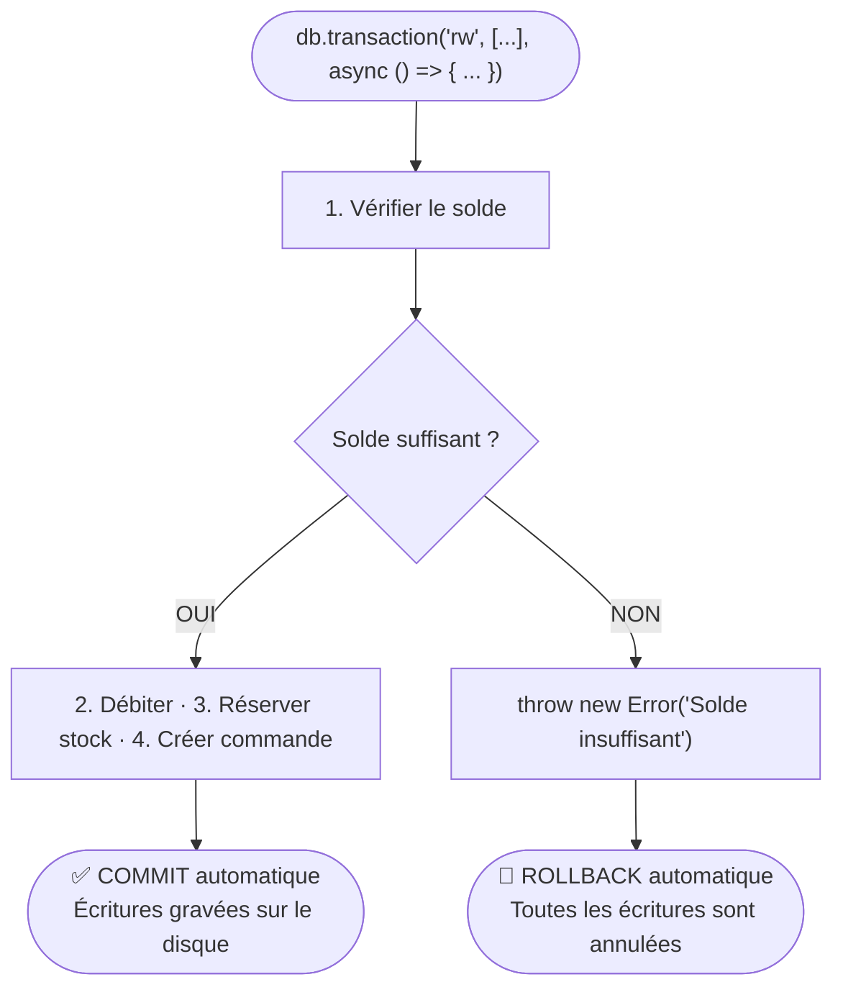

<style>
.slidev-code, .slidev-code pre { font-size: 0.72rem !important; line-height: 1.3 !important; }
.slidev-code pre { padding: 0.45rem 0.65rem !important; }
</style>

<div class="h-full flex flex-col justify-center items-center">
  <div class="inline-flex items-center gap-2 px-3.5 py-1 mb-4 text-xs font-bold rounded-full bg-blue-100 dark:bg-blue-900/40 text-blue-700 dark:text-blue-300 border-2 border-blue-300 dark:border-blue-700">
    <span class="w-2.5 h-2.5 rounded-full bg-blue-600 animate-pulse"></span>
    Programmation Orientée Objet · EAFC
  </div>

  <h1 class="text-4xl font-extrabold tracking-tight mb-3 bg-gradient-to-r from-blue-700 via-indigo-600 to-purple-700 bg-clip-text text-transparent">
    Séance 19 — IndexedDB & Dexie.js
  </h1>

  <p class="text-base text-slate-800 dark:text-slate-100 max-w-2xl mx-auto mb-5 font-semibold">
    <code>IndexedDB</code> · Le Gouffre Objet-Relationnel · Index & Requêtes Fluides · Transactions ACID · Migrations
  </p>

  <div class="flex items-center justify-center gap-2 text-xs font-mono font-bold">
    <span class="px-2.5 py-1 rounded bg-slate-200 dark:bg-slate-800 text-slate-800 dark:text-slate-200 border border-slate-300 dark:border-slate-600">TypeScript 5+</span>
    <span class="px-2.5 py-1 rounded bg-slate-200 dark:bg-slate-800 text-slate-800 dark:text-slate-200 border border-slate-300 dark:border-slate-600">Angular 22</span>
    <span class="px-2.5 py-1 rounded bg-slate-200 dark:bg-slate-800 text-slate-800 dark:text-slate-200 border border-slate-300 dark:border-slate-600">Signal-First</span>
    <span class="px-2.5 py-1 rounded bg-purple-100 dark:bg-purple-900/40 text-purple-700 dark:text-purple-300 border border-purple-300 dark:border-purple-700">Bloc D · Persistance</span>
  </div>
</div>

<!--
Bienvenue à la séance 19 du cours de Programmation Orientée Objet !
Nous clôturons aujourd'hui le Bloc D consacré à la persistance des données.
Hier (S18), nous avons éprouvé les trois murs de LocalStorage : 5 Mo, gel du thread, zéro requête.
Aujourd'hui, nous découvrons la réponse professionnelle : IndexedDB, la vraie base de données du navigateur,
et Dexie.js, la bibliothèque qui la rend simple et 100% orientée objet.
Au programme : requêtes fluides, transactions ACID et migrations de schéma.
-->

---
layout: default
---

# 🎯 Objectifs pédagogiques de la séance (1/2)

<div class="grid grid-cols-2 gap-3.5 mt-4 text-xs">
  <div class="p-2.5 rounded-xl bg-slate-500/5 border border-slate-500/15 flex items-start gap-3">
    <span class="w-7 h-7 rounded-lg bg-blue-500/10 text-blue-500 flex items-center justify-center font-bold text-xs flex-shrink-0">01</span>
    <div>
      <h4 class="font-bold text-sm mb-0.5">Découvrir IndexedDB & Dexie.js</h4>
      <p class="opacity-75">Comprendre pourquoi IndexedDB est la vraie base de données du navigateur (gigaoctets, asynchrone, indexée) et comment Dexie.js la dompte avec des classes TypeScript.</p>
    </div>
  </div>

  <div class="p-2.5 rounded-xl bg-slate-500/5 border border-slate-500/15 flex items-start gap-3">
    <span class="w-7 h-7 rounded-lg bg-indigo-500/10 text-indigo-500 flex items-center justify-center font-bold text-xs flex-shrink-0">02</span>
    <div>
      <h4 class="font-bold text-sm mb-0.5">Comprendre le Gouffre Objet-Relationnel</h4>
      <p class="opacity-75">Voir pourquoi stocker des objets dans des tables SQL est douloureux (<em>impedance mismatch</em>) et pourquoi le modèle NoSQL réconcilie nos entités avec le disque.</p>
    </div>
  </div>

  <div class="p-2.5 rounded-xl bg-slate-500/5 border border-slate-500/15 flex items-start gap-3">
    <span class="w-7 h-7 rounded-lg bg-purple-500/10 text-purple-500 flex items-center justify-center font-bold text-xs flex-shrink-0">03</span>
    <div>
      <h4 class="font-bold text-sm mb-0.5">Modéliser une Base Typée avec Dexie</h4>
      <p class="opacity-75">Maîtriser le schéma de stores et la syntaxe des index : clés (<code>id</code> / <code>++id</code>), uniques (<code>&</code>), multi-entry (<code>*</code>) et composés (<code>[a+b]</code>).</p>
    </div>
  </div>

  <div class="p-2.5 rounded-xl bg-slate-500/5 border border-slate-500/15 flex items-start gap-3">
    <span class="w-7 h-7 rounded-lg bg-rose-500/10 text-rose-500 flex items-center justify-center font-bold text-xs flex-shrink-0">04</span>
    <div>
      <h4 class="font-bold text-sm mb-0.5">Exploiter la Fluent API de Requêtes</h4>
      <p class="opacity-75">Interroger la base avec élégance : égalité, préfixes insensibles à la casse, intervalles, tris, paginations et arbitrages entre index et filtres mémoire.</p>
    </div>
  </div>
</div>

<!--
Présentez ces 4 premiers objectifs.
Rappelez que jusqu'ici, la persistance ressemblait soit à un fichier JSON (S16),
soit à des chaînes clé-valeur dans LocalStorage (S18).
Aujourd'hui, nous montons d'un niveau : une véritable base de données transactionnelle dans le navigateur.
-->

---
layout: default
---

# 🎯 Objectifs pédagogiques de la séance (2/2)

<div class="grid grid-cols-2 gap-3.5 mt-4 text-xs">
  <div class="p-2.5 rounded-xl bg-slate-500/5 border border-slate-500/15 flex items-start gap-3">
    <span class="w-7 h-7 rounded-lg bg-amber-500/10 text-amber-500 flex items-center justify-center font-bold text-xs flex-shrink-0">05</span>
    <div>
      <h4 class="font-bold text-sm mb-0.5">Garantir l'Intégrité par Transactions ACID</h4>
      <p class="opacity-75">Comprendre les 4 piliers ACID. Exécuter des opérations multi-tables atomiques avec annulation automatique (<em>rollback</em>) dès qu'une erreur survient.</p>
    </div>
  </div>

  <div class="p-2.5 rounded-xl bg-slate-500/5 border border-slate-500/15 flex items-start gap-3">
    <span class="w-7 h-7 rounded-lg bg-emerald-500/10 text-emerald-500 flex items-center justify-center font-bold text-xs flex-shrink-0">06</span>
    <div>
      <h4 class="font-bold text-sm mb-0.5">Piloter les Migrations & Angular Signal-First</h4>
      <p class="opacity-75">Faire évoluer une base installée chez des milliers d'utilisateurs sans perdre une donnée, et marier les Promises de Dexie avec <code>signal()</code> et <code>computed()</code>.</p>
    </div>
  </div>
</div>

<div class="mt-4 p-3 rounded-xl bg-blue-500/10 border border-blue-500/20 text-xs">
  <div class="font-bold text-blue-700 dark:text-blue-300 mb-1 flex items-center gap-1.5">
    <span>💡</span> Le Fil Conducteur Pédagogique
  </div>
  <p class="opacity-85">
    Dans une vraie application moderne (Offline-First, PWA, gestion de stock), perdre la connexion ou rafraîchir la page ne doit jamais détruire le travail de l'utilisateur.
    Dexie.js donne à nos classes une persistance robuste, rapide et transactionnelle — directement sur la machine client.
  </p>
</div>

<!--
Présentez ces deux objectifs en insistant sur la responsabilité professionnelle :
Créer une application qui marche sur sa machine, c'est facile.
Créer une application dont les données survivent aux pannes et aux mises à jour, c'est le métier d'ingénieur.
-->

---
layout: center
class: text-center
---

<div class="inline-flex items-center gap-2 px-3 py-1 mb-3 text-xs font-mono font-semibold rounded-full bg-blue-500/10 text-blue-500 border border-blue-500/20">
  PARTIE 00
</div>

# Le Cheminement : D'où venons-nous ?
## La Clôture du Bloc D (Persistance des Données)

<!--
Prenez 2 minutes pour contextualiser cette séance.
Les étudiants découvrent la POO pour la première fois : ils ont besoin de repères sur la carte du cours.
-->

---
layout: default
---

# La progression pédagogique du cursus POO

<div class="grid grid-cols-12 gap-2 mt-2 text-xs">
  <div class="col-span-3 p-2.5 rounded-xl bg-slate-500/5 border border-slate-500/15">
    <div class="font-mono font-bold text-blue-500 mb-1">BLOC A (S5 à S9)</div>
    <h3 class="font-bold mb-1">Fondamentaux POO</h3>
    <ul class="opacity-80 space-y-0.5 text-[10px]">
      <li>Encapsulation & invariants (S5)</li>
      <li>Héritage & spécialisation (S6)</li>
      <li>Polymorphisme dynamique (S7)</li>
      <li>Abstraction & contrats purs (S8)</li>
      <li>Composition vs héritage (S9)</li>
    </ul>
    <div class="mt-2 px-1.5 py-0.5 rounded bg-blue-500/10 text-blue-600 dark:text-blue-400 font-semibold text-center text-[10px]">
      Architecture & Objets
    </div>
  </div>

  <div class="col-span-3 p-2.5 rounded-xl bg-slate-500/5 border border-slate-500/15">
    <div class="font-mono font-bold text-indigo-500 mb-1">BLOC B (S10 à S12)</div>
    <h3 class="font-bold mb-1">Conception & Qualité</h3>
    <ul class="opacity-80 space-y-0.5 text-[10px]">
      <li>Exceptions & robustesse (S10)</li>
      <li>Principes SOLID (S, O, D) (S11)</li>
      <li>Identité, égalité & clonage (S12)</li>
    </ul>
    <div class="mt-2 px-1.5 py-0.5 rounded bg-indigo-500/10 text-indigo-600 dark:text-indigo-400 font-semibold text-center text-[10px]">
      Règles & Fiabilité
    </div>
  </div>

  <div class="col-span-3 p-2.5 rounded-xl bg-slate-500/5 border border-slate-500/15">
    <div class="font-mono font-bold text-purple-500 mb-1">BLOC C (S13 à S15)</div>
    <h3 class="font-bold mb-1">Angular Signal-First</h3>
    <ul class="opacity-80 space-y-0.5 text-[10px]">
      <li>Composants & Signals réactifs (S13)</li>
      <li>Services & Injection (DI) (S14)</li>
      <li>Signal Forms & Routing SPA (S15)</li>
    </ul>
    <div class="mt-2 px-1.5 py-0.5 rounded bg-purple-500/10 text-purple-600 dark:text-purple-400 font-semibold text-center text-[10px]">
      Réactivité & UI
    </div>
  </div>

  <div class="col-span-3 p-2.5 rounded-xl bg-amber-500/10 border-2 border-amber-500/40">
    <div class="font-mono font-bold text-amber-500 mb-1">BLOC D (S16 à S19)</div>
    <h3 class="font-bold mb-1">Persistance Données</h3>
    <ul class="opacity-80 space-y-0.5 text-[10px]">
      <li>Sérialisation & DTOs (S16)</li>
      <li>Consommer une API REST (S17)</li>
      <li>LocalStorage & limites (S18)</li>
      <li class="font-bold text-amber-600 dark:text-amber-300">👉 Dexie.js & ACID (S19)</li>
    </ul>
    <div class="mt-2 px-1.5 py-0.5 rounded bg-amber-500/20 text-amber-700 dark:text-amber-300 font-bold text-center text-[10px]">
      Clôture du Bloc D !
    </div>
  </div>
</div>

<div class="mt-4 p-3 rounded-xl bg-amber-500/10 border border-amber-500/20 text-xs">
  <div class="font-bold text-amber-700 dark:text-amber-300 mb-1 flex items-center gap-1.5">
    <span>🚀</span> La Grande Traversée du Bloc D
  </div>
  <p class="opacity-85">
    En <strong>S16</strong>, le format JSON et le piège du prototype perdu. En <strong>S17</strong>, le réseau avec <code>httpResource()</code>. En <strong>S18</strong>, les limites de LocalStorage (synchrone, 5 Mo, texte brut). Aujourd'hui en <strong>S19</strong>, nous maîtrisons l'outil ultime : une base NoSQL typée, asynchrone, indexée et transactionnelle !
  </p>
</div>

<!--
Rappelez la cohérence pédagogique :
S16 : sérialisation et réhydratation (DTO -> Entité).
S17 : communication asynchrone avec un serveur distant.
S18 : limites physiques de LocalStorage (synchrone, pas de requêtes, pas de transactions).
S19 : nous apportons la réponse professionnelle à tous les problèmes de S18.
-->

---
layout: default
---

# La Grande Question de la Séance 19

<div class="grid grid-cols-12 gap-4 mt-3 text-xs items-start">
  <div class="col-span-6 p-3 rounded-xl bg-rose-500/10 border border-rose-500/20 space-y-2">
  <div class="font-bold text-rose-600 dark:text-rose-400 text-sm flex items-center gap-1.5">
  <span>🛑</span> Quand l'application passe à l'échelle
  </div>
  <p>
      Imaginez une application utilisée par des techniciens itinérants, des commerciaux ou des médecins :
  </p>
  <ul class="list-disc list-inside space-y-1.5 opacity-85">
  <li><strong>50 000 dossiers</strong> avec historique et commentaires.</li>
  <li><strong>Recherche instantanée</strong> par nom, catégorie ou date.</li>
  <li><strong>Fonctionnement 100% hors-ligne</strong> dans les zones blanches.</li>
  <li><strong>Opérations critiques :</strong> modifier une facture ET ajuster les stocks simultanément, sans risque de divergence.</li>
  </ul>
  <p class="font-semibold text-rose-700 dark:text-rose-300">
      LocalStorage explose instantanément (rappel des 3 murs de S18) !
  </p>
  </div>

  <div class="col-span-6 p-3 rounded-xl bg-emerald-500/10 border border-emerald-500/20 space-y-2">
  <div class="font-bold text-emerald-600 dark:text-emerald-400 text-sm flex items-center gap-1.5">
  <span>✨</span> Le Défi Architectural
  </div>
  <ul class="list-disc list-inside space-y-1.5 opacity-85">
  <li>Comment stocker des <strong>objets métiers riches</strong> sans les détricoter en tables rigides ?</li>
  <li>Comment interroger des milliers d'enregistrements en <strong>moins d'une milliseconde</strong> sans bloquer l'Event Loop ?</li>
  <li>Comment garantir que <strong>deux écritures liées</strong> réussissent ensemble ou échouent ensemble ?</li>
  <li>Comment mettre à jour le code chez les clients <strong>sans détruire leur base</strong> ?</li>
  </ul>
  </div>
</div>

<div class="mt-4 p-3 rounded-xl bg-purple-500/10 border border-purple-500/20 text-center text-xs font-semibold">
  🎯 La Réponse : IndexedDB propulsée par Dexie.js
</div>

<!--
Interrogez les étudiants :
"Que se passe-t-il si un utilisateur enregistre une commande et que sa batterie coupe net au milieu ?
Avec LocalStorage, le fichier est corrompu ou à moitié écrit.
Avec Dexie.js et les transactions ACID, la base revient automatiquement à son état précédent."
-->

---
layout: center
class: text-center
---

<div class="inline-flex items-center gap-2 px-3 py-1 mb-3 text-xs font-mono font-semibold rounded-full bg-blue-500/10 text-blue-500 border border-blue-500/20">
  PARTIE 01
</div>

# IndexedDB & Le Gouffre Objet-Relationnel
## Pourquoi le Modèle NoSQL du Web est Taillé pour la POO

<p class="opacity-70 text-sm max-w-xl mx-auto">
  Comprendre l'architecture d'IndexedDB et comment Dexie.js fait disparaître toute la friction.
</p>

<!--
Partie 1 : Les fondations théoriques.
Pourquoi une base NoSQL dans le navigateur ?
Pourquoi est-ce une aubaine pour les développeurs orientés objet ?
-->

---
layout: default
---

# Qu'est-ce qu'IndexedDB ? Le Moteur NoSQL Natif

Tous les navigateurs modernes (Chrome, Firefox, Safari, Edge) intègrent un véritable moteur de base de données standardisé :

<div class="grid grid-cols-12 gap-3 mt-2 text-xs items-start">
  <div class="col-span-6 p-3 rounded-xl bg-emerald-500/10 border border-emerald-500/20 space-y-2">
  <h4 class="font-bold text-sm text-emerald-600 dark:text-emerald-400">🏗️ Les Caractéristiques Physiques</h4>
  <ul class="list-disc list-inside space-y-1.5 opacity-85">
  <li><strong>Base NoSQL orientée objets :</strong> des <em>Object Stores</em> (magasins d'objets), pas des tables à colonnes fixes.</li>
  <li><strong>Capacité gigantesque :</strong> plusieurs gigaoctets selon l'espace disque disponible (contre 5 Mo !).</li>
  <li><strong>Moteur d'index B-Tree :</strong> recherche instantanée sur n'importe quel champ indexé.</li>
  <li><strong>100% Asynchrone :</strong> ne gèle JAMAIS le thread principal (contrairement à LocalStorage !).</li>
  <li><strong>Transactions ACID :</strong> sécurité absolue contre les corruptions.</li>
  </ul>
  </div>

  <div class="col-span-6 p-3 rounded-xl bg-slate-500/5 border border-slate-500/15 space-y-2">
  <h4 class="font-bold text-sm text-purple-600 dark:text-purple-400">🧩 Comment il stocke les données</h4>
  <p class="opacity-80">
      Grâce à l'algorithme natif de <strong>Structured Clone</strong>, IndexedDB stocke directement des objets :
  </p>
  <ul class="list-disc list-inside space-y-1 opacity-80">
  <li>Des objets JavaScript et des tableaux imbriqués <strong>sans JSON.stringify</strong> !</li>
  <li>Des <code>Date</code>, des <code>Uint8Array</code> (fichiers, images).</li>
  <li>Chaque objet reçoit une clé primaire unique ; des index secondaires permettent les recherches instantanées.</li>
  </ul>
  </div>
</div>

<div class="mt-3 p-2.5 rounded-xl bg-blue-500/10 border border-blue-500/20 text-center text-xs font-semibold">
  💡 IndexedDB n'est pas un fichier texte amélioré : c'est un mini-MongoDB embarqué dans chaque onglet ! (Spotify Web, Gmail hors-ligne et WhatsApp Web l'utilisent.)
</div>

<!--
Expliquez aux étudiants que ce moteur est présent dans leurs navigateurs depuis 2011.
Quand ils utilisent Spotify Web ou WhatsApp Web, tous leurs messages en cache sont stockés dans IndexedDB !
-->

---
layout: default
---

# Le Gouffre Objet-Relationnel : l'Analogie de la Voiture Découpée

Pourquoi stocker des objets dans des tables SQL est-il si douloureux ? Ce décalage s'appelle le **Gouffre d'Impédance** (*Impedance Mismatch*) :

<div class="grid grid-cols-12 gap-3 mt-3 text-xs items-start">
  <div class="col-span-6 p-3 rounded-xl bg-rose-500/10 border border-rose-500/20 space-y-2">
<h4 class="font-bold text-sm text-rose-600 dark:text-rose-400">🚗 En Base Relationnelle SQL :</h4>
<ol class="list-decimal list-inside space-y-1 opacity-80">
<li>Pour garer votre voiture (votre objet) dans le garage SQL, vous devez <strong>la démonter entièrement</strong> : roues dans la table <code>ROUES</code>, pistons dans <code>PISTONS</code>, carrosserie dans <code>CARROSSERIES</code>...</li>
<li>Le lendemain, pour repartir travailler, il faut <strong>remonter chaque boulon</strong> avec des <code>JOIN</code> !</li>
<li>Un tableau <code>tags</code> ? Impossible : il faut une table associative tierce <code>Livre_Tag</code>.</li>
</ol>
  </div>

  <div class="col-span-6 p-3 rounded-xl bg-emerald-500/10 border border-emerald-500/20 space-y-2">
<h4 class="font-bold text-sm text-emerald-600 dark:text-emerald-400">📦 En Base NoSQL / IndexedDB :</h4>
<ul class="list-disc list-inside space-y-1 opacity-80">
<li>Vous ouvrez la porte du garage et <strong>vous garez la voiture entière</strong> d'un seul coup !</li>
<li>Le moteur reste dans la voiture, les roues restent vissées. Tableaux et sous-objets sont conservés nativement.</li>
<li>Le lendemain : vous tournez la clé de contact et vous repartez instantanément.</li>
</ul>
<div class="mt-2 p-2 rounded bg-emerald-500/20 text-emerald-700 dark:text-emerald-300 font-bold text-center">
      Zéro démontage · Zéro remontage · Structure intacte !
</div>
  </div>
</div>

<!--
Cette métaphore de Ted Neward marque profondément les esprits.
Expliquez qu'en entreprise, des milliers d'heures sont perdues avec les ORM (Hibernate, Entity Framework)
qui tentent de faire rentrer des objets ronds dans des trous carrés de tables SQL.
En IndexedDB, l'objet est stocké intact : pas besoin de 5 tables pour une facture avec ses lignes et ses tags !
-->

---
layout: default
---

# Dexie.js : Le Wrapper Orienté Objet d'IndexedDB

L'API IndexedDB native du W3C est notoirement pénible. **Dexie.js** est la bibliothèque open-source de référence pour la dompter :

<div class="grid grid-cols-12 gap-3 mt-2 text-xs items-start">
  <div class="col-span-6 p-3 rounded-xl bg-rose-500/10 border border-rose-500/20 space-y-2">
<h4 class="font-bold text-sm text-rose-600 dark:text-rose-400">❌ IndexedDB Native</h4>
<ul class="list-disc list-inside space-y-1 opacity-80 text-[11px]">
<li>API événementielle verbeuse de 2011 : <code>request.onsuccess</code>, <code>request.onerror</code>...</li>
<li>Pas de Promises, pas d'<code>async / await</code> propre.</li>
<li>Zéro typage TypeScript : tout est <code>any</code>.</li>
<li>Plus de <strong>40 lignes</strong> pour une simple insertion !</li>
</ul>
  </div>

  <div class="col-span-6 p-3 rounded-xl bg-emerald-500/10 border border-emerald-500/20 space-y-2">
<h4 class="font-bold text-sm text-emerald-600 dark:text-emerald-400">✅ Dexie.js</h4>
<ul class="list-disc list-inside space-y-1 opacity-80 text-[11px]">
<li><strong>100% Orienté Objet :</strong> notre base hérite de la classe <code>Dexie</code> (héritage de S06 !).</li>
<li><strong>Typage fort :</strong> <code>Table&lt;EntiteDTO, TypeCle&gt;</code>.</li>
<li><strong>Promises & async / await :</strong> code lisible et linéaire.</li>
<li><strong>Fluent API :</strong> <code>db.taches.where('priorite').equals('haute')</code>.</li>
</ul>
  </div>
</div>

```typescript
// Trouver les tâches urgentes avec Dexie.js : 4 lignes limpides !
const urgentes = await db.taches
  .where('priorite')
  .equals('haute')
  .toArray();
```

<div class="mt-2 p-2.5 rounded-xl bg-blue-500/10 border border-blue-500/20 text-center text-xs font-semibold">
  🎯 Dexie.js ne réinvente pas un moteur : c'est une fine couche orientée objet (quelques ko) qui sublime le moteur déjà présent dans le navigateur
</div>

<!--
Expliquez cette nuance architecturale :
Dexie.js n'alourdit pas l'application d'un moteur de 50 Mo.
Il ne pèse que quelques kilo-octets car le vrai moteur (IndexedDB) est déjà préinstallé chez l'utilisateur !
-->

---
layout: default
---

# Créer sa Première Base Dexie en TypeScript / POO

Voici comment se modélise une base de données Dexie.js — tout se passe dans une classe :

<div class="grid grid-cols-12 gap-1 mt-0 text-xs items-start">
  <div class="col-span-8  space-y-2">

```typescript
import Dexie, { Table } from 'dexie';
import { TacheDTO } from './tache.dto';

// 1. Notre classe hérite de Dexie (Héritage POO — S06 !)
export class AppDatabase extends Dexie {
  // 2. Table typée : Table<TypeEntite, TypeDeLaClePrimaire>
  taches!: Table<TacheDTO, string>;

  constructor() {
    super('EAFC_TodoDB'); // Nom de la base dans le navigateur

    // 3. Définition du schéma : les clés de RECHERCHE uniquement !
    this.version(1).stores({
      taches: 'id, priorite, terminee, dateCreationISO'
    });
  }
}

// 4. Instance unique (Singleton) partagée par toute l'application
export const db = new AppDatabase();
```

</div>

  <div class="col-span-4 p-3 rounded-xl  space-y-2">


  <div class="p-2.5 rounded-xl bg-rose-500/10 border border-rose-500/20">
    ❌ <strong>Le mauvais réflexe SQL :</strong> lister TOUTES les propriétés de la classe dans le schéma. Chaque index consomme du disque et ralentit les écritures !
  </div>
  <div class="p-2.5 rounded-xl bg-emerald-500/10 border border-emerald-500/20">
    ✅ <strong>La règle d'or Dexie :</strong> le schéma ne liste QUE les champs sur lesquels vous ferez des <code>.where()</code>. Toutes les autres propriétés sont <strong>stockées automatiquement</strong> quand même !
  </div>

</div>
</div>

<!--
Insistez très lourdement sur la règle d'or :
"Répétez après moi : Dexie stocke TOUT l'objet automatiquement. Le schéma n'est PAS une table SQL,
c'est une liste d'index de recherche !"
-->

<style>
  pre code { font-size: 11px !important; }
</style>

---
layout: center
class: text-center
---

<div class="inline-flex items-center gap-2 px-3 py-1 mb-3 text-xs font-mono font-semibold rounded-full bg-blue-500/10 text-blue-500 border border-blue-500/20">
  PARTIE 02
</div>

# L'Indexation Avancée dans Dexie.js
## Clés Primaires, Index Uniques, Multi-Entry & Composés

<p class="opacity-70 text-sm max-w-xl mx-auto">
  Comprendre physiquement ce qu'est un index B-Tree et maîtriser la syntaxe concise des schémas Dexie.
</p>

<!--
Partie 2 : L'indexation.
C'est un sujet délicat pour des étudiants qui découvrent les bases de données.
Prenons le temps de bien leur faire comprendre ce qu'est physiquement un index.
-->

---
layout: default
---

# Pourquoi Indexer ? Du Scan O(n) à l'Index B-Tree O(log n)

<div class="grid grid-cols-12 gap-3 mt-2 text-xs items-start">
  <div class="col-span-6 p-3 rounded-xl bg-rose-500/10 border border-rose-500/20 space-y-2">
<h4 class="font-bold text-sm text-rose-600 dark:text-rose-400">🐢 Sans Index : le Balayage Total</h4>
<p class="opacity-80">
      Imaginez un dictionnaire de 50 000 mots dont les pages ont été mélangées :
</p>
<ul class="list-disc list-inside space-y-1 opacity-75">
<li>Pour trouver <em>"Polymorphisme"</em>, vous lisez <strong>chaque mot un par un</strong>.</li>
<li>Complexité : <strong>O(n)</strong> — 50 000 objets examinés en mémoire.</li>
<li>L'application ralentit et chauffe la batterie !</li>
</ul>
  </div>

  <div class="col-span-6 p-3 rounded-xl bg-emerald-500/10 border border-emerald-500/20 space-y-2">
<h4 class="font-bold text-sm text-emerald-600 dark:text-emerald-400">⚡ Avec un Index B-Tree : la Recherche Binaire</h4>
<p class="opacity-80">
      L'index maintient les données triées dans un arbre équilibré :
</p>
<ul class="list-disc list-inside space-y-1 opacity-75">
<li>Le moteur ouvre le dictionnaire au milieu, élimine la moitié, recommence...</li>
<li>Complexité : <strong>O(log n)</strong> — <strong>seulement 16 comparaisons</strong> pour 50 000 objets !</li>
<li>Résultat localisé en moins de 0.2 milliseconde.</li>
</ul>
  </div>
</div>

<div class="mt-3 p-2.5 rounded-xl bg-purple-500/10 border border-purple-500/20 text-center text-xs font-semibold">
  🔑 Règle d'or : toute propriété sur laquelle vous ferez un <code>.where()</code> doit impérativement figurer dans le schéma Dexie !
</div>

<!--
Faites le calcul avec eux : log2(50 000) ≈ 15.6, donc 16 accès au lieu de 50 000 !
C'est le même principe que le jeu où l'on devine un nombre entre 1 et 100 en répondant "plus grand" ou "plus petit".
-->

---
layout: default
---

# La Clé Primaire : `id` Métier vs `++id` Auto-Incrémenté

Chaque Object Store possède une clé primaire unique, déclarée en **première position** :

<div class="grid grid-cols-12 gap-3 mt-2 text-xs items-start">
  <div class="col-span-6 p-3 rounded-xl bg-slate-500/5 border border-slate-500/15 space-y-2">
<h4 class="font-bold text-sm text-blue-600 dark:text-blue-400">1. Clé Métier Explicite (UUID)</h4>
<p class="opacity-80 font-mono text-[11px]"><code>stores({ articles: 'id, titre' })</code></p>

```typescript
const article = {
  id: crypto.randomUUID(), // Vous fournissez l'identifiant
  titre: 'Clavier Mécanique',
  prix: 89.99
};
await db.articles.add(article);
```

<div class="mt-2 p-2 rounded bg-blue-500/10 border border-blue-500/20 text-[11px]">
  💡 <strong>Quand ?</strong> Si l'objet doit être synchronisé avec un serveur plus tard :
  l'ID créé hors-ligne reste le même partout. Deux téléphones ne génèreront jamais le même UUID !
</div>
  </div>

  <div class="col-span-6 p-3 rounded-xl bg-slate-500/5 border border-slate-500/15 space-y-2">
<h4 class="font-bold text-sm text-purple-600 dark:text-purple-400">2. Clé Auto-Incrémentée (<code>++id</code>)</h4>
<p class="opacity-80 font-mono text-[11px]"><code>stores({ logs: '++id, timestamp, niveau' })</code></p>

```typescript
// Pas besoin de spécifier 'id' : Dexie l'attribue au vol !
const idGenere = await db.logs.add({
  timestamp: Date.now(),
  niveau: 'INFO',
  message: 'Utilisateur connecté'
});
console.log('Attribué ID n°', idGenere); // 1, puis 2, puis 3...
```

<div class="mt-2 p-2 rounded bg-purple-500/10 border border-purple-500/20 text-[11px]">
  💡 <strong>Quand ?</strong> Pour des données purement locales (historique, logs, brouillons).
</div>
  </div>
</div>

<!--
Expliquez l'arbitrage :
Si deux téléphones hors-ligne créent chacun une entrée avec ++id, les deux recevront id=1 : collision à la synchronisation !
Avec crypto.randomUUID(), aucun risque : chaque téléphone génère un identifiant unique au monde.
-->

<style>
  pre code { font-size: 10px !important; }
</style>

---
layout: default
---

## L'Index Unique (`&email`) : Prévention Physique des Doublons

Dans nos modèles métiers, certaines valeurs ne doivent **jamais** exister en double :

<div class="grid grid-cols-12 gap-3 mt-2 text-xs items-start">
  <div class="col-span-6">

```typescript
// Le symbole & déclare une contrainte d'unicité !
this.version(1).stores({
  utilisateurs: 'id, &email, role',
  produits: '++id, &codeBarre, nom, categorie'
});
```

<div class="mt-3 p-3 rounded-xl bg-blue-500/10 border border-blue-500/20 text-xs">
  💡 <strong>Le symbole <code>&</code> (ampersand) :</strong>
  si vous tentez d'insérer un deuxième utilisateur avec le même email,
  IndexedDB refuse immédiatement l'insertion et lève une exception <code>ConstraintError</code> !
</div>

  </div>

  <div class="col-span-6">
<div class="p-3 rounded-xl bg-slate-500/5 border border-slate-500/15">
<h4 class="font-bold text-indigo-600 dark:text-indigo-400 text-sm mb-1">🛡️ La Ceinture de Sécurité du Disque</h4>
<p class="opacity-80 text-xs">
        En POO, nous protégeons les invariants dans le constructeur (S05).
        L'index unique <code>&</code> ajoute une <strong>seconde ceinture</strong> au niveau physique du disque :
</p>

```typescript
try {
  await db.utilisateurs.add({
    id: crypto.randomUUID(),
    email: 'admin@eafc.be',
    role: 'ADMIN'
  });
} catch (err) {
  // Interception typée (S10 : Exceptions !)
  if (err instanceof Dexie.ConstraintError) {
    console.error('Cet email est déjà enregistré !');
  }
}
```

</div>
  </div>
</div>

<!--
Montrez la convergence avec le cours :
S05 : nous avons encapsulé nos objets. S10 : nous avons appris à gérer les exceptions typées.
Ici, Dexie lève une ConstraintError si la règle d'unicité physique est violée. Tout s'emboîte !
-->

<style>
  pre code { font-size: 11px !important; }
</style>

---
layout: default
---

# L'Index Multi-Entry (`*tags`) : Indexer au Cœur des Tableaux !

L'une des fonctionnalités les plus spectaculaires d'IndexedDB — inexistante en SQL sans table de jointure :

<div class="grid grid-cols-12 gap-3 mt-2 text-xs items-start">
  <div class="col-span-6">

```typescript
// Le préfixe * indexe CHAQUE élément du tableau !
this.version(1).stores({
  recettes: 'id, titre, *ingredients, tempsCuisson'
});

await db.recettes.add({
  id: 'r1',
  titre: 'Gâteau au Chocolat',
  ingredients: ['chocolat', 'farine', 'beurre', 'oeufs'],
  tempsCuisson: 30
});
```

<div class="mt-2 p-2 rounded-xl bg-purple-500/10 border border-purple-500/20 text-xs">
  🌟 Dexie extrait chaque élément du tableau et crée une entrée d'index distincte pour chacun !
</div>

  </div>

  <div class="col-span-6">
<div class="p-3 rounded-xl bg-emerald-500/10 border border-emerald-500/20">
<h4 class="font-bold text-emerald-600 dark:text-emerald-400 text-sm mb-1">🔍 Rechercher par ingrédient en 1 ms :</h4>

```typescript
// Toutes les recettes contenant du chocolat
const avecChocolat = await db.recettes
  .where('ingredients')
  .equals('chocolat')
  .toArray();
```

<p class="opacity-80 text-xs mt-2">
        Sans l'index <code>*</code>, il faudrait charger toutes les recettes et filtrer en mémoire avec <code>.includes()</code>.
        Avec <code>*</code>, IndexedDB saute directement à la page du B-Tree "chocolat" !
</p>
</div>
<div class="mt-2 p-2.5 rounded-xl bg-slate-500/5 border border-slate-500/15 text-[11px]">
  ⚖️ En SQL, il aurait fallu 3 tables : RECETTES, INGREDIENTS et RECETTE_INGREDIENT. Ici : une seule ligne de schéma !
</div>
  </div>
</div>

<!--
Expliquez la puissance de cette fonctionnalité avec l'exemple des recettes : très parlant.
Une seule ligne de schéma ('id, titre, *ingredients') remplace tout un système de tags relationnel !
-->

<style>
  pre code { font-size: 11px !important; }
</style>

---
layout: default
---

# L'Index Composé (`[statut+priorite]`) : Requêtes Multi-Critères

Quand une application filtre fréquemment sur deux critères **combinés**, un index composé évite les scans :

<div class="grid grid-cols-12 gap-3 mt-2 text-xs items-start">
  <div class="col-span-6">

```typescript
// Syntaxe entre crochets : [colonneA+colonneB]
this.version(1).stores({
  taches: 'id, titre, statut, priorite, [statut+priorite]'
});

// Requête ciblée ultra-rapide sur la COMBINAISON exacte
const tachesUrgentesEnCours = await db.taches
  .where('[statut+priorite]')
  .equals(['EN_COURS', 'HAUTE'])
  .toArray();
```

<div class="mt-2 p-2.5 rounded-xl bg-blue-500/10 border border-blue-500/20 text-xs">
  💡 IndexedDB fusionne les deux clés dans un seul arbre B-Tree :
  le moteur localise directement la paire, sans filtrer la 2ᵉ condition en mémoire !
</div>

  </div>

  <div class="col-span-6 space-y-2">
<div class="p-3 rounded-xl bg-slate-500/5 border border-slate-500/15">
<h4 class="font-bold text-purple-600 dark:text-purple-400 text-sm mb-1">🎯 Cas d'usage fréquents :</h4>
<ul class="list-disc list-inside space-y-1.5 opacity-85 text-xs">
<li><code>[clientId+dateCommande]</code> : commandes d'un client, classées par date.</li>
<li><code>[categorie+enStock]</code> : produits d'un rayon immédiatement disponibles.</li>
</ul>
</div>

<div class="p-2.5 rounded-xl bg-amber-500/10 border border-amber-500/20 text-xs">
      ⚠️ <strong>L'ordre compte :</strong> dans <code>[statut+priorite]</code>, l'arbre est trié d'abord par statut, puis par priorité.
</div>
  </div>
</div>

<!--
Faites bien comprendre la différence :
Deux index séparés ('statut, priorite') obligeraient Dexie à chercher sur le premier index, puis à filtrer le reste en mémoire.
Avec l'index composé, le B-Tree est directement organisé pour la paire ('EN_COURS', 'HAUTE').
-->

<style>
  pre code { font-size: 11px !important; }
</style>

---
layout: center
class: text-center
---

<div class="inline-flex items-center gap-2 px-3 py-1 mb-3 text-xs font-mono font-semibold rounded-full bg-blue-500/10 text-blue-500 border border-blue-500/20">
  PARTIE 03
</div>

# La Fluent API de Requêtes
## CRUD, Préfixes, Intervalles, Tris & Pagination

<p class="opacity-70 text-sm max-w-xl mx-auto">
  Interroger la base : chaque requête se lit comme une phrase.
</p>

<!--
Partie 3 : Les requêtes.
La Fluent API de Dexie est l'une des plus agréables du monde TypeScript.
Une requête se lit de gauche à droite, comme une phrase !
-->

---
layout: default
---

# Le CRUD de Base : Aussi Simple qu'une Promise

Plus besoin de `JSON.stringify` ni de réécrire 5 Mo : chaque opération est asynchrone et typée :

<div class="grid grid-cols-12 gap-3 mt-2 text-xs items-start">
  <div class="col-span-6 space-y-2">
  <div class="">
  <div class="font-bold text-emerald-600 dark:text-emerald-400 mb-1">1. CREATE — Insérer un objet</div>

```typescript
await db.taches.add({
  id: crypto.randomUUID(),
  titre: 'Réviser la POO',
  priorite: 'haute',
  terminee: false,
  dateCreationISO: new Date().toISOString()
});
```
</div>

  <div class="">
  <div class="font-bold text-blue-600 dark:text-blue-400 mb-1">2. READ — Lire les enregistrements</div>

```typescript
const toutes: TacheDTO[] = await db.taches.toArray();
const uneSeule: TacheDTO | undefined = await db.taches.get('id-123');
```
</div>
  </div>

  <div class="col-span-6 space-y-2">
  <div class="">
  <div class="font-bold text-indigo-600 dark:text-indigo-400 mb-1">3. UPDATE — Modifier</div>

```typescript
await db.taches.update('id-123', { terminee: true });
```
</div>

  <div class="">
  <div class="font-bold text-rose-600 dark:text-rose-400 mb-1">4. DELETE — Supprimer</div>

```typescript
await db.taches.delete('id-123');
```
</div>

<div class="p-2.5 rounded-xl bg-emerald-500/10 border border-emerald-500/20 text-[11px]">
  🛡️ <strong>Rappel S16 :</strong> Dexie stocke le DTO (les données). Les méthodes de classe ne sont pas sérialisées :
  on réhydrate toujours avec <code>Tache.fromDTO(dto)</code> à la lecture !
</div>
  </div>
</div>

<!--
Faites remarquer la clarté du code :
Chaque opération retourne une Promise : on utilise `await`, le code reste lisible et linéaire, sans callbacks.
Et rappelez le drame du prototype perdu : le fromDTO() reste obligatoire !
-->

<style>
  pre code { font-size: 11px !important; }
</style>

---
layout: default
---

## Égalité & Recherche Textuelle

Dexie propose des comparateurs ultra-rapides qui s'appuient directement sur les index :

<div class="grid grid-cols-12 gap-3 mt-2 text-xs items-start">
  <div class="col-span-6  space-y-1.5">
<div class="font-bold text-blue-600 dark:text-blue-400 text-xs">1. Égalité stricte (<code>equals</code>)</div>

```typescript
const admins = await db.utilisateurs
  .where('role')
  .equals('ADMIN')
  .toArray();
```
  </div>

  <div class="col-span-6 space-y-1.5">
<div class="font-bold text-indigo-600 dark:text-indigo-400 text-xs">2. Préfixe (<code>startsWithIgnoreCase</code>)</div>

```typescript
// L'utilisateur tape "mar" -> trouve "Martin",
// "Marc", "MARTINET"... en moins de 1 ms !
const suggestions = await db.clients
  .where('nom')
  .startsWithIgnoreCase(saisie.trim())
  .limit(10).toArray();
```
  </div>
</div>

<div class="mt-3 grid grid-cols-12 gap-3 text-xs items-start">
  <div class="col-span-6 space-y-1.5">
<div class="font-bold text-emerald-600 dark:text-emerald-400 text-xs">3. Intervalles (<code>between</code>, <code>above</code>, <code>below</code>)</div>

```typescript
// Stock < 5 : à réapprovisionner !
const aReappro = await db.articles
  .where('stock').below(5).toArray();

// Commandes d'octobre 2026 (les dates ISO se trient naturellement !)
const octobre = await db.commandes
  .where('dateISO')
  .between('2026-10-01T00:00:00.000Z',
           '2026-10-31T23:59:59.999Z')
  .toArray();
```
  </div>

  <div class="col-span-6 space-y-1.5">
<div class="font-bold text-purple-600 dark:text-purple-400 text-xs">4. Tri, Pagination & Filtre mémoire</div>

```typescript
// Page 3 d'une liste triée par nom (10 par page)
const page3 = await db.articles
  .orderBy('nom')
  .offset(20)      // saute les 20 premiers
  .limit(10)        // en prend 10
  .toArray();
// La combinaison gagnante : index pour dégrossir,
// .filter() JS pour affiner
const grosSF = await db.livres
  .where('genre').equals('SF').filter(l => l.pages > 500).toArray();
```
  </div>
</div>

<!--
Expliquez la barre de recherche : les étudiants l'utilisent tous les jours !
Avec startsIgnoreCase + limit(10), ils ont une autocomplétion parfaite pour leur projet.
Rappelez aussi l'astuce des dates ISO (S16) : '2026-10-05' > '2026-10-04', le B-Tree trie donc les dates comme du texte.
Et la règle de l'architecte : l'index élimine 95% des données, le .filter() JS affine le reste en mémoire.
-->

<style>
  pre code { font-size: 10px !important; }
</style>

---
layout: center
class: text-center
---

<div class="inline-flex items-center gap-2 px-3 py-1 mb-3 text-xs font-mono font-semibold rounded-full bg-blue-500/10 text-blue-500 border border-blue-500/20">
  PARTIE 04
</div>

# Les Transactions ACID
## Atomicité, Cohérence, Isolation, Durabilité

<p class="opacity-70 text-sm max-w-xl mx-auto">
  Comprendre comment Dexie protège la cohérence de vos données contre les crashs et les exceptions.
</p>

<!--
Partie 4 : Le cœur battant de la fiabilité logicielle : les transactions ACID.
C'est un concept majeur que chaque étudiant doit assimiler.
-->

---
layout: default
---

## Les incohérences : Que se passe-t-il quand ça plante ?

Imaginons une action courante dans une boutique en ligne : valider une commande.

<div class="grid grid-cols-12 gap-3 mt-2 text-xs items-start">
  <div class="col-span-7  space-y-2">
<h4 class="font-bold text-sm text-rose-600 dark:text-rose-400">💥 Le Scénario Catastrophe SANS Transaction :</h4>

```typescript
// 1. Débiter le compte client de 100€
await db.comptes.update(client.id, { solde: client.solde - 100 });

// 💥 CRASH ICI : panne de batterie, exception, onglet fermé !

// 2. Décrémenter le stock (JAMAIS EXÉCUTÉ !)
await db.articles.update(art.id, { stock: art.stock - 1 });

// 3. Créer la commande (JAMAIS EXÉCUTÉE !)
await db.commandes.add(nouvelleCommande);
```

<p class="font-semibold text-rose-700 dark:text-rose-300 text-xs">
      Résultat : le client a payé 100€, mais aucune commande n'existe et le stock n'a pas bougé. Données corrompues !
</p>
  </div>

  <div class="col-span-5 p-3 rounded-xl bg-emerald-500/10 border border-emerald-500/20 space-y-2">
<h4 class="font-bold text-sm text-emerald-600 dark:text-emerald-400">🛡️ La Solution : La Transaction</h4>
<ul class="list-disc list-inside space-y-1 opacity-80 text-xs">
<li>Soit <strong>toutes les opérations réussissent</strong> ensemble (COMMIT).</li>
<li>Soit <strong>une seule échoue</strong> : la base revient en arrière instantanément (ROLLBACK), comme si rien ne s'était passé !</li>
</ul>
<div class="mt-2 p-2 rounded bg-purple-500/10 border border-purple-500/20 font-semibold text-center text-[11px]">
  🛑 Une base corrompue est pire qu'une application qui affiche une erreur !
</div>
  </div>
</div>

<!--
Interrogez la classe :
"Préférez-vous qu'une application vous dise 'Désolé, une erreur est survenue, réessayez',
ou qu'elle vous débite 100€ sans jamais vous livrer votre colis ?"
La réponse est évidente. C'est pour cela qu'ACID existe.
-->


<style>
  pre code { font-size: 12px !important; }
</style>


---
layout: default
---

# Les 4 Piliers ACID Décortiqués

Le terme **ACID** est l'acronyme universel des quatre propriétés garanties par une vraie base de données :

<div class="grid grid-cols-12 gap-3 mt-3 text-xs items-start">
  <div class="col-span-3 p-3 rounded-xl bg-blue-500/10 border border-blue-500/20 space-y-1">
<div class="font-black text-blue-600 dark:text-blue-400 text-base">A · Atomicité</div>
<div class="font-bold text-xs">« Tout ou Rien »</div>
<p class="opacity-80 text-[11px]">
      Le bloc d'écritures est insécable. Si la moindre erreur survient, <strong>toutes</strong> les modifications sont annulées.
</p>
  </div>

  <div class="col-span-3 p-3 rounded-xl bg-indigo-500/10 border border-indigo-500/20 space-y-1">
<div class="font-black text-indigo-600 dark:text-indigo-400 text-base">C · Cohérence</div>
<div class="font-bold text-xs">« Respect des Règles »</div>
<p class="opacity-80 text-[11px]">
      La base ne peut jamais rester dans un état invalide : les contraintes d'unicité (<code>&</code>) sont respectées.
</p>
  </div>

  <div class="col-span-3 p-3 rounded-xl bg-purple-500/10 border border-purple-500/20 space-y-1">
<div class="font-black text-purple-600 dark:text-purple-400 text-base">I · Isolation</div>
<div class="font-bold text-xs">« Chacun chez soi »</div>
<p class="opacity-80 text-[11px]">
      Deux onglets ou deux tâches qui écrivent en même temps ne voient jamais les états intermédiaires l'un de l'autre.
</p>
  </div>

  <div class="col-span-3 p-3 rounded-xl bg-emerald-500/10 border border-emerald-500/20 space-y-1">
<div class="font-black text-emerald-600 dark:text-emerald-400 text-base">D · Durabilité</div>
<div class="font-bold text-xs">« Gravé sur le Disque »</div>
<p class="opacity-80 text-[11px]">
      Une fois validée (<em>committed</em>), l'écriture survit à un redémarrage de la machine.
</p>
  </div>
</div>

<!--
Faites mémoriser l'acronyme aux étudiants.
"Que signifie ACID ?" tombe très fréquemment en entretien d'embauche : ils ont ici une explication limpide.
-->

---
layout: default
---

## La Syntaxe des Transactions dans Dexie.js

Dexie simplifie tout grâce à sa méthode `db.transaction()` :

<div class="grid grid-cols-12 mt-0 text-xs items-start">
  <div class="col-span-9">

```typescript
// Syntaxe : db.transaction(mode, tablesConcernees, fonctionAsynchrone)
await db.transaction('rw', [db.comptes, db.articles, db.commandes], async () => {
  // 1. Lire et vérifier les conditions métier
  const client = await db.comptes.get(clientId);
  if (!client || client.solde < montantTotal) {
    throw new Error('Solde insuffisant !'); // ➔ Déclenche le ROLLBACK !
  }

  // 2. Débiter le compte
  await db.comptes.update(clientId, { solde: client.solde - montantTotal });
  // 3. Réserver le stock
  await db.articles.update(articleId, { stock: article.stock - quantite });
  // 4. Enregistrer la commande
  await db.commandes.add(nouvelleCommande);
  // Fin de bloc sans erreur : Dexie valide automatiquement (COMMIT) !
});
```
</div>

  <div class="col-span-3">




</div>
</div>

<div class="mt-2 grid grid-cols-2 gap-3 text-xs">
  <div class="p-2.5 rounded-xl bg-blue-500/10 border border-blue-500/20">
<strong class="text-blue-600 dark:text-blue-400">Le mode :</strong> <code>'r'</code> = lecture seule · <code>'rw'</code> = lecture + écriture.
  </div>
  <div class="p-2.5 rounded-xl bg-purple-500/10 border border-purple-500/20">
<strong class="text-purple-600 dark:text-purple-400">Le périmètre :</strong> on déclare les tables impliquées. IndexedDB les verrouille pour éviter les conflits.
  </div>
</div>

<!--
Montrez l'élégance de Dexie :
Pas besoin d'appeler tx.commit() à la main !
Si la fonction async se termine sans exception : COMMIT automatique.
Si une exception est levée : ROLLBACK automatique de TOUT.
-->

<style>
  pre code { font-size: 12px !important; }
</style>

---
layout: default
---

## ⚠️ Le Piège : Jamais de Réseau dans une Transaction !

<div class="grid grid-cols-12 gap-3 mt-2 text-xs items-start">
  <div class="col-span-6 ">
<h4 class="font-bold text-sm text-rose-600 dark:text-rose-400">❌ Interdit : un appel HTTP dans le bloc</h4>

```typescript
await db.transaction('rw', db.commandes, async () => {
  await db.commandes.add(nouvelleCmd);

  // 🛑 CATASTROPHE : fetch() au milieu !
  const reponse = await fetch('https://api.monsite.com/valider');

  await db.commandes.update(nouvelleCmd.id, { statut: 'ENVOYE' });
});
```

<p class="opacity-80 text-[11px]">
<strong>Pourquoi ?</strong> IndexedDB ferme une transaction si aucune opération de base n'a lieu pendant un tour d'Event Loop.
Un appel réseau prend 300 ms : <code>TransactionInactiveError</code> garanti !
</p>
  </div>

  <div class="col-span-6 ">
<h4 class="font-bold text-sm text-emerald-600 dark:text-emerald-400">✅ Réseau d'abord, transaction ensuite</h4>

```typescript
// 1. Le réseau, hors transaction
const reponse = await fetch('https://api.monsite.com/valider');
const confirmation = await reponse.json();

// 2. La transaction locale ultra-rapide (< 2 ms)
await db.transaction('rw', db.commandes, async () => {
  await db.commandes.add({ ...nouvelleCmd, ref: confirmation.ref });
});
```

<div class="p-2 rounded bg-emerald-500/20 text-emerald-700 dark:text-emerald-300 font-semibold text-center text-[11px]">
      Règle d'or : une transaction ne doit contenir QUE des opérations de base de données !
</div>
  </div>
</div>

<!--
Ce piège est classique chez les débutants.
Rappelez le cours de S17 sur l'Event Loop : IndexedDB libère les verrous dès qu'une microtâche étrangère s'invite.
Ne mélangez jamais réseau et transaction disque !
-->

<style>
  pre code { font-size: 10px !important; }
</style>

---
layout: center
class: text-center
---

<div class="inline-flex items-center gap-2 px-3 py-1 mb-3 text-xs font-mono font-semibold rounded-full bg-blue-500/10 text-blue-500 border border-blue-500/20">
  PARTIE 05
</div>

# Les Migrations de Schéma
## Faire Évoluer la Base sans Détruire les Données

<p class="opacity-70 text-sm max-w-xl mx-auto">
  Comment mettre à jour une base installée chez des milliers d'utilisateurs sans jamais perdre un seul octet.
</p>

<!--
Partie 5 : Un sujet souvent oubisé des cours débutants, mais indispensable en pratique :
que se passe-t-il quand on met à jour l'application chez des clients qui ont déjà des données ?
-->

---
layout: default
---

# Le Problème du Monde Réel : Votre App chez 10 000 Utilisateurs !

<div class="grid grid-cols-12 gap-3 mt-2 text-xs items-start">
  <div class="col-span-6 p-3 rounded-xl bg-slate-500/5 border border-slate-500/15 space-y-2">
<h4 class="font-bold text-sm text-blue-600 dark:text-blue-400">🏢 En Développement (votre machine)</h4>
<ul class="list-disc list-inside space-y-1 opacity-75">
<li>Vous modifiez un index ou une classe ? Simple : <kbd>F12</kbd> ➔ <em>"Delete Database"</em> ➔ recharger la page.</li>
<li>Vos données de test sont recréées en 2 secondes. Aucune conséquence.</li>
</ul>
  </div>

  <div class="col-span-6 p-3 rounded-xl bg-rose-500/10 border border-rose-500/20 space-y-2">
<h4 class="font-bold text-sm text-rose-600 dark:text-rose-400">🌍 En Production (chez vos utilisateurs)</h4>
<ul class="list-disc list-inside space-y-1 opacity-75">
<li>L'utilisateur a enregistré <strong>400 factures et 1 500 contacts</strong> sur son disque depuis 6 mois !</li>
<li>Si la nouvelle version efface sa base pour changer un index : <strong>vous perdez tout son travail</strong>.</li>
<li>Interdiction absolue de faire <code>db.delete()</code> en production !</li>
</ul>
  </div>
</div>

<div class="mt-4 p-3 rounded-xl bg-emerald-500/10 border border-emerald-500/20 text-center text-xs font-semibold">
  ✨ Solution : les <strong>migrations incrémentales</strong>. Dexie compare la version sur le disque du client avec la version du nouveau code et applique uniquement les deltas !
</div>

<!--
Faites prendre conscience de la responsabilité :
Détruire les données d'un client lors d'une mise à jour est la hantise de toute entreprise.
Dexie offre un système de migration tellement simple qu'il est presque impossible de se tromper.
-->

---
layout: default
---

## Le Versionnage Déclaratif & la Transformation `.upgrade()`

Pour faire évoluer une base, **on ne modifie JAMAIS la version 1**, on empile une version 2 :

<div class="grid grid-cols-12 gap-3 mt-2 text-xs items-start">
  <div class="col-span-7">

```typescript
export class AppDatabase extends Dexie {
  constructor() {
    super('GestionEntrepriseDB');

    // VERSION 1 : lancée en janvier (on n'y touche PLUS !)
    this.version(1).stores({
      contacts: 'id, nomComplet'
    });

    // VERSION 2 : lancée en mars
    this.version(2).stores({
      contacts: 'id, nom, prenom'
    }).upgrade(async tx => {
      // Transformer chaque ancien enregistrement :
      await tx.table('contacts').toCollection().modify(contact => {
        const morceaux = (contact.nomComplet || '').trim().split(' ');
        contact.prenom = morceaux[0] || '';
        contact.nom = morceaux.slice(1).join(' ') || '';
        delete contact.nomComplet;
      });
    });
  }
}
```

  </div>

  <div class="col-span-5 space-y-2">
<div class="p-3 rounded-xl bg-blue-500/10 border border-blue-500/20 text-xs">
  💡 <strong>Comment ça marche :</strong> à l'ouverture de l'app, Dexie inspecte la version physique du navigateur.
  S'il a la v1, Dexie exécute <code>.upgrade()</code> : la structure ET les données sont modernisées <strong>sans rien effacer</strong>.
  Un utilisateur resté en v1 depuis 6 mois migrera d'un coup vers la v4 (chaîne 1➔2➔3➔4) !
</div>

<div class="p-3 rounded-xl bg-emerald-500/10 border border-emerald-500/20 text-xs">
  🎉 <strong>Garantie absolue :</strong> <code>.upgrade()</code> s'exécute dans une transaction système.
  Si le script plante au milieu : tout est annulé, l'utilisateur reste proprement en v1.
</div>

<div class="p-2.5 rounded-xl bg-amber-500/10 border border-amber-500/20 text-xs">
  ⚠️ <strong>4 règles d'or :</strong> des entiers séquentiels (pas de v1.5) · ne jamais effacer l'historique des versions · initialiser les nouvelles propriétés obligatoires · supprimer une table via <code>null</code> explicitement.
</div>
  </div>
</div>

<!--
Soulignez la règle d'or :
"On ne modifie JAMAIS this.version(1).stores(...) ! On laisse l'historique intact et on empile this.version(2)."
Parcourez le upgrade() : Dexie parcourt chaque contact, scinde nomComplet en prenom + nom, supprime l'ancien champ.
L'utilisateur n'a rien vu, sa base est modernisée !
-->


<style>
  pre code { font-size: 11px !important; }
</style>

---
layout: center
class: text-center
---

<div class="inline-flex items-center gap-2 px-3 py-1 mb-3 text-xs font-mono font-semibold rounded-full bg-blue-500/10 text-blue-500 border border-blue-500/20">
  PARTIE 06
</div>

# Pièges Fréquents & Anti-Patterns
## Les 5 Erreurs

<p class="opacity-70 text-sm max-w-xl mx-auto">
  Identifier les pièges récurrents de Dexie.js et adopter les réflexes du développeur professionnel.
</p>

<!--
Partie 6 : Revue des pièges.
Cette partie évite aux étudiants de perdre des heures en TP et le jour de l'examen.
-->

---
layout: default
---

# Tableau des 5 Anti-Patterns Majeurs

<div class="mt-2 text-xs">

| Anti-Pattern fréquent | Pourquoi c'est une défaillance grave | Solution d'ingénierie conforme |
| :--- | :--- | :--- |
| **Lister toutes les propriétés dans le schéma** (réflexe SQL) | Chaque index consomme du disque et ralentit les écritures. Indexer une biographie n'a aucun sens. | Ne déclarer QUE les champs de recherche (<code>.where()</code>). Tout le reste est stocké automatiquement. |
| **Oublier le `await`** : `db.taches.add(dto); console.log(liste)` | Les opérations Dexie sont asynchrones : la lecture part avant la fin de l'écriture. Résultat périmé ! | Toujours <code>await</code> chaque opération, puis rafraîchir le signal. |
| **Un appel réseau dans une transaction** | IndexedDB ferme la transaction pendant l'attente réseau : <code>TransactionInactiveError</code>. | Réseau d'abord (hors transaction), transaction locale ensuite. |
| **Oublier la réhydratation <code>fromDTO()</code>** | Au runtime, les objets lus sont des DTO sans méthodes : <code>livre.estDisponible()</code> crashe. | <code>dtos.map(Livre.fromDTO)</code> à CHAQUE lecture, comme en S16-S18. |
| **Modifier la version 1 au lieu d'empiler une v2** | Les clients ayant la v1 sur disque ne passeront jamais par la migration : incohérencies garanties. | Historique de versions intact + <code>.upgrade()</code> pour transformer les données. |

</div>

<!--
Passez rapidement sur chaque ligne en donnant un exemple concret.
L'anti-pattern n°4 est LE piège de l'examen : Dexie stocke des données (DTO), jamais des méthodes !
-->

---
layout: center
class: text-center
---

<div class="inline-flex items-center gap-2 px-3 py-1 mb-3 text-xs font-mono font-semibold rounded-full bg-blue-500/10 text-blue-500 border border-blue-500/20">
  PARTIE 07
</div>

# Démonstration : BiblioTech
## Une Bibliothèque Locale avec Transaction d'Emprunt

<p class="opacity-70 text-sm max-w-xl mx-auto">
  Un mini-projet : des livres indexés, une recherche instantanée, et un emprunt transactionnel.
</p>

<!--
Partie 7 : La démo concrète — courte et parlante.
BiblioTech reprend TOUT ce que nous venons de voir sur un domaine que tout le monde comprend : une bibliothèque.
Le moment fort : la transaction d'emprunt, qui protège le stock même si on clique très vite sur le dernier exemplaire.
-->

---
layout: default
---

# BiblioTech : Chaque Interaction = Un Concept du Cours

<div class="mt-3 text-xs">

| Sur votre écran | Le concept du cours en action |
| :--- | :--- |
| **Ajoutez 2 fois le même ISBN** | L'index unique <code>&isbn</code> refuse le doublon : <code>ConstraintError</code> en direct ! (Partie 02) |
| **Tapez "ha" dans la recherche** | <code>startsWithIgnoreCase()</code> trouve "Harry Potter" en moins de 1 ms, sans recharger ! (Partie 03) |
| **Cliquez 2 fois très vite sur "Emprunter"** (dernier exemplaire) | La 2ᵉ transaction lit <code>stock = 0</code>, la règle métier lève une erreur : <strong>ROLLBACK</strong> ! Le stock ne devient JAMAIS -1 ! (Partie 04) |
| **Le badge "Exemplaires" se met à jour instantanément** | Dexie (Promises) + Signals (sync) : le service fait le pont. (Architecture) |
| **F12 ➔ Application ➔ IndexedDB ➔ <code>BiblioTechDB</code>** | Vos objets, vos index et vos données sont physiquement visibles ! |

</div>

<div class="mt-3 p-2.5 rounded-xl bg-blue-500/10 border border-blue-500/20 text-xs">
  💡 <strong>Architecture en 3 fichiers :</strong> l'entité <code>livre.entity.ts</code>, la base <code>biblio.db.ts</code>, le service <code>biblio.service.ts</code> — plus un composant qui ne fait qu'injecter et afficher.
</div>

<!--
Déroulé conseillé en direct (5 minutes maximum) :
1. Ajoutez un livre, puis retentez le MÊME ISBN : l'erreur ConstraintError s'affiche en rouge dans la console. Marquant !
2. Tapez "ha" dans la recherche : les résultats arrivent instantanément (index titre).
3. Empruntez le dernier exemplaire, puis cliquez encore : la transaction est refusée, stock intact.
4. Montrez la base dans les DevTools : les Object Stores livres et emprunts, avec leurs index.
-->

---
layout: default
---

## Étape 1 : L'Entité Métier Encapsulée (`livre.entity.ts`)

<div class="grid grid-cols-12 gap-3 mt-1 text-xs items-start">
  <div class="col-span-7">

```typescript {maxHeight:'410px'}
export interface LivreDTO {
  readonly id: string;
  readonly isbn: string;
  readonly titre: string;
  readonly genres: readonly string[];
  readonly nbExemplaires: number;
}

export class Livre {
  readonly #id: string;
  readonly #isbn: string;
  readonly #titre: string;
  readonly #genres: readonly string[];
  #nbExemplaires: number;

  constructor(id: string, isbn: string, titre: string,
              genres: readonly string[], nbExemplaires: number) {
    if (!isbn?.trim() || isbn.length < 5) throw new Error('ISBN invalide');
    if (!titre || titre.trim().length < 2) throw new Error('Titre trop court');
    if (nbExemplaires < 0) throw new Error('Stock négatif interdit');
    this.#id = id;
    this.#isbn = isbn.trim().toUpperCase();
    this.#titre = titre.trim();
    this.#genres = Object.freeze([...genres]);
    this.#nbExemplaires = Math.floor(nbExemplaires);
  }

  get id(): string { return this.#id; }
  get isbn(): string { return this.#isbn; }
  get titre(): string { return this.#titre; }
  get nbExemplaires(): number { return this.#nbExemplaires; }

  estDisponible(): boolean { return this.#nbExemplaires > 0; }

  retirerUnExemplaire(): void {
    if (!this.estDisponible()) {
      throw new Error(`Stock épuisé pour "${this.#titre}"`);
    }
    this.#nbExemplaires--;
  }

  toDTO(): LivreDTO {
    return { id: this.#id, isbn: this.#isbn, titre: this.#titre,
             genres: [...this.#genres], nbExemplaires: this.#nbExemplaires };
  }

  static fromDTO(dto: LivreDTO): Livre {
    return new Livre(dto.id, dto.isbn, dto.titre,
                     dto.genres, dto.nbExemplaires);
  }
}
```

  </div>

  <div class="col-span-5 space-y-2">
<div class="p-3 rounded-xl bg-purple-500/10 border border-purple-500/20 text-xs">
<h4 class="font-bold text-purple-600 dark:text-purple-400 text-sm mb-1">🛡️ Analyse POO :</h4>
<ul class="list-disc list-inside space-y-1.5 opacity-85">
<li><strong>Champs privés <code>#</code> :</strong> impossible de modifier <code>nbExemplaires</code> depuis l'extérieur sans passer par les méthodes métier !</li>
<li><strong>Invariants :</strong> impossible de créer un livre au stock négatif ou à l'ISBN bidon.</li>
<li><strong><code>retirerUnExemplaire()</code></strong> lève une exception si le stock est vide : c'est ELLE qui déclenchera le rollback de la transaction dans quelques slides !</li>
</ul>
</div>
  </div>
</div>

<!--
Faites admirer la robustesse de cette classe :
La règle métier (refuser un stock à 0) vit dans l'OBJET, pas dans la base ni dans le composant.
C'est cette exception qui provoquera le ROLLBACK de la transaction Dexie : POO et base de données se serrent la main !
-->

<style>
  pre code { font-size: 10px !important; }
</style>

---
layout: default
---

## Étape 2 : La Base Dexie Typée (`biblio.db.ts`)

<div class="grid grid-cols-12 gap-3 mt-1 text-xs items-start">
  <div class="col-span-7">

```typescript
import Dexie, { Table } from 'dexie';
import { LivreDTO } from '../models/livre.entity';

export interface EmpruntDTO {
  readonly id: string;
  readonly livreId: string;
  readonly adherentNom: string;
  readonly dateEmpruntISO: string;
}
export class BiblioDatabase extends Dexie {
  livres!: Table<LivreDTO, string>;
  emprunts!: Table<EmpruntDTO, string>;

  constructor() {
    super('BiblioTechDB');
    this.version(1).stores({
      // ISBN unique (&), recherche par titre,
      // index multi-entry sur les genres (*)
      livres: 'id, &isbn, titre, *genres',
      emprunts: 'id, livreId, adherentNom'
    });
  }
}

export const db = new BiblioDatabase(); // Singleton
```

  </div>

  <div class="col-span-5 space-y-2">
<div class="p-3 rounded-xl bg-slate-500/5 border border-slate-500/15 text-xs">
<h4 class="font-bold text-blue-600 dark:text-blue-400 text-sm mb-1">🔍 Décryptage des index :</h4>
<ul class="list-disc list-inside space-y-1.5 opacity-85 text-[11px]">
<li><code>&isbn</code> : impossible d'insérer deux fois le même ISBN — contrainte physique au niveau du disque !</li>
<li><code>titre</code> : la recherche par préfixe <code>startsWithIgnoreCase()</code>.</li>
<li><code>*genres</code> : chaque genre du tableau est indexé — retrouver tous les "SF" en 1 ms !</li>
</ul>
</div>

<div class="p-2.5 rounded-xl bg-emerald-500/10 border border-emerald-500/20 text-xs font-semibold text-center">
      💎 La base complète tient en moins de 30 lignes : pas de serveur MySQL, pas de driver, pas de configuration XML !
</div>
  </div>
</div>

<!--
Soulignez la simplicité :
Deux tables, trois index riches, une classe qui hérite de Dexie (S06) et un singleton.
La même structure en SQL demanderait un serveur, des identifiants et un schéma CREATE TABLE complet.
-->

---
layout: default
---

## Étape 3 : Le Service — Signaux, CRUD & la Transaction d'Emprunt

<div class="grid grid-cols-12 gap-3 mt-1 text-xs items-start">
  <div class="col-span-8">

```typescript {maxHeight:'430px'}
import { Injectable, signal } from '@angular/core';
import { Livre, LivreDTO } from '../models/livre.entity';
import { db } from '../database/biblio.db';

@Injectable({ providedIn: 'root' })
export class BiblioService {
  readonly #livres = signal<readonly Livre[]>([]);
  readonly livres = this.#livres.asReadonly();

  constructor() { this.recharger(); }

  // READ : Dexie (await, async) -> Signal (set, sync)
  async recharger(): Promise<void> {
    const dtos = await db.livres.orderBy('titre').toArray();
    this.#livres.set(dtos.map(Livre.fromDTO)); // Réhydratation !
  }

  // SEARCH : la barre de recherche instantanée
  async chercherParTitre(prefixe: string): Promise<void> {
    if (!prefixe.trim()) { await this.recharger(); return; }
    const dtos = await db.livres
      .where('titre').startsWithIgnoreCase(prefixe.trim()).toArray();
    this.#livres.set(dtos.map(Livre.fromDTO));
  }

  // CREATE : l'entité valide ses invariants AVANT le disque
  async ajouterLivre(isbn: string, titre: string,
                     genres: string[], nb: number): Promise<void> {
    const nouveau = new Livre(crypto.randomUUID(), isbn, titre, genres, nb);
    await db.livres.add(nouveau.toDTO());
    await this.recharger();
  }

  // la transaction ACID d'emprunt
  async emprunterLivre(livreId: string, adherentNom: string): Promise<void> {
    await db.transaction('rw', [db.livres, db.emprunts], async () => {
      // 1. Lire le livre DANS la transaction
      const dto = await db.livres.get(livreId);
      if (!dto) throw new Error('Livre introuvable');

      // 2. Réhydrater et appliquer la règle métier :
      // retirerUnExemplaire() lève une Error si stock = 0
      // -> Dexie annule TOUT automatiquement (ROLLBACK) !
      const livre = Livre.fromDTO(dto);
      livre.retirerUnExemplaire();

      // 3. Décrémenter le stock
      await db.livres.update(livreId, { nbExemplaires: livre.nbExemplaires });

      // 4. Créer la fiche d'emprunt (avec l'autre si tout réussit)
      await db.emprunts.add({
        id: crypto.randomUUID(), livreId,
        adherentNom: adherentNom.trim(),
        dateEmpruntISO: new Date().toISOString()
      });
    }); // Fin sans erreur : COMMIT automatique !

    await this.recharger(); // Synchronisation du signal
  }
}
```

  </div>

  <div class="col-span-4 space-y-2">
  <div class="p-2.5 rounded-xl bg-blue-500/10 border border-blue-500/20">
  <strong>Le pont Dexie ➔ Signals :</strong> Dexie est asynchrone (<code>await</code>), les Signals sont synchrones (<code>set()</code>). Le service est la passerelle parfaite !
  </div>
  <div class="p-2.5 rounded-xl bg-emerald-500/10 border border-emerald-500/20">
  <strong>Le double clic sur le dernier exemplaire :</strong> le 1ᵉʳ passe (stock 1 ➔ 0), le 2ᵉ lit <code>stock = 0</code> : <code>retirerUnExemplaire()</code> lève, ROLLBACK — la fiche d'emprunt n'est PAS créée et le stock ne devient jamais -1 !
  </div>
  <div class="p-2.5 rounded-xl bg-purple-500/10 border border-purple-500/20">
  <strong>POO + ACID :</strong> la règle métier vit dans l'objet (S05), l'atomicité vit dans la base. Les deux couches se renforcent mutuellement.
  </div>
  </div>
</div>

<!--
Faites applaudir ce morceau de code : c'est de l'ingénierie pure.
La méthode métier retirerUnExemplaire() protège la règle de gestion.
La transaction Dexie protège l'intégrité du stockage.
Le signal met à jour l'écran.
Et si la batterie coupe entre les étapes 3 et 4 : la base revient toute seule à son état précédent !
-->

<style>
  pre code { font-size: 10px !important; }
</style>

---
layout: default
---

## Étape 4 : Le Composant — Injecter & Afficher, Rien de Plus

<div class="grid grid-cols-12 gap-3 mt-1 text-xs items-start">
  <div class="col-span-9">

```typescript
import { Component, inject } from '@angular/core';
import { BiblioService } from '../services/biblio.service';

@Component({
  selector: 'app-biblio-catalogue',
  standalone: true,
  templateUrl: './biblio-catalogue.component.html'
})
export class BiblioCatalogueComponent {
  readonly service = inject(BiblioService);

  ajouter(isbn: string, titre: string, genres: string, nb: number): void {
    const listeGenres = genres.split(',').map(g => g.trim()).filter(Boolean);
    this.service.ajouterLivre(isbn, titre, listeGenres, nb)
      .catch(err => console.error('Ajout refusé :', err.message));
  }

  emprunter(id: string): void {
    this.service.emprunterLivre(id, 'Jean Dupont')
      .catch(err => alert(err.message)); // Stock épuisé, etc.
  }
}
```

  </div>
</div>

<!--
Montrez la pureté du composant :
Aucune logique métier, aucune requête Dexie directe.
Il injecte le service, appelle ses méthodes de haut niveau et affiche les signaux.
C'est l'architecture propre recommandée en Angular 22 (et le SRP de S11 !).
-->

<style>
  pre code { font-size: 12px !important; }
</style>

---
layout: default
---

<div class="grid grid-cols-12 gap-3 mt-1 text-xs items-start">
  <div class="col-span-9">

```html
<input #isbn placeholder="ISBN" />
<input #titre placeholder="Titre" />
<input #genres placeholder="SF, Aventure" />
<input #nb type="number" value="1" />
<button (click)="ajouter(isbn.value, titre.value, genres.value, +nb.value)">
  Ajouter un livre
</button>

<input #search placeholder="Rechercher par titre..."
       (input)="service.chercherParTitre(search.value)" />

@for (livre of service.livres(); track livre.id) {
  <div>
    <strong>{{ livre.titre }}</strong>
    <span class="text-muted">ISBN: {{ livre.isbn }}</span>
    @if (livre.estDisponible()) {
      <button (click)="emprunter(livre.id)">
        Emprunter ({{ livre.nbExemplaires }} dispo)
      </button>
    } @else {
      <span>Indisponible 😢</span>
    }
  </div>
}
```

  </div>
</div>

<style>
  pre code { font-size: 12px !important; }
</style>


---
layout: default
---

# Inspection dans les DevTools (<kbd>F12</kbd>)

Où visualiser concrètement votre base, vos index et vos données en direct ?

<div class="grid grid-cols-2 gap-3 mt-2 text-xs">
  <div class="p-3 rounded-xl bg-slate-500/5 border border-slate-500/15 space-y-2">
  <h4 class="font-bold text-sm text-blue-600 dark:text-blue-400">1. L'arborescence IndexedDB</h4>
  <ul class="list-disc list-inside space-y-1 opacity-75">
  <li><kbd>F12</kbd> ➔ onglet <strong>Application</strong> (Chrome/Edge) ou <strong>Stockage</strong> (Firefox).</li>
  <li>Dépliez <strong>IndexedDB</strong> ➔ <code>BiblioTechDB</code> : les Object Stores <code>livres</code> et <code>emprunts</code>.</li>
  <li>Dépliez <code>livres</code> : vos index <code>isbn</code>, <code>titre</code> et <code>genres</code> sont physiquement visibles !</li>
  </ul>
  </div>

  <div class="p-3 rounded-xl bg-slate-500/5 border border-slate-500/15 space-y-2">
  <h4 class="font-bold text-sm text-purple-600 dark:text-purple-400">2. La démo</h4>
  <ul class="list-disc list-inside space-y-1 opacity-75">
  <li>Insérez un livre, tentez le même ISBN : <code>ConstraintError</code> en rouge dans la console !</li>
  <li>Empruntez le dernier exemplaire : le compteur passe à 0 dans l'inspecteur (bouton Refresh).</li>
  <li>Retentez l'emprunt : refusé, stock intact — ACID</li>
  </ul>
  </div>
</div>

<div class="mt-3 p-2.5 rounded-xl bg-emerald-500/10 border border-emerald-500/20 text-center text-xs font-semibold">
  👀 Contrairement au tiroir LocalStorage (une simple clé/valeur en texte), IndexedDB ressemble à une vraie base relationnelle : lignes, colonnes, index et statistiques !
</div>

<!--
Projetez les DevTools en grand écran pendant la démo.
Le test du doublon d'ISBN (ConstraintError en rouge) et le refus du double emprunt sont les deux moments les plus marquants de la séance !
-->

---
layout: center
class: text-center
---

<div class="inline-flex items-center gap-2 px-3 py-1 mb-3 text-xs font-mono font-semibold rounded-full bg-blue-500/10 text-blue-500 border border-blue-500/20">
  PARTIE 08
</div>

# Synthèse & Clôture de la Séance
## Bilan du Bloc D & Passerelle vers le Monde Mobile

<p class="opacity-70 text-sm max-w-lg mx-auto">
  Récapitulatif des mécanismes étudiés, comparaison finale des outils de stockage et transition vers Capacitor.
</p>

<!--
Dernière étape : synthèse générale et clôture officielle du Bloc D (Persistance des données).
-->

---
layout: default
---

# Tableau Récapitulatif : Dexie.js

<div class="mt-2 text-xs">

| Mécanisme / Syntaxe | Rôle technique et conceptuel | Avantage architectural clé en POO |
| :--- | :--- | :--- |
| **`Object Store` NoSQL** | Espace de stockage documentaire d'IndexedDB. | Stocke des objets avec tableaux imbriqués sans jointures artificielles. |
| **`class AppDB extends Dexie`** | Déclare une base typée par héritage (S06). | Typage fort <code>Table&lt;EntiteDTO, Cle&gt;</code>, code lisible et autocomplété. |
| **Index unique (<code>&cle</code>)** | Contrainte d'unicité physique sur le B-Tree. | Complète l'encapsulation en interdisant physiquement les doublons. |
| **Multi-Entry (<code>tags</code>)** | Indexation individuelle de chaque élément d'un tableau. | Recherche par tag en 1 ms, sans table associative tierce. |
| **Index composé (<code>[a+b]</code>)** | Fusion de deux colonnes dans un seul B-Tree. | Accélère drastiquement les requêtes multi-critères combinées. |
| **Fluent API (<code>.where()</code>)** | Chaînage expressif de méthodes typées. | Requêtes lisibles comme des phrases, 100% asynchrones. |
| **Transaction ACID (<code>'rw'</code>)** | Bloc d'écritures multi-tables indivisible. | Rollback automatique en cas d'exception : jamais de données corrompues. |
| **Migration (<code>.upgrade()</code>)** | Versionnage incrémental de la base chez les clients. | Fait évoluer les données sans jamais effacer le travail des utilisateurs. |

</div>

<!--
Prenez 2 minutes pour parcourir chaque ligne.
Les étudiants ont sous les yeux leur fiche de synthèse complète pour l'examen.
-->

---
layout: default
---

# 🚀 Clôture du Bloc D & Pont vers la Séance 20

Félicitations ! Vous venez de clore avec succès le **Bloc D (Persistance des Données)** de votre cursus :

<div class="grid grid-cols-2 gap-3 mt-3 text-xs">
  <div class="p-3 rounded-xl bg-slate-500/5 border border-slate-500/15">
  <strong class="text-blue-600 dark:text-blue-400 font-bold">Acquis du Bloc D (S16 à S19) :</strong>
  <ul class="list-disc list-inside mt-1.5 space-y-1 opacity-80">
  <li><strong>S16 :</strong> Sérialisation JSON, DTOs et patron <code>fromDTO()</code>.</li>
  <li><strong>S17 :</strong> Consommation REST asynchrone avec <code>httpResource()</code>.</li>
  <li><strong>S18 :</strong> LocalStorage, SessionStorage, Cookies & leurs 3 murs.</li>
  <li><strong>S19 :</strong> Dexie.js, index riches, transactions ACID et migrations de schéma !</li>
  </ul>
  </div>

  <div class="p-3 rounded-xl bg-purple-500/10 border border-purple-500/20">
  <strong class="text-purple-600 dark:text-purple-400 font-bold">À venir en Séance 20 : De l'App Web à l'App Mobile avec Capacitor !</strong>
  <ul class="list-disc list-inside mt-1.5 space-y-1 opacity-80">
  <li><strong>Capacitor :</strong> transformer notre application Angular en véritable application native Android & iOS.</li>
  <li><strong>Accès matériel natif :</strong> caméra, géolocalisation, capteurs biométriques.</li>
  </ul>
  </div>
</div>

<div class="mt-5 text-center text-xs font-mono opacity-60">
  Bloc D terminé avec succès · Rendez-vous à la Séance 20 pour entrer dans l'univers mobile avec Capacitor !
</div>

<!--
Félicitez très chaleureusement les étudiants.
Ils viennent de maîtriser l'un des blocs les plus techniques du développement moderne.
Ouvrez la session de questions/réponses et encouragez-les à refaire la démo BiblioTech sur leur poste !
-->
