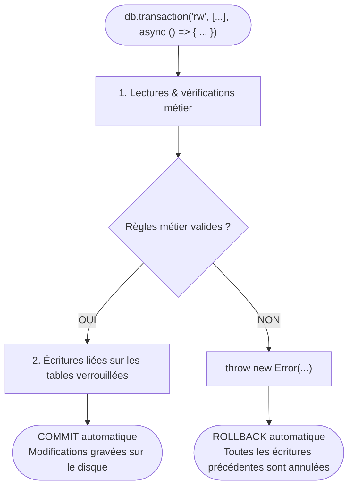

# Séance 19 — IndexedDB & Dexie.js : la vraie base de données du navigateur

**Cours de programmation orientée objet — Bachelier en informatique (EAFC)**  
**Stack technique : TypeScript 5+, Angular 22 (approche signal-first), Dexie.js 4+**

---

## Objectifs pédagogiques

À l'issue de cette séance, l'étudiant est en mesure de :

1. **Découvrir IndexedDB et Dexie.js** : comprendre pourquoi IndexedDB constitue la véritable base de données embarquée des navigateurs modernes (capacité de stockage de plusieurs gigaoctets, exécution asynchrone, moteur d'indexation) et comment la bibliothèque Dexie.js permet de l'exploiter à travers des classes TypeScript fortement typées.
2. **Comprendre le Gouffre Objet-Relationnel (*Impedance Mismatch*)** : analyser pourquoi la persistance d'objets métiers riches au sein de tables relationnelles SQL engendre une friction structurelle majeure, et démontrer comment le modèle orienté documents d'IndexedDB réconcilie nos entités POO avec le stockage disque.
3. **Modéliser une base typée avec Dexie.js** : concevoir une classe héritant de `Dexie`, définir un schéma d'index minimaliste et maîtriser la syntaxe des clés primaires (`id` explicite vs `++id` auto-incrémenté), des index uniques (`&`), des index multi-entrées (`*`) et des index composés (`[a+b]`).
4. **Exploiter la *Fluent API* de requêtes** : interroger efficacement la base locale à l'aide de requêtes chaînées et expressives (égalité stricte, recherche par préfixe insensible à la casse, intervalles numériques et temporels, tri, pagination) tout en arbitrant entre filtrage sur index B-Tree et filtrage en mémoire.
5. **Garantir l'intégrité des données par des transactions ACID** : expliquer les quatre propriétés fondamentales ACID (Atomicité, Cohérence, Isolation, Durabilité) et orchestrer des écritures multi-tables atomiques dotées d'un mécanisme d'annulation automatique (*rollback*) en cas d'exception métier.
6. **Piloter les migrations de schéma et l'intégration Angular Signal-First** : faire évoluer la structure d'une base déployée en production sans perte de données grâce au versionnage incrémental (`.upgrade()`), et relier les opérations asynchrones de Dexie aux signaux réactifs (`signal()`) d'Angular.

---

## Partie 00 — Le cheminement : d'où venons-nous ?

Cette séance marque l'aboutissement du **Bloc D (Persistance des Données)** et couronne l'ensemble du parcours de Programmation Orientée Objet construit depuis le début du cursus :

- **Bloc A — Fondamentaux POO (Séances 5 à 9)** : nous avons appris à protéger les invariants de nos objets grâce à l'encapsulation (`private` / champs privés `#`), à factoriser nos architectures par héritage (`extends`, `super()`), à exploiter le polymorphisme dynamique, à verrouiller nos contrats par des classes abstraites et interfaces, et à privilégier la composition sur l'héritage rigide.
- **Bloc B — Conception & Qualité (Séances 10 à 12)** : nous avons rendu nos classes invulnérables grâce aux exceptions typées (S10), structuré nos dépendances selon les principes SOLID — SRP, OCP, DIP (S11), et maîtrisé l'identité, l'égalité logique et le clonage immuable des objets (S12).
- **Bloc C — Angular Signal-First (Séances 13 à 15)** : nous avons connecté notre modèle métier à une interface utilisateur réactive pilotée par les signaux (`signal()`, `computed()`), les services injectables (DI), les formulaires réactifs et le routage SPA.
- **Bloc D — Persistance des Données (Séances 16 à 19)** : nous avons franchi étape par étape les défis liés à la survie des données au-delà de la mémoire vive :
  - **Séance 16 (Sérialisation & DTOs)** : nous avons découvert le format JSON et résolu le piège critique de la perte de prototype lors de la désérialisation grâce au patron de réhydratation `Entite.fromDTO(dto)`.
  - **Séance 17 (Consommer une API REST)** : nous avons appris à dialoguer de manière asynchrone avec un serveur distant via `httpResource()`.
  - **Séance 18 (LocalStorage & ses limites)** : nous avons éprouvé les trois murs physiques du stockage clé-valeur synchrone : un plafond strict de $5\text{ Mo}$, le blocage du fil d'exécution principal (*Main Thread* / Event Loop) lors de la sérialisation de gros volumes, et l'absence totale de moteur de requête ou de transaction.

### La grande question de la Séance 19

Imaginez une application professionnelle utilisée sur le terrain par des techniciens itinérants, des commerciaux ou des personnels médicaux :
- Elle doit conserver localement **$50\,000$ dossiers** enrichis d'historiques et de commentaires.
- Elle doit offrir une **recherche instantanée** par nom, catégorie ou plage de dates, même en zone blanche sans connexion Internet (**architecture *Offline-First***).
- Elle doit exécuter des **opérations critiques liées** (par exemple : enregistrer une commande **et** décrémenter simultanément le stock disponible) sans jamais risquer une corruption partielle en cas d'erreur ou de coupure de batterie.

Face à ces exigences, `LocalStorage` s'effondre immédiatement. La question architecturale de cette séance est donc :

> **« Comment doter une application web client d'une véritable base de données orientée objets, asynchrone, indexée, transactionnelle et capable d'évoluer dans le temps sans jamais détruire les données des utilisateurs ? »**

La réponse professionnelle réside dans l'alliance entre **IndexedDB**, le moteur natif intégré à tous les navigateurs modernes, et **Dexie.js**, la bibliothèque TypeScript qui lui offre une interface orientée objet fluide et sécurisée.

---

## Partie 01 — IndexedDB & le Gouffre Objet-Relationnel

### 1.1 Qu'est-ce qu'IndexedDB ? Le moteur NoSQL natif du navigateur

Contrairement à une idée reçue, le navigateur web n'est pas limité au stockage de petits fichiers texte ou de paires clé-valeur rudimentaires. Tous les navigateurs modernes (Chrome, Firefox, Safari, Edge) embarquent nativement un véritable moteur de base de données transactionnel standardisé par le W3C : **IndexedDB**. Des applications majeures telles que Spotify Web, Gmail en mode hors-ligne ou WhatsApp Web s'appuient quotidiennement sur ce moteur pour mettre en cache des gigaoctets de données sur le poste client.

Ses caractéristiques physiques et architecturales répondent point par point aux limitations de `LocalStorage` :

1. **Base de données NoSQL orientée objets** : IndexedDB n'organise pas les données en tables rigides à colonnes fixes, mais en **Object Stores** (magasins d'objets) capables d'accueillir des structures hiérarchiques complexes.
2. **Capacité de stockage massive** : là où `LocalStorage` plafonne à $5\text{ Mo}$, IndexedDB dispose d'un quota dynamique pouvant atteindre plusieurs gigaoctets selon l'espace disque disponible sur l'appareil.
3. **Moteur d'indexation B-Tree** : chaque *Object Store* peut être doté d'index secondaires organisés en arbres équilibrés, permettant de localiser un enregistrement parmi des dizaines de milliers d'autres en moins d'une milliseconde.
4. **Exécution 100 % asynchrone** : toutes les lectures et écritures s'exécutent en arrière-plan sans jamais geler le thread principal ni bloquer les animations de l'interface utilisateur.
5. **Sérialisation native par *Structured Clone*** : IndexedDB ne nécessite pas d'appeler manuellement `JSON.stringify()` ou `JSON.parse()`. Il utilise l'algorithme natif de clonage structuré du navigateur, capable de stocker directement des objets imbriqués, des tableaux, des instances de `Date`, des `Map`, des `Set` ou encore des données binaires (`Uint8Array`, fichiers, images).

---

### 1.2 Le Gouffre Objet-Relationnel (*Impedance Mismatch*)

En informatique d'entreprise, le décalage structurel entre la manière dont les données sont modélisées en mémoire vive (des **graphes d'objets** encapsulés, contenant des tableaux et des sous-objets) et la manière dont elles sont stockées dans une base relationnelle SQL (des **tables plates** reliées par des clés étrangères) porte un nom célèbre : le **Gouffre d'Impédance Objet-Relationnel** (*Object-Relational Impedance Mismatch*).

Pour comprendre cette friction, examinons **l'analogie de la voiture démontée** :

| Approche Relationnelle SQL (Tables plates) | Approche NoSQL / IndexedDB (Object Stores) |
|---|---|
| Pour garer votre voiture (votre objet métier) dans un garage SQL, vous devez **la démonter entièrement** : les quatre roues partent dans la table `ROUES`, les pistons dans `PISTONS`, la carrosserie dans `CARROSSERIES`. | Vous ouvrez simplement la porte du garage et **vous garez la voiture entière** d'un seul bloc. |
| Le lendemain matin, pour repartir travailler, vous devez **remonter chaque boulon** à l'aide de requêtes complexes et de jointures (`JOIN`). | Le moteur reste dans le châssis, les roues restent vissées. Les tableaux et sous-objets sont conservés nativement. |
| Stocker un simple tableau `genres: string[]` sur un livre impose de créer trois tables (`LIVRES`, `GENRES` et une table associative `LIVRE_GENRE`). | Vous tournez la clé de contact et vous repartez instantanément : zéro démontage, zéro remontage, structure intacte. |

En adoptant IndexedDB pour la persistance locale de nos applications TypeScript, nous éliminons cette traduction artificielle entre le monde objet et le monde relationnel.

---

### 1.3 Dexie.js : le wrapper orienté objet d'IndexedDB

Si le moteur IndexedDB est remarquablement performant, son API native définie en 2011 souffre d'une conception événementielle extrêmement verbeuse (`request.onsuccess`, `request.onerror`, gestion manuelle des curseurs et des versions), dépourvue de `Promises` natives et totalement aveugle au typage TypeScript (tout est manipulé en `any`). Écrire une simple insertion avec l'API brute requiert souvent plus de quarante lignes de code.

**Dexie.js** est la bibliothèque open-source de référence conçue pour dompter IndexedDB :

- **100 % Orienté Objet** : notre base de données est modélisée sous forme d'une classe TypeScript qui hérite directement de la classe mère `Dexie` (application directe de l'héritage vu en séance 6).
- **Typage fort de bout en bout** : chaque *Object Store* est exposé sous forme d'une propriété typée `Table<TypeDTO, TypeClePrimaire>`, offrant une autocomplétion complète et une vérification statique à la compilation.
- **Asynchronisme moderne (`async / await`)** : toutes les opérations retournent des `Promises` standards, rendant le code linéaire et lisible.
- ***Fluent API* expressive** : les requêtes s'enchaînent de gauche à droite comme une phrase en langage naturel :

```typescript
// Rechercher les tâches urgentes avec Dexie.js : 4 lignes limpides et typées !
const urgentes = await db.taches
  .where('priorite')
  .equals('haute')
  .toArray();
```

> [!TIP]
> **Poids architectural minimal :**  
> Dexie.js n'embarque pas un moteur de base de données lourd de plusieurs mégaoctets dans votre application. Il s'agit d'une fine couche d'abstraction orientée objet (quelques kilo-octets seulement) qui pilote le moteur IndexedDB déjà préinstallé dans le navigateur de chaque utilisateur.

---

### 1.4 Créer sa première base Dexie en TypeScript / POO

La déclaration d'une base de données Dexie s'effectue dans un fichier dédié en suivant quatre étapes structurantes :

```typescript
// src/app/database/app.db.ts
import Dexie, { Table } from 'dexie';
import { TacheDTO } from '../models/tache.entity';

// 1. Héritage POO (Séance 6) : notre base spécialise la classe Dexie
export class AppDatabase extends Dexie {
  // 2. Déclaration des stores typés : Table<TypeObjetStocke, TypeClePrimaire>
  taches!: Table<TacheDTO, string>;

  constructor() {
    super('EAFC_TodoDB'); // Nom physique de la base dans le navigateur

    // 3. Définition du schéma de version 1 : UNIQUEMENT les clés de recherche !
    this.version(1).stores({
      taches: 'id, priorite, terminee, dateCreationISO'
    });
  }
}

// 4. Instance unique (patron Singleton) partagée par les services de l'application
export const db = new AppDatabase();
```

> [!IMPORTANT]
> **La règle d'or du schéma Dexie (évitez le réflexe SQL !) :**  
> Dans le schéma `.stores({ ... })`, **ne listez jamais toutes les propriétés de votre classe**. Un schéma Dexie n'est pas une définition de colonnes SQL : c'est exclusivement la **liste des index de recherche** (les propriétés sur lesquelles vous effectuerez des requêtes `.where()` ou `.orderBy()`).  
> Toutes les autres propriétés de votre objet (par exemple une description longue, un commentaire ou un sous-objet) sont **stockées automatiquement** par IndexedDB sans figurer dans le schéma. Déclarer des index inutiles consomme de l'espace disque et ralentit inutilement les opérations d'écriture.

---

## Partie 02 — L'indexation avancée dans Dexie.js

### 2.1 Pourquoi indexer ? Du scan linéaire $O(n)$ à l'arbre B-Tree $O(\log n)$

Pour comprendre l'importance capitale des index dans une base de données, comparons deux stratégies de recherche sur un ensemble de $N = 50\,000$ enregistrements :

1. **Sans index — Le balayage séquentiel complet en $O(n)$** :  
   Imaginez un dictionnaire de $50\,000$ mots dont les pages auraient été reliées dans le désordre. Pour trouver la définition du mot *« Polymorphisme »*, vous êtes contraint d'ouvrir le livre à la première page et d'examiner chaque entrée une par une jusqu'à tomber sur la bonne. En informatique, cette recherche présente une complexité linéaire $O(n)$ : dans le pire cas, les $50\,000$ objets doivent être chargés et inspectés en mémoire vive, ce qui ralentit l'interface et sollicite fortement le processeur.
2. **Avec un index B-Tree — La recherche logarithmique en $O(\log n)$** :  
   Lorsqu'une propriété est déclarée dans le schéma Dexie, IndexedDB maintient automatiquement en parallèle une structure de données appelée **arbre équilibré (B-Tree)** dans laquelle les valeurs de cette propriété sont conservées triées. Pour retrouver *« Polymorphisme »*, le moteur ouvre le dictionnaire exactement au milieu, élimine instantanément la moitié des pages, ouvre la moitié restante au milieu, et ainsi de suite.  
   Pour $N = 50\,000$ objets, le nombre maximal de comparaisons nécessaires vaut :
   $$\lceil \log_2(50\,000) \rceil = 16 \text{ comparaisons}$$
   Au lieu de parcourir $50\,000$ objets, le moteur localise l'enregistrement en **16 accès**, soit moins de $0,2\text{ ms}$.

**Conséquence pratique :** toute propriété destinée à être interrogée via `.where('propriete')` doit impérativement être déclarée dans la chaîne de schéma de `.stores()`.

---

### 2.2 La clé primaire : clé métier explicite (`id`) vs auto-incrémentée (`++id`)

Dans la définition d'un *Object Store*, le **tout premier identifiant** de la chaîne de schéma désigne toujours la **clé primaire unique** de l'objet. Dexie propose deux stratégies distinctes selon l'architecture de l'application :

```typescript
this.version(1).stores({
  // Stratégie 1 : Clé métier explicite fournie par le code (UUID)
  articles: 'id, titre, categorie',

  // Stratégie 2 : Clé numérique auto-incrémentée par IndexedDB (++)
  journaux: '++id, timestamp, niveau'
});
```

| Critère d'arbitrage | Clé métier explicite (`'id, ...'`) | Clé auto-incrémentée (`'++id, ...'`) |
|---|---|---|
| **Génération de la clé** | Générée par l'application via `crypto.randomUUID()` avant l'insertion. | Générée automatiquement par IndexedDB (`1`, `2`, `3`...) lors de l'appel à `.add()`. |
| **Usage recommandé** | **Entités métiers synchronisées** avec un serveur distant ou créées hors-ligne. | **Données purement locales** (logs techniques, historique de navigation, brouillons temporaires). |
| **Résistance aux conflits** | Deux appareils hors-ligne génèrent des identifiants universellement uniques : zéro collision lors de la synchronisation. | Deux appareils hors-ligne attribueraient tous deux `id = 1` à leur premier enregistrement, provoquant un écrasement lors de la fusion. |

Exemple d'insertion avec clé auto-incrémentée :

```typescript
// La propriété 'id' est omise : Dexie retourne la clé numérique générée
const idAttribue: number = await db.journaux.add({
  timestamp: Date.now(),
  niveau: 'INFO',
  message: 'Session utilisateur initialisée'
});
```

---

### 2.3 L'index unique (`&email`) : prévention physique des doublons

Dans nos modèles orientés objet, certaines propriétés portent une contrainte d'unicité stricte : un adresse e-mail utilisateur, un numéro ISBN de livre ou un code-barres produit ne doivent jamais exister en double dans le système. En préfixant le nom de la propriété par le symbole **`&`** (*ampersand*), nous demandons à IndexedDB d'imposer une contrainte physique d'unicité sur l'arbre B-Tree :

```typescript
this.version(1).stores({
  utilisateurs: 'id, &email, role',
  produits: '++id, &codeBarre, nom, categorie'
});
```

En Séance 5, nous avons appris à protéger les invariants d'une classe à l'intérieur de son constructeur. L'index unique `&` ajoute une **seconde ceinture de sécurité au niveau physique du disque** : si une tentative d'insertion viole cette unicité, IndexedDB rejette immédiatement l'opération et lève une exception typée `Dexie.ConstraintError`, que nous interceptons proprement selon les principes de la Séance 10 :

```typescript
try {
  await db.utilisateurs.add({
    id: crypto.randomUUID(),
    email: 'admin@eafc.be',
    role: 'ADMIN'
  });
} catch (err: unknown) {
  if (err instanceof Dexie.ConstraintError) {
    console.error('Doublon détecté : cet e-mail est déjà enregistré dans la base.');
  } else {
    throw err; // Relance de toute erreur imprévue (règle de la Séance 10)
  }
}
```

---

### 2.4 L'index multi-entry (`*tags`) : indexer au cœur des tableaux

L'index *Multi-Entry*, signalé par le préfixe **`*`**, est l'une des fonctionnalités les plus puissantes d'IndexedDB. Lorsque la propriété ciblée contient un tableau de valeurs primitives (par exemple `ingredients: string[]` ou `genres: string[]`), IndexedDB extrait automatiquement **chaque élément individuel du tableau** et crée pour chacun d'eux une entrée distincte dans l'index B-Tree pointant vers l'objet parent.

```typescript
this.version(1).stores({
  recettes: 'id, titre, *ingredients, tempsCuisson'
});

await db.recettes.add({
  id: 'rec-01',
  titre: 'Fondant au Chocolat',
  ingredients: ['chocolat', 'farine', 'beurre', 'oeufs'],
  tempsCuisson: 25
});

// Recherche instantanée via l'index B-Tree de toutes les recettes contenant 'chocolat'
const recettesChocolatees = await db.recettes
  .where('ingredients')
  .equals('chocolat')
  .toArray();
```

Sans cet index multi-entrée, il aurait fallu charger l'intégralité des recettes en mémoire vive et exécuter un `.filter(r => r.ingredients.includes('chocolat'))` en $O(n)$. En modèle relationnel SQL, cette même fonctionnalité aurait exigé trois tables distinctes (`RECETTES`, `INGREDIENTS`, `RECETTE_INGREDIENT`) et deux jointures. Ici, une seule ligne de schéma suffit.

---

### 2.5 L'index composé (`[statut+priorite]`) : requêtes multi-critères

Lorsqu'une fonctionnalité applicative filtre fréquemment sur **deux critères simultanés** (par exemple : afficher toutes les tâches dont le statut est `'EN_COURS'` **et** la priorité `'HAUTE'`), déclarer deux index séparés (`statut, priorite`) oblige le moteur à utiliser un seul des deux index puis à filtrer le second critère en mémoire.

La syntaxe entre crochets **`[colonneA+colonneB]`** crée un **index composé** fusionnant les deux valeurs au sein d'un unique arbre B-Tree :

```typescript
this.version(1).stores({
  taches: 'id, titre, statut, priorite, [statut+priorite]'
});

// Requête ciblée directement sur la paire exacte de valeurs
const tachesCritiques = await db.taches
  .where('[statut+priorite]')
  .equals(['EN_COURS', 'HAUTE'])
  .toArray();
```

> [!WARNING]
> **L'ordre des propriétés dans un index composé est déterminant :**  
> Dans `[statut+priorite]`, l'arbre B-Tree est ordonné en premier lieu selon `statut`, puis, à statut égal, selon `priorite`. Cet index accélère donc également toute requête portant uniquement sur le premier composant (`statut`), mais ne peut pas être exploité directement pour une recherche portant uniquement sur `priorite`.

---

## Partie 03 — La Fluent API de requêtes

### 3.1 Le CRUD de base asynchrone et le rappel de réhydratation

Les quatre opérations fondamentales de persistance (Create, Read, Update, Delete) s'expriment sous forme de méthodes asynchrones retournant des `Promises` :

```typescript
// 1. CREATE — Insérer un nouvel enregistrement (lève ConstraintError si la clé existe déjà)
await db.taches.add({
  id: crypto.randomUUID(),
  titre: 'Préparer le laboratoire Dexie',
  priorite: 'haute',
  terminee: false,
  dateCreationISO: new Date().toISOString()
});

// 2. READ — Lire l'ensemble d'un store ou un enregistrement unique par sa clé primaire
const toutesLesTaches: TacheDTO[] = await db.taches.toArray();
const tacheCible: TacheDTO | undefined = await db.taches.get('id-123');

// 3. UPDATE — Mettre à jour partiellement les propriétés d'un objet existant
await db.taches.update('id-123', { terminee: true });

// 4. DELETE — Supprimer un enregistrement par sa clé primaire
await db.taches.delete('id-123');
```

> [!CAUTION]
> **Rappel critique de la Séance 16 (Le piège du prototype perdu) :**  
> IndexedDB sérialise uniquement les **données pures** (le DTO) et ignore totalement les méthodes et accesseurs de vos classes TypeScript. À la lecture (`db.taches.toArray()` ou `db.taches.get(...)`), les objets récupérés sont de simples objets littéraux dépourvus de comportement métier. Il est impératif de les réhydrater systématiquement via la fabrique statique `Tache.fromDTO(dto)` dès leur sortie de la base de données.

---

### 3.2 Égalité stricte et recherche textuelle instantanée

La méthode `.where('index')` ouvre une chaîne de requêtes (*WhereClause*) offrant des comparateurs directement exécutés sur les pages de l'index B-Tree :

```typescript
// 1. Égalité stricte sur un index
const administrateurs = await db.utilisateurs
  .where('role')
  .equals('ADMIN')
  .toArray();

// 2. Recherche par préfixe insensible à la casse (idéal pour l'autocomplétion)
// Si l'utilisateur saisit "mar", Dexie trouve "Martin", "Marc", "MARTINET" en < 1 ms
const suggestions = await db.clients
  .where('nom')
  .startsWithIgnoreCase(saisieUtilisateur.trim())
  .limit(10)
  .toArray();
```

En combinant `.startsWithIgnoreCase()` avec `.limit(10)`, le moteur interrompt son parcours de l'arbre B-Tree dès que dix correspondances ont été trouvées, offrant une barre de recherche instantanée sans jamais saturer la mémoire vive.

---

### 3.3 Intervalles numériques et temporels

Les arbres B-Tree étant ordonnés, IndexedDB excelle dans l'extraction de plages de valeurs (*Range Queries*) via `.below()`, `.above()` et `.between()` :

```typescript
// 1. Seuil numérique : tous les articles dont le stock est strictement inférieur à 5
const articlesEnRupture = await db.articles
  .where('stock')
  .below(5)
  .toArray();

// 2. Intervalle temporel : commandes passées durant le mois d'octobre 2026
const commandesOctobre = await db.commandes
  .where('dateISO')
  .between('2026-10-01T00:00:00.000Z', '2026-10-31T23:59:59.999Z')
  .toArray();
```

**Astuce d'architecture (vue en Séance 16) :** le format standard ISO 8601 (`YYYY-MM-DDTHH:mm:ss.sssZ`) possède la propriété remarquable que l'ordre lexicographique (alphabétique) coïncide exactement avec l'ordre chronologique. Le B-Tree trie et filtre donc les dates ISO avec une précision parfaite.

---

### 3.4 Tri, pagination et arbitrage index vs filtre mémoire

Pour afficher des listes volumineuses dans une interface graphique, Dexie permet d'enchaîner le tri sur index et la pagination par décalage (`offset`) et limite (`limit`) :

```typescript
// Récupérer la page 3 d'un catalogue trié par nom (10 articles par page)
const page3 = await db.articles
  .orderBy('nom')
  .offset(20) // Ignore les 20 premiers résultats (pages 1 et 2)
  .limit(10)  // Extrait les 10 résultats suivants
  .toArray();
```

Lorsqu'une requête combine un critère principal indexé et un critère secondaire rare qui ne justifie pas la création d'un index dédié, la stratégie optimale consiste à **dégrossir sur l'index B-Tree**, puis à **affiner en mémoire** à l'aide de `.filter()` :

```typescript
// L'index 'genre' élimine 95 % des livres sur disque ;
// la fonction JavaScript .filter() affine les 5 % restants en mémoire vive.
const grosRomansSF = await db.livres
  .where('genre')
  .equals('SF')
  .filter(livre => livre.pages > 500)
  .toArray();
```

---

## Partie 04 — Les transactions ACID

### 4.1 Le problème des écritures partielles : que se passe-t-il quand ça plante ?

Considérons une opération commerciale courante lors de la validation d'un panier :
1. Débiter le compte du client de $100\text{ €}$.
2. Décrémenter le stock de l'article commandé d'une unité.
3. Enregistrer la nouvelle fiche de commande.

Si ces trois écritures sont exécutées séquentiellement sans protection transactionnelle, une panne matérielle (batterie vide), une fermeture brutale de l'onglet ou une exception levée à l'étape 2 laisse la base de données dans un **état gravement corrompu** :

```typescript
// ❌ SCÉNARIO CATASTROPHE SANS TRANSACTION
await db.comptes.update(client.id, { solde: client.solde - 100 });

// 💥 INCIDENT ICI : exception métier (stock épuisé) ou coupure brutale !

await db.articles.update(art.id, { stock: art.stock - 1 }); // Jamais exécuté
await db.commandes.add(nouvelleCommande);                  // Jamais exécuté
// Résultat : le client a été débité de 100 €, mais aucune commande n'existe !
```

En ingénierie logicielle, une application qui affiche un message d'erreur tout en préservant l'intégrité des données est saine ; une application qui corrompt silencieusement l'état financier ou le stock est défaillante. La solution universelle à ce problème est la **transaction**.

---

### 4.2 Les 4 piliers ACID décortiqués

L'acronyme **ACID** désigne les quatre garanties fondamentales offertes par tout système de gestion de base de données fiable :

| Propriété | Devise | Signification technique et garantie offerte |
|---|---|---|
| **A — Atomicité** | *« Tout ou rien »* | L'ensemble des opérations regroupées dans la transaction forme un bloc indivisible. Si toutes réussissent, elles sont validées ensemble (*commit*). Si une seule échoue, **toutes** les modifications déjà effectuées sont annulées instantanément (*rollback*). |
| **C — Cohérence** | *« Respect des règles »* | La transaction fait passer la base d'un état valide à un autre état valide. Toutes les contraintes d'unicité (`&`) et les invariants métiers sont préservés. |
| **I — Isolation** | *« Chacun chez soi »* | Deux transactions concurrentes (par exemple deux onglets ou un double-clic rapide) s'exécutent comme si elles étaient séquentielles : aucune ne peut observer les états intermédiaires non validés de l'autre. |
| **D — Durabilité** | *« Gravé sur le disque »* | Une fois la transaction validée (*committed*), les données sont physiquement inscrites sur le support de stockage et survivent à un rechargement de page ou au redémarrage de l'ordinateur. |

---

### 4.3 Syntaxe et fonctionnement de `db.transaction()` dans Dexie.js

Dexie.js simplifie considérablement la gestion des transactions grâce à la méthode `db.transaction(mode, tables, callback)` :

```typescript
// Mode 'rw' (read-write) ou 'r' (read-only), suivi du tableau des tables verrouillées
await db.transaction('rw', [db.comptes, db.articles, db.commandes], async () => {
  // 1. Lecture et vérification des règles métier à l'intérieur de la transaction
  const client = await db.comptes.get(clientId);
  const article = await db.articles.get(articleId);

  if (!client || client.solde < montantTotal) {
    throw new Error('Solde insuffisant pour valider la commande.'); // -> ROLLBACK !
  }
  if (!article || article.stock < quantite) {
    throw new Error('Stock insuffisant pour cet article.'); // -> ROLLBACK !
  }

  // 2. Exécution des écritures liées
  await db.comptes.update(clientId, { solde: client.solde - montantTotal });
  await db.articles.update(articleId, { stock: article.stock - quantite });
  await db.commandes.add(nouvelleCommande);

  // Fin de la fonction sans exception : Dexie exécute le COMMIT automatiquement !
});
```

Le cycle de vie d'une transaction Dexie obéit à une logique déterministe :



Il n'est jamais nécessaire d'appeler manuellement une méthode `.commit()` ou `.rollback()` :
- Si la fonction `async` se termine normalement, Dexie valide la transaction (**COMMIT**).
- Si une exception est levée (`throw`) ou qu'une erreur IndexedDB survient (`ConstraintError`), Dexie annule l'intégralité des opérations (**ROLLBACK**) et propage l'exception vers l'appelant.

---

### 4.4 Le piège critique : jamais d'appel réseau dans une transaction

Conformément à la spécification W3C d'IndexedDB, le navigateur maintient une transaction active et ses verrous associés uniquement tant que des requêtes de base de données s'enchaînent au fil des microtâches de l'Event Loop. Dès que le moteur détecte un tour de boucle sans opération IndexedDB (par exemple lors de l'attente d'une réponse réseau `fetch` ou `HttpClient` qui dure $300\text{ ms}$), il **ferme automatiquement la transaction** pour éviter de bloquer les autres onglets.

```typescript
// ❌ INTERDIT : Appel HTTP au milieu d'une transaction IndexedDB
await db.transaction('rw', db.commandes, async () => {
  await db.commandes.add(nouvelleCmd);

  // 🛑 CATASTROPHE : l'attente réseau provoque la fermeture automatique de la transaction !
  const reponse = await fetch('https://api.entreprise.be/valider');

  // Lève systématiquement : TransactionInactiveError !
  await db.commandes.update(nouvelleCmd.id, { statut: 'CONFIRMEE' });
});
```

**La bonne pratique architecturale :** toujours isoler l'appel réseau en amont, puis ouvrir une transaction locale ultra-rapide (quelques millisecondes) une fois les données reçues :

```typescript
// ✅ ARCHITECTURE CONFORME : Réseau d'abord, transaction locale ensuite
const reponse = await fetch('https://api.entreprise.be/valider');
const confirmation = await reponse.json();

await db.transaction('rw', db.commandes, async () => {
  await db.commandes.add({ ...nouvelleCmd, referenceServeur: confirmation.ref });
});
```

---

## Partie 05 — Les migrations de schéma

### 5.1 Le défi de la production : faire évoluer la base chez des milliers d'utilisateurs

Pendant la phase de développement sur votre poste local, modifier un index ou restructurer une entité est trivial : il suffit d'ouvrir les outils de développement (<kbd>F12</kbd>), de supprimer la base IndexedDB et de recharger la page.

En production, lorsque votre application est déployée chez des milliers d'utilisateurs ayant accumulé des mois de factures, de dossiers ou de contacts sur leur disque local, **effacer la base (`db.delete()`) est une faute professionnelle grave** entraînant la perte définitive des données clients.

Pour résoudre ce problème, Dexie.js intègre un mécanisme de **migrations incrémentales déclaratif** : à chaque ouverture de l'application, Dexie compare le numéro de version stocké sur le disque du navigateur avec la version la plus récente déclarée dans votre code TypeScript, et exécute automatiquement les étapes de transition intermédiaires.

---

### 5.2 Le versionnage déclaratif et la transformation `.upgrade()`

Pour faire évoluer une base existante, **on ne modifie jamais le bloc `this.version(1)`** déjà publié : on conserve l'historique intact et l'on empile un nouveau bloc `this.version(2)` accompagné d'une fonction `.upgrade(tx => ...)` chargée de migrer les données existantes :

```typescript
export class AppDatabase extends Dexie {
  contacts!: Table<ContactDTO, string>;

  constructor() {
    super('GestionEntrepriseDB');

    // VERSION 1 : publiée en janvier (NE PLUS MODIFIER !)
    this.version(1).stores({
      contacts: 'id, nomComplet'
    });

    // VERSION 2 : publiée en mars — séparation de 'nomComplet' en 'nom' et 'prenom'
    this.version(2).stores({
      contacts: 'id, nom, prenom'
    }).upgrade(async tx => {
      // Parcourt et transforme chaque enregistrement hérité de la v1
      await tx.table('contacts').toCollection().modify(contact => {
        const morceaux = (contact.nomComplet || '').trim().split(' ');
        contact.prenom = morceaux[0] || '';
        contact.nom = morceaux.slice(1).join(' ') || '';
        delete contact.nomComplet;
      });
    });
  }
}
```

Ce mécanisme offre deux garanties majeures :
1. **Chaînage automatique des versions** : si un utilisateur n'a pas ouvert l'application depuis six mois et se trouve encore en version `1` alors que le code est en version `4`, Dexie exécute séquentiellement les migrations `1 -> 2 -> 3 -> 4`.
2. **Protection transactionnelle intégrée** : la méthode `.upgrade()` s'exécute à l'intérieur d'une transaction système exclusive. Si une erreur survient durant la transformation des données, l'ensemble de la migration est annulé (*rollback*) et l'utilisateur demeure proprement en version `1` sans corruption.

---

### 5.3 Les 4 règles d'or des migrations Dexie

1. **Utiliser exclusivement des entiers croissants** : numérotez vos versions `1`, `2`, `3`, `4` (jamais de nombres décimaux tels que `1.5`).
2. **Conserver l'historique des versions précédentes** : ne supprimez jamais les anciens blocs `this.version(k)` tant que des utilisateurs sont susceptibles de posséder cette version sur leur poste.
3. **Initialiser les nouvelles propriétés indexées** : lorsqu'un nouvel index est ajouté dans une version supérieure, profitez de `.upgrade()` pour attribuer une valeur par défaut cohérente aux anciens objets.
4. **Supprimer une table obsolète explicitement** : pour retirer un *Object Store* devenu inutile lors d'une nouvelle version, assignez-lui explicitement la valeur `null` dans `.stores({ ancienneTable: null })`.

---

## Partie 06 — Pièges fréquents & anti-patterns

### 6.1 Tableau des 5 anti-patterns majeurs

| Anti-pattern fréquent | Conséquence technique et architecturale | Solution d'ingénierie conforme |
|---|---|---|
| **1. Lister toutes les propriétés de la classe dans `.stores()`** (réflexe SQL) | Multiplication d'index B-Tree inutiles, gaspillage d'espace disque et ralentissement des écritures. | Ne déclarer dans `.stores()` **que** les propriétés utilisées dans `.where()` ou `.orderBy()`. Le reste de l'objet est stocké automatiquement. |
| **2. Oublier le mot-clé `await`** devant une écriture (`db.taches.add(dto)`) | Les opérations Dexie sont asynchrones : le rechargement du signal démarre avant la fin de l'écriture sur disque, affichant une liste périmée. | Toujours attendre la résolution avec `await` avant de rafraîchir l'état réactif de l'interface. |
| **3. Effectuer un appel réseau (`fetch` / HTTP) dans `db.transaction()`** | Le navigateur ferme automatiquement la transaction pendant l'attente réseau, déclenchant une `TransactionInactiveError`. | Isoler l'appel réseau hors de la transaction, puis exécuter la transaction locale uniquement sur les données reçues. |
| **4. Manipuler directement les objets lus sans `fromDTO()`** | Les objets issus d'IndexedDB sont des DTO dépourvus de prototype : l'appel à une méthode métier (`livre.estDisponible()`) provoque un crash au runtime. | Réhydrater systématiquement chaque DTO via `dtos.map(Entite.fromDTO)` à la sortie de la base de données. |
| **5. Modifier `this.version(1)` au lieu d'empiler `this.version(2)`** | Les navigateurs déjà en version `1` ne détectent aucun changement de version et conservent un schéma obsolète. | Préserver l'historique des versions et empiler un nouveau numéro de version doté de son bloc `.upgrade()`. |

---

### 6.2 Les 5 commandements de la persistance locale robuste

1. **Ne jamais indexer par habitude** : chaque index B-Tree a un coût en écriture ; n'indexez que ce que vous interrogez réellement.
2. **Toujours réhydrater à la frontière de la base** : la base stocke des DTOs immuables ; l'application manipule des instances de classes encapsulées.
3. **Verrouiller les invariants sur le disque et en mémoire** : combinez la validation dans le constructeur de l'entité (S05) avec les index uniques `&` d'IndexedDB.
4. **Encapsuler toute écriture liée dans une transaction ACID** : dès que deux tables ou deux enregistrements dépendent l'un de l'autre, `db.transaction('rw', ...)` est obligatoire.
5. **Respecter l'immuabilité de l'historique des versions** : faites évoluer vos schémas en production par empilement incrémental et transformations `.upgrade()`.

---

## Partie 07 — Démonstration Angular : BiblioTech

Pour synthétiser l'ensemble des concepts de cette séance, nous construisons **BiblioTech**, une application Angular 22 de gestion locale de bibliothèque dotée d'une recherche instantanée par préfixe, d'un contrôle d'unicité sur l'ISBN et d'un emprunt transactionnel protégé contre les accès concurrents.

### 7.1 Architecture du mini-projet

Le projet respecte strictement la séparation des responsabilités (SRP — Séance 11) en quatre couches distinctes :

```
src/app/
├── models/
│   └── livre.entity.ts              (Entité POO encapsulée, invariants et DTO)
├── database/
│   └── biblio.db.ts                 (Classe BiblioDatabase extends Dexie, index &, *)
├── services/
│   └── biblio.service.ts            (Pont Dexie async -> Signals sync, transaction ACID)
└── components/
    ├── biblio-catalogue.component.ts   (Composant standalone minimaliste)
    └── biblio-catalogue.component.html (Template réactif @for / @if)
```

---

### 7.2 Étape 1 : L'entité métier encapsulée (`livre.entity.ts`)

L'entité `Livre` protège ses invariants à l'aide des champs privés ECMAScript `#` et porte la règle métier d'emprunt (`retirerUnExemplaire()`) :

```typescript
// src/app/models/livre.entity.ts
export interface LivreDTO {
  readonly id: string;
  readonly isbn: string;
  readonly titre: string;
  readonly genres: readonly string[];
  readonly nbExemplaires: number;
}

export class Livre {
  readonly #id: string;
  readonly #isbn: string;
  readonly #titre: string;
  readonly #genres: readonly string[];
  #nbExemplaires: number;

  constructor(
    id: string,
    isbn: string,
    titre: string,
    genres: readonly string[],
    nbExemplaires: number
  ) {
    if (!isbn?.trim() || isbn.trim().length < 5) {
      throw new Error('ISBN invalide (minimum 5 caractères).');
    }
    if (!titre || titre.trim().length < 2) {
      throw new Error('Le titre du livre est trop court.');
    }
    if (nbExemplaires < 0) {
      throw new Error('Le stock initial ne peut pas être négatif.');
    }

    this.#id = id;
    this.#isbn = isbn.trim().toUpperCase();
    this.#titre = titre.trim();
    this.#genres = Object.freeze([...genres]);
    this.#nbExemplaires = Math.floor(nbExemplaires);
  }

  get id(): string { return this.#id; }
  get isbn(): string { return this.#isbn; }
  get titre(): string { return this.#titre; }
  get genres(): readonly string[] { return this.#genres; }
  get nbExemplaires(): number { return this.#nbExemplaires; }

  estDisponible(): boolean {
    return this.#nbExemplaires > 0;
  }

  retirerUnExemplaire(): void {
    if (!this.estDisponible()) {
      throw new Error(`Stock épuisé pour l'ouvrage "${this.#titre}".`);
    }
    this.#nbExemplaires--;
  }

  toDTO(): LivreDTO {
    return {
      id: this.#id,
      isbn: this.#isbn,
      titre: this.#titre,
      genres: [...this.#genres],
      nbExemplaires: this.#nbExemplaires
    };
  }

  static fromDTO(dto: LivreDTO): Livre {
    return new Livre(dto.id, dto.isbn, dto.titre, dto.genres, dto.nbExemplaires);
  }
}
```

---

### 7.3 Étape 2 : La base Dexie typée (`biblio.db.ts`)

La classe `BiblioDatabase` déclare deux *Object Stores* (`livres` et `emprunts`) en exploitant l'index unique `&isbn`, l'index de recherche `titre` et l'index multi-entrée `*genres` :

```typescript
// src/app/database/biblio.db.ts
import Dexie, { Table } from 'dexie';
import { LivreDTO } from '../models/livre.entity';

export interface EmpruntDTO {
  readonly id: string;
  readonly livreId: string;
  readonly adherentNom: string;
  readonly dateEmpruntISO: string;
}

export class BiblioDatabase extends Dexie {
  livres!: Table<LivreDTO, string>;
  emprunts!: Table<EmpruntDTO, string>;

  constructor() {
    super('BiblioTechDB');

    this.version(1).stores({
      // &isbn : unicité physique garantie sur le disque
      // titre : recherche rapide par préfixe
      // *genres : indexation individuelle de chaque genre du tableau
      livres: 'id, &isbn, titre, *genres',
      emprunts: 'id, livreId, adherentNom'
    });
  }
}

export const db = new BiblioDatabase();
```

---

### 7.4 Étape 3 : Le service applicatif et la transaction ACID (`biblio.service.ts`)

Le service `BiblioService` assure la passerelle entre le monde asynchrone de Dexie (`Promises`) et le monde réactif synchrone d'Angular (`Signals`). Observez particulièrement la méthode `emprunterLivre()`, où la règle métier de l'entité POO déclenche automatiquement le *rollback* de la transaction Dexie en cas de rupture de stock :

```typescript
// src/app/services/biblio.service.ts
import { Injectable, signal } from '@angular/core';
import { Livre } from '../models/livre.entity';
import { db } from '../database/biblio.db';

@Injectable({ providedIn: 'root' })
export class BiblioService {
  readonly #livres = signal<readonly Livre[]>([]);
  readonly livres = this.#livres.asReadonly();

  constructor() {
    this.recharger();
  }

  // READ : lecture asynchrone suivie de la réhydratation POO et mise à jour du signal
  async recharger(): Promise<void> {
    const dtos = await db.livres.orderBy('titre').toArray();
    this.#livres.set(dtos.map(Livre.fromDTO));
  }

  // SEARCH : autocomplétion instantanée sur l'index B-Tree 'titre'
  async chercherParTitre(prefixe: string): Promise<void> {
    if (!prefixe.trim()) {
      await this.recharger();
      return;
    }
    const dtos = await db.livres
      .where('titre')
      .startsWithIgnoreCase(prefixe.trim())
      .toArray();
    this.#livres.set(dtos.map(Livre.fromDTO));
  }

  // CREATE : l'entité valide ses invariants AVANT l'écriture sur le disque
  async ajouterLivre(
    isbn: string,
    titre: string,
    genres: string[],
    nb: number
  ): Promise<void> {
    const nouveau = new Livre(crypto.randomUUID(), isbn, titre, genres, nb);
    await db.livres.add(nouveau.toDTO());
    await this.recharger();
  }

  // TRANSACTION ACID : décrémente le stock ET crée la fiche d'emprunt de façon atomique
  async emprunterLivre(livreId: string, adherentNom: string): Promise<void> {
    await db.transaction('rw', [db.livres, db.emprunts], async () => {
      // 1. Lecture verrouillée à l'intérieur de la transaction
      const dto = await db.livres.get(livreId);
      if (!dto) {
        throw new Error('Livre introuvable dans le catalogue.');
      }

      // 2. Réhydratation et exécution de la règle métier :
      // si nbExemplaires === 0, retirerUnExemplaire() lève une Error -> ROLLBACK automatique !
      const livre = Livre.fromDTO(dto);
      livre.retirerUnExemplaire();

      // 3. Mise à jour du stock sur disque
      await db.livres.update(livreId, { nbExemplaires: livre.nbExemplaires });

      // 4. Création de l'enregistrement d'emprunt lié
      await db.emprunts.add({
        id: crypto.randomUUID(),
        livreId,
        adherentNom: adherentNom.trim(),
        dateEmpruntISO: new Date().toISOString()
      });
    }); // Fin sans exception : COMMIT atomique des deux tables !

    await this.recharger();
  }
}
```

---

### 7.5 Étape 4 : Le composant Angular Standalone (`biblio-catalogue.component.ts` & `.html`)

Le composant de présentation reste d'une pureté exemplaire : il ne contient aucune requête de base de données et délègue toutes les opérations au service injecté :

```typescript
// src/app/components/biblio-catalogue.component.ts
import { Component, inject } from '@angular/core';
import { BiblioService } from '../services/biblio.service';

@Component({
  selector: 'app-biblio-catalogue',
  standalone: true,
  templateUrl: './biblio-catalogue.component.html'
})
export class BiblioCatalogueComponent {
  readonly service = inject(BiblioService);

  ajouter(isbn: string, titre: string, genres: string, nb: number): void {
    const listeGenres = genres.split(',').map(g => g.trim()).filter(Boolean);
    this.service.ajouterLivre(isbn, titre, listeGenres, nb)
      .catch(err => console.error('Ajout refusé :', err.message));
  }

  emprunter(id: string): void {
    this.service.emprunterLivre(id, 'Jean Dupont')
      .catch(err => alert(err.message));
  }
}
```

```html
<!-- src/app/components/biblio-catalogue.component.html -->
<section class="catalogue-container">
  <!-- Formulaire d'ajout rapide -->
  <div class="ajout-form">
    <input #isbn placeholder="ISBN (ex: 978-2070360024)" />
    <input #titre placeholder="Titre de l'ouvrage" />
    <input #genres placeholder="Genres (ex: SF, Aventure)" />
    <input #nb type="number" value="1" min="0" />
    <button (click)="ajouter(isbn.value, titre.value, genres.value, +nb.value)">
      Ajouter au catalogue
    </button>
  </div>

  <!-- Barre de recherche instantanée -->
  <input #search
         placeholder="Rechercher un livre par titre..."
         (input)="service.chercherParTitre(search.value)" />

  <!-- Liste réactive pilotée par le signal service.livres() -->
  @for (livre of service.livres(); track livre.id) {
    <article class="livre-card">
      <strong>{{ livre.titre }}</strong>
      <span>ISBN : {{ livre.isbn }}</span>

      @if (livre.estDisponible()) {
        <button (click)="emprunter(livre.id)">
          Emprunter ({{ livre.nbExemplaires }} dispo)
        </button>
      } @else {
        <span class="indisponible">Indisponible</span>
      }
    </article>
  }
</section>
```

---

### 7.6 Scénarios de test et inspection dans les DevTools (<kbd>F12</kbd>)

Pour observer concrètement le fonctionnement interne d'IndexedDB, ouvrez les outils de développement de votre navigateur (<kbd>F12</kbd> ➔ onglet **Application** sous Chrome/Edge ou **Stockage** sous Firefox ➔ **IndexedDB** ➔ **`BiblioTechDB`**) et exécutez les trois vérifications suivantes :

1. **Test de l'index unique (`&isbn`)** : ajoutez un ouvrage avec l'ISBN `978-2070360024`, puis tentez d'en insérer un second portant exactement le même ISBN. IndexedDB rejette l'opération et lève une `ConstraintError` dans la console : l'intégrité physique du disque est confirmée.
2. **Test de la recherche B-Tree (`startsWithIgnoreCase`)** : saisissez `"ha"` dans le champ de recherche. Les titres correspondants s'affichent instantanément sans rechargement réseau ni parcours complet du catalogue.
3. **Test de la transaction ACID sous double-clic** : sur un livre ne disposant plus que d'un seul exemplaire (`nbExemplaires = 1`), cliquez deux fois très rapidement sur *« Emprunter »*. La première transaction lit `1`, décrémente le stock à `0` et crée l'emprunt. La seconde transaction, isolée, lit `0` : la méthode `livre.retirerUnExemplaire()` lève une exception, déclenchant un **rollback immédiat**. Le stock ne descend jamais à `-1` et aucune fiche d'emprunt fantôme n'est créée dans l'*Object Store* `emprunts`.

---

## Synthèse : ce qu'il faut retenir absolument

### Tableau récapitulatif des mécanismes Dexie.js & IndexedDB

| Mécanisme / Syntaxe | Rôle technique et conceptuel | Avantage architectural clé en POO |
|---|---|---|
| **`Object Store` NoSQL** | Espace de stockage documentaire d'IndexedDB utilisant *Structured Clone*. | Stocke des objets riches avec tableaux et sous-objets imbriqués sans jointures SQL artificielles. |
| **`class AppDB extends Dexie`** | Déclare une base de données typée par héritage (S06). | Typage fort `Table<EntiteDTO, Cle>`, autocomplétion complète et patron Singleton. |
| **Clé primaire (`id` / `++id`)** | Identifiant unique obligatoire placé en tête du schéma. | Choix explicite entre UUID synchronisable hors-ligne et auto-incrément local. |
| **Index unique (`&cle`)** | Contrainte d'unicité physique sur l'arbre B-Tree. | Complète l'encapsulation en interdisant physiquement les doublons (`ConstraintError`). |
| **Index Multi-Entry (`*tags`)** | Indexation individuelle de chaque élément d'un tableau. | Recherche par tag ou ingrédient en $O(\log n)$ sans table associative tierce. |
| **Index composé (`[a+b]`)** | Fusion de deux propriétés ordonnées dans un seul B-Tree. | Accélère drastiquement les requêtes multi-critères combinées. |
| ***Fluent API* (`.where()`)** | Chaînage expressif de comparateurs typés (`equals`, `between`, `startsWithIgnoreCase`). | Requêtes lisibles comme des phrases, 100 % asynchrones et non bloquantes. |
| **Transaction ACID (`'rw'`)** | Bloc d'écritures multi-tables indivisible et isolé. | *Rollback* automatique en cas d'exception : zéro corruption partielle possible. |
| **Migration (`.upgrade()`)** | Versionnage incrémental de la base sur le poste client. | Modernise le schéma et les données en production sans jamais effacer le travail de l'utilisateur. |

---

### La Règle d'Or de la Séance 19

> **« N'indexez que ce que vous interrogez, réhydratez systématiquement vos DTOs à la sortie de la base, et protégez chaque opération critique multi-tables au sein d'une transaction ACID : vos données survivront aux pannes, aux accès concurrents et aux mises à jour. »**

---

## Aperçu de la séance suivante

La **Séance 19** clôture avec succès le **Bloc D (Persistance des Données)**.  
Lors de la **Séance 20**, nous franchirons une nouvelle frontière architecturale : **De l'Application Web à l'Application Mobile Native avec Capacitor**. Vous découvrirez comment empaqueter votre application Angular — déjà dotée de sa base de données locale Dexie.js fonctionnant hors-ligne — en une véritable application mobile installable sur **Android et iOS**, tout en accédant aux capteurs matériels natifs du smartphone (caméra, géolocalisation et authentification biométrique).