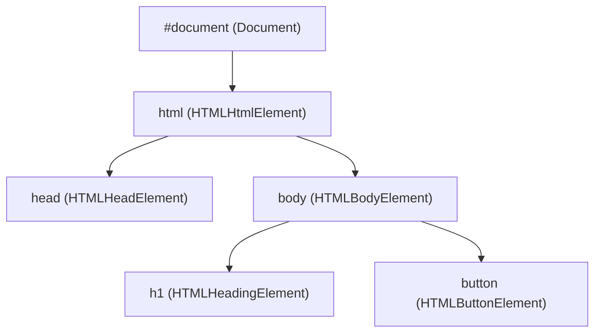

<div class="h-full flex flex-col justify-center items-center">
  <div class="inline-flex items-center gap-2 px-3 py-1 mb-3 text-xs font-semibold rounded-full bg-blue-500/10 text-blue-500 border border-blue-500/20">
    <span class="w-2 h-2 rounded-full bg-blue-500"></span>
    Programmation Orientée Objet · EAFC
  </div>

  <h1 class="text-4xl font-extrabold tracking-tight mb-3 bg-gradient-to-r from-blue-600 via-indigo-500 to-purple-600 bg-clip-text text-transparent">
    Séance 4 — HTML/CSS & Bootstrap
  </h1>

  <p class="text-base opacity-80 max-w-xl mx-auto mb-5 font-medium">
    Structure sémantique · Le DOM · Box Model & Flexbox · Grille 12 colonnes · Intégration Angular
  </p>

  <div class="flex items-center justify-center gap-2 text-xs font-mono opacity-60">
    <span class="px-2 py-0.5 rounded bg-gray-500/10 border border-gray-500/20">HTML5 / CSS3</span>
    <span class="px-2 py-0.5 rounded bg-gray-500/10 border border-gray-500/20">Bootstrap 5</span>
    <span class="px-2 py-0.5 rounded bg-gray-500/10 border border-gray-500/20">Angular & Web</span>
  </div>
</div>

---
layout: default
---

# 🎯 Objectifs pédagogiques

<div class="grid grid-cols-2 gap-2.5 mt-3">
  <div class="p-2.5 rounded-xl bg-slate-500/5 border border-slate-500/15 flex items-start gap-2.5">
    <span class="w-6 h-6 rounded-lg bg-blue-500/10 text-blue-500 flex items-center justify-center font-bold text-xs flex-shrink-0">01</span>
    <p class="text-xs opacity-80 pt-0.5">Comprendre le rôle du HTML, du CSS et du DOM dans une application web.</p>
  </div>

  <div class="p-2.5 rounded-xl bg-slate-500/5 border border-slate-500/15 flex items-start gap-2.5">
    <span class="w-6 h-6 rounded-lg bg-indigo-500/10 text-indigo-500 flex items-center justify-center font-bold text-xs flex-shrink-0">02</span>
    <p class="text-xs opacity-80 pt-0.5">Structurer une page avec des balises sémantiques.</p>
  </div>

  <div class="p-2.5 rounded-xl bg-slate-500/5 border border-slate-500/15 flex items-start gap-2.5">
    <span class="w-6 h-6 rounded-lg bg-purple-500/10 text-purple-500 flex items-center justify-center font-bold text-xs flex-shrink-0">03</span>
    <p class="text-xs opacity-80 pt-0.5">Maîtriser les fondamentaux CSS : sélecteurs, box model, flexbox.</p>
  </div>

  <div class="p-2.5 rounded-xl bg-slate-500/5 border border-slate-500/15 flex items-start gap-2.5">
    <span class="w-6 h-6 rounded-lg bg-teal-500/10 text-teal-500 flex items-center justify-center font-bold text-xs flex-shrink-0">04</span>
    <p class="text-xs opacity-80 pt-0.5">Exploiter le système de grille responsive à 12 colonnes de Bootstrap.</p>
  </div>

  <div class="p-2.5 rounded-xl bg-slate-500/5 border border-slate-500/15 flex items-start gap-2.5">
    <span class="w-6 h-6 rounded-lg bg-amber-500/10 text-amber-500 flex items-center justify-center font-bold text-xs flex-shrink-0">05</span>
    <p class="text-xs opacity-80 pt-0.5">Utiliser les composants clés (boutons, cartes, formulaires).</p>
  </div>

  <div class="p-2.5 rounded-xl bg-slate-500/5 border border-slate-500/15 flex items-start gap-2.5">
    <span class="w-6 h-6 rounded-lg bg-emerald-500/10 text-emerald-500 flex items-center justify-center font-bold text-xs flex-shrink-0">06</span>
    <p class="text-xs opacity-80 pt-0.5">Intégrer un gabarit complet dans un projet Angular.</p>
  </div>
</div>

<div class="mt-3.5 p-2.5 rounded-xl bg-blue-500/10 border border-blue-500/20 text-xs text-blue-700 dark:text-blue-300 text-center">
  💡 <strong>Fil conducteur</strong> : De la structure HTML brute à l'intégration d'une interface Bootstrap responsive dans Angular.
</div>

---
layout: two-cols-header
---

# Le trio fondamental du Web

::left::

<div class="space-y-2.5 mt-1">
  <div class="p-2.5 rounded-xl bg-blue-500/10 border border-blue-500/20 text-xs">
    <div class="font-bold text-sm text-blue-600 dark:text-blue-400 mb-0.5">🦴 HTML : Le squelette & la sémantique</div>
    <p class="opacity-80">Définit la structure du contenu (titres, paragraphes, conteneurs).</p>
  </div>

  <div class="p-2.5 rounded-xl bg-pink-500/10 border border-pink-500/20 text-xs">
    <div class="font-bold text-sm text-pink-600 dark:text-pink-400 mb-0.5">🎨 CSS : L'habillage & la mise en page</div>
    <p class="opacity-80">Définit l'apparence visuelle (couleurs, espacements, responsive).</p>
  </div>

  <div class="p-2.5 rounded-xl bg-amber-500/10 border border-amber-500/20 text-xs">
    <div class="font-bold text-sm text-amber-600 dark:text-amber-400 mb-0.5">⚡ JavaScript / TypeScript : Les muscles</div>
    <p class="opacity-80">Dynamisme, logique applicative, interaction utilisateur.</p>
  </div>
</div>

::right::

<div class="flex flex-col items-center justify-center h-full ms-3">
  <div class="p-3 border border-slate-500/20 rounded-xl shadow-sm bg-slate-500/5 text-center w-64 space-y-2 text-xs font-semibold">
    <div class="p-2 bg-blue-500/15 border border-blue-500/30 rounded text-blue-700 dark:text-blue-300">
      HTML : Structure
    </div>
    <div class="text-slate-400 text-[11px]">⬇ + style</div>
    <div class="p-2 bg-pink-500/15 border border-pink-500/30 rounded text-pink-700 dark:text-pink-300">
      CSS : Présentation
    </div>
    <div class="text-slate-400 text-[11px]">⬇ + dynamique</div>
    <div class="p-2 bg-amber-500/15 border border-amber-500/30 rounded text-amber-700 dark:text-amber-300">
      TS : Logique
    </div>
  </div>
  <p class="mt-3 text-[11px] opacity-70 text-center italic">
    En Angular, un composant réunit ces 3 aspects :<br><code>templateUrl</code>, <code>styleUrl</code> et la classe <code>TypeScript</code>.
  </p>
</div>

---
layout: center
class: text-center
---

<div class="inline-flex items-center gap-2 px-3 py-1 mb-3 text-xs font-mono font-semibold rounded-full bg-blue-500/10 text-blue-500 border border-blue-500/20">
  PARTIE 01
</div>

# Rappel HTML & le DOM

<p class="opacity-70 text-sm max-w-lg mx-auto">
  Comprendre la structure sémantique, la hiérarchie des balises et la représentation sous forme d'arbre d'objets en mémoire.
</p>

---
layout: two-cols-header
---

# Qu'est-ce que le HTML ?

::left::

<p class="text-xs font-semibold mb-2 opacity-90">
  <strong>HyperText Markup Language</strong> (langage de balisage).
</p>

<div class="space-y-2 text-xs">
  <div class="p-2 rounded-lg bg-slate-500/5 border border-slate-500/15">
    <strong>Pas de programmation :</strong> décrit la <em>structure</em> et le <em>sens</em>, sans variables ni boucles.
  </div>
  <div class="p-2 rounded-lg bg-slate-500/5 border border-slate-500/15">
    <strong>Balises (tags) :</strong> encadrent le contenu pour lui donner un rôle sémantique.
  </div>
  <div class="p-2 rounded-lg bg-slate-500/5 border border-slate-500/15">
    <strong>Attributs :</strong> enrichissent l'élément (<code>href</code>, <code>class</code>, <code>id</code>).
  </div>
  <div class="p-2 rounded-lg bg-slate-500/5 border border-slate-500/15">
    <strong>Paires vs Orphelines :</strong>
    <ul class="list-disc list-inside mt-0.5 space-y-0.5 opacity-80">
      <li>Paires : <code>&lt;h1&gt;...&lt;/h1&gt;</code>, <code>&lt;p&gt;...&lt;/p&gt;</code></li>
      <li>Orphelines : <code>&lt;img /&gt;</code>, <code>&lt;input /&gt;</code>, <code>&lt;br /&gt;</code></li>
    </ul>
  </div>
</div>

::right::

<div class="ms-2">

```html
<p class="intro" id="bienvenue">
  Bonjour tout le monde !
</p>
```

<div class="mt-3 text-xs space-y-2 p-3 bg-slate-500/5 border border-slate-500/15 rounded-xl">
  <div>🏷️ <strong>Nom de balise :</strong> <code>p</code> (paragraphe)</div>
  <div>⚙️ <strong>Attributs :</strong> <code>class="intro"</code>, <code>id="bienvenue"</code></div>
  <div>📝 <strong>Contenu :</strong> <code>Bonjour tout le monde !</code></div>
  <div class="pt-1 border-t border-slate-500/15">📦 <strong>Élément :</strong> balise ouvrante + contenu + balise fermante</div>
</div>

</div>

---
layout: two-cols-header
---

# Le DOM : L'arbre d'objets

::left::

<p class="text-xs mb-2.5">
  Le <strong>DOM</strong> (<em>Document Object Model</em>) est la représentation vivante du HTML en mémoire vive.
</p>

<div class="space-y-2 text-xs">
  <div class="p-2.5 rounded-xl bg-slate-500/5 border border-slate-500/15">
    Le navigateur lit le texte HTML et instancie un <strong>arbre d'objets</strong>.
  </div>
  <div class="p-2.5 rounded-xl bg-purple-500/10 border border-purple-500/20">
    <strong class="text-purple-600 dark:text-purple-400">Lien direct avec la POO :</strong>
    <ul class="list-disc list-inside mt-1 space-y-1 opacity-80">
      <li>Chaque nœud est un objet instancié (<code>HTMLHeadingElement</code>, <code>HTMLButtonElement</code>).</li>
      <li>Chaîne d'héritage :<br><code>EventTarget</code> ➔ <code>Node</code> ➔ <code>Element</code> ➔ <code>HTMLElement</code>.</li>
    </ul>
  </div>
  <div class="p-2.5 rounded-xl bg-blue-500/10 border border-blue-500/20">
    <strong>Angular & TypeScript</strong> interagissent avec ces objets, pas avec le fichier texte.
  </div>
</div>

::right::

<div class="flex flex-col items-center ms-2">



<span class="text-[11px] opacity-60 mt-1 italic">Arborescence d'objets manipulable par le code</span>

</div>

---
layout: default
---

# Éléments Blocs vs En-ligne

<div class="grid grid-cols-2 gap-4 mt-3">
  <div class="p-3.5 rounded-xl bg-blue-500/10 border border-blue-500/20 text-xs">
    <div class="font-bold text-sm text-blue-600 dark:text-blue-400 mb-1">
      Éléments Bloc (<em>Block</em>)
    </div>
    <div class="font-mono text-[11px] opacity-70 mb-2">
      <code>&lt;p&gt;</code>, <code>&lt;div&gt;</code>, <code>&lt;h1&gt;</code>-<code>&lt;h6&gt;</code>, <code>&lt;header&gt;</code>, <code>&lt;section&gt;</code>
    </div>
    <ul class="space-y-1.5 opacity-85">
      <li>• Occupent <strong>100 % de la largeur</strong> disponible</li>
      <li>• Provoquent toujours un <strong>retour à la ligne</strong></li>
      <li>• Acceptent <code>width</code>, <code>height</code>, et les marges verticales</li>
    </ul>
  </div>

  <div class="p-3.5 rounded-xl bg-emerald-500/10 border border-emerald-500/20 text-xs">
    <div class="font-bold text-sm text-emerald-600 dark:text-emerald-400 mb-1">
      Éléments En-ligne (<em>Inline</em>)
    </div>
    <div class="font-mono text-[11px] opacity-70 mb-2">
      <code>&lt;span&gt;</code>, <code>&lt;a&gt;</code>, <code>&lt;strong&gt;</code>, <code>&lt;em&gt;</code>, <code>&lt;code&gt;</code>
    </div>
    <ul class="space-y-1.5 opacity-85">
      <li>• Ne prennent que la <strong>largeur de leur texte</strong></li>
      <li>• Restent <strong>sur la même ligne</strong></li>
      <li>• Ignorent <code>width</code>, <code>height</code> et <code>margin-top</code> / <code>margin-bottom</code></li>
    </ul>
  </div>
</div>

<div class="mt-4 p-2.5 rounded-xl bg-slate-500/10 border border-slate-500/20 text-xs text-center">
  💡 <strong>Propriété CSS :</strong> On peut modifier ce comportement via <code>display: block</code>, <code>display: inline</code> ou <code>display: inline-block</code>.
</div>

---
layout: two-cols-header
---

# Document HTML minimal

::left::

```html
<!DOCTYPE html>
<html lang="fr">
  <head>
    <meta charset="UTF-8" />
    <title>Titre</title>
  </head>
  <body>
    <h1>Bienvenue</h1>
    <p>Contenu affiché...</p>
  </body>
</html>
```

::right::

<div class="ms-2 space-y-2 text-xs pt-1">
  <div class="p-2.5 rounded-xl bg-slate-500/5 border border-slate-500/15">
    <code>&lt;!DOCTYPE html&gt;</code> : déclaration du standard <strong>HTML5</strong>.
  </div>
  <div class="p-2.5 rounded-xl bg-slate-500/5 border border-slate-500/15">
    <code>&lt;html lang="fr"&gt;</code> : racine et langue du document.
  </div>
  <div class="p-2.5 rounded-xl bg-slate-500/5 border border-slate-500/15">
    <code>&lt;head&gt;</code> : <strong>métadonnées</strong> (encodage UTF-8, titre de l'onglet, liens CSS). Non visible directement.
  </div>
  <div class="p-2.5 rounded-xl bg-blue-500/10 border border-blue-500/20">
    <code>&lt;body&gt;</code> : tout le <strong>contenu visible</strong> par l'utilisateur.
  </div>
</div>

---
layout: two-cols-header
---

# Balises sémantiques

::left::

<div class="text-xs">

| Balise | Rôle sémantique |
|---|---|
| `<header>` | En-tête de page / section |
| `<nav>` | Navigation principale |
| `<main>` | Contenu principal (**unique**) |
| `<section>` | Section thématique |
| `<article>` | Contenu autonome & diffusable |
| `<aside>` | Contenu annexe (sidebar) |
| `<footer>` | Pied de page |

</div>

::right::

<div class="ms-2 border-2 border-slate-500/20 rounded-xl p-2.5 bg-slate-500/5 text-xs font-mono space-y-1.5">
  <div class="border border-dashed border-blue-500 p-1.5 text-center bg-blue-500/15 text-blue-700 dark:text-blue-300 rounded">
    &lt;header&gt; + &lt;nav&gt;
  </div>
  <div class="flex gap-2 min-h-28">
    <div class="flex-1 border border-dashed border-emerald-500 p-1.5 bg-emerald-500/15 text-emerald-700 dark:text-emerald-300 space-y-1 rounded">
      <div class="text-center font-bold">&lt;main&gt;</div>
      <div class="border border-emerald-400/60 p-1 text-[10px] rounded">&lt;section&gt; ... &lt;/section&gt;</div>
      <div class="border border-emerald-400/60 p-1 text-[10px] rounded">&lt;article&gt; ... &lt;/article&gt;</div>
    </div>
    <div class="w-20 border border-dashed border-purple-500 p-1 text-center bg-purple-500/15 text-purple-700 dark:text-purple-300 flex items-center justify-center text-[11px] rounded">
      &lt;aside&gt;
    </div>
  </div>
  <div class="border border-dashed border-amber-500 p-1.5 text-center bg-amber-500/15 text-amber-700 dark:text-amber-300 rounded">
    &lt;footer&gt;
  </div>
</div>

---
layout: default
---

# Exemple de structure sémantique

```html
<body>
  <header>
    <h1>Mon application</h1>
    <nav>
      <a href="/">Accueil</a>
      <a href="/profil">Profil</a>
    </nav>
  </header>

  <main>
    <section>
      <h2>Liste des utilisateurs</h2>
      <article>
        <h3>Élément 1</h3>
        <p>Description du profil.</p>
      </article>
    </section>
  </main>

  <footer><p>© 2026 — Bachelier en informatique</p></footer>
</body>
```

---
layout: two-cols-header
---

# Attributs universels : `class` et `id`

::left::

<div class="space-y-3 text-xs">
  <div class="p-3 rounded-xl bg-blue-500/10 border border-blue-500/20">
    <div class="font-bold text-sm text-blue-600 dark:text-blue-400 mb-1"><code>class</code> (Réutilisable)</div>
    <ul class="list-disc list-inside space-y-1 opacity-80">
      <li>Partagé par <strong>plusieurs éléments</strong>.</li>
      <li>Un élément peut cumuler plusieurs classes.</li>
      <li>Le mécanisme roi du styling (Bootstrap, CSS).</li>
    </ul>
    <div class="mt-2 text-[11px]">
      <code>&lt;p class="intro alert alert-success"&gt;Validé&lt;/p&gt;</code>
    </div>
  </div>

  <div class="p-3 rounded-xl bg-purple-500/10 border border-purple-500/20">
    <div class="font-bold text-sm text-purple-600 dark:text-purple-400 mb-1"><code>id</code> (Unique)</div>
    <ul class="list-disc list-inside space-y-1 opacity-80">
      <li><strong>Strictement unique</strong> dans toute la page.</li>
      <li>Formulaires, ancres d'URL, cibles JavaScript.</li>
    </ul>
  </div>
</div>

::right::

<div class="ms-2 p-4 border border-slate-500/15 rounded-xl bg-slate-500/5 text-xs space-y-3">
  <div class="font-bold text-sm text-slate-700 dark:text-slate-200">Bonnes pratiques :</div>
  <div class="p-2.5 rounded-lg bg-emerald-500/10 border border-emerald-500/20 text-emerald-700 dark:text-emerald-300">
    ✔️ Utiliser <code>class</code> pour le style réutilisable.
  </div>
  <div class="p-2.5 rounded-lg bg-amber-500/10 border border-amber-500/20 text-amber-700 dark:text-amber-300">
    ⚠️ Réserver <code>id</code> pour les identifiants techniques et formulaires (<code>&lt;label for="..."&gt;</code>).
  </div>
</div>

---
layout: center
class: text-center
---

<div class="inline-flex items-center gap-2 px-3 py-1 mb-3 text-xs font-mono font-semibold rounded-full bg-indigo-500/10 text-indigo-500 border border-indigo-500/20">
  PARTIE 02
</div>

# Rappel CSS

<p class="opacity-70 text-sm max-w-lg mx-auto">
  Séparation du fond et de la forme, calcul de cascade, modèle de boîte et alignement moderne avec Flexbox.
</p>

---
layout: two-cols-header
---

# Qu'est-ce que le CSS & la Cascade ?

::left::

<p class="text-xs mb-2">
  <strong>Cascading Style Sheets</strong> (feuilles de style en cascade).
</p>

<div class="space-y-2 text-xs">
  <div class="p-2 rounded-lg bg-slate-500/5 border border-slate-500/15">
    <strong>Rôle :</strong> sépare le <em>fond</em> (HTML) de la <em>forme</em> (CSS).
  </div>
  <div class="p-2.5 rounded-xl bg-purple-500/10 border border-purple-500/20">
    <strong class="text-purple-600 dark:text-purple-400">Spécificité (priorité des règles) :</strong>
    <ol class="list-decimal list-inside mt-1 space-y-0.5 opacity-85">
      <li>Style en ligne (<code>style="..."</code>) : <em>1000 pts</em></li>
      <li>Identifiant (<code>#pied</code>) : <em>100 pts</em></li>
      <li>Classe (<code>.carte</code>) : <em>10 pts</em></li>
      <li>Balise d'élément (<code>h1</code>, <code>p</code>) : <em>1 pt</em></li>
    </ol>
  </div>
</div>

::right::

<div class="ms-2">

```css
/* 1 pt : balise */
p { color: black; }

/* 10 pts : classe (écrase la balise) */
.carte { color: blue; }

/* 100 pts : identifiant (écrase la classe) */
#pied { color: red; }
```

<div class="mt-3 p-2.5 bg-blue-500/10 border border-blue-500/20 rounded-xl text-xs text-blue-700 dark:text-blue-300">
  💡 À score égal, la <strong>dernière règle écrite</strong> par le développeur l'emporte.
</div>

</div>

---
layout: two-cols-header
---

# Sélecteurs CSS

::left::

```css
/* 1. Élément */
h1 { color: #2c3e50; }

/* 2. Classe (réutilisable) */
.carte { 
  background: #fff; 
  border: 1px solid #ddd; 
}

/* 3. Identifiant (unique) */
#pied { text-align: center; }
```

::right::

<div class="ms-2 space-y-3 text-xs pt-1">
  <div class="p-3 rounded-xl bg-slate-500/5 border border-slate-500/15">
    <div class="font-bold text-sm text-blue-600 dark:text-blue-400 mb-1.5">Ciblage combiné</div>
    <ul class="space-y-1 opacity-80">
      <li> <code>div.carte</code> : un <code>div</code> ayant la classe <code>.carte</code></li>
      <li> <code>.carte h3</code> : un titre à l'intérieur d'une <code>.carte</code></li>
      <li> <code>.btn:hover</code> : état au survol du curseur</li>
    </ul>
  </div>

  <div class="p-3 rounded-xl bg-emerald-500/10 border border-emerald-500/20">
    <div class="font-bold text-sm text-emerald-600 dark:text-emerald-400 mb-1">Conseil moderne</div>
    <p class="opacity-80">Utiliser quasi exclusivement les <strong>classes</strong> pour le design (approche Bootstrap).</p>
  </div>
</div>

---
layout: two-cols-header
---

# Le modèle de boîte (*Box Model*)

::left::

<p class="text-xs mb-2">
  Tout élément HTML est composé de 4 couches :
</p>

<div class="p-3 rounded-xl bg-slate-500/5 border border-slate-500/15 text-xs mb-2">
  <ol class="list-decimal list-inside space-y-1 opacity-85">
    <li><strong>Content</strong> : texte, image ou enfants</li>
    <li><strong>Padding</strong> : marge interne (autour du contenu)</li>
    <li><strong>Border</strong> : bordure visible</li>
    <li><strong>Margin</strong> : marge externe (espace inter-éléments)</li>
  </ol>
</div>

```css
.boite {
  padding: 16px;
  border: 2px solid #333;
  margin: 20px;
}
```

::right::

<div class="flex justify-center items-center h-full ms-2">
  <div class="bg-amber-500/20 border-2 border-dashed border-amber-600/70 p-3 rounded-xl text-center text-xs w-72">
    <span class="font-bold text-amber-700 dark:text-amber-300">MARGIN (marge externe)</span>
    <div class="bg-yellow-400/30 border-2 border-yellow-600/70 p-3 rounded-lg mt-1">
      <span class="font-bold text-yellow-800 dark:text-yellow-200">BORDER (bordure)</span>
      <div class="bg-green-500/30 border-2 border-green-600/70 p-2.5 rounded mt-1">
        <span class="font-bold text-green-800 dark:text-green-200">PADDING (marge interne)</span>
        <div class="bg-blue-500/40 border-2 border-blue-600/70 p-2 rounded mt-1 text-blue-900 dark:text-blue-100 font-bold">
          CONTENT (contenu)
        </div>
      </div>
    </div>
  </div>
</div>

---
layout: two-cols-header
---

# Box-sizing : `content-box` vs `border-box`

::left::

```css
*, *::before, *::after {
  box-sizing: border-box;
}
```

<div class="mt-2 space-y-2 text-xs">
  <div class="p-2.5 rounded-xl bg-slate-500/5 border border-slate-500/15">
    <strong>Par défaut (<code>content-box</code>) :</strong><br>
    <code>200px</code> + <code>padding: 20px</code> + <code>border: 2px</code><br>
    ➔ <strong>Largeur réelle = 244px</strong> (dépassement).
  </div>
  <div class="p-2.5 rounded-xl bg-blue-500/10 border border-blue-500/20">
    <strong>Avec <code>border-box</code> (Standard moderne) :</strong><br>
    <code>width</code> et <code>height</code> <strong>incluent</strong> padding et bordure.<br>
    ➔ <code>width: 200px</code> reste <strong>strictement 200px</strong>.
  </div>
</div>

::right::

<div class="ms-2 space-y-2.5 pt-1 text-xs">
  <div class="p-2.5 border border-red-500/20 bg-red-500/10 rounded-xl text-red-700 dark:text-red-300">
    ❌ <strong>Sans border-box :</strong> deux colonnes à <code>width: 50%</code> avec padding dépassent 100% et s'empilent.
  </div>

  <div class="p-2.5 border border-emerald-500/20 bg-emerald-500/10 rounded-xl text-emerald-700 dark:text-emerald-300">
    ✔️ <strong>Avec border-box :</strong> deux colonnes à <code>width: 50%</code> restent parfaitement alignées côte à côte.
  </div>

  <p class="text-[11px] opacity-60 italic pt-1">
    Bootstrap applique automatiquement <code>box-sizing: border-box</code> à tout le document (Reboot CSS).
  </p>
</div>

<!--
Les pseudo-éléments ::before et ::after permettent d'insérer du contenu virtuel en CSS au tout début ou à la toute fin d'un élément HTML, sans toucher au code HTML.

Comportement par défaut (content-box) : Si tu donnes à un élément une largeur de 200px, puis que tu lui ajoutes 20px de padding et 2px de border, sa largeur totale réelle devient 244px. Il déborde souvent de son conteneur.

Avec border-box : La largeur totale reste strictement 200px. Le padding et les bordures sont intégrés à l'intérieur des dimensions spécifiées.
-->

---
layout: two-cols-header
---

# Flexbox — Disposition unidimensionnelle

::left::

```css
.conteneur {
  display: flex;
  flex-direction: row;
  justify-content: space-between;
  align-items: center;
  gap: 16px;
}
```

<div class="mt-2 space-y-1.5 text-xs">
  <div class="p-2 rounded-lg bg-slate-500/5 border border-slate-500/15">
    <strong><code>justify-content</code> :</strong> alignement axe principal.
  </div>
  <div class="p-2 rounded-lg bg-slate-500/5 border border-slate-500/15">
    <strong><code>align-items</code> :</strong> alignement axe secondaire.
  </div>
  <div class="p-2 rounded-lg bg-slate-500/5 border border-slate-500/15">
    <strong><code>gap</code> :</strong> espacement automatique entre enfants.
  </div>
</div>

::right::

<div class="ms-2 border border-slate-500/20 rounded-xl p-2.5 bg-slate-500/5 text-xs space-y-2">
  <div class="text-center font-bold text-slate-700 dark:text-slate-300">Axe principal ➔ <code>justify-content</code></div>
  <div class="flex justify-between items-center bg-blue-500/15 p-1.5 rounded-lg border border-blue-500/30">
    <div class="bg-blue-500 text-white px-2 py-1 rounded font-bold">1</div>
    <div class="bg-blue-500 text-white px-2 py-1 rounded font-bold">2</div>
    <div class="bg-blue-500 text-white px-2 py-1 rounded font-bold">3</div>
  </div>
  <div class="text-[10px] opacity-60 flex justify-between px-1">
    <span>flex-start</span>
    <span>center</span>
    <span>space-between</span>
  </div>
  <div class="mt-2 text-center font-bold text-slate-700 dark:text-slate-300">Axe secondaire ⬇ <code>align-items</code></div>
  <div class="flex justify-center items-center h-16 bg-emerald-500/15 p-1.5 rounded-lg border border-emerald-500/30 gap-2">
    <div class="bg-emerald-500 text-white px-1.5 py-0.5 rounded text-[10px] h-6 flex items-center">Haut</div>
    <div class="bg-emerald-500 text-white px-1.5 py-0.5 rounded text-[10px] h-11 flex items-center font-bold">Centré</div>
    <div class="bg-emerald-500 text-white px-1.5 py-0.5 rounded text-[10px] h-8 flex items-center">Bas</div>
  </div>
</div>

---
layout: default
---

<div class="-mt-6">
  <Window height="390px" src="https://flexboxfroggy.com/#fr"/>
</div>

---
layout: center
class: text-center
---

<div class="inline-flex items-center gap-2 px-3 py-1 mb-3 text-xs font-mono font-semibold rounded-full bg-purple-500/10 text-purple-500 border border-purple-500/20">
  PARTIE 03
</div>

# Introduction à Bootstrap

<p class="opacity-70 text-sm max-w-lg mx-auto">
  Prise en main du framework CSS : système de grille responsive à 12 colonnes, classes utilitaires et composants prêts à l'emploi.
</p>

---
layout: two-cols-header
---

# Qu'est-ce que Bootstrap ?

::left::

<div class="space-y-2 text-xs">
  <div class="p-2.5 rounded-xl bg-slate-500/5 border border-slate-500/15">
    <strong>Bibliothèque CSS complète :</strong> styles et composants préfabriqués.
  </div>
  <div class="p-2.5 rounded-xl bg-slate-500/5 border border-slate-500/15">
    <strong>Grille responsive à 12 colonnes :</strong> mise en page fluide sans media queries manuelles.
  </div>
  <div class="p-2.5 rounded-xl bg-slate-500/5 border border-slate-500/15">
    <strong>Classes utilitaires :</strong> gestion rapide des marges, couleurs, typographies.
  </div>
  <div class="p-2.5 rounded-xl bg-blue-500/10 border border-blue-500/20">
    <strong>Approche Mobile-First :</strong> conçu d'abord pour mobile, enrichi pour grand écran.
  </div>
</div>

::right::

<div class="ms-2 p-3.5 border border-purple-500/20 rounded-xl bg-purple-500/10 text-xs">
  <div class="font-bold text-sm text-purple-600 dark:text-purple-400 mb-2">Intégration dans Angular :</div>
  <ul class="list-disc list-inside space-y-1.5 opacity-85">
    <li>Installation du paquet via <code>npm</code></li>
    <li>Ajout du fichier CSS dans <code>angular.json</code></li>
    <li>Classes utilisables directement dans les templates HTML des composants</li>
  </ul>
</div>

<!--
Un réseau de diffusion de contenu (RDC) ou en anglais content delivery network (CDN).

ça permet d'afficher les pages, les données plus rapidement.
-->

---
layout: two-cols-header
---

# Système de grille (12 colonnes)

::left::

```html
<div class="container">
  <div class="row">
    <div class="col-6">6 / 12 (50%)</div>
    <div class="col-6">6 / 12 (50%)</div>
  </div>
</div>
```

<div class="mt-3 space-y-1.5 text-xs">
  <div class="p-2 rounded-lg bg-slate-500/5 border border-slate-500/15">
    <code>.container</code> : centre et fixe les marges
  </div>
  <div class="p-2 rounded-lg bg-slate-500/5 border border-slate-500/15">
    <code>.row</code> : ligne Flexbox
  </div>
  <div class="p-2 rounded-lg bg-slate-500/5 border border-slate-500/15">
    <code>.col-*</code> : colonnes réparties sur <strong>12 unités</strong>
  </div>
</div>

::right::

<div class="ms-2 space-y-2 pt-1">
  <div class="text-xs font-bold opacity-70">Combinaisons sur 12 colonnes :</div>
  
  <div class="grid grid-cols-12 gap-1 text-[10px] text-center font-bold text-white">
    <div class="col-span-12 bg-indigo-500 p-1 rounded">col-12 (100%)</div>
  </div>

  <div class="grid grid-cols-12 gap-1 text-[10px] text-center font-bold text-white">
    <div class="col-span-6 bg-blue-500 p-1 rounded">col-6 (50%)</div>
    <div class="col-span-6 bg-blue-500 p-1 rounded">col-6 (50%)</div>
  </div>

  <div class="grid grid-cols-12 gap-1 text-[10px] text-center font-bold text-white">
    <div class="col-span-4 bg-teal-500 p-1 rounded">col-4</div>
    <div class="col-span-4 bg-teal-500 p-1 rounded">col-4</div>
    <div class="col-span-4 bg-teal-500 p-1 rounded">col-4</div>
  </div>

  <div class="grid grid-cols-12 gap-1 text-[10px] text-center font-bold text-white">
    <div class="col-span-3 bg-amber-500 p-1 rounded">col-3</div>
    <div class="col-span-9 bg-amber-600 p-1 rounded">col-9</div>
  </div>
</div>

---
layout: default
---

# Points d'arrêt (breakpoints)

<div class="mt-2 p-2.5 rounded-xl bg-blue-500/10 border border-blue-500/20 text-xs mb-3 text-center font-medium">
  Approche <strong>Mobile-First</strong> : chaque breakpoint s'applique à partir de sa largeur minimale.
</div>

<div class="mt-2">

| Classe | Breakpoint | Appareils cibles |
|---|---|---|
| `col-` | < 576 px | Smartphones (vertical) |
| `col-sm-*` | ≥ 576 px | Grands smartphones / phablettes |
| `col-md-*` | ≥ 768 px | Tablettes |
| `col-lg-*` | ≥ 992 px | Ordinateurs de bureau / portables |
| `col-xl-*` | ≥ 1200 px | Grands écrans |
| `col-xxl-*` | ≥ 1400 px | Écrans très haute résolution |

</div>

---
layout: two-cols-header
---

# Exemple responsive

::left::

```html
<div class="row g-3">
  <div class="col-12 col-md-6 col-lg-4">
    <!-- Carte 1 -->
  </div>
  <div class="col-12 col-md-6 col-lg-4">
    <!-- Carte 2 -->
  </div>
  <div class="col-12 col-md-6 col-lg-4">
    <!-- Carte 3 -->
  </div>
</div>
```

::right::

<div class="ms-2 space-y-2 text-xs pt-1">
  <div class="p-2.5 rounded-xl bg-slate-500/5 border border-slate-500/15">
    <strong>Mobile (<code>&lt; 768px</code>) :</strong><br>
    <code>col-12</code> ➔ 1 élément par ligne
  </div>
  <div class="p-2.5 rounded-xl bg-slate-500/5 border border-slate-500/15">
    <strong>Tablette (<code>≥ 768px</code>) :</strong><br>
    <code>col-md-6</code> ➔ 2 colonnes (6/12)
  </div>
  <div class="p-2.5 rounded-xl bg-slate-500/5 border border-slate-500/15">
    <strong>Desktop (<code>≥ 992px</code>) :</strong><br>
    <code>col-lg-4</code> ➔ 3 colonnes (4/12)
  </div>
  <div class="p-2 rounded-xl bg-blue-500/10 border border-blue-500/20 text-blue-700 dark:text-blue-300">
    <code>.g-3</code> : gouttière (<em>gutter</em>) uniforme entre colonnes et lignes
  </div>
</div>

---
layout: two-cols-header
---

# Composant : Boutons

::left::

```html
<button class="btn btn-primary">
  Principal
</button>

<button class="btn btn-secondary">
  Secondaire
</button>

<button class="btn btn-danger">
  Danger
</button>

<button class="btn btn-outline-primary">
  Contour
</button>
```

::right::

<div class="ms-2 flex flex-col gap-2.5 items-center justify-center h-full">
  <button class="px-3 py-1.5 bg-blue-600 text-white rounded text-sm font-medium w-40 shadow-sm">
    Principal
  </button>
  <button class="px-3 py-1.5 bg-gray-600 text-white rounded text-sm font-medium w-40 shadow-sm">
    Secondaire
  </button>
  <button class="px-3 py-1.5 bg-red-600 text-white rounded text-sm font-medium w-40 shadow-sm">
    Danger
  </button>
  <button class="px-3 py-1.5 border border-blue-600 text-blue-600 rounded text-sm font-medium w-40">
    Contour
  </button>
</div>

---
layout: two-cols-header
---

# Composant : Cartes (*Cards*)

::left::

```html
<div class="card shadow-sm" style="width: 18rem;">
  <div class="card-body">
    <h5 class="card-title">Titre</h5>
    <p class="card-text text-muted">
      Description du contenu.
    </p>
    <a href="#" class="btn btn-primary">
      Détail
    </a>
  </div>
</div>
```

::right::

<div class="ms-2 flex justify-center items-center h-full">
  <div class="w-60 border border-slate-500/20 rounded-xl p-3.5 shadow-sm bg-white dark:bg-slate-800 space-y-2">
    <div class="font-bold text-base text-slate-800 dark:text-slate-100">Séance 4</div>
    <div class="text-xs text-slate-500 dark:text-slate-400">
      Intégration de Bootstrap dans Angular.
    </div>
    <button class="px-2.5 py-1 bg-blue-600 text-white text-xs rounded">
      Détail
    </button>
  </div>
</div>

---
layout: two-cols-header
---

# Composant : Formulaires

::left::

```html
<form>
  <div class="mb-3">
    <label for="email" class="form-label">
      Courriel
    </label>
    <input 
      type="email" 
      class="form-control" 
      id="email" 
    />
  </div>
  <button type="submit" class="btn btn-primary">
    Envoyer
  </button>
</form>
```

::right::

<div class="ms-2 space-y-3">
  <div class="border border-slate-500/20 rounded-xl p-3 bg-white dark:bg-slate-800 space-y-2 shadow-sm">
    <div>
      <label class="block text-xs font-semibold text-slate-700 dark:text-slate-300 mb-1">Courriel</label>
      <input type="email" placeholder="nom@exemple.com" class="w-full px-2.5 py-1 border border-slate-300 dark:border-slate-600 rounded text-xs bg-transparent" />
    </div>
    <button class="px-2.5 py-1 bg-blue-600 text-white text-xs rounded font-medium">Envoyer</button>
  </div>

  <div class="p-2.5 rounded-xl bg-slate-500/5 border border-slate-500/15 text-xs space-y-1">
    <div>• <code>form-control</code> : pleine largeur et style soigné</div>
    <div>• <code>mb-3</code> : marge basse standard (16px)</div>
  </div>
</div>

---
layout: two-cols-header
---

# Classes utilitaires d'espacement

::left::

<div class="p-2.5 rounded-xl bg-blue-500/10 border border-blue-500/20 text-xs mb-2.5">
  Syntaxe : <code>{propriété}{côté}-{taille}</code>
</div>

<div class="space-y-2 text-xs">
  <div class="p-2.5 rounded-xl bg-slate-500/5 border border-slate-500/15">
    <strong>Propriété :</strong>
    <ul class="list-disc list-inside mt-1 opacity-85">
      <li><code>m</code> = margin (marge externe)</li>
      <li><code>p</code> = padding (marge interne)</li>
    </ul>
  </div>
  <div class="p-2.5 rounded-xl bg-slate-500/5 border border-slate-500/15">
    <strong>Côté :</strong>
    <ul class="list-disc list-inside mt-1 opacity-85">
      <li><code>t</code> (top), <code>b</code> (bottom), <code>s</code> (start), <code>e</code> (end)</li>
      <li><code>x</code> (horizontal), <code>y</code> (vertical), ou rien (les 4)</li>
    </ul>
  </div>
</div>

::right::

<div class="ms-2 space-y-2 text-xs">
  <div class="p-2.5 rounded-xl bg-purple-500/10 border border-purple-500/20">
    <strong class="text-purple-600 dark:text-purple-400">Taille de 0 à 5 :</strong>
    <ul class="list-disc list-inside mt-1 space-y-0.5 opacity-85">
      <li><code>0</code> : suppression (0px)</li>
      <li><code>1</code> : 0.25rem (4px)</li>
      <li><code>2</code> : 0.5rem (8px)</li>
      <li><code>3</code> : 1rem (16px) — <em>standard</em></li>
      <li><code>4</code> : 1.5rem (24px)</li>
      <li><code>5</code> : 3rem (48px)</li>
      <li><code>auto</code> : centrage auto (<code>mx-auto</code>)</li>
    </ul>
  </div>

  <div class="p-2.5 rounded-xl bg-slate-500/5 border border-slate-500/15">
    Exemples : <code>mb-3</code>, <code>p-2</code>, <code>py-4</code>, <code>mx-auto</code>.
  </div>
</div>

---
layout: center
class: text-center
---

<div class="inline-flex items-center gap-2 px-3 py-1 mb-3 text-xs font-mono font-semibold rounded-full bg-emerald-500/10 text-emerald-500 border border-emerald-500/20">
  PARTIE 04
</div>

# Démonstration Angular

<p class="opacity-70 text-sm max-w-lg mx-auto">
  Mise en pratique pas-à-pas : installation de Bootstrap, configuration du build et conception d'un template complet.
</p>

---
layout: default
---

# Étape 1 — Cloner et lancer

<div class="mt-4">

```bash
git pull
cd Seance 4/bootstrap-test
npm install
ng serve
```

</div>

<div class="mt-4 p-3 rounded-xl bg-slate-500/5 border border-slate-500/15 text-xs opacity-80">
  💡 Assurez-vous que l'application tourne correctement sur <code>http://localhost:4200</code> avant de continuer.
</div>

---
layout: two-cols-header
---

# Étape 2 — Ajouter bootstrap

::left::

<div class="text-xs font-bold mb-1 opacity-70">1. Dans le terminal du projet :</div>

```bash
npm install bootstrap@v5.3.8
```

<div class="mt-4 p-2.5 rounded-xl bg-amber-500/10 border border-amber-500/20 text-xs">
  💡 Tester. Si le style ne s'applique pas, relancer <code>ng serve</code>.
</div>

::right::

<div class="ms-2">
  <div class="text-xs font-bold mb-1 text-blue-600 dark:text-blue-400">2. Dans le fichier <code>angular.json</code> :</div>

```json
"styles": [
  "node_modules/bootstrap/dist/css/bootstrap.min.css",
  "src/styles.css"
]
```

</div>

---
layout: default
---

# Étape 3 — Rajouter la barre de navigation

```html
<nav class="navbar navbar-expand-lg navbar-dark bg-dark">
  <div class="container-fluid">
    <a class="navbar-brand" href="#">AppDemo</a>
    <div class="collapse navbar-collapse" id="menuPrincipal">
      <ul class="navbar-nav me-auto mb-2 mb-lg-0">
        <li class="nav-item">
          <a class="nav-link active" href="#">Accueil</a>
        </li>
        <li class="nav-item">
          <a class="nav-link" href="#">Profil</a>
        </li>
      </ul>
    </div>
  </div>
</nav>
```

---
layout: default
---

# Points clés de la démo

<div class="grid grid-cols-2 gap-3.5 mt-4">
  <div class="p-3 rounded-xl bg-slate-500/5 border border-slate-500/15 text-xs">
    <strong class="text-blue-600 dark:text-blue-400 text-sm">.container</strong>
    <p class="opacity-75 mt-1">
      Centre le contenu et fixe les marges latérales en fonction de la taille d'écran.
    </p>
  </div>

  <div class="p-3 rounded-xl bg-slate-500/5 border border-slate-500/15 text-xs">
    <strong class="text-indigo-600 dark:text-indigo-400 text-sm">.row + .g-3</strong>
    <p class="opacity-75 mt-1">
      Grille flexible avec espacement uniforme (<em>gutter</em>) entre colonnes et lignes.
    </p>
  </div>

  <div class="p-3 rounded-xl bg-slate-500/5 border border-slate-500/15 text-xs">
    <strong class="text-purple-600 dark:text-purple-400 text-sm">.col-12 col-md-6 col-lg-4</strong>
    <p class="opacity-75 mt-1">
      Adaptabilité responsive complète sans avoir à écrire une seule media query.
    </p>
  </div>

  <div class="p-3 rounded-xl bg-slate-500/5 border border-slate-500/15 text-xs">
    <strong class="text-emerald-600 dark:text-emerald-400 text-sm">.h-100</strong>
    <p class="opacity-75 mt-1">
      Assure une hauteur uniforme à 100% pour toutes les cartes alignées sur une même ligne.
    </p>
  </div>
</div>

---
layout: default
---

# Étape 4 — Formulaire dans la grille

```html
<section class="container mt-5 mb-5">
  <h3 class="mb-3">Ajouter un élément</h3>
  <form>
    <div class="row">
      <div class="col-md-6 mb-3">
        <label for="titre" class="form-label">Titre</label>
        <input type="text" class="form-control" id="titre" />
      </div>
      <div class="col-md-6 mb-3">
        <label for="cat" class="form-label">Catégorie</label>
        <select class="form-select" id="cat">...</select>
      </div>
    </div>
    <button type="submit" class="btn btn-success">Enregistrer</button>
  </form>
</section>
```

---
layout: default
---

# Étape 5 — Test responsive

<div class="p-2.5 rounded-xl bg-blue-500/10 border border-blue-500/20 text-xs mb-4">
  Utiliser les outils de développement du navigateur (<strong>F12</strong> ➔ mode responsive).
</div>

<p class="text-xs font-semibold mb-2 opacity-80">
  Observer le comportement à différentes largeurs d'écran :
</p>

<div class="grid grid-cols-3 gap-3 text-xs">
  <div class="p-3 rounded-xl bg-slate-500/5 border border-slate-500/15">
    <div class="font-bold text-sm text-blue-600 dark:text-blue-400 mb-1">📱 Mobile (&lt; 768 px)</div>
    <p class="opacity-75 font-mono">col-12</p>
    <p class="opacity-80 mt-1">Empilement vertical complet des éléments.</p>
  </div>

  <div class="p-3 rounded-xl bg-slate-500/5 border border-slate-500/15">
    <div class="font-bold text-sm text-indigo-600 dark:text-indigo-400 mb-1">💻 Tablette (≥ 768 px)</div>
    <p class="opacity-75 font-mono">col-md-6</p>
    <p class="opacity-80 mt-1">Affichage sur 2 colonnes (6/12 chacune).</p>
  </div>

  <div class="p-3 rounded-xl bg-slate-500/5 border border-slate-500/15">
    <div class="font-bold text-sm text-purple-600 dark:text-purple-400 mb-1">🖥️ Desktop (≥ 992 px)</div>
    <p class="opacity-75 font-mono">col-lg-4</p>
    <p class="opacity-80 mt-1">Affichage sur 3 colonnes (4/12 chacune).</p>
  </div>
</div>

---
layout: center
class: text-center
---

<div class="inline-flex items-center gap-2 px-3 py-1 mb-3 text-xs font-mono font-semibold rounded-full bg-blue-500/10 text-blue-500 border border-blue-500/20">
  SYNTHÈSE
</div>

# Récapitulatif

<p class="opacity-70 text-sm max-w-lg mx-auto">
  Les points essentiels à retenir sur l'écosystème HTML, CSS et l'intégration de Bootstrap.
</p>

---
layout: default
---

## Ce qu'il faut retenir

<div class="mt-0">

| Notion | Point clé |
|---|---|
| **DOM** | Arbre d'objets instancié en mémoire ; manipulé par Angular & TypeScript |
| **HTML sémantique** | Balises porteuses de sens (`header`, `nav`, `main`, `section`, `article`, `footer`) |
| **Bloc vs Inline** | Éléments empilés (100 % largeur) vs éléments intégrés dans le texte |
| **Box model** | Content ➔ Padding ➔ Border ➔ Margin ; privilégier `box-sizing: border-box` |
| **Flexbox** | `display: flex`, axe principal (`justify-content`), axe secondaire (`align-items`) |
| **Grille Bootstrap** | 12 colonnes, responsive mobile-first (`col-12 col-md-6 col-lg-4`) |
| **Composants & Utilitaires** | `.btn`, `.card`, `.form-control`, espacements `.m*`, `.p*` |

</div>

---
layout: default
---

# 🚀 Prochaine séance

<div class="p-3 rounded-xl bg-gradient-to-r from-blue-500/15 via-indigo-500/10 to-purple-500/15 border border-blue-500/30 mb-4">
  <span class="text-[10px] uppercase tracking-wider font-bold text-blue-600 dark:text-blue-400">Séance suivante</span>
  <h2 class="text-lg font-extrabold mt-0.5">Séance 5 — Encapsulation</h2>
</div>

<div class="grid grid-cols-2 gap-3 text-xs">
  <div class="p-3 rounded-xl bg-slate-500/5 border border-slate-500/15">
    <strong class="text-blue-600 dark:text-blue-400 text-sm mb-1 block">Invariants & Accesseurs</strong>
    <p class="opacity-80">Getters / setters, invariants de classe et protection de l'état interne.</p>
  </div>

  <div class="p-3 rounded-xl bg-slate-500/5 border border-slate-500/15">
    <strong class="text-indigo-600 dark:text-indigo-400 text-sm mb-1 block">Visibilité</strong>
    <p class="opacity-80">Modificateurs <code>private</code> / <code>protected</code> / <code>public</code> et syntaxe concise.</p>
  </div>

  <div class="p-3 rounded-xl bg-slate-500/5 border border-slate-500/15">
    <strong class="text-purple-600 dark:text-purple-400 text-sm mb-1 block">Statique & Enums</strong>
    <p class="opacity-80">Membres statiques, fabriques nommées et gestion des énumérations.</p>
  </div>

  <div class="p-3 rounded-xl bg-slate-500/5 border border-slate-500/15">
    <strong class="text-emerald-600 dark:text-emerald-400 text-sm mb-1 block">Démonstration Angular</strong>
    <p class="opacity-80">Service avec <code>signal</code> privé et méthodes d'encapsulation.</p>
  </div>
</div>
