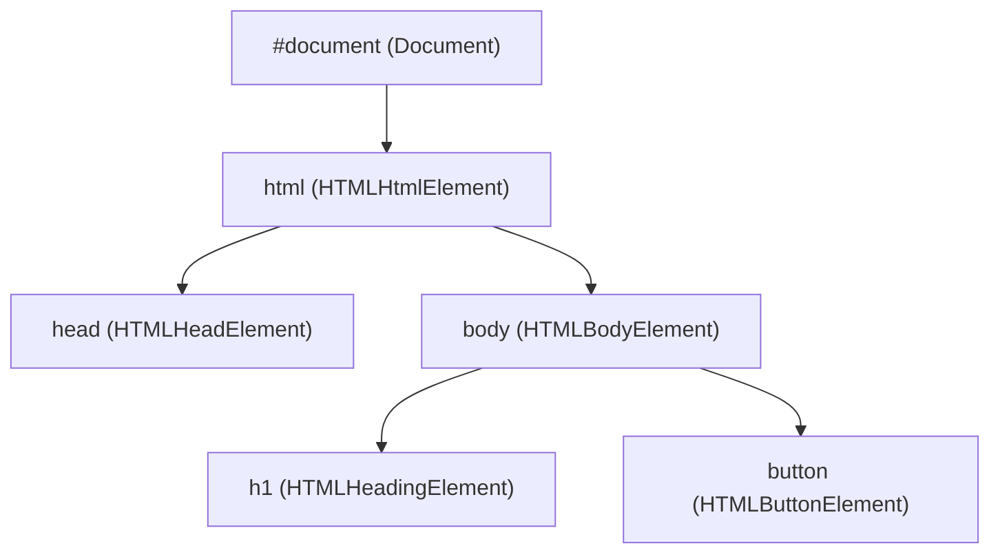

# Séance 4 — Rappel HTML/CSS et introduction à Bootstrap

**Cours de programmation orientée objet — Bachelier en informatique**

---

## Objectifs pédagogiques

À l'issue de cette séance, l'étudiant est capable de :

- comprendre le rôle respectif du HTML, du CSS et du DOM dans une application web ;
- structurer une page à l'aide de balises sémantiques ;
- maîtriser les fondamentaux du CSS : sélecteurs, cascade, modèle de boîte et flexbox ;
- exploiter le système de grille responsive à 12 colonnes de Bootstrap ;
- utiliser les composants clés de Bootstrap (boutons, cartes, formulaires) ainsi que ses classes utilitaires d'espacement ;
- intégrer un gabarit complet Bootstrap dans un projet Angular.

---

## 1. Rappel HTML et le DOM

### 1.1 Le trio fondamental du Web

Toute application web repose sur la complémentarité de trois technologies, chacune jouant un rôle distinct :

- **HTML** (*HyperText Markup Language*) constitue le squelette et la sémantique de la page. Il définit la structure du contenu : titres, paragraphes, conteneurs, liens. Il s'agit d'un langage de *balisage*, et non d'un langage de programmation : il ne comporte ni variables, ni boucles, ni conditions.
- **CSS** (*Cascading Style Sheets*) constitue l'habillage et la mise en page. Il définit l'apparence visuelle : couleurs, polices, espacements, positionnement, ainsi que le comportement responsive de la page.
- **JavaScript / TypeScript** constitue la logique applicative. Il apporte le dynamisme : réaction aux événements, manipulation des données, interaction avec l'utilisateur.

Il convient de noter que ce trio trouve une traduction directe dans Angular : un composant réunit précisément ces trois aspects au sein d'une même unité, à savoir le template (fichier HTML, référencé par `templateUrl`), les styles (fichier CSS, référencé par `styleUrl`) et la classe TypeScript qui porte la logique.

### 1.2 Le HTML : balises, attributs et éléments

Le HTML décrit la *structure* et le *sens* du contenu, sans aucune dimension programmatique. Le contenu est encadré par des **balises** (*tags*) qui lui confèrent un rôle sémantique, et enrichi par des **attributs** qui précisent le comportement ou l'identité de l'élément (`href`, `class`, `id`, `src`, etc.).

On distingue deux catégories de balises :

- les **balises en paires**, qui encadrent un contenu et possèdent une balise ouvrante et une balise fermante : `<h1>...</h1>`, `<p>...</p>`, `<div>...</div>` ;
- les **balises orphelines** (*self-closing*), qui n'ont pas de contenu ni de balise fermante : ``, `<input />`, `<br />`.

Considérons l'exemple suivant :

```html
<p class="intro" id="bienvenue">
  Bonjour tout le monde !
</p>
```

Cet extrait illustre la terminologie essentielle :

- le **nom de balise** est `p`, qui désigne un paragraphe ;
- les **attributs** sont `class="intro"` et `id="bienvenue"` ;
- le **contenu** est le texte `Bonjour tout le monde !` ;
- l'**élément** désigne l'ensemble : balise ouvrante, contenu et balise fermante.

### 1.3 Le DOM : un arbre d'objets instancié en mémoire

Le **DOM** (*Document Object Model*) est la représentation vivante du HTML en mémoire vive. Lorsqu'un navigateur charge une page, il lit le fichier texte HTML et **instancie un arbre d'objets** correspondant à chaque balise.

Ce mécanisme établit un lien direct avec la programmation orientée objet :

- chaque nœud de l'arbre est un **objet instancié** à partir d'une classe du navigateur : `HTMLHeadingElement`, `HTMLButtonElement`, `HTMLParagraphElement`, etc. ;
- ces classes sont organisées selon une **chaîne d'héritage** : `EventTarget` ➔ `Node` ➔ `Element` ➔ `HTMLElement`, d'où dérivent les classes concrètes mentionnées ci-dessus.

Ainsi, Angular et TypeScript n'interagissent jamais avec le fichier HTML source : ils manipulent les **objets du DOM** que le navigateur a instanciés. Une arborescence typique se présente ainsi :



### 1.4 Éléments de type bloc et éléments en ligne

Le HTML distingue deux grands comportements de rendu par défaut.

**Éléments de type bloc (*block*)** : `<p>`, `<div>`, `<h1>` à `<h6>`, `<header>`, `<section>`, etc.

- ils occupent **100 % de la largeur disponible**, quel que soit leur contenu ;
- ils provoquent systématiquement un **retour à la ligne** avant et après eux ;
- ils acceptent les propriétés `width`, `height` ainsi que les marges verticales (`margin-top`, `margin-bottom`).

**Éléments en ligne (*inline*)** : `<span>`, `<a>`, `<strong>`, `<em>`, `<code>`, etc.

- ils ne prennent que la **largeur de leur contenu textuel** ;
- ils restent **sur la même ligne** que les éléments voisins ;
- ils ignorent les propriétés `width`, `height` et les marges verticales.

Ce comportement par défaut peut être modifié par la propriété CSS `display`, qui accepte notamment les valeurs `block`, `inline` et `inline-block` (un comportement hybride : l'élément reste en ligne mais accepte dimensions et marges verticales).

### 1.5 Le document HTML minimal

Un document HTML5 conforme suit la structure suivante :

```html
<!DOCTYPE html>
<html lang="fr">
  <head>
    <meta charset="UTF-8" />
    <title>Titre</title>
  </head>
  <body>
    <h1>Bienvenue</h1>
    <p>Contenu affiché...</p>
  </body>
</html>
```

Chaque partie remplit un rôle précis :

- `<!DOCTYPE html>` déclare l'utilisation du standard **HTML5** ;
- `<html lang="fr">` constitue la racine du document et déclare la langue, ce qui a un impact sur l'accessibilité et le référencement ;
- `<head>` contient les **métadonnées** : encodage des caractères (UTF-8, indispensable pour le français), titre de l'onglet du navigateur, liens vers les feuilles de style. Ce contenu n'est pas affiché dans la page ;
- `<body>` contient tout le **contenu visible** par l'utilisateur.

### 1.6 Les balises sémantiques

La sémantique consiste à choisir des balises dont le nom exprime le **rôle** du contenu, plutôt que des conteneurs génériques sans signification. Les principales balises sémantiques sont :

| Balise | Rôle sémantique |
|---|---|
| `<header>` | En-tête de la page ou d'une section |
| `<nav>` | Navigation principale |
| `<main>` | Contenu principal de la page (unique) |
| `<section>` | Section thématique regroupant un contenu cohérent |
| `<article>` | Contenu autonome et diffusable (article, fiche, post) |
| `<aside>` | Contenu annexe, complémentaire (barre latérale) |
| `<footer>` | Pied de page |

L'intérêt est triple : l'accessibilité (les lecteurs d'écran exploitent ces balises), le référencement (les moteurs de recherche en tiennent compte) et la lisibilité du code. Une structure type se présente ainsi : un `<header>` contenant le titre et la `<nav>`, un `<main>` flanqué d'un `<aside>` pour le contenu annexe, et un `<footer>`.

### 1.7 Les attributs universels `class` et `id`

Deux attributs sont centraux pour le développement quotidien.

**L'attribut `class`**, réutilisable :

- il peut être **partagé par plusieurs éléments** de la page ;
- un même élément peut cumuler **plusieurs classes**, séparées par des espaces ;
- il constitue le mécanisme roi du styling, tant en CSS qu'avec Bootstrap.

```html
<p class="intro alert alert-success">Validé</p>
```

**L'attribut `id`**, unique :

- il doit être **strictement unique** dans toute la page ;
- il sert typiquement aux formulaires (association `<label for="...">` / `<input id="...">`), aux ancres d'URL (`#section-2`) et aux cibles JavaScript.

On retiendra la bonne pratique suivante : le `class` est réservé au style réutilisable, tandis que l'`id` est réservé aux identifiants techniques. Dès que le besoin est visuel et réutilisable, on privilégie une classe.

---

## 2. Rappel CSS

### 2.1 Le CSS et la cascade : la spécificité

Le **CSS** (*Cascading Style Sheets*, feuilles de style en cascade) sépare le *fond* (le contenu HTML) de la *forme* (l'apparence). Son nom renvoie au mécanisme de la cascade : lorsque plusieurs règles s'appliquent à un même élément, une hiérarchie de priorité détermine laquelle l'emporte. Cette priorité s'exprime par un **score de spécificité** :

1. le style en ligne (`style="..."`) : 1000 points ;
2. l'identifiant (`#pied`) : 100 points ;
3. la classe (`.carte`) : 10 points ;
4. la balise d'élément (`h1`, `p`) : 1 point.

```css
/* 1 pt : balise */
p { color: black; }

/* 10 pts : classe (écrase la balise) */
.carte { color: blue; }

/* 100 pts : identifiant (écrase la classe) */
#pied { color: red; }
```

À score égal, c'est la **dernière règle écrite** dans la feuille de style qui l'emporte.

### 2.2 Les sélecteurs

Les sélecteurs désignent les éléments auxquels s'appliquent les règles :

```css
/* 1. Sélecteur d'élément */
h1 { color: #2c3e50; }

/* 2. Sélecteur de classe (réutilisable) */
.carte {
  background: #fff;
  border: 1px solid #ddd;
}

/* 3. Sélecteur d'identifiant (unique) */
#pied { text-align: center; }
```

Le ciblage peut être combiné :

- `div.carte` : un élément `div` portant la classe `.carte` ;
- `.carte h3` : un titre `h3` situé à l'intérieur d'un élément `.carte` ;
- `.btn:hover` : l'élément au survol du curseur (pseudo-classe d'état).

Dans la pratique moderne — et a fortiori avec Bootstrap — on utilise quasi exclusivement des **classes** pour le design.

### 2.3 Le modèle de boîte (*Box Model*)

Tout élément HTML est rendu comme une boîte composée de **quatre couches emboîtées**, de l'intérieur vers l'extérieur :

1. **Content** : le contenu proprement dit (texte, image ou éléments enfants) ;
2. **Padding** : la marge interne, un espace situé entre le contenu et la bordure ;
3. **Border** : la bordure, une ligne potentiellement visible entourant le padding ;
4. **Margin** : la marge externe, un espace transparent qui sépare l'élément de ses voisins.

```css
.boite {
  padding: 16px;
  border: 2px solid #333;
  margin: 20px;
}
```

La confusion la plus fréquente chez le débutant concerne la distinction entre `padding` et `margin` : le premier crée de l'espace *à l'intérieur* de la boîte (entre le contenu et la bordure), le second crée de l'espace *à l'extérieur* (entre la bordure et les éléments voisins).

### 2.4 `box-sizing` : `content-box` vs `border-box`

Par défaut, le navigateur applique `box-sizing: content-box` : les dimensions déclarées (`width`, `height`) ne concernent **que le contenu**. Tout padding et toute bordure s'ajoutent par-dessus. Ainsi, un élément déclaré `width: 200px` avec `padding: 20px` et `border: 2px` occupe réellement **244 px** de large, ce qui provoque fréquemment des dépassements de conteneur.

Le standard moderne consiste à imposer `box-sizing: border-box` à l'ensemble du document :

```css
*, *::before, *::after {
  box-sizing: border-box;
}
```

Avec `border-box`, les propriétés `width` et `height` **incluent** le padding et la bordure : un élément déclaré `width: 200px` occupe strictement 200 px, quels que soient son padding et sa bordure. La conséquence pratique est immédiate : deux colonnes déclarées à `width: 50 %` restent parfaitement alignées côte à côte, là qu'avec `content-box` elles s'empileraient. Il convient de noter que **Bootstrap applique automatiquement** `box-sizing: border-box` à tout le document via son système de *reboot* CSS.

### 2.5 Flexbox : la disposition unidimensionnelle

**Flexbox** est le mode de mise en page CSS conçu pour distribuer des éléments le long d'un seul axe (une ligne ou une colonne). Il est activé sur un élément parent (*conteneur flexible*) :

```css
.conteneur {
  display: flex;
  flex-direction: row;
  justify-content: space-between;
  align-items: center;
  gap: 16px;
}
```

Les propriétés fondamentales sont :

- **`justify-content`** : alignement le long de l'**axe principal** (celui défini par `flex-direction`), avec des valeurs telles que `flex-start`, `center`, `space-between`, `space-around` ;
- **`align-items`** : alignement le long de l'**axe secondaire** (perpendiculaire), avec des valeurs telles que `stretch`, `flex-start`, `center` ;
- **`gap`** : espacement automatique et uniforme entre les enfants, sans marges artificielles.

Flexbox constitue le socle technique du système de grille de Bootstrap : les `.row` de Bootstrap ne sont rien d'autre que des conteneurs flex préconfigurés. Pour s'entraîner de manière ludique, l'étudiant pourra compléter les niveaux du jeu *Flexbox Froggy* (flexboxfroggy.com), chaque niveau sollicitant une propriété flexbox précise.

---

## 3. Introduction à Bootstrap

### 3.1 Présentation et intégration dans Angular

**Bootstrap** est une bibliothèque CSS complète qui fournit des styles et des composants préfabriqués : barres de navigation, boutons, cartes, formulaires, alertes, etc. Ses caractéristiques essentielles sont :

- une **grille responsive à 12 colonnes**, qui dispense d'écrire des *media queries* manuelles ;
- un système de **classes utilitaires** permettant de gérer rapidement marges, couleurs et typographie ;
- une approche **mobile-first** : le style est conçu d'abord pour le mobile, puis enrichi pour les écrans plus larges.

L'intégration dans un projet Angular s'effectue en deux temps. D'abord, l'installation du paquet via le gestionnaire de dépendances :

```bash
npm install bootstrap@v5.3.8
```

Ensuite, l'ajout de la feuille de style compilée dans le fichier de configuration `angular.json`, **avant** la feuille de style globale du projet afin que les styles personnalisés puissent compléter Bootstrap :

```json
"styles": [
  "node_modules/bootstrap/dist/css/bootstrap.min.css",
  "src/styles.css"
]
```

Une fois cette configuration effectuée, les classes Bootstrap sont utilisables directement dans les templates HTML de tous les composants de l'application.

### 3.2 Le système de grille à 12 colonnes

Le cœur de Bootstrap est son système de grille. Chaque ligne est divisée en **12 unités**, et les colonnes occupent un nombre entier de ces unités :

```html
<div class="container">
  <div class="row">
    <div class="col-6">6 / 12 (50%)</div>
    <div class="col-6">6 / 12 (50%)</div>
  </div>
</div>
```

Trois classes structurent toute mise en page Bootstrap :

- **`.container`** : centre le contenu et fixe les marges latérales automatiques ;
- **`.row`** : crée une ligne, qui est matériellement un conteneur flexbox ;
- **`.col-*`** : définit la largeur de la colonne en douzièmes (`.col-6` = 6/12 = 50 %, `.col-4` = 4/12 ≈ 33 %, etc.).

Combinées, ces classes couvrent l'intégralité des répartitions usuelles : une colonne pleine largeur (`col-12`), deux colonnes égales (`col-6`), trois colonnes égales (`col-4`), ou des répartitions asymétriques (`col-3` / `col-9`).

### 3.3 Les points d'arrêt (*breakpoints*)

Bootstrap définit des **points d'arrêt** (*breakpoints*) : des largeurs d'écran à partir desquelles la mise en page peut changer. Conformément à l'approche mobile-first, chaque classe préfixée s'applique **à partir de** la largeur minimale correspondante, et reste active pour toutes les largeurs supérieures :

| Classe | Breakpoint | Appareils cibles |
|--------|------------|------------------|
| `col-` | < 576 px | Smartphones (vertical) |
| `col-sm-*` | ≥ 576 px | Grands smartphones / phablettes |
| `col-md-*` | ≥ 768 px | Tablettes |
| `col-lg-*` | ≥ 992 px | Ordinateurs de bureau et portables |
| `col-xl-*` | ≥ 1200 px | Grands écrans |
| `col-xxl-*` | ≥ 1400 px | Écrans très haute résolution |

Une colonne sans préfixe de point d'arrêt (`col-6`) s'applique à toutes les largeurs.

### 3.4 Exemple responsive complet

En cumulant plusieurs classes de colonnes, on décrit une mise en page qui s'adapte seule à chaque catégorie d'appareil :

```html
<div class="row g-3">
  <div class="col-12 col-md-6 col-lg-4">
    <!-- Carte 1 -->
  </div>
  <div class="col-12 col-md-6 col-lg-4">
    <!-- Carte 2 -->
  </div>
  <div class="col-12 col-md-6 col-lg-4">
    <!-- Carte 3 -->
  </div>
</div>
```

Le comportement obtenu est le suivant :

- sur **mobile** (< 768 px) : `col-12` s'applique, les cartes s'empilent verticalement, une par ligne ;
- sur **tablette** (≥ 768 px) : `col-md-6` prend le relais, deux cartes par ligne ;
- sur **ordinateur** (≥ 992 px) : `col-lg-4` s'applique, trois cartes par ligne.

La classe **`.g-3`** (*gutter*) ajoute un espacement uniforme entre les colonnes et entre les lignes. C'est la totalité du comportement responsive qui est ainsi obtenue, sans écrire la moindre *media query* manuelle.

### 3.5 Les composants clés

**Les boutons.** Bootstrap normalise l'apparence des boutons et propose des variantes sémantiques par classe :

```html
<button class="btn btn-primary">Principal</button>
<button class="btn btn-secondary">Secondaire</button>
<button class="btn btn-danger">Danger</button>
<button class="btn btn-outline-primary">Contour</button>
```

La classe `.btn` applique la structure de base ; la classe `.btn-*` détermine la couleur sémantique (bleu primaire, gris secondaire, rouge danger, etc.). Les variantes `.btn-outline-*` offrent un style à contour sans fond coloré.

**Les cartes (*cards*).** Le composant carte est la brique de présentation la plus utilisée :

```html
<div class="card shadow-sm" style="width: 18rem;">
  <div class="card-body">
    <h5 class="card-title">Titre</h5>
    <p class="card-text text-muted">
      Description du contenu.
    </p>
    <a href="#" class="btn btn-primary">Détail</a>
  </div>
</div>
```

La classe `.card` crée le conteneur, `.card-body` l'espace de contenu, `.card-title` et `.card-text` les styles typographiques internes.

**Les formulaires.** Bootstrap uniformise l'apparence des champs de saisie :

```html
<form>
  <div class="mb-3">
    <label for="email" class="form-label">Courriel</label>
    <input type="email" class="form-control" id="email" />
  </div>
  <button type="submit" class="btn btn-primary">Envoyer</button>
</form>
```

La classe `.form-control` donne au champ sa pleine largeur et son style soigné ; la classe `.form-label` harmonise les étiquettes. La classe `.mb-3` (marge basse de 16 px) structure l'espacement vertical du formulaire. L'attribut `for` de l'étiquette correspond à l'`id` du champ, ce qui rend le champ accessible (un clic sur l'étiquette active le champ).

### 3.6 Les classes utilitaires d'espacement

Bootstrap fournit des classes utilitaires pour les marges et le padding, selon une syntaxe rigoureuse : `{propriété}{côté}-{taille}`.

- **Propriété** : `m` pour *margin* (marge externe), `p` pour *padding* (marge interne) ;
- **Côté** : `t` (haut), `b` (bas), `s` (début, côté gauche en français), `e` (fin, côté droit en français), `x` (horizontal), `y` (vertical), ou rien pour les quatre côtés à la fois ;
- **Taille**, de 0 à 5, exprimée en multiples de 0,25 rem (4 px) :
  - `0` : suppression (0 px) ;
  - `1` : 0,25 rem (4 px) ;
  - `2` : 0,5 rem (8 px) ;
  - `3` : 1 rem (16 px), la valeur standard ;
  - `4` : 1,5 rem (24 px) ;
  - `5` : 3 rem (48 px) ;
  - `auto` : marge automatique, utilisée notamment pour le centrage horizontal (`mx-auto`).

On retiendra par exemple `mb-3` (marge basse standard), `p-2`, `py-4` ou encore `mx-auto`.

---

## 4. Démonstration Angular

La démonstration consiste à intégrer un gabarit Bootstrap complet dans un projet Angular existant, étape par étape. Le mini-projet préparé par l'enseignant est mis à disposition via Git ; l'étudiant le récupère et l'explore pendant la démonstration.

### Étape 1 — Récupérer et lancer le projet

L'étudiant récupère la dernière version du dépôt, se place dans le dossier du projet de la démonstration et lance le serveur de développement :

```bash
git pull
cd Seance 4/bootstrap-test
npm install
ng serve
```

Le projet s'affiche alors dans le navigateur à l'adresse locale indiquée par le CLI, et toute modification du code provoque un rechargement automatique.

### Étape 2 — Ajouter Bootstrap au projet

Dans le terminal du projet, on installe Bootstrap :

```bash
npm install bootstrap@v5.3.8
```

On déclare ensuite la feuille de style dans le fichier `angular.json`, **avant** la feuille de style globale du projet :

```json
"styles": [
  "node_modules/bootstrap/dist/css/bootstrap.min.css",
  "src/styles.css"
]
```

Si le style ne s'applique pas immédiatement, il convient de relancer `ng serve` afin que le CLI recharge sa configuration.

### Étape 3 — Ajouter la barre de navigation

On remplace la navigation existante par une barre de navigation Bootstrap sombre :

```html
<nav class="navbar navbar-expand-lg navbar-dark bg-dark">
  <div class="container-fluid">
    <a class="navbar-brand" href="#">AppDemo</a>
    <div class="collapse navbar-collapse" id="menuPrincipal">
      <ul class="navbar-nav me-auto mb-2 mb-lg-0">
        <li class="nav-item">
          <a class="nav-link active" href="#">Accueil</a>
        </li>
        <li class="nav-item">
          <a class="nav-link" href="#">Profil</a>
        </li>
      </ul>
    </div>
  </div>
</nav>
```

Les points clés de cette étape sont :

- `.container` centre le contenu et fixe les marges latérales ;
- `.row` combiné à `.g-3` crée une grille flexible avec un espacement uniforme entre les cartes ;
- les colonnes `.col-12 col-md-6 col-lg-4` assurent l'adaptabilité responsive sans aucune *media query* manuelle ;
- la classe `.h-100` (hauteur 100 %) donne une hauteur uniforme à toutes les cartes d'une même ligne.

### Étape 4 — Intégrer un formulaire dans la grille

On ajoute une section de formulaire dont les champs s'organisent selon la grille :

```html
<section class="container mt-5 mb-5">
  <h3 class="mb-3">Ajouter un élément</h3>
  <form>
    <div class="row">
      <div class="col-md-6 mb-3">
        <label for="titre" class="form-label">Titre</label>
        <input type="text" class="form-control" id="titre" />
      </div>
      <div class="col-md-6 mb-3">
        <label for="cat" class="form-label">Catégorie</label>
        <select class="form-select" id="cat">...</select>
      </div>
    </div>
    <button type="submit" class="btn btn-success">Enregistrer</button>
  </form>
</section>
```

Sur tablette et ordinateur, les deux champs `col-md-6` se placent côte à côte ; sur mobile, ils s'empilent naturellement. Le bouton de soumission utilise la variante sémantique `.btn-success`.

### Étape 5 — Tester le comportement responsive

À l'aide des outils de développement du navigateur (`F12`, puis activation du mode responsive), on observe le comportement du gabarit à différentes largeurs d'écran :

- **mobile (< 768 px)** : empilement vertical de tous les éléments (`col-12`) ;
- **tablette (≥ 768 px)** : passage à deux colonnes (`col-md-6`) ;
- **ordinateur (≥ 992 px)** : passage à trois colonnes (`col-lg-4`).

Cette vérification conclut la démonstration : le gabarit complet — navigation, grille de cartes et formulaire — est désormais intégré au projet Angular et entièrement responsive.

---

## 5. Récapitulatif

| Notion | Point clé |
|---|---|
| **DOM** | Arbre d'objets instancié en mémoire par le navigateur, manipulé par Angular et TypeScript |
| **HTML sémantique** | Balises porteuses de sens : `header`, `nav`, `main`, `section`, `article`, `footer` |
| **Bloc vs en ligne** | Éléments empilés occupant 100 % de la largeur vs éléments intégrés dans le flux du texte |
| **Box model** | Quatre couches : contenu, padding, bordure, marge ; privilégier `box-sizing: border-box` |
| **Flexbox** | `display: flex`, alignement sur l'axe principal (`justify-content`) et l'axe secondaire (`align-items`) |
| **Grille Bootstrap** | 12 colonnes, responsive mobile-first : `col-12 col-md-6 col-lg-4` |
| **Composants et utilitaires** | `.btn`, `.card`, `.form-control`, espacements `.m*`, `.p*` |

---

## Prochaine séance

La séance 5 abordera l'**encapsulation** : getters et setters, invariants de classe, visibilité `private` / `protected` / `public`, membres statiques et enums, avec pour démonstration Angular un service dont l'état interne (un `signal` privé) n'est exposé qu'en lecture via une méthode ou un `computed()`.
