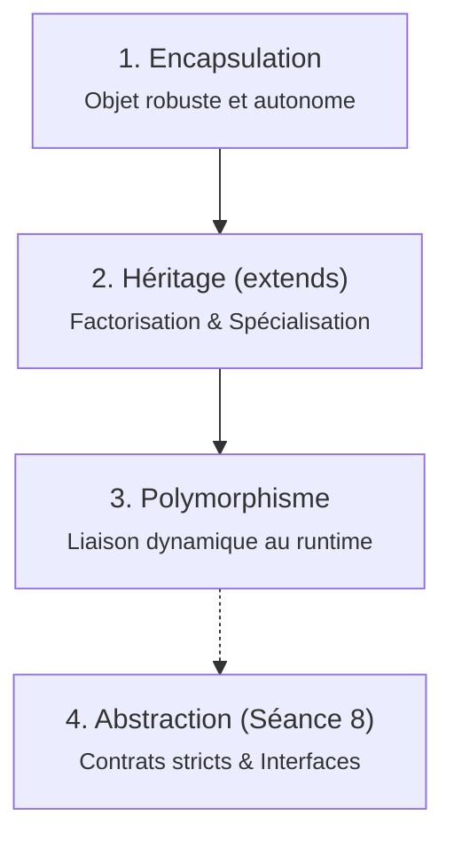
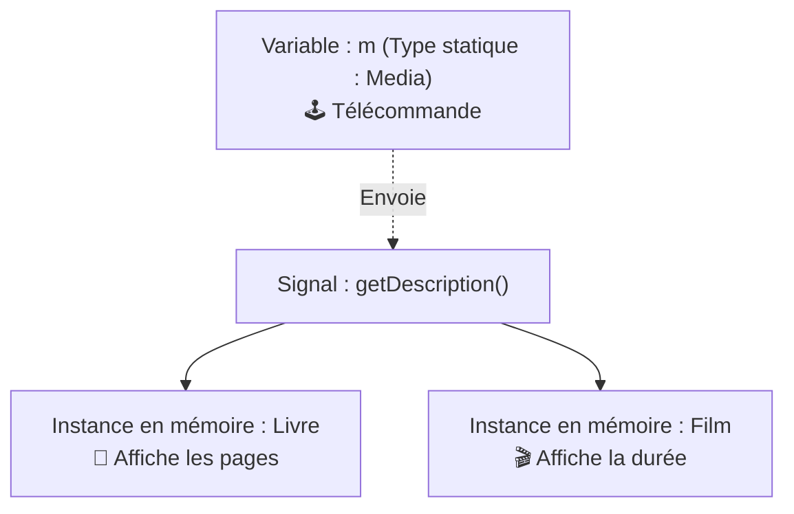
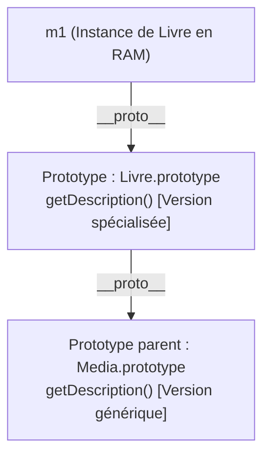

<div class="h-full flex flex-col justify-center items-center">
  <div class="inline-flex items-center gap-2 px-3 py-1 mb-4 text-xs font-semibold rounded-full bg-blue-500/10 text-blue-500 border border-blue-500/20">
    <span class="w-2 h-2 rounded-full bg-blue-500"></span>
    Programmation Orientée Objet · EAFC
  </div>

  <h1 class="text-4xl font-extrabold tracking-tight mb-4 bg-gradient-to-r from-blue-600 via-indigo-500 to-purple-600 bg-clip-text text-transparent">
    Séance 7 — Le Polymorphisme
  </h1>

  <p class="text-lg opacity-80 max-w-xl mx-auto mb-6 font-medium">
    Redéfinition & Surcharge · Collections hétérogènes · Type Narrowing · Intégration Angular
  </p>

  <div class="flex items-center justify-center gap-2 text-xs font-mono opacity-60">
    <span class="px-2 py-0.5 rounded bg-gray-500/10 border border-gray-500/20">TypeScript 5+</span>
    <span class="px-2 py-0.5 rounded bg-gray-500/10 border border-gray-500/20">Angular 21+</span>
    <span class="px-2 py-0.5 rounded bg-gray-500/10 border border-gray-500/20">Standalone</span>
    <span class="px-2 py-0.5 rounded bg-gray-500/10 border border-gray-500/20">POO</span>
  </div>
</div>

<!--
Bienvenue à la séance 7 du cours de Programmation Orientée Objet.
Lors des séances précédentes, nous avons exploré deux piliers majeurs :
- L'encapsulation (séance 5), pour protéger l'état interne de nos objets.
- L'héritage (séance 6), pour factoriser et spécialiser des classes.

Aujourd'hui, nous abordons le véritable super-pouvoir de l'héritage : le Polymorphisme.
C'est le mécanisme qui permet à un code client de manipuler des objets variés de façon totalement uniforme, tout en laissant chaque objet exécuter son propre comportement.
-->

---
layout: default
---

# 🎯 Objectifs pédagogiques

<div class="grid grid-cols-2 gap-4 mt-4">
  <div class="p-3.5 rounded-xl bg-slate-500/5 border border-slate-500/15 flex items-start gap-3">
    <span class="w-7 h-7 rounded-lg bg-blue-500/10 text-blue-500 flex items-center justify-center font-bold text-xs flex-shrink-0">01</span>
    <div>
      <h4 class="font-bold text-sm mb-0.5">Fondements & Liaison Dynamique</h4>
      <p class="text-xs opacity-75">Distinguer redéfinition (dynamique) et surcharge (statique), type statique et type dynamique. Comprendre comment le runtime résout la méthode effective (<em>late binding</em>).</p>
    </div>
  </div>

  <div class="p-3.5 rounded-xl bg-slate-500/5 border border-slate-500/15 flex items-start gap-3">
    <span class="w-7 h-7 rounded-lg bg-indigo-500/10 text-indigo-500 flex items-center justify-center font-bold text-xs flex-shrink-0">02</span>
    <div>
      <h4 class="font-bold text-sm mb-0.5">Collections Hétérogènes & OCP</h4>
      <p class="text-xs opacity-75">Manipuler des listes polymorphes sous un type commun et respecter le principe Ouvert/Fermé (extensibilité sans modification).</p>
    </div>
  </div>

  <div class="p-3.5 rounded-xl bg-slate-500/5 border border-slate-500/15 flex items-start gap-3">
    <span class="w-7 h-7 rounded-lg bg-purple-500/10 text-purple-500 flex items-center justify-center font-bold text-xs flex-shrink-0">03</span>
    <div>
      <h4 class="font-bold text-sm mb-0.5">Contrôle de Type : <code>instanceof</code> & Unions</h4>
      <p class="text-xs opacity-75">Opérer un <em>Type Narrowing</em> sécurisé avec <code>instanceof</code> et découvrir l'alternative moderne par unions discriminées.</p>
    </div>
  </div>

  <div class="p-3.5 rounded-xl bg-slate-500/5 border border-slate-500/15 flex items-start gap-3">
    <span class="w-7 h-7 rounded-lg bg-emerald-500/10 text-emerald-500 flex items-center justify-center font-bold text-xs flex-shrink-0">04</span>
    <div>
      <h4 class="font-bold text-sm mb-0.5">Intégration Angular Moderne</h4>
      <p class="text-xs opacity-75">Afficher une collection polymorphe dans un composant Standalone avec Signals, <code>@for</code> et <code>@if</code>.</p>
    </div>
  </div>
</div>

<div class="mt-4 p-2.5 rounded-xl bg-blue-500/10 border border-blue-500/20 text-xs text-blue-700 dark:text-blue-300 text-center">
  💡 <strong>Fil conducteur</strong> : Passer d'un code rigide rempli de vérifications de types à un catalogue multimédia ouvert, extensible et piloté par le polymorphisme.
</div>

<!--
Présentez les 4 objectifs clairement.
Insistez sur le fil conducteur : les étudiants ont souvent l'impression que le polymorphisme est un terme abstrait.
Notre mission aujourd'hui est de leur prouver qu'il s'agit de la technique concrète qui élimine 90% des 'switch' et des 'if' verbeux dans le code métier.
-->

---
layout: two-cols-header
---

# Le cheminement de la POO

::left::

<div class="space-y-2 mt-1 text-xs">
  <div class="p-2 rounded-xl bg-blue-500/10 border border-blue-500/20">
    <div class="font-bold text-blue-600 dark:text-blue-400 mb-0.5">📦 Séance 5 — L'Objet Isolé (Encapsulation)</div>
    <p class="opacity-80">Protection de l'état interne, maintien des invariants métier via <code>private</code> et accesseurs.</p>
  </div>

  <div class="p-2 rounded-xl bg-indigo-500/10 border border-indigo-500/20">
    <div class="font-bold text-indigo-600 dark:text-indigo-400 mb-0.5">🧬 Séance 6 — La Famille de Classes (Héritage)</div>
    <p class="opacity-80">Factorisation des attributs communs, relation « est-un », appel à <code>super()</code> et redéfinition avec <code>override</code>.</p>
  </div>

  <div class="p-2 rounded-xl bg-purple-500/15 border border-purple-500/30">
    <div class="font-bold text-purple-600 dark:text-purple-400 mb-0.5">🎭 Séance 7 — La Vision Dynamique (Polymorphisme)</div>
    <p class="opacity-80">Piloter des objets spécialisés à travers une signature générale sans connaître leur type concret à l'avance.</p>
  </div>
</div>

::right::

<div class="ms-2 flex flex-col items-center justify-center h-full">



<span class="text-[11px] opacity-60 mt-2 italic text-center">
  L'héritage prépare la structure ; le polymorphisme libère son plein potentiel d'extensibilité.
</span>

</div>

<!--
Cette diapositive pose le cadre mental pour les étudiants.
Sans encapsulation, l'héritage produit du code chaotique.
Sans polymorphisme, l'héritage ne sert qu'à économiser quelques lignes d'attributs (copier-coller évité).
C'est le polymorphisme qui justifie l'existence de l'héritage en entreprise !
-->

---
layout: center
class: text-center
---

<div class="inline-flex items-center gap-2 px-3 py-1 mb-3 text-xs font-mono font-semibold rounded-full bg-blue-500/10 text-blue-500 border border-blue-500/20">
  PARTIE 01
</div>

# Du Code Rigide au Polymorphisme

<p class="opacity-70 text-sm max-w-lg mx-auto">
  Pourquoi les cascades de conditions sur les types mènent à la catastrophe logicielle, et comment la POO résout élégamment ce problème.
</p>

<!--
On commence par faire ressentir la douleur d'un code sans polymorphisme.
-->

---
layout: two-cols-header
---

# L'idée en 10 secondes : la basse-cour

::left::

<p class="text-xs mb-2 opacity-90">
  Avant tout code métier, une image simple. On donne <strong>le même ordre</strong> à trois animaux différents :
</p>

```typescript
class Animal {
  crier(): string {
    return '...';
  }
}

class Chat extends Animal {
  override crier(): string { return 'Miaou !'; }
}
class Chien extends Animal {
  override crier(): string { return 'Ouaf !'; }
}
class Vache extends Animal {
  override crier(): string { return 'Meuh !'; }
}
```

::right::

<div class="ms-2 flex flex-col items-center justify-center h-full">

<div class="p-3 rounded-xl bg-slate-500/5 border border-slate-500/15 text-xs font-mono w-full">
  <div class="font-bold text-slate-700 dark:text-slate-200 mb-2 font-sans">for (const a of [chat, chien, vache]) a.crier();</div>
  <div class="text-blue-600 dark:text-blue-400">🐱 "Miaou !"</div>
  <div class="text-emerald-600 dark:text-emerald-400">🐶 "Ouaf !"</div>
  <div class="text-amber-600 dark:text-amber-400">🐮 "Meuh !"</div>
</div>

<div class="mt-3 p-2.5 rounded-xl bg-blue-500/10 border border-blue-500/20 text-xs text-center">
  💡 <strong>Un seul ordre, trois réactions différentes.</strong> Vous venez de comprendre le polymorphisme.
</div>
</div>

<style>
  code {
    font-size: 10px !important;
  }
</style>

<!--
Cette diapositive n'a qu'un seul but : faire "cliquer" le concept AVANT de plonger dans le code métier.
Dites-le clairement : "Vous venez de comprendre le polymorphisme en une slide. Tout le reste du cours consiste juste à appliquer cette même idée dans du code professionnel."
Ne passez pas plus de 2 minutes ici — l'objectif est le déclic mental, pas l'exhaustivité. On repart ensuite sur l'exemple Livre/Film connu depuis la séance 6.
-->

---
layout: two-cols-header
---

# L'anti-pattern de la tour de contrôle

::left::

<p class="text-xs mb-1.5 opacity-90">
  Supposons que nous ayons nos classes <code>Livre</code> et <code>Film</code> issues de la Séance 6, et que nous voulions afficher leurs informations :
</p>

```typescript
// Approche procédurale sans polymorphisme
function afficherInfo(item: any): void {
  if (item.type === 'livre') {
    console.log(`Livre: ${item.titre} (${item.pages} p.)`);
  } else if (item.type === 'film') {
    console.log(`Film: ${item.titre} (${item.duree} min)`);
  } else {
    console.log(`Média inconnu`);
  }
}
```

<div class="mt-2 p-2 rounded-lg bg-rose-500/10 border border-rose-500/20 text-xs text-rose-600 dark:text-rose-400">
  ⚠️ <strong>Code rigide</strong> : Le code appelant doit inspecter l'intérieur de chaque objet pour décider quoi faire !
</div>

::right::

<div class="ms-2 space-y-2 text-xs pt-1">
  <div class="p-2.5 rounded-xl bg-slate-500/5 border border-slate-500/15">
    <strong class="text-rose-600 dark:text-rose-400">1. Couplage fort</strong><br>
    La fonction doit connaître l'intégralité des types concrets existant dans le système.
  </div>

  <div class="p-2.5 rounded-xl bg-slate-500/5 border border-slate-500/15">
    <strong class="text-amber-600 dark:text-amber-400">2. Duplication des cascades</strong><br>
    Si on doit aussi calculer un tarif ou imprimer une étiquette, on réécrit le même <code>if/else if</code> ailleurs !
  </div>

  <div class="p-2.5 rounded-xl bg-red-500/10 border border-red-500/20">
    <strong class="text-red-600 dark:text-red-400">3. Violation de l'Open/Closed Principle</strong><br>
    L'ajout d'un <code>JeuVideo</code> oblige à rouvrir et modifier <em>toutes</em> les fonctions existantes. Risque maximal de régression.
  </div>
</div>

<!--
Soulignez aux étudiants la métaphore de la tour de contrôle.
La tour de contrôle (la fonction externe) prend toutes les décisions à la place des pilotes (les objets).
En POO, on inverse cette responsabilité : on demande à l'objet d'agir, et c'est lui qui sait comment faire.
-->

---
layout: two-cols-header
---

# La solution POO : Déléguer à l'objet

::left::

```typescript
// Classe de base
class Media {
  constructor(public titre: string, public annee: number) {}

  getDescription(): string {
    return `${this.titre} (${this.annee})`;
  }
}

// Sous-classes spécialisées
class Livre extends Media {
  constructor(titre: string, annee: number, public pages: number) {
    super(titre, annee);
  }

  override getDescription(): string {
    return `Livre : ${this.titre} — ${this.pages} pages`;
  }
}
```

::right::

<div class="ms-2">

```typescript
class Film extends Media {
  constructor(titre: string, annee: number, public duree: number) 
  {
    super(titre, annee);
  }

  override getDescription(): string {
    return `Film : ${this.titre} — ${this.duree} min`;
  }
}
// Consommation : Zéro condition !
function afficher(media: Media): void {
  console.log(media.getDescription());
}
```

<div class="mt-2.5 p-2.5 rounded-xl bg-emerald-500/10 border border-emerald-500/20 text-xs">
  <div class="font-bold text-emerald-600 dark:text-emerald-400 mb-0.5">✨ Zéro `if`, Zéro `switch` !</div>
  <p class="opacity-80">La fonction <code>afficher</code> ne sait même pas si elle reçoit un <code>Livre</code> ou un <code>Film</code>. Elle fait confiance à la méthode de l'objet.</p>
</div>

</div>

<style>
  code {
    font-size: 10px !important;
  }
</style>


<!--
Regardez la clarté de la fonction 'afficher(media: Media)'.
Elle tient en une ligne. Elle ne pose aucune question sur l'identité de l'objet.
Elle envoie un message (getDescription) et l'objet récepteur réagit selon sa propre nature.
-->

---
layout: two-cols-header
---

# Qu'est-ce que le Polymorphisme ?

::left::

<div class="space-y-2.5 text-xs">
  <div class="p-3 rounded-xl bg-blue-500/10 border border-blue-500/20">
    <div class="font-bold text-sm text-blue-600 dark:text-blue-400 mb-1">Étymologie</div>
    <p class="opacity-85">
      Du grec <strong>poly</strong> (plusieurs) et <strong>morphê</strong> (formes).<br>
      La faculté pour un même concept ou un même appel de prendre différentes formes d'exécution.
    </p>
  </div>

  <div class="p-3 rounded-xl bg-purple-500/10 border border-purple-500/20">
    <div class="font-bold text-sm text-purple-600 dark:text-purple-400 mb-1">Définition formelle</div>
    <p class="opacity-85">
      Capacité d'un système orienté objet à invoquer la méthode appropriée à l'exécution en fonction du <strong>type effectif de l'instance</strong>, bien que la référence soit typée selon la <strong>classe parente</strong>.
    </p>
  </div>
</div>

::right::

<div class="ms-2 p-3.5 rounded-xl bg-slate-500/5 border border-slate-500/15 text-xs space-y-2.5">
  <div class="font-bold text-sm text-slate-800 dark:text-slate-100">Les 3 conditions indispensables :</div>

  <div class="flex items-start gap-2">
    <span class="px-1.5 py-0.5 rounded bg-blue-500/20 text-blue-600 font-mono font-bold">1</span>
    <p class="opacity-80">Une <strong>relation d'héritage</strong> (<code>extends</code>) entre une classe générale et des classes dérivées.</p>
  </div>

  <div class="flex items-start gap-2">
    <span class="px-1.5 py-0.5 rounded bg-indigo-500/20 text-indigo-600 font-mono font-bold">2</span>
    <p class="opacity-80">Une <strong>redéfinition de méthode</strong> (<code>override</code>) avec la même signature dans la classe fille.</p>
  </div>

  <div class="flex items-start gap-2">
    <span class="px-1.5 py-0.5 rounded bg-emerald-500/20 text-emerald-600 font-mono font-bold">3</span>
    <p class="opacity-80">Une <strong>référence de type parent</strong> pointant vers un objet instancié d'une sous-classe.</p>
  </div>
</div>

<!--
Précisez bien que le polymorphisme dont on parle ici est le polymorphisme par sous-typage (ou polymorphisme d'inclusion).
C'est le plus important en POO classique.
-->

---
layout: two-cols-header
---

# Une autre forme de polymorphisme : la surcharge

::left::

<div class="space-y-2.5 text-xs">
  <div class="p-3 rounded-xl bg-amber-500/10 border border-amber-500/20">
    <div class="font-bold text-sm text-amber-600 dark:text-amber-400 mb-1">Polymorphisme ad hoc (surcharge)</div>
    <p class="opacity-85">
      Plusieurs méthodes portant <strong>le même nom</strong>, dans <strong>la même classe</strong>, mais avec des <strong>signatures différentes</strong> (nombre ou type de paramètres).
    </p>
  </div>

  <div class="p-3 rounded-xl bg-slate-500/5 border border-slate-500/15">
    <p class="opacity-85">
      C'est le compilateur qui choisit, <strong>à la compilation</strong>, quelle version appeler selon les arguments fournis. Rien à voir avec l'objet en mémoire !
    </p>
  </div>
</div>

::right::

<div class="ms-2 p-3.5 rounded-xl bg-slate-500/5 border border-slate-500/15 text-xs">
  <div class="font-bold text-sm mb-2">Ne pas confondre avec la redéfinition !</div>
  <table class="w-full text-[11px]">
    <thead>
      <tr class="opacity-70 text-left">
        <th class="pb-1"></th>
        <th class="pb-1">Surcharge</th>
        <th class="pb-1">Redéfinition</th>
      </tr>
    </thead>
    <tbody class="opacity-90">
      <tr><td class="py-0.5 font-bold">Où ?</td><td>Même classe</td><td>Classe fille</td></tr>
      <tr><td class="py-0.5 font-bold">Signature</td><td>Différente</td><td>Identique</td></tr>
      <tr><td class="py-0.5 font-bold">Résolue</td><td>Compilation</td><td>Exécution</td></tr>
      <tr><td class="py-0.5 font-bold">Vu</td><td>👉 Maintenant</td><td>✅ Déjà vu</td></tr>
    </tbody>
  </table>
</div>

<!--
Nommez clairement les deux familles pour éviter la confusion classique chez les étudiants :
- Redéfinition (override) = polymorphisme d'inclusion, dynamique, déjà vu à l'instant.
- Surcharge (overload) = polymorphisme ad hoc, statique, nouveau.
Les deux méritent le nom "polymorphisme" (même nom, comportements différents), mais leur mécanisme est complètement différent. C'est une confusion très fréquente en examen.
-->

---
layout: two-cols-header
---

# La surcharge en TypeScript : un piège à connaître

::left::

<p class="text-xs mb-1.5 opacity-90">
  Contrairement à Java ou C#, TypeScript (comme JavaScript) n'autorise <strong>qu'une seule implémentation</strong> par nom de méthode. On simule la surcharge avec des <strong>signatures</strong> au-dessus d'une implémentation unique :
</p>

```typescript
class Livre extends Media {
  // Signatures de surcharge (visibles à l'appel)
  resume(): string;
  resume(nbCaracteres: number): string;

  // Implémentation unique (jamais appelée directement)
  resume(nbCaracteres?: number): string {
    const texte = `${this.titre}, par ${this.auteur}`;
    return nbCaracteres ? texte.slice(0, nbCaracteres) : texte;
  }
}
```

::right::

<div class="ms-2 space-y-2.5 text-xs pt-1">
  <div class="p-3 rounded-xl bg-blue-500/10 border border-blue-500/20">
    <strong class="text-blue-600 dark:text-blue-400">À l'usage</strong>
    <div class="mt-1.5 font-mono text-[11px] bg-slate-500/10 rounded p-1.5">
      livre.resume();<br>
      <span class="opacity-60">// texte complet</span><br>
      livre.resume(20);<br>
      <span class="opacity-60">// 20 premiers caractères</span>
    </div>
  </div>

  <div class="p-3 rounded-xl bg-rose-500/10 border border-rose-500/20">
    <strong class="text-rose-600 dark:text-rose-400">⚠️ Piège classique</strong>
    <p class="opacity-80 mt-1">
      En Java, on écrirait deux méthodes <code>resume()</code> avec deux corps différents. En TypeScript, ça ne compile pas : <strong>un seul corps</strong>, les signatures du dessus ne servent qu'à guider l'auto-complétion et la vérification de type.
    </p>
  </div>
</div>

<!--
Insistez sur la différence avec Java, que certains étudiants connaissent déjà via d'autres cours.
JavaScript ne connaît pas la notion de "méthodes multiples avec le même nom" au runtime : il n'y a qu'une seule fonction en mémoire.
Les signatures de surcharge sont une pure fiction du compilateur TypeScript, effacée à la compilation (comme les interfaces vues plus tôt).
-->

---
layout: center
class: text-center
---

<div class="inline-flex items-center gap-2 px-3 py-1 mb-3 text-xs font-mono font-semibold rounded-full bg-indigo-500/10 text-indigo-500 border border-indigo-500/20">
  PARTIE 02
</div>

# Mécanique Interne : Type Statique vs Type Dynamique

<p class="opacity-70 text-sm max-w-lg mx-auto">
  L'analogie de la télécommande universelle, le rôle du compilateur et le fonctionnement de la liaison dynamique au moment de l'exécution.
</p>

<!--
Passons sous le capot pour comprendre comment le moteur JavaScript et le compilateur TypeScript gèrent cela.
-->

---
layout: two-cols-header
---

# L'analogie de la télécommande universelle

::left::

<p class="text-xs mb-2 opacity-90">
  Considérons le type de la variable comme une <strong>télécommande</strong> et l'objet instancié en mémoire vive comme l'<strong>appareil</strong> :
</p>

<div class="space-y-2 text-xs">
  <div class="p-2.5 rounded-xl bg-blue-500/10 border border-blue-500/20">
    <strong class="text-blue-600 dark:text-blue-400">La télécommande (`Media`)</strong><br>
    Elle possède un bouton : <code>getDescription()</code>.<br>
    C'est le <strong>contrat statique</strong> vérifié par TypeScript.
  </div>

  <div class="p-2.5 rounded-xl bg-emerald-500/10 border border-emerald-500/20">
    <strong class="text-emerald-600 dark:text-emerald-400">L'appareil récepteur (`Livre` ou `Film`)</strong><br>
    Quand vous pressez le bouton, c'est l'appareil branché derrière qui réagit selon ses propres circuits !
  </div>
</div>

::right::

<div class="ms-2 flex flex-col items-center justify-center">



<div class="mt-2 p-2 rounded-lg bg-slate-500/5 border border-slate-500/15 text-[11px] opacity-75 text-center">
  Une seule commande envoyée, mais deux réactions différentes selon l'objet ciblé.
</div>

</div>

<!--
L'analogie de la télécommande est l'une des plus efficaces en pédagogie POO :
Le type de la variable détermine quels boutons sont physiquement présents sur la télécommande.
Mais c'est l'objet au bout du fil qui décide de la manière d'exécuter l'action.
-->

---
layout: two-cols-header
---

# Type Statique vs Type Dynamique

::left::

```typescript
// 1. Déclaration avec type parent (Statique)
// 2. Instanciation de la sous-classe (Dynamique)
const m1: Media = new Livre("Clean Code", 2008, 464);
const m2: Media = new Film("Inception", 2010, 148);

// Appel polymorphe :
console.log(m1.getDescription());
// 👉 "Livre : Clean Code — 464 pages"

console.log(m2.getDescription());
// 👉 "Film : Inception — 148 min"
```

::right::

<div class="ms-2 space-y-2.5 text-xs pt-1">
  <div class="p-2.5 rounded-xl bg-blue-500/10 border border-blue-500/20">
    <strong class="text-blue-600 dark:text-blue-400">Type Statique (Déclaré)</strong>
    <ul class="list-disc list-inside mt-1 opacity-80 space-y-0.5">
      <li>Connu au moment de la <strong>compilation</strong>.</li>
      <li>Ici : <code>Media</code>.</li>
      <li>Fixe les méthodes et propriétés accessibles.</li>
    </ul>
  </div>

  <div class="p-2.5 rounded-xl bg-purple-500/10 border border-purple-500/20">
    <strong class="text-purple-600 dark:text-purple-400">Type Dynamique (Effectif)</strong>
    <ul class="list-disc list-inside mt-1 opacity-80 space-y-0.5">
      <li>Déterminé à l'<strong>exécution</strong> (<em>runtime</em>).</li>
      <li>Ici : <code>Livre</code> et <code>Film</code>.</li>
      <li>Détermine le code réellement exécuté.</li>
    </ul>
  </div>
</div>

<!--
Faites bien répéter aux étudiants :
Type statique = ce que le compilateur voit.
Type dynamique = ce qui est réellement en mémoire RAM (l'objet instancié avec 'new').
-->

---
layout: two-cols-header
---

# La Liaison Dynamique (*Late Binding*)

::left::

<p class="text-xs mb-2 opacity-90">
  Rappelez-vous le chat et le chien qui criaient chacun à leur façon : comment le moteur JavaScript (V8) sait-il concrètement quelle méthode appeler ?
</p>

<div class="space-y-2 text-xs">
  <div class="p-2.5 rounded-xl bg-slate-500/5 border border-slate-500/15">
    <strong>Liaison statique (précoce) :</strong><br>
    L'adresse de la fonction est gravée dans le marbre dès la compilation (ex: fonctions simples ou méthodes privées/finales dans d'autres langages).
  </div>

  <div class="p-2.5 rounded-xl bg-emerald-500/10 border border-emerald-500/20">
    <strong class="text-emerald-600 dark:text-emerald-400">Liaison dynamique (tardive) :</strong><br>
    L'adresse de la méthode est cherchée <em>au moment précis de l'appel</em> en inspectant le prototype de l'objet présent en mémoire.
  </div>
</div>

::right::

<div class="ms-2">



<div class="mt-2 p-2 rounded-lg bg-blue-500/10 border border-blue-500/20 text-[11px] text-center">
  🔍 Le moteur trouve <code>getDescription</code> directement sur <code>Livre.prototype</code> et l'exécute immédiatement sans remonter plus haut !
</div>

</div>

<!--
Expliquez la mécanique sous-jacente :
En JavaScript / TypeScript, chaque objet a un pointeur vers son prototype (__proto__).
Quand on écrit m1.getDescription(), le moteur inspecte m1.
Si m1 est un Livre, son prototype contient la version redéfinie.
Si aucune redéfinition n'existe, il remonte la chaîne jusqu'à Media.prototype.
-->

---
layout: two-cols-header
---

# La règle d'or du compilateur TypeScript

::left::

```typescript
const m: Media = new Livre("Les Misérables", 1862, 1488);

// ✅ Autorisé : déclaré sur Media
console.log(m.titre);
console.log(m.getDescription());

// ❌ ERREUR DE COMPILATION !
console.log(m.pages);
// TS2339: Property 'pages' does not exist on type 'Media'.
```

<div class="mt-2 p-2 rounded-lg bg-red-500/10 border border-red-500/20 text-xs text-red-600 dark:text-red-400">
  Même si l'objet réel possède bien la propriété <code>pages</code>, TypeScript la bloque !
</div>

::right::

<div class="ms-2 space-y-3 text-xs pt-1">
  <div class="p-3 rounded-xl bg-slate-500/5 border border-slate-500/15">
    <div class="font-bold text-sm text-blue-600 dark:text-blue-400 mb-1">Pourquoi ce blocage ?</div>
    <p class="opacity-80">
      TypeScript garantit la sécurité de type. Si la variable est de type <code>Media</code>, elle pourrait tout aussi bien contenir un <code>Film</code> (qui n'a pas de pages !).
    </p>
  </div>

  <div class="p-3 rounded-xl bg-amber-500/10 border border-amber-500/20">
    <div class="font-bold text-sm text-amber-600 dark:text-amber-400 mb-1">Règle fondamentale</div>
    <p class="opacity-80">
      <strong>Le type statique restreint la vue.</strong> Vous ne pouvez voir et actionner que les membres déclarés sur la classe de référence.
    </p>
  </div>
</div>

<!--
Insistez lourdement sur cette slide. C'est l'erreur numéro un des étudiants :
'Mais Monsieur, j'ai fait new Livre(), donc pages existe ! Pourquoi TypeScript m'insulte ?'
Réponse : TypeScript regarde l'étiquette de la boîte (Media), pas ce qui a été mis dedans au runtime.
-->

---
layout: center
class: text-center
---

<div class="inline-flex items-center gap-2 px-3 py-1 mb-3 text-xs font-mono font-semibold rounded-full bg-purple-500/10 text-purple-500 border border-purple-500/20">
  PARTIE 03
</div>

# Collections Hétérogènes & Extensibilité (OCP)

<p class="opacity-70 text-sm max-w-lg mx-auto">
  Comment unifier des objets variés au sein d'une même liste et ajouter de nouvelles fonctionnalités sans toucher au code existant.
</p>

<!--
Entrons dans l'application concrète : la gestion d'un catalogue multimédia avec des listes polymorphes.
-->

---
layout: two-cols-header
---

# Manipuler une collection hétérogène

::left::

<p class="text-xs mb-1.5 opacity-90">
  Une <strong>collection hétérogène</strong> rassemble des instances de sous-classes différentes sous un type commun :
</p>

```typescript
// Tableau d'objets variés unifiés par 'Media'
const catalogue: Media[] = [
  new Livre("1984", 1949, 328),
  new Film("Matrix", 1999, 136),
  new Livre("Dune", 1965, 412),
  new Film("Interstellar", 2014, 169)
];

// Traitement uniforme
for (const media of catalogue) {
  console.log(media.getDescription());
}
```

::right::

<div class="ms-2">

<div class="p-3 rounded-xl bg-slate-500/5 border border-slate-500/15 text-xs font-mono">
  <div class="font-bold text-slate-700 dark:text-slate-200 mb-2 font-sans">Sortie console :</div>
  <div class="text-blue-600 dark:text-blue-400">Livre : 1984 — 328 pages</div>
  <div class="text-purple-600 dark:text-purple-400">Film : Matrix — 136 min</div>
  <div class="text-blue-600 dark:text-blue-400">Livre : Dune — 412 pages</div>
  <div class="text-purple-600 dark:text-purple-400">Film : Interstellar — 169 min</div>
</div>

<div class="mt-3 p-2.5 rounded-xl bg-emerald-500/10 border border-emerald-500/20 text-xs">
  💡 <strong>Liaison dynamique en boucle :</strong> À chaque tour, le moteur résout la méthode adaptée à l'objet courant, sans aucune condition manuelle.
</div>

</div>

<!--
Faites remarquer l'élégance de la boucle 'for...of'.
Un seul appel 'media.getDescription()', 4 lignes affichées avec des formats complètement différents.
-->

---
layout: two-cols-header
---

# Le crash-test de l'extensibilité (OCP)

::left::

<p class="text-xs mb-1 font-bold text-purple-600 dark:text-purple-400">
  Défi métier : Ajoutons un nouveau type `JeuVideo` !
</p>

```typescript
class JeuVideo extends Media {
  constructor(
    titre: string,
    annee: number,
    public plateforme: string
  ) {
    super(titre, annee);
  }

  override getDescription(): string {
    return `Jeu : ${this.titre} [${this.plateforme}]`;
  }
}
```

::right::

<div class="ms-2">

```typescript
// On injecte le nouveau type dans le catalogue :
catalogue.push(
  new JeuVideo("Zelda: BotW", 2017, "Nintendo Switch")
);

// La boucle existante :
for (const media of catalogue) {
  console.log(media.getDescription());
}
// 👉 Affiche parfaitement le jeu vidéo !
```

<div class="mt-2.5 p-2.5 rounded-xl bg-blue-500/10 border border-blue-500/20 text-xs">
  🛡️ <strong>Principe Ouvert/Fermé respecté :</strong><br>
  Le code est <strong>ouvert à l'extension</strong> (on a créé <code>JeuVideo</code>) mais <strong>fermé à la modification</strong> (aucun code existant n'a été retouché).
</div>

</div>

<style>
  code {
    font-size: 10px !important;
  }
</style>


<!--
C'est le moment fort de la première moitié du cours :
Montrez aux étudiants que nous n'avons PAS touché à la classe Media.
Nous n'avons PAS touché à la boucle for.
Nous n'avons PAS touché à Livre ni à Film.
Nous avons simplement branché un nouveau module, et l'application fonctionne immédiatement.
-->

---
layout: default
---

# Comparatif architectural : Avec vs Sans Polymorphisme

<div class="grid grid-cols-2 gap-4 mt-3 text-xs">
  <div class="p-3.5 rounded-xl bg-rose-500/5 border border-rose-500/20 space-y-2">
    <div class="font-bold text-sm text-rose-600 dark:text-rose-400">
      ❌ Sans Polymorphisme (Procédural)
    </div>
    <ul class="space-y-1.5 opacity-85 list-disc list-inside">
      <li>Multiplication des blocs <code>if / else if</code> ou <code>switch</code>.</li>
      <li>Ajout d'un média = risque de casser les fonctions existantes en les modifiant.</li>
      <li>Le code client est saturé de détails internes de chaque classe.</li>
      <li>Tests unitaires lourds car chaque fonction doit tester tous les cas.</li>
    </ul>
    <div class="p-2 rounded bg-rose-500/10 font-mono text-[11px] text-rose-700 dark:text-rose-300">
      Dette technique exponentielle avec la taille du projet.
    </div>
  </div>

  <div class="p-3.5 rounded-xl bg-emerald-500/5 border border-emerald-500/20 space-y-2">
    <div class="font-bold text-sm text-emerald-600 dark:text-emerald-400">
      ✅ Avec Polymorphisme (Objet pur)
    </div>
    <ul class="space-y-1.5 opacity-85 list-disc list-inside">
      <li>Une seule ligne d'appel unifiée : <code>media.getDescription()</code>.</li>
      <li>Ajout d'un média = créer une classe fille, zéro impact sur le reste.</li>
      <li>Chaque classe fille encapsule ses propres spécificités.</li>
      <li>Tests unitaires isolés : chaque classe est testée individuellement.</li>
    </ul>
    <div class="p-2 rounded bg-emerald-500/10 font-mono text-[11px] text-emerald-700 dark:text-emerald-300">
      Architecture modulaire, maintenable et sereine.
    </div>
  </div>
</div>

<!--
Ce tableau synthétique est parfait pour les révisions d'examen.
Il formalise pourquoi les entreprises valorisent autant la POO bien comprise.
-->

---
layout: center
class: text-center
---

<div class="inline-flex items-center gap-2 px-3 py-1 mb-3 text-xs font-mono font-semibold rounded-full bg-teal-500/10 text-teal-500 border border-teal-500/20">
  PARTIE 04
</div>

# Le Garde de Type : `instanceof` & Type Narrowing

<p class="opacity-70 text-sm max-w-lg mx-auto">
  Quand le polymorphisme pur ne suffit pas : comment accéder en toute sécurité aux fonctionnalités exclusives d'une sous-classe.
</p>

<!--
On aborde maintenant la nuance : parfois, on a VRAIMENT besoin d'une méthode qui n'existe que sur Livre ou Film.
Comment faire sans perdre la sécurité de type ?
-->

---
layout: two-cols-header
---

# Quand le polymorphisme pur ne suffit pas

::left::

<p class="text-xs mb-2 opacity-90">
  Imaginons des méthodes qui n'ont aucun sens sur la classe parente <code>Media</code> :
</p>

<div class="space-y-2 text-xs">
  <div class="p-2.5 rounded-xl bg-slate-500/5 border border-slate-500/15">
    <code>Livre.feuilleter()</code> — Un film ne se feuillette pas !
  </div>
  <div class="p-2.5 rounded-xl bg-slate-500/5 border border-slate-500/15">
    <code>Film.regarderBandeAnnonce()</code> — Un livre papier n'a pas de bande-annonce vidéo !
  </div>
</div>

<div class="mt-3 p-2.5 rounded-xl bg-amber-500/10 border border-amber-500/20 text-xs">
  ⚠️ <strong>Mauvaise idée :</strong> Ajouter des méthodes vides ou throw Exception dans <code>Media</code> (pollution de l'interface parente).
</div>

::right::

<div class="ms-2">

<div class="p-3 rounded-xl bg-blue-500/10 border border-blue-500/20 text-xs space-y-2">
  <div class="font-bold text-sm text-blue-600 dark:text-blue-400">La bonne démarche :</div>
  <p class="opacity-80">
    Conserver ces méthodes uniquement dans les classes spécialisées, et utiliser un <strong>garde de type</strong> au moment précis où l'on souhaite les déclencher.
  </p>
  <div class="p-2 bg-slate-500/10 rounded font-mono text-[11px]">
    media instanceof Livre
  </div>
</div>

</div>

<!--
Mettez en garde contre l'erreur de conception classique :
Mettre toutes les méthodes possibles et imaginables dans la classe de base avec des corps vides.
C'est une hérésie qui casse l'encapsulation et le principe de ségrégation.
-->

---
layout: two-cols-header
---

# L'opérateur `instanceof` en action

::left::

<p class="text-xs mb-1 opacity-90">
  L'opérateur <code>instanceof</code> vérifie si un objet appartient à une classe donnée :
</p>

```typescript
function traiterMedia(media: Media): void {
  // Appel polymorphe général
  console.log(media.getDescription());

  // Traitement spécialisé sécurisé
  if (media instanceof Livre) {
    // TypeScript SAIT que media est un Livre ici !
    console.log(`Pages à lire : ${media.pages}`);
  } else if (media instanceof Film) {
    // TypeScript SAIT que media est un Film ici !
    console.log(`Durée : ${media.duree} minutes`);
  }
}
```

::right::

<div class="ms-2 space-y-2.5 text-xs pt-1">
  <div class="p-3 rounded-xl bg-emerald-500/10 border border-emerald-500/20">
    <div class="font-bold text-emerald-600 dark:text-emerald-400 text-sm mb-1">
      Type Narrowing automatique
    </div>
    <p class="opacity-85">
      Dès que la condition <code>media instanceof Livre</code> est validée, le compilateur TypeScript change temporairement le type de <code>media</code> en <code>Livre</code> à l'intérieur du bloc <code>{ ... }</code>.
    </p>
    <div class="mt-2 text-[11px] text-emerald-700 dark:text-emerald-300">
      ✔️ L'auto-complétion de l'IDE propose immédiatement <code>media.pages</code> sans cast manuel !
    </div>
  </div>
</div>

<!--
Expliquez le concept de 'Type Narrowing' (rétrécissement de type).
C'est l'une des forces majeures de TypeScript : il analyse le flot de contrôle du code.
-->

---
layout: two-cols-header
---

# Les 3 pièges critiques de `instanceof`

::left::

<div class="space-y-2 text-xs">
  <div class="p-2.5 rounded-xl bg-rose-500/10 border border-rose-500/20">
    <strong class="text-rose-600 dark:text-rose-400">1. Ne marche qu'avec des CLASSES</strong><br>
    <code>instanceof</code> inspecte la chaîne de prototypes à l'exécution. Les <code>interface</code> ou <code>type</code> TypeScript sont effacés à la compilation et provoquent une erreur !
  </div>

  <div class="p-2.5 rounded-xl bg-amber-500/10 border border-amber-500/20">
    <strong class="text-amber-600 dark:text-amber-400">2. Attention au JSON.parse()</strong><br>
    Un objet reçu d'une API via HTTP n'est qu'un objet littéral sans classe. <code>data instanceof Livre</code> vaudra toujours <code>false</code> s'il n'est pas ré-instancié avec <code>new Livre(...)</code> !
  </div>
</div>

::right::

<div class="ms-2 space-y-2 text-xs">
  <div class="p-2.5 rounded-xl bg-purple-500/10 border border-purple-500/20">
    <strong class="text-purple-600 dark:text-purple-400">3. Le piège de l'abus</strong><br>
    Si vous mettez des <code>if (m instanceof ...)</code> partout dans votre code, vous réintroduisez l'anti-pattern procédural de la tour de contrôle !
  </div>

  <div class="p-2.5 rounded-xl bg-slate-500/5 border border-slate-500/15">
    💡 <strong>Règle d'or de conception :</strong><br>
    Privilégiez <strong>toujours</strong> une méthode polymorphe redéfinie. Réservez <code>instanceof</code> aux cas exceptionnels (affichage de métadonnées exclusives dans l'UI).
  </div>
</div>

<!--
Ces trois pièges sont capitaux en entreprise, particulièrement le piège du JSON.parse() qui cause des bugs incompréhensibles aux développeurs juniors sur Angular.
-->

---
layout: center
class: text-center
---

<div class="inline-flex items-center gap-2 px-3 py-1 mb-3 text-xs font-mono font-semibold rounded-full bg-amber-500/10 text-amber-500 border border-amber-500/20">
  PARTIE 05
</div>

# Alternative Moderne : Unions Discriminées

<p class="opacity-70 text-sm max-w-lg mx-auto">
  Comment obtenir les bienfaits du polymorphisme sans classes ni héritage, directement sur des données brutes en TypeScript.
</p>

<!--
Abordons une spécificité incontournable du TypeScript moderne : le polymorphisme structurel avec unions discriminées.
-->

---
layout: two-cols-header
---

# Qu'est-ce qu'une union discriminée ?

::left::

<p class="text-xs mb-1.5 opacity-90">
  Une technique TypeScript combinant des <strong>types littéraux</strong> et une <strong>propriété commune</strong> (le discriminant) :
</p>

```typescript
type LivreData = {
  kind: 'livre'; // Discrimant
  titre: string;
  pages: number;
};

type FilmData = {
  kind: 'film';  // Discriminant
  titre: string;
  duree: number;
};

// L'union des deux types
type MediaData = LivreData | FilmData;
```

::right::

<div class="ms-2 space-y-2 text-xs pt-1">
  <div class="p-2.5 rounded-xl bg-blue-500/10 border border-blue-500/20">
    <strong class="text-blue-600 dark:text-blue-400">Propriété discriminante :</strong><br>
    La propriété <code>kind</code> (ou <code>type</code>) possède une valeur littérale unique pour chaque membre.
  </div>

  <div class="p-2.5 rounded-xl bg-slate-500/5 border border-slate-500/15">
    <strong>Idéal pour les API web :</strong><br>
    Parfait pour typer les réponses JSON d'un serveur REST ou WebSocket sans devoir instancier des classes avec <code>new</code>.
  </div>
</div>

<!--
Expliquez la différence de philosophie :
Les classes regroupent données et méthodes.
Les types/unions discriminées décrivent de la donnée pure (DTO, payloads API).
-->

---
layout: two-cols-header
---

# Filtrage exhaustif avec `switch` & `never`

::left::

```typescript
function formaterMedia(item: MediaData): string {
  switch (item.kind) {
    case 'livre':
      // item est automatiquement LivreData ici !
      return `Livre: ${item.titre} (${item.pages} p.)`;

    case 'film':
      // item est automatiquement FilmData ici !
      return `Film: ${item.titre} (${item.duree} min)`;

    default:
      // Sécurité absolue à la compilation !
      const _exhaustif: never = item;
      throw new Error(`Cas non géré : ${_exhaustif}`);
  }
}
```

::right::

<div class="ms-2 space-y-2.5 text-xs pt-1">
  <div class="p-3 rounded-xl bg-purple-500/10 border border-purple-500/20">
    <div class="font-bold text-sm text-purple-600 dark:text-purple-400 mb-1">
      Le piège du `never`
    </div>
    <p class="opacity-85">
      Si demain vous ajoutez <code>type JeuData = { kind: 'jeu', ... }</code> à l'union <code>MediaData</code> sans mettre à jour le <code>switch</code>, TypeScript <strong>refusera de compiler</strong> !
    </p>
    <div class="mt-2 text-[11px] text-purple-700 dark:text-purple-300">
      🛡️ Détection immédiate des oublis à la compilation.
    </div>
  </div>
</div>

<!--
Montrez l'astuce du type 'never' en TypeScript. C'est le Graal du typage fonctionnel pour garantir qu'aucun cas n'a été oublié.
-->

---
layout: default
---

# Tableau comparatif : Classes (POO) vs Unions Discriminées

<div class="mt-3 text-xs">

| Critère | Classes & Héritage (POO) | Unions Discriminées (TS) |
|---|---|---|
| **Nature** | Hiérarchie de classes avec prototypes | Types littéraux et typage structurel |
| **Comportement** | Méthodes internes encapsulées (`media.getDescription()`) | Fonctions externes (`formater(media)`) |
| **État & Invariants** | Encapsulation forte (`private`, constructeur de validation) | Données brutes souvent immutables |
| **Extensibilité** | **Facile d'ajouter un type** (nouvelle classe fille sans toucher au code existant) | **Facile d'ajouter une opération** (nouvelle fonction externe sans toucher aux types) |
| **Contexte de prédilection** | Modèle métier riche, logique d'application, entités complexes | Payloads HTTP / JSON, DTOs, événements |

</div>

<!--
Cette comparaison est essentielle pour faire des étudiants des développeurs matures, capables de choisir le bon outil selon la situation.
-->

---
layout: center
class: text-center
---

<div class="inline-flex items-center gap-2 px-3 py-1 mb-3 text-xs font-mono font-semibold rounded-full bg-emerald-500/10 text-emerald-500 border border-emerald-500/20">
  PARTIE 06
</div>

# Démonstration Angular Moderne (Pas-à-Pas)

<p class="opacity-70 text-sm max-w-lg mx-auto">
  Mise en pratique au sein d'une application Angular 21+ Standalone : gestion d'un catalogue réactif avec Signals et rendu polymorphe.
</p>

<!--
Passons au projet Angular ! Nous allons construire le catalogue multimédia étape par étape.
-->

---
layout: two-cols-header
---

# Étape 1 — Modèle métier en pur TypeScript

::left::

```typescript
// src/app/models/media.model.ts
export class Media {
  constructor(
    public titre: string,
    public annee: number
  ) {}

  getDescription(): string {
    return `${this.titre} (${this.annee})`;
  }

  getBadgeCss(): string {
    return 'badge bg-secondary';
  }
}
```

::right::

<div class="ms-2">

```typescript
export class Livre extends Media {
  constructor(
    titre: string,
    annee: number,
    public auteur: string,
    public pages: number
  ) {
    super(titre, annee);
  }

  override getDescription(): string {
    return `« ${this.titre} » par ${this.auteur}`;
  }

  override getBadgeCss(): string {
    return 'badge bg-primary';
  }
}
```

</div>

<style>
  code {
    font-size: 10px !important;
  }
</style>

<!--
Le modèle métier reste 100% indépendant d'Angular. Zéro import @angular/core dans ce fichier !
C'est le principe d'architecture propre.
-->

---
layout: two-cols-header
---

# Étape 1 (suite) — Classes `Film` et `JeuVideo`

::left::

```typescript
export class Film extends Media {
  constructor(
    titre: string,
    annee: number,
    public realisateur: string,
    public duree: number
  ) {
    super(titre, annee);
  }

  override getDescription(): string {
    return `Film : ${this.titre} (${this.duree} min)`;
  }

  override getBadgeCss(): string {
    return 'badge bg-danger';
  }
}
```

::right::

<div class="ms-2">

```typescript
export class JeuVideo extends Media {
  constructor(
    titre: string,
    annee: number,
    public console: string
  ) {
    super(titre, annee);
  }

  override getDescription(): string {
    return `Jeu : ${this.titre} [${this.console}]`;
  }

  override getBadgeCss(): string {
    return 'badge bg-success';
  }
}
```

</div>

<style>
  code {
    font-size: 10px !important;
  }
</style>

<!--
Remarquez la méthode polymorphe getBadgeCss().
Elle permet au modèle de fournir son code couleur pour Bootstrap sans que le template HTML ait besoin de savoir quel type d'objet il manipule !
-->

---
layout: default
---

# Étape 2 — Service réactif avec Signals

```typescript
// src/app/services/mediatheque.service.ts
import { Injectable, signal, computed } from '@angular/core';
import { Media, Livre, Film, JeuVideo } from '../models/media.model';

@Injectable({ providedIn: 'root' })
export class MediathequeService {
  // Signal privé encapsulé contenant notre collection polymorphe
  private readonly _medias = signal<Media[]>([
    new Livre('Le Petit Prince', 1943, 'Antoine de Saint-Exupéry', 96),
    new Film('Inception', 2010, 'Christopher Nolan', 148),
    new JeuVideo('The Witcher 3', 2015, 'PC / Consoles')
  ]);

  // Exposition en lecture seule
  readonly medias = computed(() => this._medias());

  ajouterLivre(titre: string, annee: number, auteur: string, pages: number): void {
    const nouveau = new Livre(titre, annee, auteur, pages);
    this._medias.update(liste => [...liste, nouveau]);
  }
}
```

<!--
Rappelez le patron appris en séance 5 sur l'encapsulation :
Un signal privé modifiable (_medias), exposé publiquement via un signal calculé en lecture seule (medias).
-->

---
layout: two-cols-header
---

# Étape 3 — Le composant Standalone

::left::

```typescript
// src/app/components/catalogue.component.ts
import { Component, inject } from '@angular/core';
import { MediathequeService } from '../services/mediatheque.service';
import { Livre, Film, JeuVideo } from '../models/media.model';

@Component({
  selector: 'app-catalogue',
  standalone: true,
  templateUrl: './catalogue.component.html'
})
export class CatalogueComponent {
  protected readonly service = inject(MediathequeService);

  // Exposition des constructeurs pour utilisation dans le template avec instanceof
  protected readonly LivreClass = Livre;
  protected readonly FilmClass = Film;
  protected readonly JeuVideoClass = JeuVideo;
}
```

::right::

<div class="ms-2 space-y-2 text-xs pt-1">
  <div class="p-3 rounded-xl bg-blue-500/10 border border-blue-500/20">
    <div class="font-bold text-sm text-blue-600 dark:text-blue-400 mb-1">
      Inject moderne Angular
    </div>
    <p class="opacity-80">
      Utilisation de la fonction <code>inject(MediathequeService)</code> sans constructeur verbeux.
    </p>
  </div>

  <div class="p-3 rounded-xl bg-amber-500/10 border border-amber-500/20">
    <div class="font-bold text-sm text-amber-600 dark:text-amber-400 mb-1">
      Astuce Template Angular
    </div>
    <p class="opacity-80">
      Dans un template Angular, pour écrire <code>item instanceof Livre</code>, la référence à la classe <code>Livre</code> doit être exposée comme propriété de la classe du composant !
    </p>
  </div>
</div>

<style>
  code {
    font-size: 10px !important;
  }
</style>

<!--
Cette astuce est cruciale pour éviter les blocages des étudiants dans leurs projets Angular :
Les templates Angular ne voient que les propriétés déclarées sur la classe du composant.
-->

---
layout: default
---

# Étape 4 — Le template avec `@for` et appel polymorphe

```html
<!-- src/app/components/catalogue.component.html -->
<div class="container py-4">
  <h2 class="mb-4">Catalogue de la Médiathèque</h2>
  <div class="row g-3">
    @for (media of service.medias(); track media.titre) {
      <div class="col-12 col-md-6 col-lg-4">
        <div class="card h-100 shadow-sm border-0 bg-light">
          <div class="card-body d-flex flex-column justify-content-between">
            <div>
              <span [class]="media.getBadgeCss()">{{ media.annee }}</span>
              <!-- Appel polymorphe pur : résolution dynamique au runtime ! -->
              <h5 class="card-title mt-2">{{ media.getDescription() }}</h5>
            </div>
          </div>
        </div>
      </div>
    } @empty {
      <div class="col-12"><p class="text-muted">Aucun média dans le catalogue.</p></div>
    }
  </div>
</div>
```

<style>
  code {
    font-size: 10px !important;
  }
</style>

<!--
Montrez à quel point le template HTML est court, lisible et robuste.
Il n'a pas besoin de savoir si l'élément est un livre ou un film pour afficher sa description et son badge.
-->

---
layout: default
---

# Étape 5 — Afficher les spécificités avec `@if` et `instanceof`

```html
<!-- Intérieur de la carte (après le titre) -->
<div class="mt-3 pt-2 border-top text-muted small">
  @if (media instanceof LivreClass) {
    <p class="mb-0">
      ✍️ <strong>Auteur :</strong> {{ media.auteur }}<br>
      📄 <strong>Pagination :</strong> {{ media.pages }} pages
    </p>
  }

  @if (media instanceof FilmClass) {
    <p class="mb-0">
      🎬 <strong>Réalisateur :</strong> {{ media.realisateur }}<br>
      ⏱️ <strong>Durée :</strong> {{ media.duree }} minutes
    </p>
  }

  @if (media instanceof JeuVideoClass) {
    <p class="mb-0">
      🎮 <strong>Plateforme :</strong> {{ media.console }}
    </p>
  }
</div>
```

<style>
  code {
    font-size: 10px !important;
  }
</style>

<!--
Voici l'illustration concrète de l'usage légitime de 'instanceof' :
Pour l'affichage de métadonnées de présentation purement spécifiques à chaque objet dans l'UI.
-->

---
layout: default
---

# 🌟 Synthèse des points clés de l'architecture

<div class="grid grid-cols-2 gap-3.5 mt-4 text-xs">
  <div class="p-3 rounded-xl bg-slate-500/5 border border-slate-500/15">
    <strong class="text-blue-600 dark:text-blue-400 text-sm">1. Appel Polymorphe</strong>
    <p class="opacity-75 mt-1">
      <code>media.getDescription()</code> s'exécute dynamiquement selon la sous-classe sans aucune ligne de condition dans le template.
    </p>
  </div>

  <div class="p-3 rounded-xl bg-slate-500/5 border border-slate-500/15">
    <strong class="text-indigo-600 dark:text-indigo-400 text-sm">2. Collection Hétérogène</strong>
    <p class="opacity-75 mt-1">
      Le tableau <code>Media[]</code> stocke côte à côte des livres, des films et des jeux sous un contrat commun.
    </p>
  </div>

  <div class="p-3 rounded-xl bg-slate-500/5 border border-slate-500/15">
    <strong class="text-purple-600 dark:text-purple-400 text-sm">3. Narrowing Contrôlé</strong>
    <p class="opacity-75 mt-1">
      <code>media instanceof Livre</code> permet d'extraire les attributs propres à chaque média en toute sécurité.
    </p>
  </div>

  <div class="p-3 rounded-xl bg-emerald-500/10 border border-emerald-500/20">
    <strong class="text-emerald-600 dark:text-emerald-400 text-sm">4. Extensibilité Maximale (OCP)</strong>
    <p class="opacity-75 mt-1">
      Pour ajouter un <code>Podcast</code>, il suffit de créer une sous-classe. L'application continue de fonctionner sans régression !
    </p>
  </div>
</div>

<!--
Ce récapitulatif clôt la démonstration Angular.
-->

---
layout: center
class: text-center
---

<div class="inline-flex items-center gap-2 px-3 py-1 mb-3 text-xs font-mono font-semibold rounded-full bg-blue-500/10 text-blue-500 border border-blue-500/20">
  SYNTHÈSE & VALIDATION
</div>

# Ce qu'il faut retenir & Auto-évaluation

<p class="opacity-70 text-sm max-w-lg mx-auto">
  Vérifions la maîtrise des concepts clés avant de nous projeter vers la séance suivante.
</p>

<!--
Phase finale : synthèse et validation des acquis.
-->

---
layout: default
---

# 📌 Récapitulatif de la séance

<div class="mt-2 text-xs">

| Notion | Rôle fondamental | Exemple clé |
|---|---|---|
| **Polymorphisme par redéfinition** | Même appel, exécution dépendante du type réel en mémoire | `m.getDescription()` résout la méthode de `Livre` |
| **Polymorphisme par surcharge** | Même nom, signatures différentes, résolu à la compilation | `resume()` / `resume(20)` |
| **Type statique vs Type dynamique** | Contrôle à la compilation vs Objet en RAM à l'exécution | `const m: Media = new Livre(...)` |
| **Liaison dynamique (*Late binding*)** | Résolution de méthode au runtime via le prototype | Recherche dans la chaîne de prototypes |
| **Collection hétérogène** | Unifier des sous-classes sous une référence commune | `catalogue: Media[] = [livre, film]` |
| **Garde `instanceof`** | Rétrécissement de type (*Type Narrowing*) sécurisé | `if (m instanceof Livre) { m.pages }` |
| **Union discriminée** | Alternative sans classes pour données API / JSON | `type Media = LivreData \| FilmData` |

</div>

<!--
Tableau synthétique pour ancrer les définitions.
-->


---
layout: default
---

# 🚀 Prochaine séance : Le paradoxe de la classe de base

<div class="p-3.5 rounded-xl bg-gradient-to-r from-blue-500/15 via-indigo-500/10 to-purple-500/15 border border-blue-500/30 mb-4">
  <span class="text-[10px] uppercase tracking-wider font-bold text-blue-600 dark:text-blue-400">Séance 8 en approche</span>
  <h2 class="text-lg font-extrabold mt-0.5">Classes Abstraites & Interfaces</h2>
</div>

<div class="grid grid-cols-2 gap-3.5 text-xs">
  <div class="p-3 rounded-xl bg-slate-500/5 border border-slate-500/15">
    <strong class="text-rose-600 dark:text-rose-400 text-sm mb-1 block">❓ Le problème actuel dans notre code</strong>
    <p class="opacity-80">
      Rien n'interdit actuellement d'écrire :<br>
      <code>const m = new Media("Objet Bizarre", 2026);</code><br>
      Mais dans la vraie vie, un média générique <em>qui n'est ni un livre, ni un film, ni un jeu</em> n'a aucun sens d'exister !
    </p>
  </div>

  <div class="p-3 rounded-xl bg-slate-500/5 border border-slate-500/15">
    <strong class="text-emerald-600 dark:text-emerald-400 text-sm mb-1 block">✨ La réponse en Séance 8</strong>
    <ul class="space-y-1 opacity-80 list-disc list-inside">
      <li>Empêcher l'instanciation directe avec <code>abstract class</code>.</li>
      <li>Forcer les sous-classes à implémenter une méthode avec <code>abstract</code>.</li>
      <li>Définir des contrats purs multi-familles avec les <code>interfaces</code>.</li>
    </ul>
  </div>
</div>

<div class="mt-3 p-2 rounded-xl bg-slate-500/10 border border-slate-500/20 text-center text-xs opacity-75">
  À la semaine prochaine pour franchir l'étape ultime de la modélisation objet ! 🎯
</div>

<!--
Terminez la séance en ouvrant l'appétit pour la séance 8.
C'est ainsi qu'on donne du sens à la progression pédagogique globale.
-->
