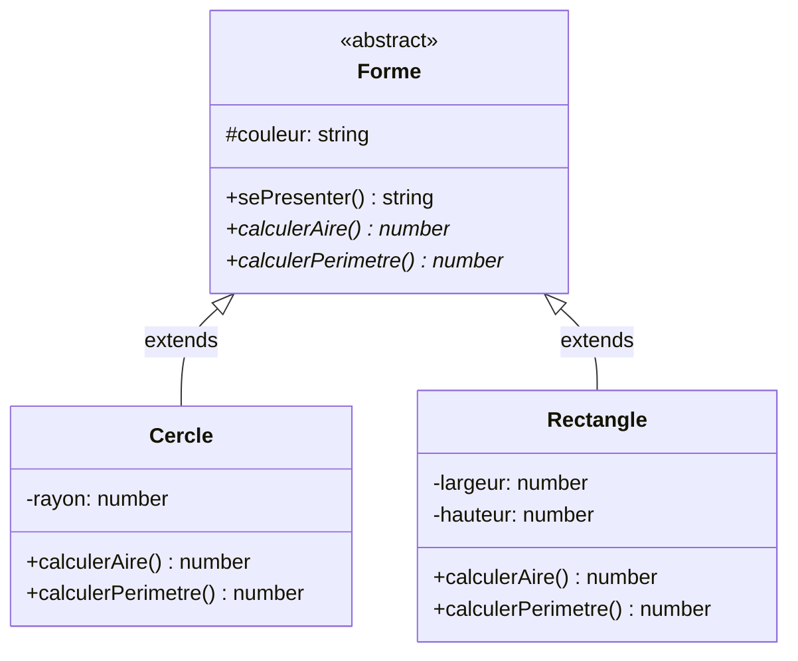
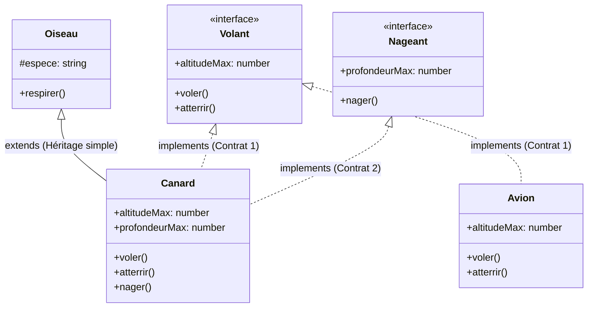

<style>
.slidev-code, .slidev-code pre { font-size: 0.72rem !important; line-height: 1.3 !important; }
.slidev-code pre { padding: 0.45rem 0.65rem !important; }
</style>

<div class="h-full flex flex-col justify-center items-center">
  <div class="inline-flex items-center gap-2 px-3 py-1 mb-4 text-xs font-semibold rounded-full bg-blue-500/10 text-blue-500 border border-blue-500/20">
    <span class="w-2 h-2 rounded-full bg-blue-500"></span>
    Programmation Orientée Objet · EAFC
  </div>

  <h1 class="text-4xl font-extrabold tracking-tight mb-3 bg-gradient-to-r from-blue-600 via-indigo-500 to-purple-600 bg-clip-text text-transparent">
    Séance 8 — Classes Abstraites & Interfaces
  </h1>

  <p class="text-lg opacity-80 max-w-2xl mx-auto mb-6 font-medium">
    Contrats purs · Implémentation partielle · Typage structurel · Découplage & Démonstration OO
  </p>

  <div class="flex items-center justify-center gap-2 text-xs font-mono opacity-60">
    <span class="px-2 py-0.5 rounded bg-gray-500/10 border border-gray-500/20">TypeScript 5+</span>
    <span class="px-2 py-0.5 rounded bg-gray-500/10 border border-gray-500/20">Angular 21+</span>
    <span class="px-2 py-0.5 rounded bg-gray-500/10 border border-gray-500/20">Signals</span>
    <span class="px-2 py-0.5 rounded bg-gray-500/10 border border-gray-500/20">POO Avancée</span>
  </div>
</div>

<!--
Bienvenue à la séance 8 du cours de Programmation Orientée Objet.
Jusqu'ici : encapsulation (séance 5), héritage (séance 6), polymorphisme (séance 7).
Deux problèmes restaient en suspens : des classes mères qu'on ne devrait jamais instancier,
et l'impossibilité d'hériter de plusieurs comportements à la fois.
C'est exactement ce que résolvent les classes abstraites et les interfaces.
-->

---
layout: default
---

# 🎯 Objectifs pédagogiques

<div class="grid grid-cols-2 gap-3.5 mt-4 text-xs">
  <div class="p-3 rounded-xl bg-slate-500/5 border border-slate-500/15 flex items-start gap-3">
    <span class="w-7 h-7 rounded-lg bg-blue-500/10 text-blue-500 flex items-center justify-center font-bold text-xs flex-shrink-0">01</span>
    <div>
      <h4 class="font-bold text-sm mb-0.5">Nécessité de l'Abstraction</h4>
      <p class="opacity-75">Pourquoi certaines classes ne doivent jamais être instanciées, et comment interdire <code>new</code> au compilateur.</p>
    </div>
  </div>

  <div class="p-3 rounded-xl bg-slate-500/5 border border-slate-500/15 flex items-start gap-3">
    <span class="w-7 h-7 rounded-lg bg-indigo-500/10 text-indigo-500 flex items-center justify-center font-bold text-xs flex-shrink-0">02</span>
    <div>
      <h4 class="font-bold text-sm mb-0.5">Classes Abstraites</h4>
      <p class="opacity-75"><code>abstract class</code>, méthodes sans corps, factorisation d'état via <code>constructor</code> et <code>super()</code>.</p>
    </div>
  </div>

  <div class="p-3 rounded-xl bg-slate-500/5 border border-slate-500/15 flex items-start gap-3">
    <span class="w-7 h-7 rounded-lg bg-purple-500/10 text-purple-500 flex items-center justify-center font-bold text-xs flex-shrink-0">03</span>
    <div>
      <h4 class="font-bold text-sm mb-0.5">Interfaces & Contrats Purs</h4>
      <p class="opacity-75">Définir des contrats sans implémentation et contourner la limite de l'héritage simple via <code>implements</code> multiple.</p>
    </div>
  </div>

  <div class="p-3 rounded-xl bg-slate-500/5 border border-slate-500/15 flex items-start gap-3">
    <span class="w-7 h-7 rounded-lg bg-teal-500/10 text-teal-500 flex items-center justify-center font-bold text-xs flex-shrink-0">04</span>
    <div>
      <h4 class="font-bold text-sm mb-0.5">Typage Structurel (Duck Typing)</h4>
      <p class="opacity-75">Conformité par la forme, DTOs et coût mémoire strictement nul au runtime (0 octet JS).</p>
    </div>
  </div>

  <div class="p-3 rounded-xl bg-slate-500/5 border border-slate-500/15 flex items-start gap-3">
    <span class="w-7 h-7 rounded-lg bg-amber-500/10 text-amber-500 flex items-center justify-center font-bold text-xs flex-shrink-0">05</span>
    <div>
      <h4 class="font-bold text-sm mb-0.5">Discernement & Modèle Hybride</h4>
      <p class="opacity-75">Choisir méthodiquement entre classe abstraite et interface, puis combiner les deux.</p>
    </div>
  </div>

  <div class="p-3 rounded-xl bg-slate-500/5 border border-slate-500/15 flex items-start gap-3">
    <span class="w-7 h-7 rounded-lg bg-emerald-500/10 text-emerald-500 flex items-center justify-center font-bold text-xs flex-shrink-0">06</span>
    <div>
      <h4 class="font-bold text-sm mb-0.5">Démonstration & Découplage UI</h4>
      <p class="opacity-75">Collection hétérogène dans un composant, traitement polymorphe sans aucun <code>switch/if</code>.</p>
    </div>
  </div>
</div>

<div class="mt-4 p-2.5 rounded-xl bg-blue-500/10 border border-blue-500/20 text-xs text-blue-700 dark:text-blue-300 text-center">
  💡 <strong>Fil conducteur :</strong> passer de classes mères factices à des contrats rigoureux et réutilisables dans nos composants Angular.
</div>

<!--
Chaque concept d'aujourd'hui répond à un problème concret rencontré en séance 6 et 7.
-->

---
layout: center
class: text-center
---

<div class="inline-flex items-center gap-2 px-3 py-1 mb-3 text-xs font-mono font-semibold rounded-full bg-blue-500/10 text-blue-500 border border-blue-500/20">
  PARTIE 00
</div>

# Le Cheminement : D'où venons-nous ?

<p class="opacity-70 text-sm max-w-xl mx-auto">
  Comment les acquis des séances 5, 6 et 7 nous mènent naturellement aux classes abstraites et aux interfaces.
</p>

<!--
Situer la séance : les étudiants doivent voir la cohérence du voyage pédagogique.
-->

---
layout: default
---

# La progression du cursus POO

<div class="grid grid-cols-4 gap-3 mt-4 text-xs">
  <div class="p-3 rounded-xl bg-slate-500/5 border border-slate-500/15">
    <div class="font-mono font-bold text-blue-500 mb-1">SÉANCE 5</div>
    <h3 class="font-bold mb-1.5">Encapsulation</h3>
    <ul class="opacity-80 space-y-0.5 list-disc list-inside">
      <li>Protection de l'état interne</li>
      <li>Stack vs Heap</li>
      <li><code>private</code> / <code>public</code></li>
      <li>Invariants garantis</li>
    </ul>
    <div class="mt-2.5 px-2 py-1 rounded bg-blue-500/10 text-blue-600 dark:text-blue-400 font-semibold text-center text-[11px]">Un objet robuste et autonome</div>
  </div>

  <div class="p-3 rounded-xl bg-slate-500/5 border border-slate-500/15">
    <div class="font-mono font-bold text-indigo-500 mb-1">SÉANCE 6</div>
    <h3 class="font-bold mb-1.5">Héritage</h3>
    <ul class="opacity-80 space-y-0.5 list-disc list-inside">
      <li>Factorisation <code>extends</code></li>
      <li>Appel à <code>super()</code></li>
      <li>Relation « est-un »</li>
      <li>Accès <code>protected</code></li>
    </ul>
    <div class="mt-2.5 px-2 py-1 rounded bg-indigo-500/10 text-indigo-600 dark:text-indigo-400 font-semibold text-center text-[11px]">Partage de structure & de code</div>
  </div>

  <div class="p-3 rounded-xl bg-slate-500/5 border border-slate-500/15">
    <div class="font-mono font-bold text-purple-500 mb-1">SÉANCE 7</div>
    <h3 class="font-bold mb-1.5">Polymorphisme</h3>
    <ul class="opacity-80 space-y-0.5 list-disc list-inside">
      <li>Liaison dynamique</li>
      <li>Collections hétérogènes</li>
      <li>Fin des <code>switch/if</code></li>
      <li>Principe OCP</li>
    </ul>
    <div class="mt-2.5 px-2 py-1 rounded bg-purple-500/10 text-purple-600 dark:text-purple-400 font-semibold text-center text-[11px]">Uniformité d'invocation</div>
  </div>

  <div class="p-3 rounded-xl bg-amber-500/10 border border-amber-500/30">
    <div class="font-mono font-bold text-amber-600 dark:text-amber-400 mb-1">SÉANCE 8</div>
    <h3 class="font-bold mb-1.5">Abstraction & Contrats</h3>
    <ul class="opacity-80 space-y-0.5 list-disc list-inside">
      <li>Interdire les objets fantômes</li>
      <li>Supprimer le code factice</li>
      <li>Contrats stricts</li>
      <li>Multi-implémentation</li>
    </ul>
    <div class="mt-2.5 px-2 py-1 rounded bg-amber-500/20 text-amber-700 dark:text-amber-300 font-semibold text-center text-[11px]">Rigueur & Découplage</div>
  </div>
</div>

<!--
En séance 6 et 7, nous avons assemblé des classes concrètes.
Deux brèches majeures restaient ouvertes dans notre architecture — c'est l'objet d'aujourd'hui.
-->

---
layout: two-cols-header
---

# Problème 1 : Les « objets fantômes »

::left::

<p class="text-xs mb-1.5 opacity-90">
  En séance 6 & 7, la classe de base <code>Forme</code> ou <code>Media</code> factorisait le code. Rien n'empêchait alors :
</p>

```typescript
// Rien n'interdit ce code valide pour le compilateur :
const formeMystere = new Forme('rouge');
const mediaInconnu = new Media('Sans titre', 2026);

// Mais quel sens métier ?
console.log(formeMystere.calculerAire()); // ???
```

<div class="mt-2 p-2 rounded-lg bg-rose-500/10 border border-rose-500/20 text-xs text-rose-600 dark:text-rose-400">
  ⚠️ <strong>Aberration sémantique :</strong> une « forme » générique n'existe pas dans le monde réel — seuls les cercles, rectangles ou triangles existent concrètement.
</div>

::right::

<div class="ms-2 space-y-2 text-xs pt-1">
  <div class="p-2.5 rounded-xl bg-slate-500/5 border border-slate-500/15">
    <strong class="text-emerald-600 dark:text-emerald-400">1. Interdire au compile-time</strong><br>
    <code>new Forme()</code> doit générer une <strong>erreur de compilation bloquante</strong>.
  </div>

  <div class="p-2.5 rounded-xl bg-slate-500/5 border border-slate-500/15">
    <strong class="text-blue-600 dark:text-blue-400">2. Conserver la factorisation</strong><br>
    Les sous-classes (<code>Cercle</code>, <code>Rectangle</code>) héritent toujours des propriétés communes (ex. <code>couleur</code>).
  </div>

  <div class="p-2.5 rounded-xl bg-slate-500/5 border border-slate-500/15">
    <strong class="text-purple-600 dark:text-purple-400">3. Patron incomplet</strong><br>
    La classe parente ne sert que de socle pour d'autres classes.
  </div>
</div>

<!--
"Est-ce que l'un d'entre vous a déjà vu 'une forme' marcher dans la rue ?"
L'idée de Forme est une abstraction humaine. En code, elle doit être abstraite !
-->

---
layout: two-cols-header
---

# Problème 2 : Le piège du code « bouchon » factice

::left::

<p class="text-xs mb-1.5 opacity-90">
  Pour que le polymorphisme fonctionne, la méthode devait être déclarée dans la classe mère :
</p>

```typescript
class Forme {
  constructor(public couleur: string) {}

  // Option A : valeur bidon
  calculerAire(): number {
    return 0; // Silencieux et faux !
  }

  // Option B : exception au runtime
  calculerPerimetre(): number {
    throw new Error('Méthode non implémentée !');
  }
}
```

<div class="mt-2 p-2 rounded-lg bg-rose-500/10 border border-rose-500/20 text-xs text-rose-600 dark:text-rose-400">
  💥 Si une sous-classe oublie d'écraser la méthode, le bogue explose <strong>en production</strong> au lieu d'être bloqué à la compilation.
</div>

::right::

<div class="ms-2 p-3 rounded-xl bg-emerald-500/10 border border-emerald-500/20 text-xs space-y-2">
  <div class="font-bold text-sm text-emerald-600 dark:text-emerald-400">Le besoin : une signature SANS corps</div>
  <p class="opacity-85">
    Déclarer : <em>« Toute forme possède une aire, mais seule la sous-classe sait comment la calculer. »</em>
  </p>
  <ul class="opacity-85 space-y-1 list-disc list-inside">
    <li><strong>Aucun corps</strong> : pas de <code>{ return 0; }</code>, signature pure terminée par <code>;</code>.</li>
    <li><strong>Obligation imposée</strong> : si <code>Cercle</code> n'implémente pas le calcul, TypeScript refuse de compiler.</li>
    <li><strong>Sécurité absolue</strong> : zéro bogue à l'exécution dû à un oubli d'implémentation.</li>
  </ul>
</div>

<!--
Un développeur professionnel préfère 1000 fois une erreur du compilateur
qu'un plantage en production chez un client.
-->

---
layout: two-cols-header
---

# Problème 3 : La barrière de l'héritage simple

::left::

<p class="text-xs mb-1.5 opacity-90">
  TypeScript refuse l'héritage multiple de classes (évite le problème du diamant) :
</p>

```typescript
class Fichier {}
class Imprimable {}
class Chiffrable {}

// ❌ INTERDIT EN TYPESCRIPT :
class FacturePDF extends Fichier, Imprimable, Chiffrable {
  // Erreur de syntaxe : une seule classe autorisée !
}
```

<div class="mt-2 p-2 rounded-lg bg-rose-500/10 border border-rose-500/20 text-xs text-rose-600 dark:text-rose-400">
  🚫 <strong>Impasse :</strong> comment modéliser des objets réels possédant plusieurs aptitudes transversales ?
</div>

::right::

<div class="ms-2 space-y-2 text-xs pt-1">
  <div class="p-2.5 rounded-xl bg-slate-500/5 border border-slate-500/15">
    <strong class="text-teal-600 dark:text-teal-400">Séparer l'identité des capacités</strong><br>
    Hiérarchie de parenté (« ce que je suis ») ≠ aptitudes (« ce dont je suis capable »).
  </div>

  <div class="p-2.5 rounded-xl bg-slate-500/5 border border-slate-500/15">
    <strong class="text-indigo-600 dark:text-indigo-400">Contrat pur</strong><br>
    Une interface décrit une aptitude sans imposer de code pré-existant.
  </div>

  <div class="p-2.5 rounded-xl bg-slate-500/5 border border-slate-500/15">
    <strong class="text-blue-600 dark:text-blue-400">Multi-implémentation</strong><br>
    <code>implements A, B, C</code> : autant de contrats qu'on veut, zéro collision possible.
  </div>
</div>

<!--
Un étudiant est une Personne (héritage). Mais il est aussi Conducteur, Lecteur, Musicien.
On ne peut pas faire hériter Étudiant de Conducteur ET de Musicien — ce sont des aptitudes (interfaces).
-->

---
layout: center
class: text-center
---

<div class="inline-flex items-center gap-2 px-3 py-1 mb-3 text-xs font-mono font-semibold rounded-full bg-blue-500/10 text-blue-500 border border-blue-500/20">
  PARTIE 01
</div>

# La Classe Abstraite (`abstract class`)

<p class="opacity-70 text-sm max-w-lg mx-auto">
  Le modèle incomplet : factorisation de code, état partagé et obligation d'implémentation, sans risque d'instanciation intempestive.
</p>

<!--
Nous rentrons dans le vif du sujet avec les classes abstraites.
-->

---
layout: two-cols-header
---

# Définition : La Classe Abstraite

::left::

<p class="text-xs mb-2 opacity-90">
  Une <strong>classe abstraite</strong> ne peut pas être instanciée directement avec <code>new</code>. Elle est marquée par le mot-clé <code>abstract</code>.
</p>

<div class="space-y-2 text-xs">
  <div class="p-2.5 rounded-xl bg-slate-500/5 border border-slate-500/15">
    <strong class="text-blue-600 dark:text-blue-400">1. Modèle d'héritage</strong><br>
    Elle n'existe que pour servir de classe mère à des sous-classes spécialisées.
  </div>

  <div class="p-2.5 rounded-xl bg-slate-500/5 border border-slate-500/15">
    <strong class="text-indigo-600 dark:text-indigo-400">2. Hybride par nature</strong><br>
    Elle combine code implémenté (méthodes concrètes) et signatures vides (méthodes abstraites).
  </div>

  <div class="p-2.5 rounded-xl bg-slate-500/5 border border-slate-500/15">
    <strong class="text-purple-600 dark:text-purple-400">3. État partagé</strong><br>
    Elle possède un constructeur et initialise des attributs communs à tous ses descendants.
  </div>
</div>

::right::

<div class="ms-2 flex flex-col items-center justify-center h-full gap-3">
  <div class="w-full p-3 rounded-xl bg-rose-500/10 border border-rose-500/20 text-xs text-rose-600 dark:text-rose-400 text-center font-mono">
    🚫 <code>new Animal('Rex')</code><br>
    <span class="text-[11px] font-sans">❌ TS2511 : Cannot create an instance of an abstract class.</span>
  </div>
  <div class="w-full p-3 rounded-xl bg-emerald-500/10 border border-emerald-500/20 text-xs text-emerald-600 dark:text-emerald-400 text-center font-mono">
    ✅ <code>new Chien('Rex')</code><br>
    <span class="text-[11px] font-sans">Validé ! Une sous-classe concrète est instanciable.</span>
  </div>
</div>

<!--
Le mot-clé abstract est un bouclier : toute tentative d'instanciation directe est soulignée en rouge.
-->

---
layout: two-cols-header
---

# Syntaxe d'une classe abstraite

::left::

```typescript
// animal.model.ts
export abstract class Animal {
  // Constructeur avec Parameter Property : factorise l'état
  constructor(
    protected nom: string,
    public age: number
  ) {}

  // 1. Méthode concrète : code partagé par TOUS les animaux
  dormir(): void {
    console.log(`${this.nom} s'endort paisiblement... Zzz`);
  }

  // 2. Méthode concrète qui exploite l'abstraction
  sePresenter(): string {
    return `Animal: ${this.nom}, bruit: ${this.faireDuBruit()}`;
  }

  // 3. Méthode abstraite : AUCUN corps, juste une signature
  abstract faireDuBruit(): string;
}
```

::right::

<div class="ms-2 space-y-2 text-xs pt-1">
  <div class="p-2.5 rounded-xl bg-slate-500/5 border border-slate-500/15">
    <strong class="text-blue-600 dark:text-blue-400">Mot-clé <code>abstract</code> en en-tête</strong><br>
    La classe est incomplète par définition.
  </div>

  <div class="p-2.5 rounded-xl bg-slate-500/5 border border-slate-500/15">
    <strong class="text-emerald-600 dark:text-emerald-400">Méthodes concrètes (avec corps)</strong><br>
    Écrites une seule fois, héritées par tous les enfants (principe DRY).
  </div>

  <div class="p-2.5 rounded-xl bg-slate-500/5 border border-slate-500/15">
    <strong class="text-amber-600 dark:text-amber-400">Méthode abstraite (terminée par <code>;</code>)</strong><br>
    Pas d'accolades <code>{}</code> ! Une promesse imposée aux sous-classes futures.
  </div>
</div>

<!--
sePresenter() appelle this.faireDuBruit() alors même que faireDuBruit n'a pas de code dans Animal !
La classe mère orchestre le déroulement, la sous-classe fournit le détail.
-->

---
layout: two-cols-header
---

# L'implémentation concrète avec `extends`

::left::

```typescript
// chien.model.ts
import { Animal } from './animal.model';

export class Chien extends Animal {
  constructor(nom: string, age: number, public race: string) {
    // 1. Appel obligatoire au constructeur parent
    super(nom, age);
  }

  // 2. Obligation absolue : implémenter la méthode abstraite
  override faireDuBruit(): string {
    return 'Wouf ! Wouf !';
  }

  // 3. Comportement spécifique supplémentaire
  rapporterBalle(): void {
    console.log(`${this.nom} court chercher la balle !`);
  }
}
```

::right::

<div class="ms-2 space-y-2 text-xs pt-1">
  <div class="p-2.5 rounded-xl bg-slate-500/5 border border-slate-500/15">
    <strong class="text-indigo-600 dark:text-indigo-400">Lien d'héritage standard</strong><br>
    Même mot-clé <code>extends</code> qu'en séance 6.
  </div>

  <div class="p-2.5 rounded-xl bg-slate-500/5 border border-slate-500/15">
    <strong class="text-blue-600 dark:text-blue-400">Constructeur <code>super()</code></strong><br>
    Même si <code>Animal</code> est abstraite, son constructeur initialise <code>nom</code> et <code>age</code> dans le tas (Heap).
  </div>

  <div class="p-2.5 rounded-xl bg-slate-500/5 border border-slate-500/15">
    <strong class="text-emerald-600 dark:text-emerald-400">Mot-clé <code>override</code></strong><br>
    Explicite en TypeScript moderne que l'on honore une méthode héritée.
  </div>
</div>

<!--
Chien devient une classe CONCRÈTE car elle a comblé tous les trous laissés par Animal.
-->

---
layout: two-cols-header
---

# Que se passe-t-il en cas d'oubli ?

::left::

```typescript
// chat.model.ts (Tentative avec oubli)
import { Animal } from './animal.model';

// ❌ ERREUR DE COMPILATION IMMÉDIATE !
export class Chat extends Animal {
  constructor(nom: string, age: number) {
    super(nom, age);
  }

  // Nous avons oublié d'écrire faireDuBruit() !
}
```

<div class="mt-2 p-2 rounded-lg bg-rose-500/10 border border-rose-500/20 text-xs text-rose-600 dark:text-rose-400 font-mono">
  <span class="font-sans">TS2515:</span> Non-abstract class 'Chat' does not implement inherited abstract member 'faireDuBruit' from class 'Animal'.
</div>

::right::

<div class="ms-2 p-3 rounded-xl bg-slate-500/5 border border-slate-500/15 text-xs space-y-2">
  <div class="font-bold text-sm">Le compilateur veille au grain</div>
  <p class="opacity-80">
    Contrairement à un oubli dans une classe classique — appel silencieux à un code bidon ou crash en production — ici :
  </p>
  <p class="p-2 rounded bg-emerald-500/10 border border-emerald-500/20 text-emerald-700 dark:text-emerald-300 font-semibold">
    🛡️ Le code ne peut pas être généré tant que la promesse contractuelle n'est pas honorée.
  </p>
  <p class="opacity-80">Deux issues possibles : fournir le corps de <code>faireDuBruit()</code>, ou déclarer <code>Chat</code> comme <code>abstract</code> elle-même.</p>
</div>

<!--
C'est la valeur ajoutée majeure de TypeScript : l'erreur est détectée avant même d'exécuter le programme.
-->

---
layout: two-cols-header
---

# Chaîne d'abstraction intermédiaire

::left::

```typescript
// Niveau 1 : Abstrait racine
abstract class Animal {
  constructor(public nom: string) {}
  abstract faireDuBruit(): string;
}

// Niveau 2 : Abstrait intermédiaire
// (ajoute un nouveau contrat)
abstract class Mammifere extends Animal {
  // Pas encore faireDuBruit(), mais :
  abstract readonly nombreDeMamelles: number;
}

// Niveau 3 : Concret feuille
// (comble toutes les abstractions)
class Vache extends Mammifere {
  readonly nombreDeMamelles = 4;

  override faireDuBruit(): string {
    return 'Meuhhh !';
  }
}
```

::right::

<div class="ms-2 space-y-2 text-xs pt-1">
  <div class="p-2.5 rounded-xl bg-slate-500/5 border border-slate-500/15">
    <strong class="text-blue-600 dark:text-blue-400">Spécialisation par paliers</strong><br>
    Une sous-classe peut rester abstraite si elle affine le concept sans fournir toutes les réalisations concrètes.
  </div>

  <div class="p-2.5 rounded-xl bg-slate-500/5 border border-slate-500/15">
    <strong class="text-purple-600 dark:text-purple-400">Propriétés abstraites</strong><br>
    Un attribut peut aussi être marqué <code>abstract</code> !
  </div>

  <div class="p-2.5 rounded-xl bg-slate-500/5 border border-slate-500/15">
    <strong class="text-emerald-600 dark:text-emerald-400">La feuille de l'arbre</strong><br>
    La première classe concrète instanciable (ici <code>Vache</code>) doit solder <strong>toutes</strong> les dettes d'abstraction de l'arbre.
  </div>
</div>

<!--
Animal -> Mammifère -> Vache : c'est exactement ainsi que sont architecturés
les grands frameworks (Angular, Spring, .NET).
-->

---
layout: two-cols-header
---

# Visibilité des méthodes abstraites

::left::

```typescript
abstract class Compte {
  // ❌ ERREUR TS18010:
  // 'private' modifier cannot be used with 'abstract' modifier.
  private abstract calculerInterets(): number;
}
```

<div class="mt-2 p-2.5 rounded-lg bg-amber-500/10 border border-amber-500/20 text-xs text-amber-700 dark:text-amber-300">
  🧠 <strong>Raisonnement :</strong> <code>private</code> = « seule cette classe y touche, les sous-classes ne la voient pas » ; <code>abstract</code> = « je n'ai pas de code, une sous-classe DOIT me redéfinir ». Contradiction totale !
</div>

::right::

<div class="ms-2 space-y-2 text-xs pt-1">
  <div class="p-2.5 rounded-xl bg-slate-500/5 border border-slate-500/15">
    <strong class="text-emerald-600 dark:text-emerald-400"><code>public abstract</code> (défaut)</strong><br>
    Accessible partout, y compris par le code appelant externe.
  </div>

  <div class="p-2.5 rounded-xl bg-slate-500/5 border border-slate-500/15">
    <strong class="text-blue-600 dark:text-blue-400"><code>protected abstract</code> (très fréquent)</strong><br>
    Usage interne entre la classe mère et ses sous-classes dérivées.
  </div>

  <div class="p-2.5 rounded-xl bg-slate-500/5 border border-slate-500/15">
    <strong class="text-rose-600 dark:text-rose-400"><code>private abstract</code> (INTERDIT)</strong><br>
    Erreur de compilation immédiate.
  </div>
</div>

<!--
Question classique d'examen ou d'entretien : "Pourquoi une méthode abstraite ne peut-elle pas être privée ?"
-->

---
layout: default
---

# Schéma UML de synthèse : Classe Abstraite

<div class="flex flex-col items-center justify-center h-full">



<div class="mt-2 text-xs opacity-70 text-center">
  En UML, les classes et méthodes abstraites sont en <em>italique</em> ou marquées d'une astérisque <code>*</code>.
</div>

</div>

<!--
30 secondes pour décrypter le diagramme avec la classe :
Forme en haut avec #couleur (protected) et ses méthodes étoilées ;
Cercle et Rectangle comblent ces méthodes.
-->

---
layout: center
class: text-center
---

<div class="inline-flex items-center gap-2 px-3 py-1 mb-3 text-xs font-mono font-semibold rounded-full bg-blue-500/10 text-blue-500 border border-blue-500/20">
  PARTIE 02
</div>

# L'Interface (`interface`) : Le Contrat Pur

<p class="opacity-70 text-sm max-w-lg mx-auto">
  Le contrat d'engagement comportemental sans aucune implémentation : découpler les modules et autoriser l'héritage multiple de contrats.
</p>

<!--
La seconde arme majeure : l'interface.
-->

---
layout: two-cols-header
---

# Définition : Qu'est-ce qu'une Interface ?

::left::

<p class="text-xs mb-2 opacity-90">
  Une <strong>interface</strong> définit un ensemble de signatures (propriétés et méthodes) qu'un objet ou une classe s'engage à respecter. C'est un <strong>contrat pur</strong>.
</p>

<div class="space-y-2 text-xs">
  <div class="p-2.5 rounded-xl bg-slate-500/5 border border-slate-500/15">
    <strong class="text-purple-600 dark:text-purple-400">1. Zéro implémentation</strong><br>
    Aucune ligne de code exécutable, aucun corps d'algorithme.
  </div>

  <div class="p-2.5 rounded-xl bg-slate-500/5 border border-slate-500/15">
    <strong class="text-blue-600 dark:text-blue-400">2. Zéro état initialisé</strong><br>
    Pas de valeurs par défaut, pas de constructeur.
  </div>

  <div class="p-2.5 rounded-xl bg-slate-500/5 border border-slate-500/15">
    <strong class="text-emerald-600 dark:text-emerald-400">3. Visibilité implicite</strong><br>
    Tout membre est implicitement <code>public</code> (<code>private</code> interdit).
  </div>
</div>

::right::

<div class="ms-2 p-3 rounded-xl bg-slate-500/5 border border-slate-500/15 text-xs">
  <div class="font-bold text-purple-600 dark:text-purple-400 mb-1">🤝 Métaphore : la prise électrique standardisée</div>
  <p class="opacity-80">
    La prise se moque de savoir si vous y branchez un grille-pain, un Mac ou une lampe. Tant que l'appareil a deux broches compatibles, le courant passe !
  </p>
</div>

<!--
L'interface normalise la connexion entre deux mondes qui ne se connaissent pas.
-->

---
layout: two-cols-header
---

# Syntaxe d'une interface en TypeScript

::left::

```typescript
// volant.interface.ts
export interface Volant {
  // Propriété requise (ici en lecture seule)
  readonly altitudeMax: number;

  // Signatures de méthodes (pas d'accolades !)
  decoller(): void;
  voler(vitesseKmH: number): void;
  atterrir(): boolean;
}

// nageant.interface.ts
export interface Nageant {
  profondeurMax: number;
  nager(): void;
}
```

::right::

<div class="ms-2 space-y-2 text-xs pt-1">
  <div class="p-2.5 rounded-xl bg-slate-500/5 border border-slate-500/15">
    <strong class="text-blue-600 dark:text-blue-400">Convention de nommage</strong><br>
    PascalCase, souvent un adjectif en <code>-able</code> ou un rôle : <code>Imprimable</code>, <code>Volant</code>, <code>Nageant</code>.
  </div>

  <div class="p-2.5 rounded-xl bg-slate-500/5 border border-slate-500/15">
    <strong class="text-emerald-600 dark:text-emerald-400">Propriétés <code>readonly</code></strong><br>
    Force la propriété à être immuable une fois assignée.
  </div>

  <div class="p-2.5 rounded-xl bg-slate-500/5 border border-slate-500/15">
    <strong class="text-amber-600 dark:text-amber-400">Propriétés optionnelles <code>?</code></strong><br>
    Ex. <code>radar?: boolean;</code> — le champ n'est pas obligatoire.
  </div>
</div>

<!--
Nommage : adjectifs en '-able' (Imprimable, Sérialisable, Dessinable) ou rôles (Volant, Nageant).
-->

---
layout: two-cols-header
---

# Implémentation multiple avec `implements`

::left::

```typescript
// canard.model.ts
import { Volant } from './volant.interface';
import { Nageant } from './nageant.interface';

// ✅ Une classe peut implémenter PLUSIEURS interfaces !
export class Canard implements Volant, Nageant {
  readonly altitudeMax = 1200;
  profondeurMax = 3;

  constructor(public nom: string) {}

  // Contrat Volant
  decoller(): void { console.log('Prend son élan sur l\'eau...'); }
  voler(v: number): void { console.log(`Vole à ${v} km/h`); }
  atterrir(): boolean { return true; }

  // Contrat Nageant
  nager(): void { console.log('Palme énergiquement'); }
}
```

::right::

<div class="ms-2 space-y-2 text-xs pt-1">
  <div class="p-2.5 rounded-xl bg-slate-500/5 border border-slate-500/15">
    <strong class="text-purple-600 dark:text-purple-400">Mot-clé <code>implements</code></strong><br>
    La classe signe le contrat et garantit la présence effective de chaque membre.
  </div>

  <div class="p-2.5 rounded-xl bg-slate-500/5 border border-slate-500/15">
    <strong class="text-emerald-600 dark:text-emerald-400">Contournement de l'héritage simple</strong><br>
    Un seul <code>extends</code>, mais autant de <code>implements</code> que nécessaire, séparés par des virgules.
  </div>

  <div class="p-2.5 rounded-xl bg-slate-500/5 border border-slate-500/15">
    <strong class="text-blue-600 dark:text-blue-400">Contrôle exhaustif</strong><br>
    Si <code>Canard</code> oublie <code>atterrir()</code>, refus immédiat de compilation.
  </div>
</div>

<!--
Canard est à la fois Volant et Nageant sans aucun conflit de code hérité :
c'est la réponse au problème n°3 du début du cours.
-->

---
layout: two-cols-header
---

# Héritage entre interfaces avec `extends`

::left::

```typescript
// Une interface peut étendre d'autres interfaces
interface EntiteNommee {
  id: string;
  nom: string;
}

interface Auditable {
  dateCreation: Date;
  auteur: string;
}

// ✅ Héritage MULTIPLE d'interfaces parfaitement autorisé !
interface UtilisateurComplet extends EntiteNommee, Auditable {
  email: string;
  role: 'admin' | 'user';
  desactiver(): void;
}
```

::right::

<div class="ms-2 space-y-2 text-xs pt-1">
  <div class="p-2.5 rounded-xl bg-slate-500/5 border border-slate-500/15">
    <strong class="text-blue-600 dark:text-blue-400">Composition de contrats</strong><br>
    Des micro-contrats modulaires regroupés dans des interfaces plus riches.
  </div>

  <div class="p-2.5 rounded-xl bg-slate-500/5 border border-slate-500/15">
    <strong class="text-purple-600 dark:text-purple-400">Attention au vocabulaire !</strong><br>
    Interface <code>extends</code> interface. C'est la <strong>classe</strong> qui <code>implements</code> l'interface.
  </div>

  <div class="p-2.5 rounded-xl bg-slate-500/5 border border-slate-500/15">
    <strong class="text-emerald-600 dark:text-emerald-400">Cumul sans conflit</strong><br>
    <code>UtilisateurComplet</code> exige <code>id</code>, <code>nom</code>, <code>dateCreation</code>, <code>auteur</code>, <code>email</code>…
  </div>
</div>

<!--
Subtilité à retenir :
Classe EXTENDS Classe. Interface EXTENDS Interface(s). Classe IMPLEMENTS Interface(s).
-->

---
layout: default
---

# Schéma relationnel : Multi-implémentation

<div class="flex flex-col items-center justify-center h-full">



<div class="mt-2 text-xs opacity-70 text-center">
  <code>Canard</code> et <code>Avion</code> partagent le contrat <code>Volant</code> sans avoir aucun ancêtre commun.
</div>

</div>

<!--
L'Avion n'a RIEN à voir avec un Oiseau généalogiquement.
Pourtant ils partagent la même interface Volant : c'est le polymorphisme par comportement.
-->

---
layout: center
class: text-center
---

<div class="inline-flex items-center gap-2 px-3 py-1 mb-3 text-xs font-mono font-semibold rounded-full bg-blue-500/10 text-blue-500 border border-blue-500/20">
  PARTIE 03
</div>

# Le Typage Structurel en TypeScript (*Duck Typing*)

<p class="opacity-70 text-sm max-w-lg mx-auto">
  Pourquoi TypeScript diffère de Java et C# : conformité par la forme, DTOs d'API REST et absence totale d'empreinte mémoire au runtime.
</p>

<!--
Partie essentielle pour comprendre la vraie puissance des interfaces en TypeScript.
-->

---
layout: two-cols-header
---

# Typage Nominal vs Typage Structurel

::left::

<div class="p-3 rounded-xl bg-slate-500/5 border border-slate-500/15 text-xs">
  <div class="font-bold text-sm mb-1.5">Typage Nominal (Java, C#)</div>
  <p class="opacity-80 mb-2">
    Pour qu'un objet soit accepté comme <code>Point</code>, sa classe <strong>doit avoir écrit</strong> <code>implements Point</code> dans son code source.
  </p>

```java
// Java : même si la structure est identique,
// sans 'implements Point' dans le code source,
// le compilateur rejette l'objet.
```

  <div class="mt-2 p-2 rounded bg-slate-500/10 text-[11px] opacity-80">
    🔒 La conformité est liée au certificat de naissance de la classe.
  </div>
</div>

::right::

<div class="ms-2 p-3 rounded-xl bg-slate-500/5 border border-slate-500/15 text-xs">
  <div class="font-bold text-sm mb-1.5 text-teal-600 dark:text-teal-400">Typage Structurel (TypeScript)</div>
  <p class="opacity-80 mb-2">
    TypeScript vérifie uniquement la <strong>forme</strong> (<em>shape</em>) de la donnée en mémoire :
  </p>
  <p class="p-2 rounded bg-teal-500/10 text-teal-700 dark:text-teal-300 text-[11px] mb-2">
    🦆 <strong>Duck Typing :</strong> <em>« S'il vole comme un canard et cancane comme un canard, c'est un canard. »</em>
  </p>
  <p class="opacity-80">
    Si un objet littéral possède les champs requis avec les bons types, il est compatible à 100 %, sans classe ni <code>implements</code>.
  </p>
</div>

<!--
Le typage structurel a été choisi car JavaScript manipule en permanence
des objets JSON anonymes venant d'APIs.
-->

---
layout: two-cols-header
---

# Démonstration du Duck Typing

::left::

```typescript
interface Coordonnees2D {
  x: number;
  y: number;
}

function tracerPoint(point: Coordonnees2D): void {
  console.log(`Trace au point (${point.x}, ${point.y})`);
}

// 1. Objet littéral anonyme (ex: JSON.parse)
const positionSouris = { x: 150, y: 320 };
tracerPoint(positionSouris); // ✅ Valide !

// 2. Propriétés EXCÉDENTAIRES tolérées
const curseur = { x: 10, y: 20, couleur: 'rouge', visible: true };
tracerPoint(curseur); // ✅ Valide ! (il a au moins x et y)

// 3. Objet incomplet
const invalide = { x: 50 };
// ❌ TS2345: Property 'y' is missing in type '{ x: number; }'
// tracerPoint(invalide);
```

::right::

<div class="ms-2 space-y-2 text-xs pt-1">
  <div class="p-2.5 rounded-xl bg-slate-500/5 border border-slate-500/15">
    <strong class="text-emerald-600 dark:text-emerald-400">Zéro classe requise</strong><br>
    On type des objets complexes sans instancier la moindre classe avec <code>new</code>.
  </div>

  <div class="p-2.5 rounded-xl bg-slate-500/5 border border-slate-500/15">
    <strong class="text-blue-600 dark:text-blue-400">Idéal pour les DTOs</strong><br>
    Parfait pour typer <code>http.get&lt;Produit[]&gt;('/api/produits')</code> dans un service Angular.
  </div>

  <div class="p-2.5 rounded-xl bg-slate-500/5 border border-slate-500/15">
    <strong class="text-amber-600 dark:text-amber-400">Tolérance des surplus</strong><br>
    Un objet apportant plus de données que demandé est accepté, tant que le contrat minimal est respecté.
  </div>
</div>

<!--
Piège de l'affectation directe d'objet littéral :
tracerPoint({ x: 10, y: 20, z: 30 }) râle sur l'excédent (excess property check).
Mais via une variable intermédiaire, ça valide — comportement voulu.
-->

---
layout: two-cols-header
---

# Le coût au runtime : 0 octet !

::left::

**Code TypeScript source**

```typescript
// user.interface.ts
export interface User {
  id: number;
  username: string;
}

export abstract class BaseService {
  constructor(protected apiUrl: string) {}
  abstract log(): void;
}
```

::right::

<div class="ms-2">

**Code JavaScript transpilé (dans le bundle)**

```javascript
// user.interface.js
// 💨 L'INTERFACE A TOTAMENT DISPARU !
// 0 ligne, 0 octet dans le fichier final.

// La classe abstraite génère une vraie fonction :
export class BaseService {
  constructor(apiUrl) {
    this.apiUrl = apiUrl;
  }
}
```

</div>

<div class="mt-3 p-2.5 rounded-xl bg-emerald-500/10 border border-emerald-500/20 text-xs text-emerald-700 dark:text-emerald-300 text-center">
  🚀 <strong>L'interface est un outil du compile-time</strong> : elle n'alourdit pas votre bundle JavaScript final d'un seul octet.
</div>

<!--
Une classe abstraite existe au runtime dans le navigateur.
Une interface N'EXISTE PAS au runtime — conséquence directe sur instanceof (voir plus loin).
-->

---
layout: center
class: text-center
---

<div class="inline-flex items-center gap-2 px-3 py-1 mb-3 text-xs font-mono font-semibold rounded-full bg-blue-500/10 text-blue-500 border border-blue-500/20">
  PARTIE 04
</div>

# Le Duel : Classe Abstraite vs Interface

<p class="opacity-70 text-sm max-w-lg mx-auto">
  Quand utiliser l'une, quand utiliser l'autre : la grille comparative, la règle mentale et le modèle hybride d'entreprise.
</p>

<!--
Partie synthèse et comparaison directe.
-->

---
layout: default
---

# Tableau comparatif exhaustif

<div class="mt-3 overflow-x-auto text-xs">

| Critère | Classe Abstraite (`abstract class`) | Interface (`interface`) |
|---|---|---|
| **Instanciation directe** | ❌ Interdite (`new` refusé) | ❌ Impossible (aucun constructeur) |
| **Code des méthodes** | ✅ Partielle (avec et sans corps) | ❌ Aucune (signatures pures) |
| **Attributs & État interne** | ✅ Oui (variables, constructeur) | ❌ Non (types et `readonly` seulement) |
| **Modificateurs de visibilité** | ✅ `public`, `protected` (jamais `private abstract`) | ❌ Tout est implicitement `public` |
| **Nombre par classe** | ⚠️ Héritage simple : **1 seule** (`extends`) | ✅ Multiple : **plusieurs** (`implements`) |
| **Constructeur propre** | ✅ Oui (appelé via `super()`) | ❌ Non |
| **Présence au runtime JS** | 📦 Oui (classe JS en mémoire) | 💨 Non (effacée à la transpilation) |
| **Compatible avec `instanceof`** | ✅ Oui | ❌ **Non — erreur de compilation !** |

</div>

<!--
C'est la fiche récapitulative à garder en tête toute sa carrière de développeur.
-->

---
layout: default
---

# La règle mentale : « Est-un » vs « Capable-de »

<div class="grid grid-cols-2 gap-3.5 mt-4 text-xs">
  <div class="p-3.5 rounded-xl bg-blue-500/5 border border-blue-500/20">
    <div class="font-bold text-sm text-blue-600 dark:text-blue-400 mb-1.5">🏛️ Classe Abstraite ➔ « EST UN » (identité fondamentale)</div>
    <p class="opacity-80 mb-2">
      Filiation structurelle forte + code métier commun :
    </p>
    <ul class="opacity-80 space-y-1 list-disc list-inside">
      <li>Un <code>Chien</code> <strong>est un</strong> <code>Mammifere</code> (qui <strong>est un</strong> <code>Animal</code>).</li>
      <li>Un <code>CompteEpargne</code> <strong>est un</strong> <code>CompteBancaire</code>.</li>
      <li>Un <code>Cercle</code> <strong>est une</strong> <code>FormeGeometrique</code>.</li>
    </ul>
    <div class="mt-2.5 p-2 rounded bg-blue-500/10 text-[11px] font-semibold text-blue-700 dark:text-blue-300">
      🎯 Objectif : factoriser du code et de l'état partagé.
    </div>
  </div>

  <div class="p-3.5 rounded-xl bg-purple-500/5 border border-purple-500/20">
    <div class="font-bold text-sm text-purple-600 dark:text-purple-400 mb-1.5">📜 Interface ➔ « CAPABLE DE » (rôle / comportement)</div>
    <p class="opacity-80 mb-2">
      Aptitude transversale adoptée par des objets disparates :
    </p>
    <ul class="opacity-80 space-y-1 list-disc list-inside">
      <li>Un <code>Document</code> et un <code>BilletAvion</code> sont <strong>imprimables</strong>.</li>
      <li>Un <code>Utilisateur</code> et un <code>Article</code> sont <strong>exportables en JSON</strong>.</li>
      <li>Un <code>Bouton</code> et un <code>Lien</code> sont <strong>cliquables</strong>.</li>
    </ul>
    <div class="mt-2.5 p-2 rounded bg-purple-500/10 text-[11px] font-semibold text-purple-700 dark:text-purple-300">
      🎯 Objectif : découplage maximal et polymorphisme de rôle.
    </div>
  </div>
</div>

<!--
Cette grille mentale 'Is-a' vs 'Can-do' débloque 95% des hésitations d'architecture.
-->

---
layout: two-cols-header
---

# L'approche hybride professionnelle

::left::

```typescript
// 1. Le contrat pur de haut niveau
export interface Dessinable {
  dessiner(contexte: CanvasRenderingContext2D): void;
}

// 2. Le socle abstrait qui implémente le contrat
//    et factorise couleur et position
export abstract class FormeGraphique implements Dessinable {
  constructor(
    public x: number,
    public y: number,
    public couleur: string
  ) {}

  deplacer(dx: number, dy: number): void {
    this.x += dx;
    this.y += dy;
  }

  // Laisse dessiner() abstraite pour les enfants
  abstract dessiner(ctx: CanvasRenderingContext2D): void;
}
```

::right::

<div class="ms-2 space-y-2 text-xs pt-1">
  <div class="p-2.5 rounded-xl bg-slate-500/5 border border-slate-500/15">
    <strong class="text-emerald-600 dark:text-emerald-400">Le meilleur des deux mondes</strong><br>
    Une classe abstraite peut implémenter une ou plusieurs interfaces !
  </div>

  <div class="p-2.5 rounded-xl bg-slate-500/5 border border-slate-500/15">
    <strong class="text-blue-600 dark:text-blue-400">Architecture d'entreprise</strong><br>
    L'<strong>interface</strong> = API publique découplée. La <strong>classe abstraite</strong> = boîte à outils prête à l'emploi (<em>boilerplate</em> factorisé) pour les sous-classes.
  </div>

  <div class="p-2.5 rounded-xl bg-slate-500/5 border border-slate-500/15">
    <strong class="text-purple-600 dark:text-purple-400">Confort & Rigueur</strong><br>
    Les sous-classes héritent gratuitement de <code>deplacer()</code> tout en garantissant le respect de <code>Dessinable</code>.
  </div>
</div>

<!--
Pattern roi des frameworks modernes :
Interface -> AbstractSkeleton -> ConcreteImplementations.
-->

---
layout: center
class: text-center
---

<div class="inline-flex items-center gap-2 px-3 py-1 mb-3 text-xs font-mono font-semibold rounded-full bg-blue-500/10 text-blue-500 border border-blue-500/20">
  PARTIE 05
</div>

# Pièges Fréquents & Bonnes Pratiques

<p class="opacity-70 text-sm max-w-lg mx-auto">
  Les erreurs classiques des juniors — dont le piège mortel de <code>instanceof</code> avec une interface.
</p>

<!--
Passons en revue les pièges classiques.
-->

---
layout: two-cols-header
---

# Piège 1 : `instanceof` avec une Interface !

::left::

```typescript
interface Volant {
  voler(): void;
}

function testerAppareil(obj: unknown) {
  // ❌ ERREUR DE COMPILATION FATALE TS2693 :
  // 'Volant' only refers to a type,
  // but is being used as a value here.
  if (obj instanceof Volant) {
    obj.voler();
  }
}
```

<div class="mt-2 p-2 rounded-lg bg-rose-500/10 border border-rose-500/20 text-xs text-rose-600 dark:text-rose-400">
  💥 <strong>Pourquoi ?</strong> Au runtime, <code>Volant</code> n'existe plus en mémoire JavaScript. <code>instanceof</code> exige une fonction constructeur réelle !
</div>

::right::

<div class="ms-2 space-y-2 text-xs pt-1">
  <div class="p-2.5 rounded-xl bg-slate-500/5 border border-slate-500/15">
    <strong class="text-emerald-600 dark:text-emerald-400">Solution 1 : classe abstraite</strong><br>
    Elle génère un constructeur réel : <code>obj instanceof Animal</code> est 100 % valide.
  </div>

  <div class="p-2.5 rounded-xl bg-slate-500/5 border border-slate-500/15">
    <strong class="text-blue-600 dark:text-blue-400">Solution 2 : Type Guard maison</strong>

```typescript
function isVolant(obj: any): obj is Volant {
  return obj && typeof obj.voler === 'function';
}

if (isVolant(obj)) {
  obj.voler(); // TypeScript sait qu'il est Volant !
}
```
  </div>
</div>

<style>
  code {
    font-size:13px !important;
  }
</style>

<!--
À noter en rouge gras dans les cahiers : JAMAIS de instanceof sur une interface !
-->

---
layout: two-cols-header
---

# Piège 2 : L'interface géante « fourre-tout »

::left::

```typescript
// ❌ Mauvaise pratique : un contrat qui exige TOUT
interface SuperMachine {
  imprimer(): void;
  scanner(): void;
  envoyerFax(): void;
  relierDocument(): void;
}

// Une simple imprimante est forcée d'implémenter
// des méthodes qui ne la concernent pas !
class ImprimanteSimple implements SuperMachine {
  imprimer() { /* OK */ }
  scanner() { throw new Error('Pas de scanner !'); }
  envoyerFax() { throw new Error('Pas de fax !'); }
  relierDocument() { throw new Error('Non !'); }
}
```

<div class="mt-2 p-2 rounded-lg bg-rose-500/10 border border-rose-500/20 text-xs text-rose-600 dark:text-rose-400">
  🚫 <strong>Violation de contrat :</strong> les classes filles héritent de méthodes qui n'ont aucun sens pour elles.
</div>

::right::

<div class="ms-2">

```typescript
// ✅ Des micro-contrats modulaires
interface Imprimable { imprimer(): void; }
interface Scannable { scanner(): void; }
interface Faxable { envoyerFax(): void; }

// Chaque classe ne signe que ce qu'elle sait faire
class ImprimanteSimple implements Imprimable {
  imprimer() { console.log('Impression papier...'); }
}

class CopieurBureau implements Imprimable, Scannable {
  imprimer() { /* ... */ }
  scanner() { /* ... */ }
}
```

<div class="mt-2 p-2.5 rounded-lg bg-emerald-500/10 border border-emerald-500/20 text-xs text-emerald-700 dark:text-emerald-300">
  💡 <strong>Principe de Ségrégation des Interfaces :</strong> aucun code client ne devrait dépendre de méthodes qu'il n'utilise pas.
</div>

</div>

<style>
  code {
    font-size:12px !important;
  }
</style>

<!--
De petites interfaces ciblées sont bien plus réutilisables qu'un gros bloc rigide.
-->

---
layout: center
class: text-center
---

<div class="inline-flex items-center gap-2 px-3 py-1 mb-3 text-xs font-mono font-semibold rounded-full bg-blue-500/10 text-blue-500 border border-blue-500/20">
  PARTIE 06
</div>

# Démonstration : L'Équipe de Héros (RPG)

<p class="opacity-70 text-sm max-w-lg mx-auto">
  Classe abstraite <code>Personnage</code>, contrat <code>Soigneur</code>, classes concrètes et traitement polymorphe dans Angular.
</p>

<!--
Un exemple visuel et intuitif qui rend limpides tous les concepts théoriques vus aujourd'hui.
-->

---
layout: two-cols-header
---

# Architecture du mini-projet : L'Arène des Héros

::left::

**Structure des fichiers**

<div class="mt-2 font-mono text-xs opacity-85 space-y-1">
  <div class="text-purple-500 font-bold">📂 src/app/models/</div>
  <div class="ps-4">📄 <strong>soigneur.interface.ts</strong> — contrat pur (aptitude)</div>
  <div class="ps-4">📄 <strong>personnage.model.ts</strong> — classe abstraite (socle commun)</div>
  <div class="ps-4">📄 <strong>guerrier.model.ts</strong> — classe concrète 1</div>
  <div class="ps-4">📄 <strong>mage.model.ts</strong> — classe concrète 2</div>
  <div class="text-blue-500 font-bold mt-1.5">📂 src/app/components/arene/</div>
  <div class="ps-4">📄 <strong>arene.component.ts</strong> — contrôleur UI agnostique</div>
  <div class="ps-4">📄 <strong>arene.component.html</strong> — template d'affichage</div>
</div>

::right::

<div class="ms-2 space-y-2 text-xs pt-1">
  <div class="p-2.5 rounded-xl bg-slate-500/5 border border-slate-500/15">
    <strong class="text-blue-600 dark:text-blue-400">1. Pas de « héros fantôme »</strong><br>
    <code>new Personnage()</code> est interdit : un héros sans classe n'existe pas dans le jeu.
  </div>

  <div class="p-2.5 rounded-xl bg-slate-500/5 border border-slate-500/15">
    <strong class="text-purple-600 dark:text-purple-400">2. Rôle transversal (interface)</strong><br>
    Soigner est une aptitude (<code>Soigneur</code>) : le Mage l'adopte, le Guerrier l'ignore.
  </div>

  <div class="p-2.5 rounded-xl bg-slate-500/5 border border-slate-500/15">
    <strong class="text-emerald-600 dark:text-emerald-400">3. Polymorphisme total</strong><br>
    Le composant déclenche <code>heros.attaquer()</code> sans <code>switch</code> ni <code>if</code> sur le type.
  </div>
</div>

<!--
Les modèles POO sont 100% agnostiques de la vue.
Le composant n'affiche la liste et ne déclenche que les actions.
-->

---
layout: default
---

# Étape 1 : Le Contrat `Soigneur` & la classe `Personnage`

<div class="grid grid-cols-2 gap-4 mt-3">
  <div>

```typescript
// src/app/models/soigneur.interface.ts
import { Personnage } from './personnage.model';

export interface Soigneur {
  // Contrat pur : aptitude transversale
  soigner(cible: Personnage): string;
}
```

<div class="mt-2 p-2 rounded bg-purple-500/10 border border-purple-500/20 text-[11px] text-purple-600 dark:text-purple-400">
  ✨ Une interface décrit une <strong>aptitude</strong> (« capable de soigner ») : zéro implémentation, zéro constructeur.
</div>

  </div>
  <div>

```typescript
// src/app/models/personnage.model.ts
export abstract class Personnage {
  constructor(
    public readonly nom: string,
    public pointsDeVie: number
  ) {}

  // 1. Méthode concrète partagée (code commun)
  recevoirDegats(montant: number): void {
    this.pointsDeVie = Math.max(0, this.pointsDeVie - montant);
  }

  // 2. Méthode abstraite : obligatoire pour les enfants
  abstract attaquer(): string;
}
```

<div class="mt-2 p-2 rounded bg-blue-500/10 border border-blue-500/20 text-[11px] text-blue-600 dark:text-blue-400">
  🛡️ <code>abstract class</code> : <code>new Personnage()</code> bloqué ! <code>attaquer()</code> n'a aucun corps : chaque classe fille aura sa propre formule.
</div>

  </div>
</div>

<style>
  code {
    font-size:12px !important;
  }
</style>

<!--
Tout le monde a un nom et des PV (état factorisé) ;
tout le monde subit des dégâts de la même façon (méthode concrète) ;
mais chacun attaque avec son arme propre (méthode abstraite).
-->

---
layout: default
---

# Étape 2 : Les Classes Concrètes (`Guerrier` & `Mage`)

<div class="grid grid-cols-2 gap-4 mt-3">
  <div>

```typescript
// src/app/models/guerrier.model.ts
import { Personnage } from './personnage.model';

export class Guerrier extends Personnage {
  constructor(nom: string, pv: number, public epee: string) {
    super(nom, pv); // Initialise le socle parent
  }

  // Obligation : implémenter la méthode abstraite
  override attaquer(): string {
    return `${this.nom} frappe avec son ${this.epee} ! 💥`;
  }
}
```

<div class="mt-2 p-2 rounded bg-blue-500/10 border border-blue-500/20 text-[11px] text-blue-600 dark:text-blue-400">
  ⚔️ Le Guerrier <strong>est un</strong> Personnage. Il honore le contrat avec son attaque au corps-à-corps.
</div>

  </div>
  <div>

```typescript
// src/app/models/mage.model.ts
import { Personnage } from './personnage.model';
import { Soigneur } from './soigneur.interface';
// ✅ Hérite du socle ET signe le contrat Soigneur !
export class Mage extends Personnage implements Soigneur {
  constructor(nom: string, pv: number, public sort: string) {
    super(nom, pv);
  }

  override attaquer(): string {
    return `${this.nom} lance le sort ${this.sort} ! ⚡`;
  }
  // Implémentation du contrat Soigneur
  soigner(cible: Personnage): string {
    cible.pointsDeVie += 20;
    return `${this.nom} soigne ${cible.nom} (+20 PV) 🌿`;
  }
}
```

<div class="mt-2 p-2 rounded bg-purple-500/10 border border-purple-500/20 text-[11px] text-purple-600 dark:text-purple-400">
  ✨ <strong>extends</strong> pour factoriser nom et PV, <strong>implements Soigneur</strong> pour ajouter le don de soin sans alourdir <code>Personnage</code>.
</div>

  </div>
</div>

<style>
  code {
    font-size:12px !important;
  }
</style>

<!--
Insistez sur la combinaison :
extends Personnage pour factoriser ; implements Soigneur pour la capacité de soin.
-->

---
layout: two-cols-header
---

# Étape 3 : Pourquoi l'Interface était indispensable ?

::left::

<p class="text-xs mb-1.5 opacity-90">
  Si on avait mis <code>soigner()</code> directement dans la classe abstraite <code>Personnage</code> :
</p>

```typescript
abstract class Personnage {
  // ❌ ERREUR DE CONCEPTION :
  // Le Guerrier n'a aucune magie de soin !
  abstract soigner(cible: Personnage): string;
}

class Guerrier extends Personnage {
  // Forcé d'écrire du code bidon ou dangereux :
  override soigner(cible: Personnage): string {
    throw new Error('Un guerrier ne soigne pas !');
  }
}
```

::right::

<div class="ms-2 space-y-2 text-xs pt-1">
  <div class="p-2.5 rounded-xl bg-slate-500/5 border border-slate-500/15">
    <strong class="text-emerald-600 dark:text-emerald-400">Héritage propre</strong><br>
    Le <code>Guerrier</code> ne contient que du code qui le concerne vraiment.
  </div>

  <div class="p-2.5 rounded-xl bg-slate-500/5 border border-slate-500/15">
    <strong class="text-purple-600 dark:text-purple-400">Multi-usages</strong><br>
    Demain, une <code>PotionMagique</code> pourra aussi implémenter <code>Soigneur</code> sans hériter de <code>Personnage</code> !
  </div>

  <div class="p-2.5 rounded-xl bg-blue-500/10 border border-blue-500/20">
    <strong class="text-blue-600 dark:text-blue-400">🎯 Règle d'or</strong><br>
    <em>« Classe abstraite pour ce qu'on EST, interface pour ce qu'on SAIT FAIRE. »</em>
  </div>
</div>

<!--
Le déclic : pourquoi créer une interface si on a déjà une classe abstraite ?
Parce que Soigneur n'est pas une identité, c'est une aptitude.
-->

---
layout: two-cols-header
---

# Étape 4 : Le Composant Angular (`AreneComponent`)

::left::

```typescript
// src/app/components/arene/arene.component.ts
import { Component } from '@angular/core';
import { Personnage } from '../../models/personnage.model';
import { Guerrier } from '../../models/guerrier.model';
import { Mage } from '../../models/mage.model';
@Component({
  selector: 'app-arene',
  standalone: true,
  templateUrl: './arene.component.html'
})
export class AreneComponent {
  equipe: Personnage[] = [
    new Guerrier('Conan', 120, 'Épée bâtarde'),
    new Mage('Gandalf', 80, 'Boule de feu')
  ];
  messageAction = '';
  // Traitement agnostique & polymorphe
  faireAttaquer(heros: Personnage): void {
    // Le composant ne sait pas quel héros attaque :
    // le polymorphisme exécute la bonne version !
    this.messageAction = heros.attaquer();
  }
}
```

::right::

<div class="ms-2 space-y-2 text-xs pt-1">
  <div class="p-2.5 rounded-xl bg-slate-500/5 border border-slate-500/15">
    <strong class="text-purple-600 dark:text-purple-400">Collection hétérogène</strong><br>
    Le tableau <code>Personnage[]</code> accueille indifféremment <code>Guerrier</code> et <code>Mage</code> : ils <em>sont tous des Personnages</em>.
  </div>

  <div class="p-2.5 rounded-xl bg-slate-500/5 border border-slate-500/15">
    <strong class="text-emerald-600 dark:text-emerald-400">Zéro <code>switch / if</code> !</strong><br>
    Pas de <code>if (heros instanceof Guerrier)</code> : <code>faireAttaquer(heros)</code> appelle simplement <code>heros.attaquer()</code>.
  </div>

  <div class="p-2.5 rounded-xl bg-slate-500/5 border border-slate-500/15">
    <strong class="text-blue-600 dark:text-blue-400">Extensibilité infinie (OCP)</strong><br>
    Ajoutez un <code>Archer extends Personnage</code> : cette méthode fonctionne sans changer une ligne !
  </div>
</div>

<style>
  code {
    font-size:12px !important;
  }
</style>

<!--
Tout le travail d'architecture a été fait dans les modèles.
Le composant est libéré de toute logique conditionnelle complexe.
-->

---
layout: two-cols-header
---

# Étape 5 : Le Template & le Polymorphisme en direct

::left::

```html
<!-- src/app/components/arene/arene.component.html -->
<main class="p-4 max-w-lg mx-auto">
  <h2 class="text-lg font-bold mb-3">⚔️ L'Arène des Héros</h2>
  <div class="space-y-3">
    @for (heros of equipe; track heros.nom) {
      <div class="p-3 rounded-xl border-2 bg-white 
      dark:bg-slate-800 flex items-center justify-between">
        <div> <span class="font-bold text-sm">{{ heros.nom }}</span>
          <span class="text-xs text-slate-500 ms-2">({{ heros.pointsDeVie }} PV)
          </span></div>
        <button (click)="faireAttaquer(heros)"
          class="px-3 py-1 text-xs font-bold rounded-lg bg-indigo-600 
          text-white hover:bg-indigo-700">
          Attaquer ! </button></div>
    }
  </div>
  @if (messageAction) {
    <div class="mt-4 p-3 rounded-lg bg-emerald-100 dark:bg-emerald-900/50 border-2 
    border-emerald-400 text-xs font-bold text-emerald-900 dark:text-emerald-100 text-center">
      {{ messageAction }}
    </div>
  }
</main>
```

::right::

<div class="ms-2 space-y-2 text-xs pt-1">
  <div class="p-3 rounded-xl bg-slate-500/5 border border-slate-500/15">
    <div class="font-bold text-sm mb-1.5">🎮 Ce qui se passe à l'écran</div>
    <div class="space-y-1.5 font-mono text-[11px]">
      <div class="p-1.5 rounded bg-slate-500/10">
        👉 Clic sur Conan (Guerrier) :<br>
        <span class="text-indigo-500 font-bold">« Conan frappe avec son Épée bâtarde ! 💥 »</span>
      </div>
      <div class="p-1.5 rounded bg-slate-500/10">
        👉 Clic sur Gandalf (Mage) :<br>
        <span class="text-purple-500 font-bold">« Gandalf lance le sort Boule de feu ! ⚡ »</span>
      </div>
    </div>
  </div>

  <div class="p-2.5 rounded-xl bg-emerald-500/10 border border-emerald-500/20">
    <strong class="text-emerald-600 dark:text-emerald-400">Le miracle du polymorphisme</strong><br>
    Un <strong>seul bouton</strong> dans le template, une <strong>seule méthode</strong> dans le composant, mais <strong>deux comportements différents</strong> selon l'objet réel en mémoire !
  </div>
</div>

<style>
  code {
    font-size:11px !important;
  }
</style>

<!--
Le template ne contient AUCUN if pour savoir si c'est un Guerrier ou un Mage.
L'objet porte son propre comportement : c'est la quintessence de la POO.
-->

---
layout: center
class: text-center
---

<div class="inline-flex items-center gap-2 px-3 py-1 mb-3 text-xs font-mono font-semibold rounded-full bg-blue-500/10 text-blue-500 border border-blue-500/20">
  SYNTHÈSE
</div>

# Récapitulatif & Règle d'Or

<p class="opacity-70 text-sm max-w-xl mx-auto">
  Ce qu'il faut graver dans vos mémoires avant les travaux pratiques et la séance suivante.
</p>

<!--
La synthèse finale.
-->

---
layout: default
---

# Ce qu'il faut retenir absolument

<div class="grid grid-cols-2 gap-3.5 mt-4 text-xs">
  <div class="p-3.5 rounded-xl bg-slate-500/5 border border-slate-500/15">
    <h3 class="font-bold text-sm text-blue-600 dark:text-blue-400 mb-1.5">🏛️ Classe Abstraite (<code>abstract</code>)</h3>
    <ul class="opacity-80 space-y-1 list-disc list-inside">
      <li><strong>Non instanciable :</strong> <code>new</code> formellement interdit par le compilateur.</li>
      <li><strong>Factorisation partielle :</strong> code concret partagé + méthodes abstraites (signatures sans corps).</li>
      <li><strong>Relation « Est-un » :</strong> identité forte au sein d'un héritage simple (<code>extends</code>).</li>
      <li><strong>Constructeur :</strong> invoqué obligatoirement par <code>super()</code>.</li>
    </ul>
  </div>

  <div class="p-3.5 rounded-xl bg-slate-500/5 border border-slate-500/15">
    <h3 class="font-bold text-sm text-purple-600 dark:text-purple-400 mb-1.5">📜 Interface (<code>interface</code>)</h3>
    <ul class="opacity-80 space-y-1 list-disc list-inside">
      <li><strong>Contrat pur :</strong> zéro code, zéro constructeur, visibilité implicitement publique.</li>
      <li><strong>Multi-implémentation :</strong> une infinité de contrats (<code>implements A, B, C</code>).</li>
      <li><strong>Typage structurel :</strong> compatible objets littéraux, DTOs et JSON d'API.</li>
      <li><strong>Coût runtime nul :</strong> disparaît totalement à la compilation (0 octet).</li>
    </ul>
  </div>
</div>

<div class="mt-3.5 p-3 rounded-xl bg-emerald-500/10 border border-emerald-500/20 text-center">
  <div class="text-xs font-bold text-emerald-600 dark:text-emerald-400 uppercase tracking-wider mb-0.5">💡 La Règle d'Or de la Séance 8</div>
  <p class="text-sm font-bold">
    « Utilisez une <strong>classe abstraite</strong> pour factoriser du code au sein d'une même famille (« est-un »).<br>
    Utilisez une <strong>interface</strong> pour découpler vos composants et définir des rôles transversaux (« capable-de »). »
  </p>
</div>

<!--
Faites répéter la règle d'or par un étudiant.
-->

---
layout: default
---

# 🚀 Prochaine séance : L'Étape suivante

<div class="p-3 rounded-xl bg-gradient-to-r from-blue-500/15 via-indigo-500/10 to-purple-500/15 border border-blue-500/30 mb-4">
  <span class="text-[10px] uppercase tracking-wider font-bold text-blue-600 dark:text-blue-400">Séance suivante</span>
  <h2 class="text-lg font-extrabold mt-0.5">Séance 9 — Composition vs Héritage</h2>
</div>

<div class="grid grid-cols-2 gap-3 text-xs">
  <div class="p-3 rounded-xl bg-slate-500/5 border border-slate-500/15">
    <strong class="text-blue-600 dark:text-blue-400 text-sm mb-1 block">« Préférer la composition à l'héritage »</strong>
    <p class="opacity-75">Pourquoi l'héritage excessif crée des architectures rigides, fragiles et difficilement maintenables (couplage fort).</p>
  </div>

  <div class="p-3 rounded-xl bg-slate-500/5 border border-slate-500/15">
    <strong class="text-indigo-600 dark:text-indigo-400 text-sm mb-1 block">La relation « A un » (Has-a)</strong>
    <p class="opacity-75">Déléguer des responsabilités à des objets spécialisés plutôt que tout concentrer dans une immense classe mère.</p>
  </div>

  <div class="p-3 rounded-xl bg-slate-500/5 border border-slate-500/15">
    <strong class="text-purple-600 dark:text-purple-400 text-sm mb-1 block">Limites réelles de l'héritage</strong>
    <p class="opacity-75">Cas concrets où l'héritage conduit à une explosion combinatoire de sous-classes ingérables.</p>
  </div>

  <div class="p-3 rounded-xl bg-slate-500/5 border border-slate-500/15">
    <strong class="text-emerald-600 dark:text-emerald-400 text-sm mb-1 block">Composition en Angular</strong>
    <p class="opacity-75">Injection de dépendances et services spécialisés : le summum de la composition moderne.</p>
  </div>
</div>

<!--
Fin de la présentation. Ouvrez les IDE pour les travaux pratiques.
-->
