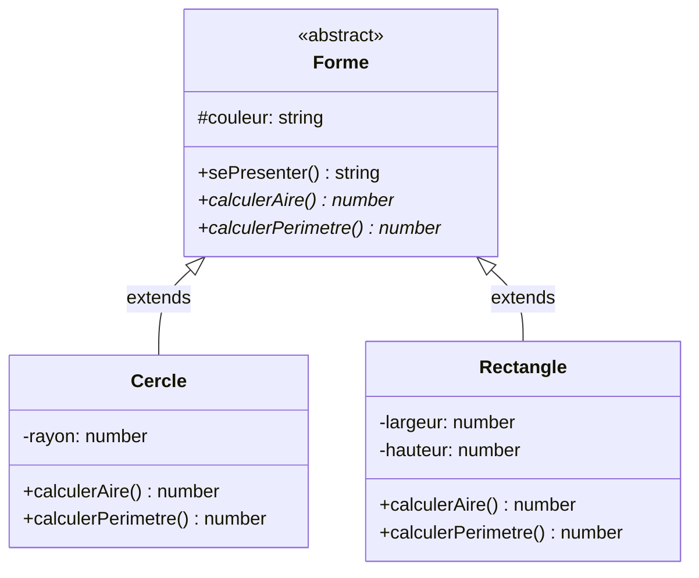
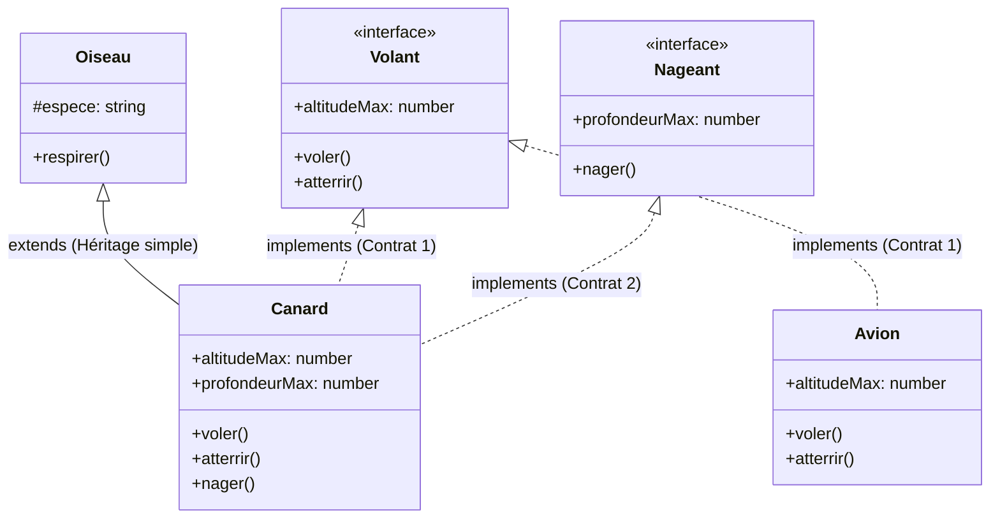

# Séance 8 — Classes Abstraites et Interfaces

**Cours de programmation orientée objet — Bachelier en informatique**

---

## Objectifs pédagogiques

À l'issue de cette séance, l'étudiant sera en mesure de :

1. **Expliquer la nécessité de l'abstraction** : comprendre pourquoi certaines classes ne doivent jamais être instanciées et interdire l'usage de `new` au compilateur.
2. **Maîtriser les classes abstraites** : définir une `abstract class`, écrire des méthodes abstraites sans corps et factoriser un état partagé grâce au constructeur et à `super()`.
3. **Définir des interfaces et des contrats purs** : contourner la limite de l'héritage simple grâce à l'implémentation multiple (`implements`).
4. **Exploiter le typage structurel** (duck typing) : comprendre la conformité par la forme, les DTOs et le coût mémoire strictement nul d'une interface au runtime.
5. **Discerner la classe abstraite de l'interface** : appliquer la règle « est-un » contre « capable-de » et combiner les deux dans un modèle hybride professionnel.
6. **Démontrer le découplage dans un composant Angular** : manipuler une collection hétérogène et déclencher un traitement polymorphe sans aucun `switch` ni `if`.

---

## Partie 00 — Le cheminement : d'où venons-nous ?

Cette séance constitue une étape charnière du cours. Les séances précédentes ont construit les fondations sur lesquelles repose la matière du jour :

- **Séance 5 — Encapsulation** : protection de l'état interne, visibilité `private`/`public`, invariants garantis par la classe. On retiendra l'objet robuste et autonome.
- **Séance 6 — Héritage** : factorisation via `extends`, appel obligatoire à `super()`, spécialisation et relation « est-un ».
- **Séance 7 — Polymorphisme** : liaison dynamique, collections hétérogènes, remplacement des structures `switch`/`if` et introduction au principe Ouvert/Fermé (OCP).

L'héritage et le polymorphisme vus en séances 6 et 7 laissent toutefois **deux brèches majeures** dans l'architecture logicielle. C'est précisément ce que viennent combler les classes abstraites et les interfaces.

### Problème 1 : les « objets fantômes »

Lors des séances 6 et 7, une classe de base (par exemple `Forme` ou `Media`) a été créée pour factoriser le code. Or, rien n'empêchait le compilateur d'accepter l'instanciation suivante :

```typescript
// Rien n'interdit ce code pour le compilateur :
const formeMystere = new Forme('rouge');
console.log(formeMystere.calculerAire()); // ???
```

Il s'agit d'une **aberration sémantique** : une forme géométrique « générique » n'existe pas dans le monde réel. Seuls le cercle, le rectangle ou le triangle existent concrètement. Il faut donc un mécanisme qui dise au compilateur TypeScript :

- `new Forme()` doit produire une **erreur de compilation bloquante** ;
- les sous-classes (`Cercle`, `Rectangle`) continuent d'hériter des propriétés communes (par exemple `couleur`) ;
- la classe parente ne sert que de modèle et de socle pour d'autres classes.

### Problème 2 : le piège du code « bouchon » factice

Pour que le polymorphisme fonctionne, la méthode devait être déclarée dans la classe mère. Deux options s'offraient alors, toutes deux défectueuses :

```typescript
class Forme {
  constructor(public couleur: string) {}

  // Option A : retourner une valeur bidon
  calculerAire(): number {
    return 0; // Silencieux et faux !
  }

  // Option B : jeter une exception à l'exécution
  calculerPerimetre(): number {
    throw new Error('Méthode non implémentée !');
  }
}
```

Le danger est mortel : si une sous-classe oublie d'écraser la méthode, le bogue **explose en production chez l'utilisateur** au lieu d'être bloqué à la compilation. Le besoin réel est celui d'une **signature sans corps**, accompagnée d'une obligation de résultat imposée par le compilateur : si la sous-classe n'implémente pas le calcul, TypeScript refuse de compiler l'application. Zéro bogue à l'exécution dû à un oubli d'implémentation.

> Un développeur professionnel préfère infiniment une erreur du compilateur à un plantage en production chez un client.

### Problème 3 : la barrière de l'héritage simple

TypeScript, à l'image de JavaScript, refuse strictement l'héritage multiple de classes (afin d'éviter le célèbre « problème du diamant ») :

```typescript
class Fichier {}
class Imprimable {}
class Chiffrable {}

// ❌ INTERDIT EN TYPESCRIPT :
class FacturePDF extends Fichier, Imprimable, Chiffrable {
  // Erreur de syntaxe : une seule classe mère autorisée !
}
```

Comment alors modéliser des objets possédant plusieurs aptitudes transversales ? La solution consiste à séparer la hiérarchie de parenté (« ce que je suis ») des capacités (« ce dont je suis capable ») : une **interface** décrit une aptitude sans imposer de code pré-existant, et une classe peut respecter autant de contrats qu'elle le souhaite. Comme les interfaces ne contiennent pas de code, aucun conflit de corps de méthode n'est possible.

> Métaphore : un étudiant est une `Personne` (héritage). Il est aussi `Conducteur`, `Lecteur`, `Musicien`. On ne peut pas faire hériter `Etudiant` de `Conducteur` *et* de `Musicien` : ce sont des aptitudes, donc des interfaces.

---

## Partie 01 — La classe abstraite (`abstract class`)

### 1.1 Définition

Une **classe abstraite** est une classe qui **ne peut pas être instanciée directement** avec le mot-clé `new`. Elle est marquée par le mot-clé `abstract` et se caractérise par trois propriétés :

1. Elle n'existe que pour servir de classe mère à des sous-classes spécialisées (modèle d'héritage).
2. Elle est **hybride par nature** : elle peut contenir à la fois du code implémenté (méthodes concrètes) et des signatures vides (méthodes abstraites).
3. Elle possède un constructeur et peut initialiser des attributs communs à tous ses descendants (état partagé).

```typescript
const animal = new Animal('Rex');
// ❌ TS2511 : Cannot create an instance of an abstract class.

const chien = new Chien('Rex');
// ✅ Validé : une sous-classe concrète est parfaitement instanciable.
```

Le mot-clé `abstract` agit comme un bouclier : dès que l'on tente d'instancier la classe directement, l'éditeur souligne l'erreur en rouge.

### 1.2 Syntaxe d'une classe abstraite

```typescript
// animal.model.ts
export abstract class Animal {
  // Constructeur avec Parameter Property : factorise l'état
  constructor(
    protected nom: string,
    public age: number
  ) {}

  // 1. Méthode concrète : code partagé par TOUS les animaux
  dormir(): void {
    console.log(`${this.nom} s'endort paisiblement... Zzz`);
  }

  // 2. Méthode concrète qui exploite l'abstraction
  sePresenter(): string {
    return `Animal: ${this.nom}, bruit: ${this.faireDuBruit()}`;
  }

  // 3. Méthode abstraite : AUCUN corps, juste une signature
  abstract faireDuBruit(): string;
}
```

Trois éléments sont à souligner :

- Le mot-clé `abstract` en en-tête indique que la classe est incomplète par définition.
- Les **méthodes concrètes** (avec corps) sont écrites une seule fois et héritées par tous les enfants : c'est le principe DRY (Don't Repeat Yourself).
- La **méthode abstraite** se termine par un point-virgule, sans accolades `{}` : c'est une promesse imposée aux sous-classes futures.

> Remarque pédagogique essentielle : la méthode `sePresenter()` appelle `this.faireDuBruit()` alors même que cette méthode n'a aucun code dans `Animal`. C'est le sommet du polymorphisme : **la classe mère orchestre le déroulement, la sous-classe fournit le détail**.

### 1.3 L'implémentation concrète avec `extends`

```typescript
// chien.model.ts
import { Animal } from './animal.model';

export class Chien extends Animal {
  constructor(nom: string, age: number, public race: string) {
    // 1. Appel obligatoire au constructeur parent
    super(nom, age);
  }

  // 2. Obligation absolue : implémenter la méthode abstraite
  override faireDuBruit(): string {
    return 'Wouf ! Wouf !';
  }

  // 3. Comportement spécifique supplémentaire
  rapporterBalle(): void {
    console.log(`${this.nom} court chercher la balle !`);
  }
}
```

Points clés :

- On utilise le mot-clé standard `extends`, exactement comme en séance 6.
- Même si `Animal` est abstraite, son constructeur s'exécute pour initialiser `nom` et `age` (rappel du modèle mémoire : l'objet réel est alloué dans le tas).
- Le mot-clé `override` (vu en séance 6) est recommandé pour expliciter que l'on honore une méthode héritée.
- `Chien` devient une classe **concrète**, car elle a comblé tous les trous laissés par `Animal`.

### 1.4 Que se passe-t-il en cas d'oubli ?

```typescript
// chat.model.ts (tentative avec oubli)
import { Animal } from './animal.model';

// ❌ ERREUR DE COMPILATION IMMÉDIATE !
export class Chat extends Animal {
  constructor(nom: string, age: number) {
    super(nom, age);
  }

  // Nous avons oublié d'écrire faireDuBruit() !
}
```

Le compilateur produit l'erreur suivante :

```
TS2515 : Non-abstract class 'Chat' does not implement inherited
abstract member 'faireDuBruit' from class 'Animal'.
```

Contrairement à une classe classique où l'oubli provoquait un appel silencieux à un code bidon (`return 0`) ou un crash en production, le code **ne peut pas être généré** tant que la promesse contractuelle n'est pas honorée. Il n'existe que deux issues possibles :

1. fournir le corps de `faireDuBruit()` ;
2. ou déclarer `Chat` comme classe `abstract` elle-même.

> C'est là toute la valeur ajoutée de TypeScript : le compilateur veille au grain. Il faut bien distinguer une erreur de compilation (bloquante, détectée immédiatement dans l'IDE) d'une erreur au runtime (détectée tardivement, potentiellement en production).

### 1.5 Chaîne d'abstraction intermédiaire

Une sous-classe peut rester abstraite si elle affine le concept sans encore pouvoir fournir toutes les réalisations concrètes :

```typescript
// Niveau 1 : abstrait racine
abstract class Animal {
  constructor(public nom: string) {}
  abstract faireDuBruit(): string;
}

// Niveau 2 : abstrait intermédiaire (ajoute un nouveau contrat)
abstract class Mammifere extends Animal {
  // Il n'implémente pas encore faireDuBruit()
  // Mais il ajoute une propriété abstraite :
  abstract readonly nombreDeMamelles: number;
}

// Niveau 3 : concret feuille (comble toutes les abstractions)
class Vache extends Mammifere {
  readonly nombreDeMamelles = 4;

  override faireDuBruit(): string {
    return 'Meuhhh !';
  }
}
```

Il convient de noter que :

- une propriété (attribut) peut également être marquée `abstract` (comme `nombreDeMamelles`) ;
- la première classe concrète instanciable (ici `Vache`) a l'obligation de solder **l'intégralité** des dettes d'abstraction accumulées dans l'arbre ;
- c'est exactement ainsi que sont architecturés les grands frameworks (Angular, Spring, .NET).

### 1.6 Visibilité des méthodes abstraites

| Modificateur | Statut | Usage |
|---|---|---|
| `public abstract` (défaut) | ✅ Autorisé | Accessible partout, y compris par le code appelant externe. |
| `protected abstract` | ✅ Autorisé, très fréquent | Dédié à un usage interne entre la classe mère et ses sous-classes dérivées. |
| `private abstract` | ❌ **STRICTEMENT INTERDIT** | Provoque une erreur de compilation immédiate (TS18010). |

```typescript
abstract class Compte {
  // ❌ TS18010 :
  // 'private' modifier cannot be used with 'abstract' modifier.
  private abstract calculerInterets(): number;
}
```

**Pourquoi `private abstract` est un non-sens ?** Les deux volontés sont totalement contradictoires :

- `private` signifie : *« seule cette classe a le droit d'y toucher, les sous-classes ne peuvent même pas la voir »* ;
- `abstract` signifie : *« je n'ai pas de code, une sous-classe DOIT me redéfinir »*.

> C'est une question classique d'examen ou d'entretien d'embauche : il faut en comprendre la justification logique.

### 1.7 Schéma UML de synthèse



En UML, le nom de la classe et des méthodes abstraites sont indiqués en *italique* ou avec une astérisque `*`.

---

## Partie 02 — L'interface (`interface`) : le contrat pur

### 2.1 Définition

Une **interface** définit un ensemble de signatures (propriétés et méthodes) qu'un objet ou une classe s'engage à respecter. C'est un **contrat pur**, qui se caractérise par :

1. **Zéro implémentation** : aucune ligne de code exécutable, aucun corps d'algorithme.
2. **Zéro état initialisé** : pas de valeurs par défaut, pas de constructeur.
3. **Visibilité implicite** : tout membre d'une interface est implicitement `public` (il est inutile, et interdit, d'écrire `public` ou `private`).

> **Métaphore contractuelle** : l'interface est comme une prise électrique murale standardisée (220 V). La prise se moque de savoir si l'on y branche un grille-pain, un ordinateur ou une lampe. Tant que l'appareil possède deux broches compatibles, le courant passe. L'interface normalise la connexion entre deux mondes qui ne se connaissent pas.

### 2.2 Syntaxe d'une interface en TypeScript

```typescript
// volant.interface.ts
export interface Volant {
  // Propriété requise (ici en lecture seule)
  readonly altitudeMax: number;

  // Signatures de méthodes (pas d'accolades !)
  decoller(): void;
  voler(vitesseKmH: number): void;
  atterrir(): boolean;
}

// nageant.interface.ts
export interface Nageant {
  profondeurMax: number;
  nager(): void;
}
```

Points de syntaxe :

- Convention de nommage **PascalCase** ; on emploie souvent des adjectifs en `-able` (`Imprimable`, `Serializable`, `Dessinable`) ou des rôles (`Volant`, `Nageant`).
- Une propriété peut être déclarée `readonly` : elle est alors immuable une fois assignée par la classe.
- Une propriété peut être **optionnelle** grâce au `?` : `radar?: boolean;` indique que sa présence n'est pas obligatoire.

### 2.3 Implémentation multiple avec `implements`

```typescript
// canard.model.ts
import { Volant } from './volant.interface';
import { Nageant } from './nageant.interface';

// ✅ Une classe peut implémenter PLUSIEURS interfaces !
export class Canard implements Volant, Nageant {
  readonly altitudeMax = 1200;
  profondeurMax = 3;

  constructor(public nom: string) {}

  // Contrat Volant
  decoller(): void { console.log('Prend son élan sur l\'eau...'); }
  voler(v: number): void { console.log(`Vole à ${v} km/h`); }
  atterrir(): boolean { return true; }

  // Contrat Nageant
  nager(): void { console.log('Palme énergiquement'); }
}
```

Trois enseignements :

- Le mot-clé `implements` signifie que la classe **signe le contrat** et garantit la présence effective de chaque membre.
- Une classe ne peut avoir qu'un seul `extends`, mais **autant de `implements` que nécessaire**, séparés par des virgules. C'est la réponse au problème de l'héritage multiple.
- Si `Canard` oublie `atterrir()`, le compilateur refuse immédiatement la compilation.

### 2.4 Héritage entre interfaces avec `extends`

Il convient de ne pas confondre les vocabulaires :

- une interface **`extends`** d'autres interfaces ;
- une classe **`extends`** une classe ;
- une classe **`implements`** une interface.

```typescript
// Une interface peut étendre d'autres interfaces
interface EntiteNommee {
  id: string;
  nom: string;
}

interface Auditable {
  dateCreation: Date;
  auteur: string;
}

// ✅ Héritage MULTIPLE d'interfaces parfaitement autorisé !
interface UtilisateurComplet extends EntiteNommee, Auditable {
  email: string;
  role: 'admin' | 'user';
  desactiver(): void;
}
```

On compose ainsi des micro-contrats modulaires regroupés dans des interfaces plus riches. `UtilisateurComplet` exige désormais `id`, `nom`, `dateCreation`, `auteur`, `email`, etc.

### 2.5 Schéma relationnel : multi-implémentation



Il faut observer que `Canard` et `Avion` partagent le contrat `Volant` **sans avoir aucun ancêtre commun**. C'est le polymorphisme par comportement : l'`Avion` n'a rien à voir avec un `Oiseau` sur le plan généalogique, et pourtant ils respectent le même contrat.

---

## Partie 03 — Le typage structurel en TypeScript (*duck typing*)

### 3.1 Typage nominal vs typage structurel

**Typage nominal (Java, C#)** : pour qu'un objet soit accepté comme `Point`, sa classe **doit explicitement avoir écrit** `implements Point` dans son code source. La conformité est liée au « certificat de naissance » de la classe. Même si la structure est identique, si la classe n'écrit pas `implements Point`, le compilateur rejette l'objet.

**Typage structurel (TypeScript)** : le compilateur vérifie uniquement la **forme** (*shape*) de la donnée en mémoire vive.

> **Principe du duck typing** : *« Si un oiseau vole comme un canard et cancane comme un canard, alors pour moi c'est un canard ! »*

Si un objet littéral possède les champs requis avec les bons types, il est déclaré compatible à 100 %, sans avoir besoin d'écrire une classe ni `implements`. Ce choix s'explique par la nature de JavaScript, qui manipule en permanence des objets JSON anonymes venant d'APIs.

### 3.2 Démonstration du duck typing

```typescript
interface Coordonnees2D {
  x: number;
  y: number;
}

function tracerPoint(point: Coordonnees2D): void {
  console.log(`Trace au point (${point.x}, ${point.y})`);
}

// 1. Objet littéral anonyme (ex: reçu d'un JSON.parse)
const positionSouris = { x: 150, y: 320 };
tracerPoint(positionSouris); // ✅ Parfaitement valide !

// 2. Objet avec des propriétés EXCÉDENTAIRES
const curseur = { x: 10, y: 20, couleur: 'rouge', visible: true };
tracerPoint(curseur); // ✅ Valide ! (Il a au moins x et y de type number)

// 3. Objet incomplet
const invalide = { x: 50 };
// ❌ TS2345 : Property 'y' is missing in type '{ x: number; }'
// tracerPoint(invalide);
```

Trois conséquences pratiques :

- **Zéro classe requise** : on peut typer des objets complexes sans instancier la moindre classe avec `new`.
- **Idéal pour les DTOs** : c'est le mécanisme employé pour typer la réponse d'une requête HTTP d'un service Angular (`http.get<Produit[]>('/api/produits')`).
- **Tolérance des surplus** : si l'objet apporte plus de données que demandé, TypeScript l'accepte tant que le contrat minimal est respecté.

> Nuance à connaître : si l'on écrit directement `tracerPoint({ x: 10, y: 20, z: 30 })`, TypeScript signale la propriété excédentaire (*excess property check*). En revanche, si l'objet transite par une variable intermédiaire, il est validé. C'est le comportement attendu.

### 3.3 Le coût au runtime : 0 octet

```typescript
// Code TypeScript source (user.interface.ts)
export interface User {
  id: number;
  username: string;
}

export abstract class BaseService {
  constructor(protected apiUrl: string) {}
  abstract log(): void;
}
```

```javascript
// Code JavaScript transpilé (dans le bundle)
// 💨 DISPARITION TOTALE DE L'INTERFACE !
// 0 ligne, 0 octet dans le fichier final !

// BaseService génère une vraie fonction constructeur :
export class BaseService {
  constructor(apiUrl) {
    this.apiUrl = apiUrl;
  }
}
```

**Conséquence majeure pour la performance web** : l'interface est un outil d'aide au développement à la compilation. Elle n'alourdit pas le bundle JavaScript final d'un seul octet.

Il faut bien graver la distinction : une **classe abstraite existe au runtime** dans le navigateur (elle génère une fonction constructeur), une **interface n'existe pas au runtime**. Cette distinction aura une conséquence directe sur l'usage de `instanceof` (voir piège n° 1 ci-dessous).

---

## Partie 04 — Le duel : classe abstraite vs interface

### 4.1 Tableau comparatif exhaustif

| Critère d'évaluation | Classe abstraite (`abstract class`) | Interface (`interface`) |
|---|---|---|
| **Instanciation directe** | ❌ Interdite (`new` refusé) | ❌ Impossible (aucun constructeur) |
| **Code des méthodes** | ✅ Partielle (méthodes avec et sans corps) | ❌ Aucune (signatures pures uniquement) |
| **Attributs & état interne** | ✅ Oui (variables, constantes, constructeur) | ❌ Non (seulement types et `readonly`) |
| **Modificateurs de visibilité** | ✅ `public`, `protected` (pas de `private abstract`) | ❌ Tout est implicitement `public` |
| **Nombre par classe** | ⚠️ Héritage simple : **1 seule** (`extends`) | ✅ Héritage multiple : **plusieurs** (`implements`) |
| **Constructeur propre** | ✅ Oui (appelé via `super()`) | ❌ Non |
| **Présence au runtime JS** | 📦 Oui (génère une classe JS en mémoire) | 💨 Non (effacée lors de la transpilation) |
| **Compatible avec `instanceof`** | ✅ Oui (`if (x instanceof Animal)`) | ❌ **Non ! Erreur de compilation !** |

### 4.2 La règle mentale : « est-un » vs « capable-de »

**Classe abstraite → « EST UN » (identité fondamentale).** On l'utilise lorsque les objets partagent une filiation biologique ou structurelle forte et du code métier commun :

- un `Chien` **est un** `Mammifere` (qui **est un** `Animal`) ;
- un `CompteEpargne` **est un** `CompteBancaire` ;
- un `Cercle` **est une** `FormeGeometrique`.

Objectif principal : **factoriser du code et de l'état partagé**.

**Interface → « CAPABLE DE » (rôle / comportement).** On l'utilise pour qualifier une aptitude transversale que des objets totalement disparates peuvent adopter :

- un `Document` et un `BilletAvion` sont **imprimables** (`Imprimable`) ;
- un `Utilisateur` et un `Article` sont **exportables en JSON** (`Serializable`) ;
- un `Bouton` et un `Lien` sont **cliquables** (`Clickable`).

Objectif principal : **découplage maximal et polymorphisme de rôle**.

> Cette grille mentale « is-a » contre « can-do » débloque l'immense majorité des hésitations d'architecture.

### 4.3 L'approche hybride professionnelle

Une classe abstraite peut implémenter une ou plusieurs interfaces : on obtient ainsi le meilleur des deux mondes.

```typescript
// 1. Le contrat pur de haut niveau
export interface Dessinable {
  dessiner(contexte: CanvasRenderingContext2D): void;
}

// 2. Le socle abstrait qui implémente le contrat
//    et factorise la couleur et la position
export abstract class FormeGraphique implements Dessinable {
  constructor(
    public x: number,
    public y: number,
    public couleur: string
  ) {}

  deplacer(dx: number, dy: number): void {
    this.x += dx;
    this.y += dy;
  }

  // Laisse dessiner() abstraite pour les enfants
  abstract dessiner(ctx: CanvasRenderingContext2D): void;
}
```

C'est le modèle d'architecture d'entreprise par excellence :

- l'**interface** sert d'API publique découplée ;
- la **classe abstraite** fournit une boîte à outils prête à l'emploi (*boilerplate* factorisé) pour les développeurs de sous-classes ;
- les sous-classes héritent gratuitement de `deplacer()` tout en garantissant le respect de `Dessinable`.

Ce schéma — *Interface → AbstractSkeleton → ConcreteImplementations* — est le pattern roi des frameworks modernes.

---

## Partie 05 — Pièges fréquents et bonnes pratiques

### Piège 1 : `instanceof` avec une interface

```typescript
interface Volant {
  voler(): void;
}

function testerAppareil(obj: unknown) {
  // ❌ ERREUR DE COMPILATION FATALE TS2693 :
  // 'Volant' only refers to a type,
  // but is being used as a value here.
  if (obj instanceof Volant) {
    obj.voler();
  }
}
```

**Pourquoi ?** À l'exécution dans le navigateur, `Volant` n'existe plus en mémoire vive JavaScript (l'interface a été effacée lors de la transpilation). L'opérateur `instanceof` a impérativement besoin d'une fonction constructeur réelle.

**Alternatives valides :**

*Solution 1 — avec une classe abstraite* : une classe abstraite génère un constructeur réel. `obj instanceof Animal` est donc 100 % valide.

*Solution 2 — garde de type personnalisée* (*user-defined type guard*) :

```typescript
function isVolant(obj: any): obj is Volant {
  return obj && typeof obj.voler === 'function';
}

if (isVolant(obj)) {
  obj.voler(); // TypeScript sait qu'il est Volant !
}
```

> À retenir impérativement : **jamais de `instanceof` sur une interface**.

### Piège 2 : l'interface géante « fourre-tout »

```typescript
// Mauvaise pratique : une interface qui exige TOUT
interface SuperMachine {
  imprimer(): void;
  scanner(): void;
  envoyerFax(): void;
  relierDocument(): void;
}

// Une simple imprimante USB est obligée d'implémenter
// des méthodes qui ne la concernent pas du tout !
class ImprimanteSimple implements SuperMachine {
  imprimer() { /* OK */ }
  scanner() { throw new Error('Pas de scanner !'); }
  envoyerFax() { throw new Error('Pas de fax !'); }
  relierDocument() { throw new Error('Non !'); }
}
```

La bonne pratique consiste à **ségréguer les contrats ciblés** :

```typescript
// Des micro-contrats modulaires
interface Imprimable { imprimer(): void; }
interface Scannable { scanner(): void; }
interface Faxable { envoyerFax(): void; }

// Chaque classe ne signe que ce qu'elle sait faire !
class ImprimanteSimple implements Imprimable {
  imprimer() { console.log('Impression papier...'); }
}

class CopieurBureau implements Imprimable, Scannable {
  imprimer() { /* ... */ }
  scanner() { /* ... */ }
}
```

> **Principe de Ségrégation des Interfaces** : aucun code client ne devrait être forcé de dépendre de méthodes qu'il n'utilise pas. De petites interfaces ciblées sont beaucoup plus réutilisables qu'un gros bloc rigide.

---

## Partie 06 — Démonstration Angular : l'Équipe de Héros (RPG)

Cette démonstration mobilise un mini-projet mis à disposition des étudiants via Git (`git clone` / `git pull`). Le cas concret retenu est celui d'une équipe d'aventuriers de jeu vidéo (RPG), exemple visuel et intuitif qui illustre l'ensemble des concepts de la séance.

### 6.1 Architecture du mini-projet : l'Arène des Héros

```
📂 src/app/models/
   📄 soigneur.interface.ts    (Contrat pur : aptitude)
   📄 personnage.model.ts      (Classe abstraite : socle commun)
   📄 guerrier.model.ts        (Classe concrète 1)
   📄 mage.model.ts            (Classe concrète 2)
📂 src/app/components/arene/
   📄 arene.component.ts       (Contrôleur UI agnostique)
   📄 arene.component.html     (Template d'affichage)
```

La démonstration met en évidence trois mécanismes :

1. **Pas de « héros fantôme »** : `new Personnage()` est interdit — un personnage sans classe n'existe pas dans le jeu.
2. **Rôle transversal (interface)** : soigner est une aptitude (`Soigneur`). Le Mage l'adopte, le Guerrier l'ignore.
3. **Polymorphisme total** : le composant déclenche `heros.attaquer()` sans aucun `switch` ni `if (type === 'Guerrier')`.

Il convient de souligner la séparation des responsabilités : les modèles POO sont 100 % agnostiques de la vue ; le composant n'est là que pour afficher la liste et déclencher les actions.

### 6.2 Étape 1 — le contrat `Soigneur` et la classe `Personnage`

```typescript
// src/app/models/soigneur.interface.ts
import { Personnage } from './personnage.model';

export interface Soigneur {
  // Contrat pur : aptitude transversale
  soigner(cible: Personnage): string;
}
```

Une interface décrit une **aptitude** (« capable de soigner »). Elle ne contient ni implémentation, ni constructeur.

```typescript
// src/app/models/personnage.model.ts
export abstract class Personnage {
  constructor(
    public readonly nom: string,
    public pointsDeVie: number
  ) {}

  // 1. Méthode concrète partagée (code commun)
  recevoirDegats(montant: number): void {
    this.pointsDeVie = Math.max(0, this.pointsDeVie - montant);
  }

  // 2. Méthode abstraite : obligatoire pour les enfants
  abstract attaquer(): string;
}
```

`abstract class` bloque `new Personnage()` ; la méthode `attaquer()` n'a aucun corps : chaque classe fille fournira sa propre formule. La logique est claire : tout le monde a un nom et des points de vie (état factorisé), tout le monde subit des dégâts de la même façon (méthode concrète), mais chacun attaque avec sa propre arme (méthode abstraite).

### 6.3 Étape 2 — les classes concrètes (`Guerrier` et `Mage`)

```typescript
// src/app/models/guerrier.model.ts
import { Personnage } from './personnage.model';

export class Guerrier extends Personnage {
  constructor(nom: string, pv: number, public epee: string) {
    super(nom, pv); // Initialise le socle parent
  }

  // Obligation : implémenter la méthode abstraite
  override attaquer(): string {
    return `${this.nom} frappe avec son ${this.epee} ! 💥`;
  }
}
```

Le Guerrier **est un** `Personnage` : il honore le contrat en écrivant son attaque au corps-à-corps.

```typescript
// src/app/models/mage.model.ts
import { Personnage } from './personnage.model';
import { Soigneur } from './soigneur.interface';

// ✅ Hérite du socle ET signe le contrat Soigneur !
export class Mage extends Personnage implements Soigneur {
  constructor(nom: string, pv: number, public sort: string) {
    super(nom, pv);
  }

  override attaquer(): string {
    return `${this.nom} lance le sort ${this.sort} ! ⚡`;
  }

  // Implémentation du contrat Soigneur
  soigner(cible: Personnage): string {
    cible.pointsDeVie += 20;
    return `${this.nom} soigne ${cible.nom} (+20 PV) 🌿`;
  }
}
```

Il faut insister sur la combinaison : `extends Personnage` factorise nom et points de vie, tandis que `implements Soigneur` ajoute la capacité de soin **sans alourdir** `Personnage`.

### 6.4 Étape 3 — pourquoi l'interface était indispensable

Sans interface, si l'on avait placé `soigner()` directement dans la classe abstraite `Personnage` :

```typescript
abstract class Personnage {
  // ❌ ERREUR DE CONCEPTION :
  // Le Guerrier n'a aucune magie de soin !
  abstract soigner(cible: Personnage): string;
}

class Guerrier extends Personnage {
  // Forcé d'écrire du code bidon ou dangereux :
  override soigner(cible: Personnage): string {
    throw new Error('Un guerrier ne soigne pas !');
  }
}
```

C'est une **violation de contrat** : les classes filles héritent de méthodes qui n'ont aucun sens pour elles.

Grâce à `interface Soigneur`, seules les classes qui possèdent réellement ce don l'implémentent :

- **Héritage propre** : le `Guerrier` ne contient que du code qui le concerne vraiment ;
- **Multi-usages** : demain, une `PotionMagique` pourra aussi implémenter `Soigneur` sans hériter de `Personnage` ;
- **Règle d'or** : *« Classe abstraite pour ce qu'on EST, interface pour ce qu'on SAIT FAIRE. »*

### 6.5 Étape 4 — le composant Angular (`AreneComponent`)

```typescript
// src/app/components/arene/arene.component.ts
import { Component } from '@angular/core';
import { Personnage } from '../../models/personnage.model';
import { Guerrier } from '../../models/guerrier.model';
import { Mage } from '../../models/mage.model';

@Component({
  selector: 'app-arene',
  standalone: true,
  templateUrl: './arene.component.html'
})
export class AreneComponent {
  equipe: Personnage[] = [
    new Guerrier('Conan', 120, 'Épée bâtarde'),
    new Mage('Gandalf', 80, 'Boule de feu')
  ];

  messageAction = '';

  // Traitement agnostique & polymorphe
  faireAttaquer(heros: Personnage): void {
    // Le composant ne sait pas quel héros attaque :
    // le polymorphisme exécute la bonne version automatiquement !
    this.messageAction = heros.attaquer();
  }
}
```

Trois mécanismes Angular/OO sont mis en avant :

- **Collection hétérogène** : le tableau est typé `Personnage[]`. Il accueille indifféremment des `Guerrier` et des `Mage`, car ils sont tous des `Personnage` (rappel du polymorphisme de la séance 7).
- **Zéro `switch` / `if`** : pas de `if (heros instanceof Guerrier)`. La méthode `faireAttaquer(heros)` se contente d'appeler `heros.attaquer()`.
- **Extensibilité infinie (OCP)** : si l'on ajoute un `Archer extends Personnage`, cette méthode fonctionne immédiatement sans changer une seule ligne.

La concision du composant illustre la valeur de l'architecture : tout le travail a été accompli dans les modèles ; le composant est libéré de toute logique conditionnelle complexe.

### 6.6 Étape 5 — le template et le polymorphisme en direct

```html
<!-- src/app/components/arene/arene.component.html -->
<main class="p-4 max-w-lg mx-auto">
  <h2 class="text-lg font-bold mb-3">⚔️ L'Arène des Héros</h2>

  <!-- Boucle sur la collection de Personnage -->
  <div class="space-y-3">
    @for (heros of equipe; track heros.nom) {
      <div class="p-3 rounded-xl border-2 bg-white dark:bg-slate-800
                  flex items-center justify-between">
        <div>
          <span class="font-bold text-sm">{{ heros.nom }}</span>
          <span class="text-xs text-slate-500 ms-2">
            ({{ heros.pointsDeVie }} PV)
          </span>
        </div>
        <!-- Appel polymorphe au clic -->
        <button (click)="faireAttaquer(heros)"
          class="px-3 py-1 text-xs font-bold rounded-lg
                 bg-indigo-600 text-white hover:bg-indigo-700">
          Attaquer !
        </button>
      </div>
    }
  </div>

  @if (messageAction) {
    <div class="mt-4 p-3 rounded-lg bg-emerald-100 dark:bg-emerald-900/50
                border-2 border-emerald-400 text-xs font-bold
                text-emerald-900 dark:text-emerald-100 text-center">
      {{ messageAction }}
    </div>
  }
</main>
```

Comportement à l'écran :

- clic sur **Conan** (Guerrier) : *« Conan frappe avec son Épée bâtarde ! 💥 »* ;
- clic sur **Gandalf** (Mage) : *« Gandalf lance le sort Boule de feu ! ⚡ »*.

**Le miracle du polymorphisme** : un *seul* bouton dans le template, une *seule* méthode dans le composant, mais *deux comportements différents* exécutés selon l'objet réel en mémoire vive. Le template ne contient aucun `if` pour distinguer le Guerrier du Mage : c'est la quintessence de la POO — **l'objet porte son propre comportement**.

---

## Synthèse — ce qu'il faut retenir absolument

### Classe abstraite (`abstract`)

- **Non instanciable** : `new` est formellement interdit par le compilateur.
- **Factorisation partielle** : combine code concret (partagé) et méthodes abstraites (signatures sans corps).
- **Relation « est-un »** : modélise une identité forte au sein d'un héritage simple (`extends`).
- **Constructeur** : possède un constructeur invoqué obligatoirement par `super()`.

### Interface (`interface`)

- **Contrat pur** : zéro ligne de code, zéro constructeur, visibilité implicitement publique.
- **Multi-implémentation** : une classe peut signer une infinité de contrats (`implements A, B, C`).
- **Typage structurel** : compatible avec les objets littéraux, les DTOs et les JSON d'API.
- **Coût runtime nul** : disparaît totalement à la compilation (0 octet dans le bundle).

> **Règle d'or de la séance 8** — *« Utilisez une classe abstraite pour factoriser du code au sein d'une même famille (« est-un »). Utilisez une interface pour découpler vos composants et définir des rôles transversaux (« capable-de »). »*

---

## Rappel des prérequis et perspective

Cette séance suppose acquises les notions des séances 5 à 7 (encapsulation, héritage, polymorphisme, `override`, `protected`, `instanceof` sur les classes). La **séance 9** prolongera la réflexion avec la *composition face à l'héritage* : pourquoi l'héritage excessif crée des architectures rigides et difficilement maintenables (couplage fort), la relation « a-un » (*has-a*) comme délégation de responsabilités, l'analyse des limites réelles de l'héritage (explosion combinatoire de sous-classes) et la manière dont l'injection de dépendances et les services spécialisés d'Angular incarnent le summum de la composition moderne.
