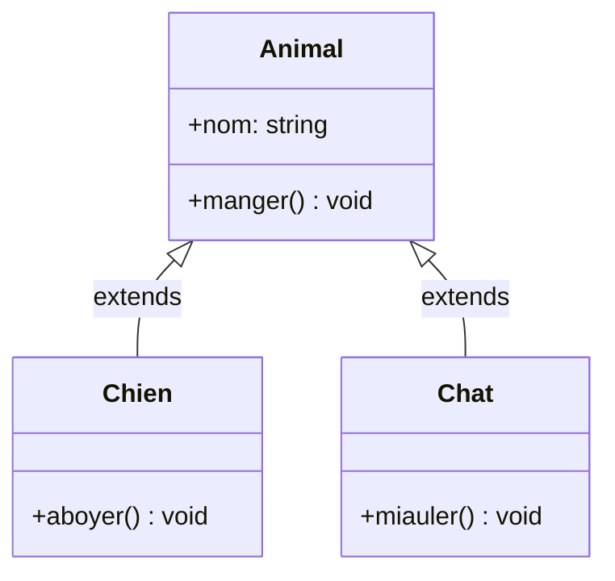
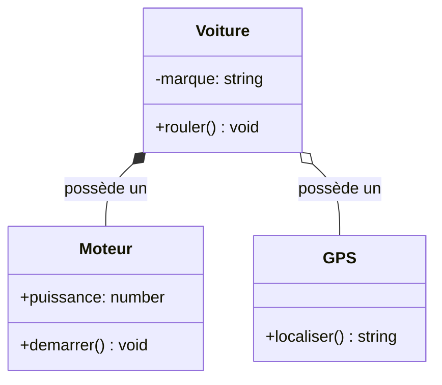
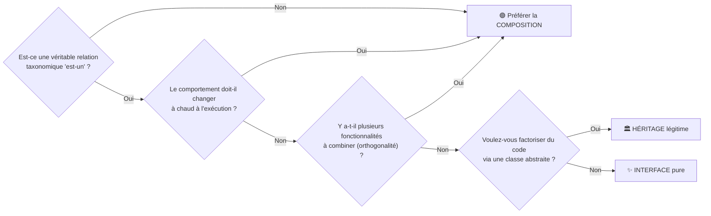

<div class="h-full flex flex-col justify-center items-center">
  <div class="inline-flex items-center gap-2 px-3 py-1 mb-4 text-xs font-semibold rounded-full bg-blue-500/10 text-blue-500 border border-blue-500/20">
    <span class="w-2 h-2 rounded-full bg-blue-500"></span>
    Programmation Orientée Objet · EAFC
  </div>

  <h1 class="text-4xl font-extrabold tracking-tight mb-4 bg-gradient-to-r from-blue-600 via-indigo-500 to-purple-600 bg-clip-text text-transparent">
    Séance 9 — Composition vs Héritage
  </h1>

  <p class="text-lg opacity-80 max-w-2xl mx-auto mb-6 font-medium">
    Lien « A un » · Délégation · Couplage faible · Architecture modulaire Angular
  </p>

  <div class="flex items-center justify-center gap-2 text-xs font-mono opacity-60">
    <span class="px-2 py-0.5 rounded bg-gray-500/10 border border-gray-500/20">TypeScript 5+</span>
    <span class="px-2 py-0.5 rounded bg-gray-500/10 border border-gray-500/20">Angular 21+</span>
    <span class="px-2 py-0.5 rounded bg-gray-500/10 border border-gray-500/20">Signals</span>
    <span class="px-2 py-0.5 rounded bg-gray-500/10 border border-gray-500/20">POO Avancée</span>
  </div>
</div>

<!--
Bienvenue à la séance 9 du cours de Programmation Orientée Objet !
Dans les séances précédentes, nous avons exploré l'héritage, le polymorphisme et les classes abstraites.
Beaucoup de développeurs débutants pensent que la POO se résume à créer de longues chaînes d'héritage avec extends.
Aujourd'hui, nous allons déconstruire cette idée reçue et découvrir l'un des principes les plus fondamentaux du génie logiciel :
« Préférer la composition à l'héritage ».
-->

---
layout: default
---

# 🎯 Objectifs pédagogiques

<div class="grid grid-cols-12 gap-3 mt-1">
  <div class="col-span-6 p-2 rounded-xl bg-slate-500/5 border border-slate-500/15 flex items-start gap-3">
    <span class="w-7 h-7 rounded-lg bg-blue-500/10 text-blue-500 flex items-center justify-center font-bold text-xs flex-shrink-0">01</span>
    <div>
      <h4 class="font-bold text-sm">Pathologies de l'Héritage</h4>
      <p class="text-xs opacity-75">Comprendre le couplage fort, le syndrome de la classe de base fragile et l'explosion combinatoire des sous-classes.</p>
    </div>
  </div>

  <div class="col-span-6 p-2 rounded-xl bg-slate-500/5 border border-slate-500/15 flex items-start gap-3">
    <span class="w-7 h-7 rounded-lg bg-indigo-500/10 text-indigo-500 flex items-center justify-center font-bold text-xs flex-shrink-0">02</span>
    <div>
      <h4 class="font-bold text-sm">Relation « A un » (Has-a)</h4>
      <p class="text-xs opacity-75">Distinguer sémantiquement la spécialisation (<em>est-un</em>) de l'assemblage modulaire de pièces autonomes (<em>a-un</em>).</p>
    </div>
  </div>

  <div class="col-span-6 p-2 rounded-xl bg-slate-500/5 border border-slate-500/15 flex items-start gap-3">
    <span class="w-7 h-7 rounded-lg bg-purple-500/10 text-purple-500 flex items-center justify-center font-bold text-xs flex-shrink-0">03</span>
    <div>
      <h4 class="font-bold text-sm">Principe de Délégation</h4>
      <p class="text-xs opacity-75">Transférer l'exécution d'une tâche à des objets internes spécialisés plutôt que de tout implémenter dans une seule classe.</p>
    </div>
  </div>

  <div class="col-span-6 p-2 rounded-xl bg-slate-500/5 border border-slate-500/15 flex items-start gap-3">
    <span class="w-7 h-7 rounded-lg bg-teal-500/10 text-teal-500 flex items-center justify-center font-bold text-xs flex-shrink-0">04</span>
    <div>
      <h4 class="font-bold text-sm">Découplage par l'Interface</h4>
      <p class="text-xs opacity-75">Combiner composition et interfaces (S8) pour autoriser le remplacement de composants à chaud et simplifier les tests (mocks).</p>
    </div>
  </div>

</div>


<!--
Présentez ces 6 objectifs aux étudiants.
Expliquez bien la bascule d'esprit : jusqu'ici, nous avons appris à réutiliser du code par filiation (extends).
Aujourd'hui, nous apprenons la seconde façon — souvent bien supérieure — de réutiliser du code : par collaboration et assemblage.
-->

---
layout: default
---

# 🎯 Objectifs pédagogiques suite

<div class="grid grid-cols-12 gap-3 mt-1">
  <div class="col-span-6 p-2 rounded-xl bg-slate-500/5 border border-slate-500/15 flex items-start gap-3">
    <span class="w-7 h-7 rounded-lg bg-amber-500/10 text-amber-500 flex items-center justify-center font-bold text-xs flex-shrink-0">05</span>
    <div>
      <h4 class="font-bold text-sm">Discernement Architectural</h4>
      <p class="text-xs opacity-75">Maîtriser l'arbre de décision pour choisir méthodiquement entre héritage et composition selon le contexte métier.</p>
    </div>
  </div>

  <div class="col-span-6 p-2 rounded-xl bg-slate-500/5 border border-slate-500/15 flex items-start gap-3">
    <span class="w-7 h-7 rounded-lg bg-emerald-500/10 text-emerald-500 flex items-center justify-center font-bold text-xs flex-shrink-0">06</span>
    <div>
      <h4 class="font-bold text-sm">Pratique Angular Accessible</h4>
      <p class="text-xs opacity-75">Visualiser la composition dans un composant Standalone simple : injection de dépendances, entrées par signaux et délégation directe.</p>
    </div>
  </div>
</div>

<div class="mt-3 p-2.5 rounded-xl bg-blue-500/10 border border-blue-500/20 text-xs text-blue-700 dark:text-blue-300 text-center">
  💡 <strong>Fil conducteur :</strong> Rompre avec les hiérarchies de classes monolithiques et rigides en apprenant à assembler des objets autonomes, testables et interchangeables.
</div>


---
layout: center
class: text-center
---

<div class="inline-flex items-center gap-2 px-3 py-1 mb-3 text-xs font-mono font-semibold rounded-full bg-blue-500/10 text-blue-500 border border-blue-500/20">
  PARTIE 00
</div>

# Le Cheminement : Pourquoi l'Héritage ne suffit plus ?

<p class="opacity-70 text-sm max-w-xl mx-auto">
  Comment les acquis des séances 5 à 8 nous ont menés au pied du mur : les limites réelles de l'héritage dans les projets d'envergure.
</p>

<!--
On commence par replacer la séance dans l'ensemble du cursus.
Les étudiants ont besoin de comprendre pourquoi on remet en question l'héritage qu'ils viennent tout juste d'apprendre.
-->

---
layout: default
---

# La progression du cursus POO

<div class="grid grid-cols-12 gap-3 mt-3">
  <div class="col-span-3 p-3 rounded-xl bg-slate-500/5 border border-slate-500/15">
    <div class="text-xs font-mono font-bold text-blue-500 mb-1">SÉANCE 5</div>
    <h3 class="text-sm font-bold mb-2">Encapsulation</h3>
    <ul class="text-xs opacity-75 space-y-1">
      <li> État interne protégé</li>
      <li> Visibilité <code>private</code> / <code>public</code></li>
      <li> Invariants de classe garantis</li>
      <li> Frontière objet hermétique</li>
    </ul>
    <div class="mt-3 p-1.5 rounded bg-blue-500/10 text-[11px] font-bold text-blue-600 dark:text-blue-400 text-center">
      L'objet autonome
    </div>
  </div>

  <div class="col-span-3 p-3 rounded-xl bg-slate-500/5 border border-slate-500/15">
    <div class="text-xs font-mono font-bold text-indigo-500 mb-1">SÉANCE 6 & 7</div>
    <h3 class="text-sm font-bold mb-2">Héritage & Polym.</h3>
    <ul class="text-xs opacity-75 space-y-1">
      <li> Factorisation via <code>extends</code></li>
      <li> Appel obligatoire à <code>super()</code></li>
      <li> Liaison dynamique (<em>late binding</em>)</li>
      <li> Remplacement des <code>switch/if</code></li>
    </ul>
    <div class="mt-3 p-1.5 rounded bg-indigo-500/10 text-[11px] font-bold text-indigo-600 dark:text-indigo-400 text-center">
      Filiation & Spécialisation
    </div>
  </div>

  <div class="col-span-3 p-3 rounded-xl bg-slate-500/5 border border-slate-500/15">
    <div class="text-xs font-mono font-bold text-purple-500 mb-1">SÉANCE 8</div>
    <h3 class="text-sm font-bold mb-2">Abstraction & Contrats</h3>
    <ul class="text-xs opacity-75 space-y-1">
      <li> <code>abstract class</code> sans <code>new</code></li>
      <li> <code>interface</code> (contrat pur)</li>
      <li> <code>implements</code> multiple</li>
      <li> Typage structurel (Duck Typing)</li>
    </ul>
    <div class="mt-3 p-1.5 rounded bg-purple-500/10 text-[11px] font-bold text-purple-600 dark:text-purple-400 text-center">
      Rigueur & Interfaces
    </div>
  </div>

  <div class="col-span-3 p-3 rounded-xl bg-blue-500/5 border-2 border-blue-500/30">
    <div class="text-xs font-mono font-bold text-blue-500 mb-1">AUJOURD'HUI (S9)</div>
    <h3 class="text-sm font-bold mb-2">Composition</h3>
    <ul class="text-xs opacity-75 space-y-1">
      <li> Sortir du couplage rigide</li>
      <li> Remplacer <em>is-a</em> par <em>has-a</em></li>
      <li> Mécanisme de délégation</li>
      <li> Briques réutilisables & testables</li>
    </ul>
    <div class="mt-3 p-1.5 rounded bg-blue-500/10 text-[11px] font-bold text-blue-600 dark:text-blue-400 text-center">
      Souplesse & Assemblage
    </div>
  </div>
</div>

<!--
Prenez le temps d'illustrer la transition :
En séances 6, 7 et 8, nous avons exploré toutes les facettes de l'héritage et des contrats.
Mais dès que nos applications grossissent, l'héritage seul devient une prison architecturale.
Voyons les 3 pièges majeurs auxquels l'héritage nous confronte.
-->

---
layout: default
---

## Problème 1 : L'explosion combinatoire des sous-classes

<div class="grid grid-cols-12 gap-3 mt-1">
  <div class="col-span-6 p-3 rounded-xl bg-slate-500/5 border border-slate-500/15">
    <h4 class="text-sm font-bold text-rose-500 mb-2">❌ Le piège de l'héritage cumulatif</h4>
    <p class="text-xs opacity-75 mb-2">
      Imaginons que nous modélisons des <strong>Véhicules</strong>. Nous voulons combiner plusieurs caractéristiques :
    </p>

```typescript
class Vehicule { /* ... */ }
// Si on hérite pour chaque variante :
class VehiculeThermique extends Vehicule {}
class VehiculeElectrique extends Vehicule {}

// Mais que faire avec la transmission ?
class VehiculeThermiqueManuel extends VehiculeThermique {}
class VehiculeThermiqueAutomatique extends VehiculeThermique {}
class VehiculeElectriqueAutomatique extends VehiculeElectrique {}

// Et si on ajoute l'option "Connecté" ?
// -> VehiculeThermiqueManuelConnecte ???
```

  <div class="mt-2 p-2 rounded-lg bg-amber-500/10 border border-amber-500/20 text-xs text-amber-600 dark:text-amber-400">
    ⚠️ <strong>Catastrophe arithmétique :</strong> Avec $N$ options orthogonales à 2 choix, il faut créer $2^N$ sous-classes ! Pour 4 options, c'est déjà 16 classes à maintenir !
  </div>
</div>

  <div class="col-span-6 p-3 rounded-xl bg-slate-500/5 border border-slate-500/15">
    <h4 class="text-sm font-bold text-emerald-500 mb-2">✅ La solution : L'assemblage de briques</h4>
    <p class="text-xs opacity-75 mb-2">
      Au lieu de créer une classe par combinaison, nous conservons <strong>une seule classe <code>Vehicule</code></strong> qui assemble des composants :
    </p>

```typescript
class Vehicule {
  constructor(
    private moteur: Moteur,             // Thermique ou Électrique
    private transmission: Transmission, // Manuelle ou Automatique
    private connectivite?: ModuleGPS    // Optionnel
  ) {}
}

// Les combinaisons se font à l'instanciation :
const tesla = new Vehicule(
  new MoteurElectrique(),
  new TransmissionAutomatique()
);
```

  <div class="mt-2 p-2 rounded-lg bg-emerald-500/10 border border-emerald-500/20 text-xs text-emerald-600 dark:text-emerald-400">
    ✨ <strong>Modularité totale :</strong> Ajouter une nouvelle option ne demande plus aucune nouvelle sous-classe de véhicule.
  </div>

</div>

</div>

<style>
pre code {
  font-size: 10px !important;
}
</style>

<!--
Expliquez ce problème avec des mots simples :
Quand on essaie de modéliser des caractéristiques indépendantes avec extends, le nombre de classes explose.
La composition résout cela immédiatement : on fabrique l'objet comme un lego.
-->

---
layout: default
---

## Problème 2 : La classe de base fragile (*Fragile Base Class*)

<div class="grid grid-cols-12 gap-3 mt-3">
  <div class="col-span-6 p-3 rounded-xl bg-slate-500/5 border border-slate-500/15">
    <h4 class="text-sm font-bold text-rose-500 mb-2">❌ Couplage fort parent-enfant</h4>
    <p class="text-xs opacity-75 mb-2">
      L'héritage brise l'encapsulation : une classe fille dépend intimement des détails d'implémentation de sa mère.
    </p>

```typescript
class CompteBancaire {
  protected solde: number = 0;
  deposer(montant: number): void {
    this.solde += montant;
  }
  // Version 1 de la classe mère :
  deposerPlusieurs(montants: number[]): void {
    for (const m of montants) {
      this.solde += m; // modification directe
    }
  }
}
class CompteAvecJournal extends CompteBancaire {
  // On surcharge pour compter les opérations :
  override deposer(montant: number): void {
    super.deposer(montant);
    console.log(`Dépôt de ${montant} €`);
  }
}
```

  </div>

  <div class="col-span-6 p-3 rounded-xl bg-slate-500/5 border border-slate-500/15">
    <h4 class="text-sm font-bold text-amber-500 mb-2">💥 L'effet de bord silencieux</h4>
    <p class="text-xs opacity-75 mb-2">
      Un jour, le mainteneur de <code>CompteBancaire</code> refactorise pour réutiliser son code interne :
    </p>

```typescript
// Modification dans CompteBancaire :
deposerPlusieurs(montants: number[]): void {
  for (const m of montants) {
    this.deposer(m); // ⚠️ Appelle deposer() !
  }
}
// Conséquence dans CompteAvecJournal :
const compte = new CompteAvecJournal();
compte.deposerPlusieurs([10, 20]);
// Si l'enfant avait aussi surchargé deposerPlusieurs()
// en appelant super.deposerPlusieurs(), les logs
// risquent d'être dupliqués ou corrompus !
```

  <div class="mt-2 p-2 rounded-lg bg-amber-500/10 border border-amber-500/20 text-xs text-amber-600 dark:text-amber-400">
    ⚡ <strong>Le danger :</strong> Modifier une ligne anodine dans la classe mère peut casser silencieusement des sous-classes distantes sans la moindre erreur de compilation.
  </div>

</div>

</div>

<style>
pre code {
  font-size: 10px !important;
}
</style>

<!--
Insistez sur la notion de couplage fort :
Avec l'héritage d'implémentation (extends), l'enfant connaît les rouages internes du parent.
Toute modification du parent peut briser le comportement attendu de l'enfant.
-->

---
layout: default
---

# Problème 3 : Le piège du « Gorille et de la Banane »

<div class="grid grid-cols-12 gap-3 mt-3">
  <div class="col-span-6 p-3 rounded-xl bg-slate-500/5 border border-slate-500/15 flex flex-col justify-between">
    <div>
      <h4 class="text-sm font-bold text-blue-500 mb-2">Une citation célèbre du génie logiciel</h4>
      <blockquote class="p-3 my-2 rounded-lg bg-slate-500/5 border-l-4 border-blue-500 text-xs opacity-80 italic">
        « Le problème avec les langages orientés objet classiques, c'est tout ce monde implicite qu'ils transportent avec eux. Vous vouliez une banane, mais ce que vous obtenez, c'est un gorille qui tient la banane, et toute la jungle qui va avec ! »
      </blockquote>
      <div class="text-right text-[11px] font-bold opacity-60">— Joe Armstrong (concepteur d'Erlang)</div>

  <div class="mt-3 p-2 rounded-lg bg-slate-500/5 text-xs opacity-75">
    Quand une classe hérite d'une autre pour une seule méthode, elle hérite aussi de <strong>toutes ses variables</strong>, de ses constructeurs complexes et de ses dépendances cachées.
  </div>

  </div>
  </div>

  <div class="col-span-6 p-3 rounded-xl bg-slate-500/5 border border-slate-500/15">
    <h4 class="text-sm font-bold text-rose-500 mb-2">La dérive de la classe « Fourre-tout »</h4>
    <p class="text-xs opacity-75 mb-2">
      L'anti-pattern classique dans les projets débutants : créer un ancêtre géant pour partager du code :
    </p>

```typescript
abstract class BaseEntity {
  id: string;
  createdAt: Date;
  envoyerEmail(dest: string, msg: string) { /* ... */ }
  sauvegarderEnBase() { /* ... */ }
  genererPdf() { /* ... */ }
  loguerActivite() { /* ... */ }
}
// Une simple facture hérite de 50 méthodes inutiles !
class Facture extends BaseEntity {
  // A-t-elle vraiment besoin de la gestion SMTP d'emails ?
}
```

  <div class="mt-2 p-2 rounded-lg bg-rose-500/10 border border-rose-500/20 text-xs text-rose-600 dark:text-rose-400">
    🛑 <strong>Violation du SRP :</strong> La classe mère a trop de responsabilités. Toutes les sous-classes héritent d'un bagage lourd et inutile.
  </div>
</div>
</div>

<style>
pre code {
  font-size: 10.5px !important;
}
</style>

<!--
Cette citation est très parlante pour les étudiants.
Faites-leur visualiser l'absurdité : si vous voulez juste formater une date, vous n'allez pas faire hériter votre modèle d'une classe qui gère la base de données !
-->

---
layout: center
class: text-center
---

<div class="inline-flex items-center gap-2 px-3 py-1 mb-3 text-xs font-mono font-semibold rounded-full bg-blue-500/10 text-blue-500 border border-blue-500/20">
  PARTIE 01
</div>

# Les Deux Piliers Relationnels : « Est-un » vs « A-un »

<p class="opacity-70 text-sm max-w-xl mx-auto">
  Comment poser le bon diagnostic dès l'analyse : distinguer la filiation identitaire de l'assemblage de composants.
</p>

<!--
On passe à la clarification conceptuelle.
Avant d'écrire la moindre ligne de code, il faut savoir si la relation réelle relève de l'héritage ou de la composition.
-->

---
layout: default
---

# Définition : La relation « Est-un » (*Is-a*)

<div class="grid grid-cols-12 gap-3 mt-3">
  <div class="col-span-6 p-3 rounded-xl bg-slate-500/5 border border-slate-500/15">
    <div class="inline-flex items-center gap-2 px-2 py-1 mb-2 text-xs font-bold rounded bg-indigo-500/10 text-indigo-500">
      🏛️ Spécialisation taxonomique
    </div>
    <p class="text-xs opacity-75 mb-3">
      La relation <strong>« Est-un »</strong> formalise qu'une classe fille est une <strong>variante spécifique</strong> d'une classe plus générale. Elle s'exprime avec le mot-clé <code>extends</code>.
    </p>

  <div class="space-y-2 text-xs opacity-90">
    <div class="p-2 rounded-lg bg-slate-500/5">• Un <code>Chien</code> <strong>est un</strong> <code>Animal</code>.</div>
    <div class="p-2 rounded-lg bg-slate-500/5">• Un <code>Cercle</code> <strong>est une</strong> <code>Forme</code>.</div>
    <div class="p-2 rounded-lg bg-slate-500/5">• Un <code>CompteEpargne</code> <strong>est un</strong> <code>CompteBancaire</code>.</div>
  </div>
  </div>

  <div class="col-span-6 p-3 rounded-xl bg-slate-500/5 border border-slate-500/15">
    <h3 class="text-sm font-bold text-indigo-500 mb-2">Caractéristiques fondamentales</h3>
    <ul class="text-xs text-left opacity-75 space-y-3 list-none">
  <li>
    <strong class="font-bold">🔒 Statique :</strong>
    Le lien est soudé à la compilation. Un <code>Chien</code> ne peut pas devenir un <code>Oiseau</code> au cours de l'exécution du programme.
  </li>
  <li>
    <strong class="font-bold">🧬 Substituable :</strong>
    Le principe de Liskov (LSP) doit être respecté : partout où un <code>Animal</code> est attendu, un <code>Chien</code> doit fonctionner sans surprise.
  </li>
  <li>
    <strong class="font-bold">🔗 Héritage simple :</strong>
    En TypeScript, une classe ne peut avoir <strong>qu'un seul et unique parent</strong> direct.
  </li>
</ul>

  <div class="mt-4 p-2 rounded-lg bg-indigo-500/10 border border-indigo-500/20 text-xs text-indigo-600 dark:text-indigo-400">
    🎯 <strong>Règle :</strong> Ne choisissez l'héritage que s'il y a une identité fondamentale commune, jamais par simple commodité technique.
  </div>
  </div>
</div>

<!--
Soulignez bien le caractère statique : l'héritage est gravé dans le marbre du code.
Une fois compilé, on ne peut pas modifier la hiérarchie.
-->

---
layout: default
---

# Définition : La relation « A-un » (*Has-a*)

<div class="grid grid-cols-12 gap-3 mt-3">
  <div class="col-span-6 p-3 rounded-xl bg-slate-500/5 border border-slate-500/15">
    <div class="inline-flex items-center gap-2 px-2 py-1 mb-2 text-xs font-bold rounded bg-emerald-500/10 text-emerald-500">
      🧩 Assemblage modulaire
    </div>
    <p class="text-xs opacity-75 mb-3">
      La relation <strong>« A-un »</strong> formalise qu'une classe est <strong>composée d'autres objets</strong> pour fonctionner. Elle conserve une référence vers eux comme attributs.
    </p>

  <div class="space-y-2 text-xs opacity-90">
    <div class="p-2 rounded-lg bg-slate-500/5">• Une <code>Voiture</code> <strong>a un</strong> <code>Moteur</code>.</div>
    <div class="p-2 rounded-lg bg-slate-500/5">• Un <code>Ordinateur</code> <strong>a un</strong> <code>Processeur</code>.</div>
    <div class="p-2 rounded-lg bg-slate-500/5">• Un <code>Utilisateur</code> <strong>a une</strong> <code>Adresse</code>.</div>
  </div>

  </div>

  <div class="col-span-6 p-3 rounded-xl bg-slate-500/5 border border-slate-500/15">
    <h3 class="text-sm font-bold text-emerald-500 mb-2">Caractéristiques fondamentales</h3>
    <ul class="text-xs text-left opacity-75 space-y-3 list-none">
  <li>
    <strong class="font-bold">⚡ Dynamique :</strong>
    Le composant interne peut être remplacé ou reconfiguré pendant l'exécution (ex. changer de moteur ou de carte réseau).
  </li>
  <li>
    <strong class="font-bold">📦 Boîte noire (*Black-box*) :</strong>
    La classe composite utilise uniquement les méthodes publiques du composant sans se soucier de son code interne.
  </li>
  <li>
    <strong class="font-bold">🔀 Multiplicité illimitée :</strong>
    Une classe peut contenir 1, 2, 5 composants différents sans aucune restriction linguistique.
  </li>
</ul>

  <div class="mt-4 p-2 rounded-lg bg-emerald-500/10 border border-emerald-500/20 text-xs text-emerald-600 dark:text-emerald-400">
    ✨ <strong>Règle :</strong> Une voiture n'est PAS un moteur : elle POSSÈDE un moteur. Cette distinction change tout en conception !
  </div>
  </div>
</div>

<!--
Faites répéter la phrase aux étudiants :
« Une voiture n'est pas un moteur, elle a un moteur. »
Si on faisait class Voiture extends Moteur, ce serait absurde : une voiture hériterait de la vidange d'huile et du nombre de soupapes !
-->

---
layout: default
---

# Schéma UML comparatif : Héritage vs Composition

<div class="grid grid-cols-12 gap-3 mt-3">
  <div class="col-span-6">
    <h3 class="text-sm font-bold text-indigo-500 mb-2 text-center">Héritage (« Est-un »)</h3>



  <div class="mt-2 text-[11px] text-center opacity-60">
    Flèche à triangle blanc fermé : <strong>Filiation stricte et figée</strong>.
  </div>
  </div>

  <div class="col-span-6">
    <h3 class="text-sm font-bold text-emerald-500 mb-2 text-center">Composition (« A-un »)</h3>



  <div class="mt-2 text-[11px] text-center opacity-60">
    Losange UML : <strong>Possession / Assemblage de références</strong>.
  </div>
  </div>
</div>

<div class="mt-3 text-xs opacity-60 text-center">
  💡 En UML : le losange plein (◆) désigne une composition forte (la pièce n'existe pas sans le tout), le losange creux (◇) une agrégation (la pièce peut exister indépendamment).
</div>

<!--
Montrez la clarté visuelle d'un diagramme UML :
À gauche, l'arbre généalogique.
À droite, le plan de montage industriel.
-->

---
layout: default
---

# Quiz interactif : « Est-un » ou « A-un » ?

<div class="grid grid-cols-12 gap-3 mt-3">
  <div class="col-span-6 p-3 rounded-xl bg-slate-500/5 border border-slate-500/15 space-y-3">
    <div class="p-2.5 rounded-lg bg-slate-500/5 border border-slate-500/10">
      <div class="font-bold text-sm mb-1">Cas 1 : Un Smartphone et une Batterie</div>
      <p class="text-xs opacity-60">Le smartphone est-il une batterie ou a-t-il une batterie ?</p>
      <div class="mt-1.5 text-xs font-bold text-emerald-500">➔ « A un » (Composition) : on peut remplacer la batterie.</div>
    </div>

  <div class="p-2.5 rounded-lg bg-slate-500/5 border border-slate-500/10">
    <div class="font-bold text-sm mb-1">Cas 2 : Un Enseignant et une Personne</div>
    <p class="text-xs opacity-60">Un enseignant a-t-il une personne ou est-il une personne ?</p>
    <div class="mt-1.5 text-xs font-bold text-indigo-500">➔ « Est un » (Héritage) : identité humaine irréductible.</div>
  </div>
  </div>

  <div class="col-span-6 p-3 rounded-xl bg-slate-500/5 border border-slate-500/15 space-y-3">
    <div class="p-2.5 rounded-lg bg-slate-500/5 border border-slate-500/10">
      <div class="font-bold text-sm mb-1">Cas 3 : Un Compte Bancaire et un Journal de logs</div>
      <p class="text-xs opacity-60">Le compte est-il un journal ou possède-t-il un journal ?</p>
      <div class="mt-1.5 text-xs font-bold text-emerald-500">➔ « A un » (Composition) : le journal est un service externe.</div>
    </div>

  <div class="p-2.5 rounded-lg bg-slate-500/5 border border-slate-500/10">
    <div class="font-bold text-sm mb-1">Cas 4 : Un Carré et un Rectangle</div>
    <p class="text-xs opacity-60">Un carré est-il un rectangle particulier ?</p>
    <div class="mt-1.5 text-xs font-bold text-amber-500">⚠️ Piège célèbre de Liskov ! Mathématiquement oui, mais en POO mutable, hériter mène à des incohérences de redimensionnement.</div>
  </div>
</div>
</div>

<div class="mt-3 text-xs opacity-60 text-center italic">
  Interrogez-vous toujours : <em>« Si je remplace ou retire ce composant, l'objet principal conserve-t-il son identité ? »</em>
</div>

<!--
Faites participer la salle !
Demandez aux étudiants de répondre avant d'afficher les explications.
Le cas 4 est passionnant : en mathématiques un carré est un rectangle, mais en POO, si on peut modifier largeur et hauteur séparément, un Carré viole le comportement d'un Rectangle !
-->

---
layout: center
class: text-center
---

<div class="inline-flex items-center gap-2 px-3 py-1 mb-3 text-xs font-mono font-semibold rounded-full bg-indigo-500/10 text-indigo-500 border border-indigo-500/20">
  PARTIE 02
</div>

# Le Mécanisme de Composition & la Délégation

<p class="opacity-70 text-sm max-w-xl mx-auto">
  Comment programmer concrètement la composition en TypeScript : instanciation, stockage d'attributs et transmission d'ordres.
</p>

<!--
Nous entrons dans la mise en œuvre pratique en TypeScript pur.
-->

---
layout: default
---

# Le concept clé : La Délégation

<div class="grid grid-cols-12 gap-3 mt-3">
  <div class="col-span-6 p-3 rounded-xl bg-slate-500/5 border border-slate-500/15">
    <h3 class="text-sm font-bold text-blue-500 mb-2">Qu'est-ce que la délégation ?</h3>
    <p class="text-xs opacity-75 mb-3">
      La <strong>délégation</strong> est l'acte par lequel un objet, lorsqu'il reçoit un appel de méthode, <strong>confie l'exécution du travail</strong> à un objet collaborateur interne.
    </p>

  <div class="p-3 rounded-lg bg-slate-500/5 text-xs opacity-75 space-y-2">
    <div class="font-bold opacity-100">Exemple de la vie réelle :</div>
    <p>Un chef d'entreprise ne va pas lui-même livrer les colis ni réparer le réseau. Quand un client demande : <em>« Expédiez ma commande ! »</em>, le chef délègue l'ordre au <code>ServiceLivraison</code>.</p>
  </div>
  </div>

  <div class="col-span-6 p-3 rounded-xl bg-slate-500/5 border border-slate-500/15">
    <h3 class="text-sm font-bold text-emerald-500 mb-2">Les 3 vertus de la délégation</h3>
    <div class="space-y-2 text-xs opacity-75">
      <div class="p-2 rounded-lg bg-slate-500/5">
        <strong>1. Spécialisation :</strong> Chaque classe se concentre sur son unique responsabilité (SRP - Single Responsibility Principle).
      </div>
      <div class="p-2 rounded-lg bg-slate-500/5">
        <strong>2. Cloisonnement :</strong> Si le fonctionnement interne du composant change, la classe composite n'a pas besoin d'être modifiée.
      </div>
      <div class="p-2 rounded-lg bg-slate-500/5">
        <strong>3. Réutilisabilité :</strong> Le composant délégué peut être réutilisé dans d'autres classes composites totalement différentes.
      </div>
    </div>
  </div>
</div>

<!--
La délégation est le moteur de la composition.
Sans délégation, la classe composite devrait réécrire tout le code elle-même.
-->

---
layout: default
---

## Syntaxe TypeScript : Assemblage simple & Délégation

<div class="grid grid-cols-12 gap-3 mt-3">
  <div class="col-span-6">

```typescript
// Le composant spécialisé
class Moteur {
  constructor(private puissanceCV: number) {}

  demarrer(): string {
    return `Moteur ${this.puissanceCV} CV vrombit !`;
  }
}
// La classe composite
class Voiture {
  constructor(
    public marque: string,
    // "a un" Moteur stocké en privé
    private moteur: Moteur
  ) {}

  rouler(): void {
    // ✅ DÉLÉGATION de l'action au composant interne
    const bruit = this.moteur.demarrer();
    console.log(`${this.marque} roule : ${bruit}`);
  }
}
```
  </div>

  <div class="col-span-6 space-y-2 text-xs opacity-75">
    <div class="p-2.5 rounded-xl bg-slate-500/5 border border-slate-500/15">
      <strong class="text-blue-500">Instanciation & Injection :</strong>

```typescript
const moteurV8 = new Moteur(450);
const mustang = new Voiture('Ford Mustang', moteurV8);

mustang.rouler();
// Sortie : Ford Mustang roule : Moteur 450 CV vrombit !
```
  </div>

  <div class="p-2.5 rounded-xl bg-slate-500/5 border border-slate-500/15">
    <strong>Aucun héritage utilisé :</strong> <code>Voiture</code> n'utilise pas <code>extends</code>. Elle possède une référence vers une instance de <code>Moteur</code>. Ce même <code>Moteur</code> pourrait équiper un <code>Bateau</code> ou un <code>GenerateurElectrique</code> sans duplication !
  </div>

  </div>

</div>

<style>
pre code {
  font-size: 11px !important;
}
</style>

<!--
Montrez aux étudiants la simplicité du code :
Voiture a un Moteur en paramètre de constructeur.
Quand Voiture veut rouler, elle demande au Moteur de démarrer. C'est la délégation.
-->

---
layout: default
---

# Remplacement dynamique à chaud (Runtime)

<div class="grid grid-cols-12 gap-3 mt-3">
  <div class="col-span-6">

```typescript
class VoitureModulable {
  constructor(
    public marque: string,
    private moteur: Moteur
  ) {}

  // Permet de changer le moteur en cours de route !
  remplacerMoteur(nouveauMoteur: Moteur): void {
    console.log(`[Atelier] Remplacement du moteur...`);
    this.moteur = nouveauMoteur;
  }

  rouler(): void {
    console.log(`${this.marque} -> ${this.moteur.demarrer()}`);
  }
}
```

  </div>

  <div class="col-span-6 space-y-2 text-xs opacity-75">
    <div class="p-2.5 rounded-xl bg-slate-500/5 border border-slate-500/15">
      <strong class="text-blue-500">Exécution :</strong>

```typescript
const monVehicule = new VoitureModulable('EcoCar', new Moteur(75));
monVehicule.rouler();
// EcoCar -> Moteur 75 CV vrombit !

// Changement à chaud :
monVehicule.remplacerMoteur(new Moteur(300));
monVehicule.rouler();
// EcoCar -> Moteur 300 CV vrombit !
```
  </div>

  <div class="p-2.5 rounded-xl bg-rose-500/10 border border-rose-500/20 text-rose-600 dark:text-rose-400">
    🚫 <strong>Impossible avec l'héritage :</strong> si <code>VoitureEco</code> héritait d'une classe fixe, vous devriez détruire l'objet et instancier une toute nouvelle classe pour modifier son comportement.
  </div>

  <div class="p-2.5 rounded-xl bg-emerald-500/10 border border-emerald-500/20 text-emerald-600 dark:text-emerald-400">
    ✨ <strong>Avantage majeur :</strong> la composition offre une mutabilité et une flexibilité temporelle absolue.
  </div>
  </div>
</div>

<style>
pre code {
  font-size: 10px !important;
}
</style>

<!--
Posez cette question aux étudiants :
« Peut-on transformer un Chien en Chat à l'exécution avec l'héritage ? Non, c'est impossible. »
Mais avec la composition, un Guerrier peut ranger son épée et équiper un arc immédiatement !
-->

---
layout: center
class: text-center
---

<div class="inline-flex items-center gap-2 px-3 py-1 mb-3 text-xs font-mono font-semibold rounded-full bg-purple-500/10 text-purple-500 border border-purple-500/20">
  PARTIE 03
</div>

# Découplage par l'Interface & Injection

<p class="opacity-70 text-sm max-w-xl mx-auto">
  L'alliance suprême entre la composition et les interfaces de la Séance 8 : programmer vers un contrat d'abstraction.
</p>

<!--
On connecte les acquis de la séance 8 avec la composition.
C'est ici que les étudiants comprennent pourquoi nous avons étudié les interfaces juste avant !
-->

---
layout: default
---

# Mauvaise vs Bonne composition

<div class="grid grid-cols-12 gap-3 mt-3">
  <div class="col-span-6 p-3 rounded-xl bg-slate-500/5 border border-slate-500/15">
    <h3 class="text-sm font-bold text-rose-500 mb-2">❌ Mauvaise composition : Le `new` en dur</h3>

```typescript
class Voiture {
  private moteur: MoteurEssence;

  constructor() {
    // ⚠️ Couplage fort caché à l'intérieur !
    this.moteur = new MoteurEssence(120);
  }
}
```

  <div class="mt-2 p-2 rounded bg-rose-500/10 border border-rose-500/20 text-[11px] text-rose-600 dark:text-rose-400">
    Problème : <code>Voiture</code> est mariée à vie avec <code>MoteurEssence</code>. Impossible de tester avec un faux moteur, impossible de mettre un moteur électrique.
  </div>
  </div>

  <div class="col-span-6 p-3 rounded-xl bg-slate-500/5 border border-slate-500/15">
    <h3 class="text-sm font-bold text-emerald-500 mb-2">✅ Bonne composition : L'Interface injectée</h3>

```typescript
// Contrat pur (Séance 8)
interface Moteur {
  demarrer(): string;
}

class Voiture {
  // Dépend de l'INTERFACE, pas de la classe concrète !
  constructor(private moteur: Moteur) {}
}
```

  <div class="mt-2 p-2 rounded bg-emerald-500/10 border border-emerald-500/20 text-[11px] text-emerald-600 dark:text-emerald-400">
    Victoire : <code>Voiture</code> accepte n'importe quel objet du moment qu'il respecte le contrat <code>Moteur</code> (Inversion des Dépendances).
  </div>
  </div>
</div>

<!--
Expliquez bien la différence :
Faire new Moteur() dans le constructeur de Voiture semble être de la composition, mais c'est une composition rigide.
Passer le moteur en paramètre de constructeur (Constructor Injection) libère totalement la classe.
-->

<style>
pre code {
  font-size: 11px !important;
}
</style>

---
layout: default
---

# L'inversion de dépendances en action

<div class="grid grid-cols-12 gap-3 mt-3">
  <div class="col-span-6">

```typescript
// 1. Contrat d'abstraction
interface Moteur {
  demarrer(): string;
}
// 2. Deux implémentations interchangeables
class MoteurThermique implements Moteur {
  demarrer(): string { return 'Vroum ! Essence brûlée.'; }
}

class MoteurElectrique implements Moteur {
  demarrer(): string { return 'Bzzzz ! 100% silencieux.'; }
}
// 3. Voiture ne dépend QUE du contrat
class Voiture {
  constructor(
    public readonly nom: string,
    private moteur: Moteur
  ) {}

  conduire(): string {
    return `${this.nom} : ${this.moteur.demarrer()}`;
  }
}
```

  </div>

  <div class="col-span-6 space-y-2 text-xs opacity-75">
    <div class="p-2.5 rounded-xl bg-slate-500/5 border border-slate-500/15">
      <strong class="text-blue-500">Assemblage libre :</strong>

```typescript
const clio = new Voiture('Renault Clio', new MoteurThermique());
const zoé = new Voiture('Renault Zoé', new MoteurElectrique());

console.log(clio.conduire());
// Renault Clio : Vroum ! Essence brûlée.

console.log(zoé.conduire());
// Renault Zoé : Bzzzz ! 100% silencieux.
```
  </div>

  <div class="p-2.5 rounded-xl bg-emerald-500/10 border border-emerald-500/20 text-emerald-600 dark:text-emerald-400">
    <strong>Le polymorphisme sans héritage :</strong> remarquez qu'il n'y a <strong>aucun <code>extends</code></strong> ! Le polymorphisme est assuré par l'interface et la composition.
  </div>
  </div>
</div>

<style>
pre code {
  font-size: 10px !important;
}
</style>

<!--
Soulignez ce point capital :
Nous avons du polymorphisme sans avoir besoin d'hériter de code d'une classe mère.
Les deux moteurs sont interchangeables parce qu'ils implémentent le même contrat Moteur.
-->

---
layout: default
---

# La testabilité révolutionnée : L'injection de Mocks

<div class="grid grid-cols-12 gap-3 mt-3">
  <div class="col-span-6 p-3 rounded-xl bg-slate-500/5 border border-slate-500/15">
    <h3 class="text-sm font-bold mb-2">Le problème des tests avec l'héritage</h3>
    <p class="text-xs opacity-75 mb-2">
      Si <code>Voiture</code> hérite d'une classe qui contacte un GPS satellite réel ou écrit dans une base de données, vos tests unitaires échouent ou prennent des minutes !
    </p>

  <div class="p-2.5 rounded-lg bg-rose-500/10 border border-rose-500/20 text-xs text-rose-600 dark:text-rose-400">
    Impossible d'isoler la sous-classe de son parent lourd.
  </div>
  </div>

  <div class="col-span-6 p-3 rounded-xl bg-slate-500/5 border border-slate-500/15">
    <h3 class="text-sm font-bold text-emerald-500 mb-2">Le test unitaire pur avec la composition</h3>

```typescript
// Mock créé sur mesure en 3 lignes pour le test :
class MockMoteur implements Moteur {
  demarrer(): string {
    return 'TEST_OK';
  }
}

// Test unitaire instantané et déterministe :
const voitureTest = new Voiture('Testeur', new MockMoteur());
console.assert(
  voitureTest.conduire() === 'Testeur : TEST_OK',
  'Le test doit réussir !'
);
```

  <div class="mt-2 p-2 rounded-lg bg-emerald-500/10 border border-emerald-500/20 text-xs text-emerald-600 dark:text-emerald-400">
    ✨ <strong>Isolation absolue :</strong> on teste la logique de <code>Voiture</code> sans dépendre d'aucune machinerie réelle externe.
  </div>
  </div>
</div>

<style>
pre code {
  font-size: 10px !important;
}
</style>

<!--
En entreprise, la testabilité est le critère numéro un de qualité logicielle.
L'héritage rend les tests compliqués car on traîne toute la hiérarchie.
La composition permet de substituer n'importe quelle brique par un simulateur (Mock).
-->

---
layout: center
class: text-center
---

<div class="inline-flex items-center gap-2 px-3 py-1 mb-3 text-xs font-mono font-semibold rounded-full bg-teal-500/10 text-teal-500 border border-teal-500/20">
  PARTIE 04
</div>

# Le Duel : Héritage vs Composition

<p class="opacity-70 text-sm max-w-xl mx-auto">
  Critères objectifs, maxime du Gang of Four et logigramme de décision pour trancher avec discernement.
</p>

<!--
Voici le cœur analytique de la séance : le face-à-face.
-->

---
layout: default
---

# Tableau comparatif exhaustif

<div class="mt-2 overflow-x-auto text-xs">

| Critère d'évaluation | Héritage (`extends`) | Composition (`has-a`) |
|---|---|---|
| **Relation sémantique** | « Est-un » (*Is-a*) — Filiation | « A-un » (*Has-a*) — Assemblage |
| **Liaison temporelle** | 🔒 Statique (fixée à la compilation) | ⚡ Dynamique (modifiable à l'exécution) |
| **Niveau de couplage** | ⚠️ Fort (l'enfant dépend du parent) | 🟢 Faible (dépendance par interface) |
| **Encapsulation** | ⚠️ Brisure (*White-box reuse*, `protected`) | 🛡️ Respectée (*Black-box reuse*, méthodes publiques) |
| **Nombre de relations** | ❌ 1 seul parent direct en TypeScript | ✅ Multiplicité libre (autant de composants voulus) |
| **Risque combinatoire** | 💥 Élevé (explosion exponentielle de classes) | 🟢 Nul (combinaisons infinies à l'instanciation) |
| **Testabilité (Mocks)** | ⚠️ Difficile (chaîne de constructeurs `super`) | 🟢 Triviale (injection d'un faux composant) |
| **Idéal pour...** | Taxonomie biologique, gabarit abstrait commun | Fonctionnalités transversales, services, modularité |

</div>

<!--
Prenez 3 minutes pour commenter chaque ligne.
Ce tableau synthétise toutes les notions abordées jusqu'ici.
Les étudiants doivent comprendre que l'héritage n'est pas "mauvais", mais qu'il est beaucoup plus rigide.
-->

---
layout: default
---

# La maxime du *Gang of Four* (Design Patterns)

<div class="grid grid-cols-12 gap-3 mt-3">
  <div class="col-span-12 p-4 rounded-xl bg-indigo-500/5 border-2 border-indigo-500/30">
    <div class="text-xs font-mono font-bold uppercase text-indigo-500 mb-1">Principe fondamental de conception logicielle</div>
    <h2 class="text-lg font-black mb-2">
      « Favor object composition over class inheritance »
    </h2>
    <p class="text-xs opacity-75 leading-relaxed">
      Énoncé en 1994 par Erich Gamma, Richard Helm, Ralph Johnson et John Vlissides dans le livre fondateur des <em>Design Patterns</em>. Ce principe recommande de toujours <strong>considérer la composition comme le choix par défaut</strong>, et d'exiger une justification stricte avant de recourir à l'héritage.
    </p>
  </div>

  <div class="col-span-4 p-3 rounded-xl bg-slate-500/5 border border-slate-500/15">
    <h4 class="font-bold text-xs text-blue-500 mb-1">1. Moins de code parasite</h4>
    <p class="text-[11px] opacity-75">On n'embarque pas les méthodes dont on n'a pas besoin. L'interface reste compacte et propre.</p>
  </div>

  <div class="col-span-4 p-3 rounded-xl bg-slate-500/5 border border-slate-500/15">
    <h4 class="font-bold text-xs text-indigo-500 mb-1">2. Architecture évolutive</h4>
    <p class="text-[11px] opacity-75">Modifier ou remplacer une pièce interne n'a aucun impact sur les autres parties du logiciel.</p>
  </div>

  <div class="col-span-4 p-3 rounded-xl bg-slate-500/5 border border-slate-500/15">
    <h4 class="font-bold text-xs text-emerald-500 mb-1">3. Agilité d'équipe</h4>
    <p class="text-[11px] opacity-75">Deux développeurs peuvent coder séparément le Moteur et la Voiture sans conflit git ni blocage.</p>
  </div>
</div>

<!--
Cette citation est la plus célèbre de toute la programmation orientée objet.
Expliquez aux étudiants qu'en entretien d'embauche, citer et justifier cette règle fait immédiatement la différence.
-->

---
layout: default
---

# L'arbre de décision : Comment trancher ?



<div class="grid grid-cols-12 gap-3 mt-3">
  <div class="col-span-6 text-xs opacity-75">
<div class="p-2.5 rounded-xl bg-emerald-500/10 border border-emerald-500/20">
      <strong class="text-emerald-600 dark:text-emerald-400">La composition gagne presque toujours :</strong>
      dès qu'une fonctionnalité peut varier, être réutilisée ailleurs ou être remplacée pour un test, choisissez la composition.
    </div>
  </div>

  <div class="col-span-6 space-y-2 text-xs opacity-75">
    

  <div class="p-2.5 rounded-xl bg-blue-500/10 border border-blue-500/20">
    <strong class="text-blue-600 dark:text-blue-400">Quand garder l'héritage ?</strong>
    Quand la relation est biologique ou mathématique (un <code>Cercle</code> <em>est</em> une <code>Forme</code>) et que la hiérarchie reste très courte (2 niveaux).
  </div>
  </div>
</div>

<!--
Suivez le logigramme avec les étudiants.
Posez un exemple : « J'ai un système de paiement par carte ou par virement. Héritage ou composition ? »
On déroule l'arbre : la commande a un moyen de paiement -> Composition !
-->

---
layout: center
class: text-center
---

<div class="inline-flex items-center gap-2 px-3 py-1 mb-3 text-xs font-mono font-semibold rounded-full bg-amber-500/10 text-amber-500 border border-amber-500/20">
  PARTIE 05
</div>

# Pièges Fréquents & Anti-Patterns

<p class="opacity-70 text-sm max-w-xl mx-auto">
  Les erreurs classiques à éviter pour ne pas tomber dans les travers de l'héritage ni abuser de la composition.
</p>

<!--
Cette section met en garde contre les erreurs courantes rencontrées dans le code des débutants.
-->

---
layout: default
---

### Piège 1 : L'héritage par pure paresse (*Convenience Inheritance*)

<div class="grid grid-cols-12 gap-3 mt-3">
  <div class="col-span-6 p-3 rounded-xl bg-slate-500/5 border border-slate-500/15">
    <h4 class="text-sm font-bold text-rose-500 mb-2">❌ Le piège : Hériter d'un tableau</h4>

```typescript
// L'étudiant veut créer une Pile (LIFO - Dernier entré, premier sorti)
// Il hérite d'un tableau natif pour "gagner du temps" :
class Pile<T> extends Array<T> {
  empiler(element: T): void {
    this.push(element);
  }
  depiler(): T | undefined {
    return this.pop();
  }
}

const p = new Pile<number>();
p.empiler(10);
p.empiler(20);
// 💥 CATASTROPHE : Toutes les méthodes d'Array sont exposées !
p.splice(0, 1);       // On supprime au milieu !
p.sort();             // On casse l'ordre de la pile !
```

  </div>

  <div class="col-span-6 p-3 rounded-xl bg-slate-500/5 border border-slate-500/15">
    <h4 class="text-sm font-bold text-emerald-500 mb-2">✅ La solution : Encapsuler un tableau</h4>

```typescript
// Une Pile N'EST PAS un tableau, elle UTILISE un tableau !
class Pile<T> {
  // Le tableau est privé et parfaitement sécurisé :
  private elements: T[] = [];

  empiler(element: T): void {
    this.elements.push(element);
  }
  depiler(): T | undefined {
    return this.elements.pop();
  }
  get taille(): number {
    return this.elements.length;
  }
}
// ✅ Impossible de contourner les règles de la pile !
```

  <div class="mt-2 p-2 rounded bg-emerald-500/10 border border-emerald-500/20 text-xs text-emerald-600 dark:text-emerald-400">
    L'encapsulation est sauve : l'utilisateur ne peut utiliser QUE les opérations prévues par la pile.
  </div>
  </div>
</div>

<style>
pre code {
  font-size: 10px !important;
}
</style>

<!--
Cet exemple est historique : même la bibliothèque standard de Java (Java 1.0) avait commis cette erreur avec la classe Stack héritant de Vector !
Montrez bien comment la composition protège les invariants.
-->

---
layout: default
---

### Piège 2 : L'anti-pattern `BaseComponent` en Angular

<div class="grid grid-cols-12 gap-3 mt-3">
  <div class="col-span-6 p-3 rounded-xl bg-slate-500/5 border border-slate-500/15">
    <h4 class="text-sm font-bold text-rose-500 mb-2">❌ La fausse bonne idée de l'héritage</h4>

```typescript
// ❌ Classe mère créée pour "factoriser" des services
abstract class BaseComponent {
  protected router = inject(Router);
  protected alert = inject(AlertService);
  protected http = inject(HttpClient);
  protected userAuth = inject(AuthService);

  log(msg: string) { console.log(msg); }
}

// Un composant tout simple qui veut juste afficher un titre :
@Component({ ... })
export class SimpleTitleComponent extends BaseComponent {
  // ⚠️ Hérite de 4 services dont il ne se sert jamais !
  // Complique l'arbre des dépendances et les tests.
}
```

  </div>

  <div class="col-span-6 p-3 rounded-xl bg-slate-500/5 border border-slate-500/15">
    <h4 class="text-sm font-bold text-emerald-500 mb-2">✅ La composition moderne par injection</h4>

```typescript
// ✅ En Angular moderne : Chaque composant est autonome !
@Component({ ... })
export class SimpleTitleComponent {
  // N'injecte STRICTEMENT QUE ce dont il a besoin :
  // Aucun héritage, zéro pollution.
  title = input.required<string>();
}

// Si besoin d'un comportement partagé :
// Créer un petit service dédié ou une directive de composition !
```

  <div class="mt-2 p-2 rounded bg-emerald-500/10 border border-emerald-500/20 text-xs text-emerald-600 dark:text-emerald-400">
    Angular a été conçu dès l'origine pour la composition via l'injection de dépendances, jamais pour l'héritage de composants.
  </div>
  </div>
</div>

<style>
pre code {
  font-size: 10px !important;
}
</style>

<!--
Dites aux étudiants : si vous voyez un jour extends BaseComponent dans du code Angular, c'est une alerte rouge !
Angular fournit des services injectables et des directives pour composer, pas pour empiler des classes mères.
-->

---
layout: center
class: text-center
---

<div class="inline-flex items-center gap-2 px-3 py-1 mb-3 text-xs font-mono font-semibold rounded-full bg-emerald-500/10 text-emerald-500 border border-emerald-500/20">
  PARTIE 06
</div>

# Démonstration Angular

<p class="opacity-70 text-sm max-w-xl mx-auto">
  Une mise en pratique simple et visuelle : comment assembler un objet composite et observer la délégation dans l'interface graphique.
</p>

<!--
Voici notre démonstration pratique.
Comme convenu, nous restons très simples, très visuels et didactiques pour ne perdre personne.
-->

---
layout: default
---

# Architecture du mini-projet : Galerie de Véhicules

<div class="grid grid-cols-12 gap-3 mt-3">
  <div class="col-span-6 p-3 rounded-xl bg-slate-500/5 border border-slate-500/15">
    <h3 class="text-sm font-bold mb-2">Structure des fichiers</h3>
    <div class="font-mono text-xs opacity-75 space-y-1.5">
      <div class="text-purple-500 font-bold">📂 src/app/models/</div>
      <div class="ps-4">📄 <strong>engine.interface.ts</strong> (Contrat pur du moteur)</div>
      <div class="ps-4">📄 <strong>electric-engine.model.ts</strong> (Moteur électrique)</div>
      <div class="ps-4">📄 <strong>combustion-engine.model.ts</strong> (Moteur essence)</div>
      <div class="ps-4">📄 <strong>car.model.ts</strong> (Classe composite Voiture)</div>
      <div class="text-blue-500 font-bold mt-2">📂 src/app/components/vehicle-card/</div>
      <div class="ps-4">📄 <strong>vehicle-card.component.ts</strong> (Composant enfant)</div>
      <div class="ps-4">📄 <strong>vehicle-card.component.html</strong> (Template enfant)</div>
      <div class="text-emerald-500 font-bold mt-2">📂 src/app/</div>
      <div class="ps-4">📄 <strong>app.component.ts</strong> (Parent : assemblage des voitures)</div>
    </div>
  </div>

  <div class="col-span-6 p-3 rounded-xl bg-slate-500/5 border border-slate-500/15">
    <h3 class="text-sm font-bold text-blue-500 mb-2">Ce que nous allons observer en direct</h3>
    <div class="space-y-2 text-xs opacity-75">
      <div class="p-2 rounded-lg bg-slate-500/5">
        <strong>1. Composition pure :</strong> la classe <code>Car</code> reçoit son moteur par constructeur.
      </div>
      <div class="p-2 rounded-lg bg-slate-500/5">
        <strong>2. Délégation :</strong> le clic sur le bouton demande à la voiture de démarrer, qui délègue au moteur.
      </div>
      <div class="p-2 rounded-lg bg-slate-500/5">
        <strong>3. Clarté Angular :</strong> le composant utilise un signal <code>input.required&lt;Car&gt;()</code> sans aucune complexité web.
      </div>
    </div>
  </div>
</div>

<!--
Présentez calmement la structure :
Nous n'avons besoin que de modèles TypeScript simples et d'un petit composant carte.
Tout étudiant peut comprendre cette organisation en un coup d'œil.
-->

---
layout: default
---

# Étape 1 : Le Contrat Moteur & les deux moteurs

<div class="grid grid-cols-12 gap-3 mt-3">
  <div class="col-span-5">

```typescript
// src/app/models/engine.interface.ts
export interface Engine {
  readonly type: string;
  start(): string;
}
```

<div class="mt-2 p-2 rounded bg-purple-500/10 border border-purple-500/20 text-[11px] text-purple-600 dark:text-purple-400">
  ✨ Contrat pur : tout moteur doit savoir démarrer et annoncer son type.
</div>

  </div>

  <div class="col-span-7">

```typescript
// src/app/models/engines.model.ts
import { Engine } from './engine.interface';

export class ElectricEngine implements Engine {
  readonly type = 'Électrique';
  start(): string {
    return '⚡ Silence absolu... 100% couple instantané !';
  }
}

export class CombustionEngine implements Engine {
  readonly type = 'Thermique';
  constructor(private cylindres: number = 4) {}

  start(): string {
    return `🔥 Vrouuum ! Les ${this.cylindres} cylindres rugissent !`;
  }
}
```

<div class="mt-2 p-2 rounded bg-blue-500/10 border border-blue-500/20 text-[11px] text-blue-600 dark:text-blue-400">
  Deux comportements sonores et techniques complètement distincts.
</div>

  </div>
</div>

<style>
pre code {
  font-size: 11px !important;
}
</style>

<!--
Rappelez la séance 8 :
L'interface Engine définit la forme.
ElectricEngine et CombustionEngine implémentent ce contrat sans aucun lien de parenté entre eux.
-->

---
layout: default
---

# Étape 2 : Le Modèle `Car` composé par délégation

<div class="grid grid-cols-12 gap-3 mt-3">
  <div class="col-span-6">

```typescript
// src/app/models/car.model.ts
import { Engine } from './engine.interface';

export class Car {
  constructor(
    public readonly brand: string,
    public readonly model: string,
    public readonly color: string,
    // ✅ "A UN" moteur (Composition !)
    private engine: Engine
  ) {}

  get engineType(): string {
    return this.engine.type;
  }
  // ✅ DÉLÉGATION de l'action
  start(): string {
    return this.engine.start();
  }
}
```

  </div>

  <div class="col-span-6 space-y-2 text-xs opacity-75">
    <div class="p-2.5 rounded-xl bg-slate-500/5 border border-slate-500/15">
      <strong class="text-emerald-500">Pas de classe <code>CarElectrique</code> !</strong>
      Une seule classe <code>Car</code> suffit. Elle délègue le bruit et la gestion de la propulsion à l'objet <code>engine</code> injecté.
    </div>

  <div class="p-2.5 rounded-xl bg-slate-500/5 border border-slate-500/15">
    <strong class="text-blue-500">Encapsulation forte :</strong>
    le moteur est privé. L'extérieur demande simplement à la voiture de <code>start()</code>, sans savoir quel moteur est sous le capot.
  </div>

  <div class="p-2.5 rounded-xl bg-slate-500/5 border border-slate-500/15">
    <strong class="text-purple-500">Évolutivité garantie :</strong>
    si demain nous créons un <code>HydrogenEngine</code>, la classe <code>Car</code> n'aura besoin d'aucune retouche !
  </div>
  </div>
</div>

<style>
pre code {
  font-size: 11px !important;
}
</style>

<!--
Faites remarquer la méthode start() :
Elle tient en une seule ligne : return this.engine.start();
C'est l'essence même de la délégation.
-->

---
layout: default
---

# Étape 3 : Le composant enfant Standalone

<div class="grid grid-cols-12 gap-3 mt-3">
  <div class="col-span-6">

```typescript
// src/app/components/vehicle-card/vehicle-card.component.ts
import { Component, input, signal } from '@angular/core';
import { Car } from '../../models/car.model';

@Component({
  selector: 'app-vehicle-card',
  standalone: true,
  templateUrl: './vehicle-card.component.html'
})
export class VehicleCardComponent {
  // ✅ Reçoit la voiture par Signal Input
  car = input.required<Car>();
  // ✅ État local réactif : message du moteur
  engineSound = signal<string>('Moteur à l’arrêt');

  onStartCar(): void {
    // Appel de la méthode de la voiture -> Délégation !
    const sound = this.car().start();
    this.engineSound.set(sound);
  }
}
```

  </div>

  <div class="col-span-6 space-y-2 text-xs opacity-75">
    <div class="p-2.5 rounded-xl bg-slate-500/5 border border-slate-500/15">
      <strong class="text-blue-500"><code>input.required&lt;Car&gt;()</code> :</strong>
      la syntaxe moderne Angular Signal-First. Le composant exige qu'on lui fournisse une instance de <code>Car</code>.
    </div>

  <div class="p-2.5 rounded-xl bg-slate-500/5 border border-slate-500/15">
    <strong class="text-emerald-500">Signal d'état <code>engineSound</code> :</strong>
    un simple <code>signal('...')</code> pour stocker la phrase renvoyée par le moteur et mettre à jour le template automatiquement.
  </div>

  <div class="p-2.5 rounded-xl bg-slate-500/5 border border-slate-500/15">
    <strong>Zéro complexité web :</strong>
    pas de routing, pas de requêtes HTTP compliquées : que de la pure POO et un clic de bouton !
  </div>
  </div>
</div>

<style>
pre code {
  font-size: 11px !important;
}
</style>

<!--
Regardez comme ce composant est simple :
Il a une entrée (la voiture), un état pour le son (signal), et une méthode déclenchée au clic.
Tout étudiant débutant peut lire ce composant en 30 secondes.
-->

---
layout: default
---

# Étape 4 : Le template enfant (L'affichage visuel)

<div class="grid grid-cols-12 gap-3 mt-3">
  <div class="col-span-7">

```html
<!-- src/app/components/vehicle-card/vehicle-card.component.html -->
<div [style.border-color]="car().color"
  class="p-4 rounded-xl border-2 bg-white dark:bg-slate-900 shadow-md flex flex-col justify-between">
  <div>
    <!-- 1. Marque et Modèle -->
    <h3 class="text-lg font-bold text-slate-900 dark:text-white">
      {{ car().brand }} {{ car().model }}
    </h3>
    <!-- 2. Type de moteur (propriété déléguée) -->
    <span class="inline-block px-2 py-0.5 mt-1 text-[11px] font-bold rounded bg-slate-200 dark:bg-slate-800 text-slate-700 dark:text-slate-300">
      Moteur : {{ car().engineType }}
    </span>
  </div>
  <!-- 3. Message de démarrage issu de la délégation -->
  <div class="my-3 p-2 rounded bg-slate-100 dark:bg-slate-800 text-xs font-mono text-slate-800 dark:text-slate-200 min-h-[3rem] flex items-center">
    {{ engineSound() }}
  </div>
  <!-- 4. Bouton d'action -->
  <button (click)="onStartCar()"
    class="w-full py-1.5 px-3 rounded-lg bg-blue-600 hover:bg-blue-700 text-white font-bold text-xs transition">
    🔑 Démarrer le véhicule
  </button>
</div>
```

  </div>

  <div class="col-span-5 space-y-2 text-xs opacity-75">
    <div class="p-2.5 rounded-xl bg-slate-500/5 border border-slate-500/15">
      <strong class="text-blue-500">Lecture réactive : <code>car()</code> & <code>engineSound()</code></strong> — les parenthèses lisent directement les signaux Angular.
    </div>

  <div class="p-2.5 rounded-xl bg-slate-500/5 border border-slate-500/15">
    <strong class="text-emerald-500">Liaison d'événement <code>(click)</code> :</strong>
    le clic déclenche la méthode <code>onStartCar()</code> qui sollicite la délégation.
  </div>

  <div class="p-2.5 rounded-xl bg-slate-500/5 border border-slate-500/15">
    <strong class="text-purple-500">Style dynamique :</strong>
    la bordure de la carte s'illumine avec la couleur réelle du véhicule via <code>[style.border-color]</code>.
  </div>
  </div>
</div>

<style>
pre code {
  font-size: 10px !important;
}
</style>

<!--
Expliquez ce qui se passe quand l'utilisateur clique :
(click) -> onStartCar() -> car().start() -> engine.start() -> engineSound.set(...) -> affichage à l'écran !
Les étudiants voient la chaîne de responsabilité de bout en bout.
-->

---
layout: default
---

# Étape 5 : Le composant parent & l'assemblage

<div class="grid grid-cols-12 gap-3 mt-3">
  <div class="col-span-6">

```typescript
// src/app/app.component.ts
import { Component } from '@angular/core';
import { VehicleCardComponent } from './components/vehicle-card/vehicle-card.component';
import { Car } from './models/car.model';
import { ElectricEngine, CombustionEngine } from './models/engines.model';

@Component({
  selector: 'app-root',
  standalone: true,
  imports: [VehicleCardComponent],
  templateUrl: './app.component.html'
})
export class AppComponent {
  // ✅ Le parent ASSEMBLE les objets composites
  vehicles: Car[] = [
    new Car('Tesla', 'Model 3', '#3b82f6', new ElectricEngine()),
    new Car('Ford', 'Mustang GT', '#ef4444', new CombustionEngine(8)),
    new Car('Renault', 'Zoé', '#10b981', new ElectricEngine()),
    new Car('Porsche', '911 Carrera', '#f59e0b', new CombustionEngine(6))
  ];
}
```

  </div>

  <div class="col-span-6">

```html
<!-- src/app/app.component.html -->
<main class="p-6 max-w-4xl mx-auto">
  <h1 class="text-2xl font-black text-slate-900 dark:text-white mb-4">
    🚗 Garage Modulaire — Démonstration de la Composition
  </h1>

  <div class="grid grid-cols-12 gap-4">
    @for (v of vehicles; track $index) {
      <div class="col-span-12 sm:col-span-6 md:col-span-3">
        <!-- Injection de l'instance dans le composant -->
        <app-vehicle-card [car]="v" />
      </div>
    }
  </div>
</main>
```

<div class="mt-2 p-2 bg-emerald-500/10 border border-emerald-500/20 rounded text-xs text-emerald-600 dark:text-emerald-400">
  ✨ Une seule boucle <code>@for</code>, un seul composant d'affichage : chaque véhicule se comporte selon le moteur qu'on lui a composé !
</div>

  </div>
</div>

<style>
pre code {
  font-size: 10px !important;
}
</style>

<!--
Insistez sur la beauté de ce résultat :
Dans AppComponent, nous avons créé 4 voitures avec 2 types de moteurs différents, avec des cylindrées différentes.
Le composant enfant affiche chacune fidèlement sans avoir besoin de savoir comment le moteur fonctionne.
-->

---
layout: center
class: text-center
---

<div class="inline-flex items-center gap-2 px-3 py-1 mb-3 text-xs font-mono font-semibold rounded-full bg-blue-500/10 text-blue-500 border border-blue-500/20">
  SYNTHÈSE
</div>

# Récapitulatif & Règle d'Or

<p class="opacity-70 text-sm max-w-xl mx-auto">
  Ce qu'il faut retenir pour concevoir des architectures orientées objet professionnelles et durables.
</p>

<!--
On réunit l'ensemble des enseignements de la séance.
-->

---
layout: default
---

# Ce qu'il faut retenir absolument

<div class="grid grid-cols-12 gap-3 mt-3">
  <div class="col-span-6 space-y-2.5">
    <div class="p-2.5 rounded-xl bg-slate-500/5 border border-slate-500/15">
      <div class="text-xs font-bold text-blue-500 mb-1">1. L'Héritage est un engagement lourd</div>
      <p class="text-xs opacity-75">L'héritage crée un lien rigide et statique fixé à la compilation. Il expose la classe fille aux modifications de la classe mère.</p>
    </div>

  <div class="p-2.5 rounded-xl bg-slate-500/5 border border-slate-500/15">
    <div class="text-xs font-bold text-indigo-500 mb-1">2. La Composition est un assemblage de briques</div>
    <p class="text-xs opacity-75">Construire un objet en lui associant des collaborateurs évite l'explosion combinatoire de sous-classes et préserve l'encapsulation.</p>
  </div>

  <div class="p-2.5 rounded-xl bg-slate-500/5 border border-slate-500/15">
    <div class="text-xs font-bold text-purple-500 mb-1">3. La Délégation confie le travail aux spécialistes</div>
    <p class="text-xs opacity-75">La classe composite n'a pas à tout faire : elle transmet l'ordre à son composant interne compétent.</p>
  </div>
  </div>

  <div class="col-span-6 space-y-2.5">
    <div class="p-2.5 rounded-xl bg-slate-500/5 border border-slate-500/15">
      <div class="text-xs font-bold text-teal-500 mb-1">4. L'Interface offre le découplage suprême</div>
      <p class="text-xs opacity-75">En typant les composants par des interfaces plutôt que des classes concrètes, on permet le changement à chaud et les mocks de test.</p>
    </div>

  <div class="p-2.5 rounded-xl bg-slate-500/5 border border-slate-500/15">
    <div class="text-xs font-bold text-amber-500 mb-1">5. En Angular, tout est composition</div>
    <p class="text-xs opacity-75">L'injection de dépendances (DI) et l'assemblage de composants enfants avec <code>input()</code> incarnent la composition au quotidien.</p>
  </div>

  <div class="p-2.5 rounded-xl bg-emerald-500/10 border border-emerald-500/30">
    <div class="text-xs font-bold text-emerald-600 dark:text-emerald-400 mb-1">Le réflexe du développeur senior</div>
    <p class="text-xs text-emerald-600 dark:text-emerald-400">Par défaut : <strong>composez</strong>. N'utilisez <code>extends</code> que si vous pouvez prouver une relation <em>is-a</em> incontestable.</p>
  </div>
  </div>
</div>

<!--
Passez en revue ces 5 points de repère pour les examens et projets.
-->

---
layout: center
---


<div class="h-full flex flex-col justify-center items-center -mt-6">
  <div class="p-6 rounded-2xl bg-indigo-500/5 border-2 border-indigo-500/30 max-w-2xl text-center">
    <span class="text-3xl mb-2 block">⚖️</span>
    <h2 class="text-2xl font-black mb-4">
      La Règle d'Or de la Conception POO
    </h2>
    <p class="text-lg font-bold text-indigo-600 dark:text-indigo-400 italic mb-4">
      « Composez ce que vos objets FONT,<br>Héritez uniquement de ce que vos objets SONT. »
    </p>
    <div class="text-xs opacity-75">
      Si c'est une <strong>aptitude</strong>, un <strong>comportement</strong> ou une <strong>pièce mécanique</strong> ➔ <strong>Composition</strong>.<br>
      Si c'est une <strong>essence ontologique immuable</strong> ➔ <strong>Héritage</strong>.
    </div>
  </div>
</div>

<!--
Faites lire cette phrase à haute voix par un étudiant.
C'est la phrase qui doit leur rester en tête toute leur carrière professionnelle.
-->

---
layout: default
---

# 🚀 Prochaine séance : L'Étape suivante

<div class="p-3.5 rounded-xl bg-gradient-to-r from-blue-500/15 via-indigo-500/10 to-purple-500/15 border border-blue-500/30 mb-4">
  <span class="text-[10px] uppercase tracking-wider font-bold text-blue-600 dark:text-blue-400">Séance suivante</span>
  <h2 class="text-lg font-extrabold mt-0.5">Séance 10 — Gestion des Exceptions & Robustesse en POO</h2>
</div>

<div class="grid grid-cols-12 gap-3 text-xs opacity-75">
  <div class="col-span-6 p-3 rounded-xl bg-slate-500/5 border border-slate-500/15">
    <strong class="text-blue-500 text-sm mb-1 block">Le flux d'exécution exceptionnel</strong>
    <p>Pourquoi les codes d'erreur de retour (ex. <code>return -1</code>) rendent le code illisible et comment les blocs <code>try / catch / finally</code> séparent la logique nominale du traitement d'erreur.</p>
  </div>

  <div class="col-span-6 p-3 rounded-xl bg-slate-500/5 border border-slate-500/15">
    <strong class="text-indigo-500 text-sm mb-1 block">Hiérarchie d'erreurs typées</strong>
    <p>Créer ses propres classes d'exception métier héritant de la classe standard <code>Error</code> pour un typage et un filtrage précis des pannes.</p>
  </div>

  <div class="col-span-6 p-3 rounded-xl bg-slate-500/5 border border-slate-500/15">
    <strong class="text-purple-500 text-sm mb-1 block">Propagation & Appel de pile</strong>
    <p>Comprendre le mécanisme de remontée de la pile (<em>stack unwinding</em>) et savoir à quel niveau architectural intercepter une exception.</p>
  </div>

  <div class="col-span-6 p-3 rounded-xl bg-slate-500/5 border border-slate-500/15">
    <strong class="text-emerald-500 text-sm mb-1 block">Robustesse en Angular</strong>
    <p>Intercepter les erreurs applicatives pour offrir un retour utilisateur propre sans jamais planter l'interface graphique.</p>
  </div>
</div>

<!--
Fin de la présentation de la séance 9.
Invitez maintenant les étudiants à ouvrir leur environnement de développement pour l'atelier pratique !
-->
